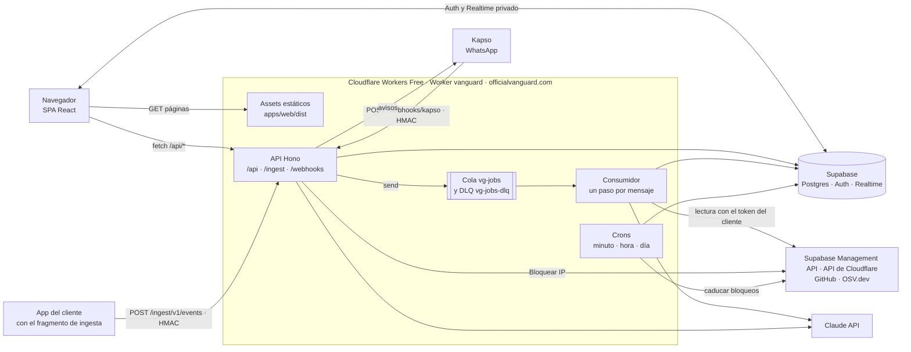

# Arquitectura de VanGUARD

Este documento describe la arquitectura **tal como está en `main` y desplegada** en https://officialvanguard.com.
Lo que todavía no existe va en «Hoja de ruta», dicho como tal. Cada afirmación cita el archivo que la respalda.

Estado comprobado el 24-oct-2026 a las 17:45 UTC: `GET https://officialvanguard.com/api/health` devolvía
`"version":"8de07c3c72b2ffd254dea6744144f7925ec5860d"`, que era el último commit de `main` en el repo público. Cada
push a `main` que se despliega cambia ese valor (sección 12).

---

## 1. Mapa general



En una frase: **un solo Worker** sirve la SPA y la API en el mismo origen; el trabajo largo va **paso a paso por una
cola**; los datos viven en **Supabase**; el navegador recibe cambios por **Realtime** y, si falla, por **polling**.
Todo corre en el **plan gratuito** de Cloudflare Workers (sección 13).

---

## 2. Monorepo

pnpm 10.34.7 con workspaces (`pnpm-workspace.yaml`: `apps/*` y `packages/*`, versiones exactas con `saveExact`).
Node ≥ 24.12 (`package.json`). TypeScript 6.0.3 y Vitest 4.1.12 en todo el monorepo.

| Carpeta | Qué es | Cómo llega a producción |
|---|---|---|
| `apps/web` | SPA: React 19, React Router 7, TanStack Query 5, Tailwind 4, Vite 8 (`apps/web/package.json`) | Se compila a `apps/web/dist` y el Worker la sirve como assets |
| `apps/api` | API Hono 4.13.13, consumidor de la cola y crons (`apps/api/src/worker.ts`) | Es el Worker `vanguard` (`apps/api/wrangler.jsonc`) |
| `apps/victima` | App de demostración «Tienda Demo» con el fragmento de ingesta firmado (`apps/victima/src/ingesta.ts`) | Worker propio `vanguard-victima` para `demo.officialvanguard.com` (`apps/victima/wrangler.jsonc`). Su despliegue va con la demo del equipo: al escribir esto ese dominio no tenía registros DNS |
| `packages/core` | Lógica pura: reglas, motor en vivo, puntaje, redacción de secretos, cifrado, plantillas (`packages/core/src`) | La importa `apps/api`. `apps/web` no puede importarla (sección 11) |
| `packages/contracts` | Esquemas zod compartidos entre FRONT y BACK, tipos de la base y fixtures (`packages/contracts/src`) | La importan `apps/web`, `apps/api`, `core` y `deepwiki` |
| `packages/deepwiki` | Motor «Wiki del repo» por pasos, sin SDK de Anthropic (`packages/deepwiki/LEEME.md`) | Lo importa `apps/api` |
| `supabase/` | 19 migraciones SQL (`supabase/migrations/0000`–`0010`), seeds y pruebas SQL (`supabase/tests/*.sql`) | Se aplican a mano al proyecto de producción (no hay CI de base) |
| `scripts/` (local, fuera del repo), `demo/` | Herramientas: simulador de ataque (`scripts/ataque.mjs`), subida de secretos por API (`scripts/subir-secretos-worker.mjs`), repo vulnerable de demo (`demo/repo-vulnerable`) | No se despliegan |

Desarrollo local sin `workerd`: `apps/api/src/dev-node.ts` corre la misma app Hono en Node 24 y sustituye la cola por
`colaEnSerie()` (`apps/api/src/jobs.ts`), un doble que imita reintentos, retrasos y DLQ.

---

## 3. Un solo Worker: SPA y API en el mismo origen

Archivo clave: `apps/api/wrangler.jsonc`.

- `"main": "src/worker.ts"` exporta tres manejadores: `fetch` (Hono), `scheduled` (crons) y `queue` (consumidor).
- `"assets.directory": "../web/dist"` con `"not_found_handling": "single-page-application"`: cualquier ruta de la SPA
  devuelve `index.html` desde el borde. **Los assets no invocan al Worker**: no gastan CPU ni cupo de peticiones.
- `"run_worker_first"`: solo estas rutas pasan primero por el Worker:
  `["/api/*", "/ingest/*", "/webhooks/*", "/mcp", "/mcp/*", "/.*", "!/.well-known/security.txt"]`.
  El patrón `/.*` hace que `/.env` o `/.git` reciban el 404 de Hono y no el `index.html`. La negación deja
  `security.txt` como asset. Comprobado en producción: `/.env` → 404, `/.well-known/security.txt` → 200,
  `/resumen` (ruta de la SPA) → 200.
- Dominios: `officialvanguard.com` y `www` como Custom Domains, más `workers_dev: true` como URL de respaldo.
- Mismo origen = sin CORS. `apps/web/vite.config.ts` escribe `dist/_headers` con una CSP de `script-src 'self'` y
  `connect-src 'self'` más **solo** Auth y Realtime de Supabase (comprobado en la cabecera de producción). El navegador nunca consulta tablas de Supabase
  directamente: no hay `supabase.from()` ni `supabase.rpc()` en `apps/web/src`; todo dato pasa por `/api`.

Orden de middlewares (`apps/api/src/app.ts`): `requestId` → `securityHeaders` → límite de 1 MB en `/api/*` →
`originGuard` → `auth` (JWT de Supabase con `getClaims`, `apps/api/src/mw/auth.ts`) → `rateLimit` →
`orgMember` y `anonReadOnly` en `/api/orgs/:org/*`. Cada consulta filtra por `org_id` (anti-IDOR,
`apps/api/src/lib/db.ts`). `/webhooks/*` y `/ingest/*` no usan sesión: los autentica su firma HMAC.

Las acciones con efecto real (bloquear IP con E20–E22 y el WhatsApp de prueba E27) y los productores de la cola
(E11 y E41) solo se aceptan en el host de producción (`requireProdHost` y `requireColaPropia`,
`apps/api/src/mw/prod-host.ts`). Un despliegue de
prueba no puede encolar en la cola de producción.

---

## 4. Auditoría por pasos en la cola `vg-jobs`

El plan Free da 10 ms de CPU por invocación. Una auditoría completa no cabe en una sola. Por eso se parte en pasos y
**cada paso es un mensaje y una invocación** (`apps/api/src/jobs.ts`).

Configuración (`apps/api/wrangler.jsonc`, bloque `queues`):

- Productor `JOBS_Q` → cola `vg-jobs`.
- Consumidor de `vg-jobs` con `max_batch_size: 1`, `max_retries: 3` y `dead_letter_queue: "vg-jobs-dlq"`.
- Consumidor de `vg-jobs-dlq` con `max_batch_size: 1`: cierra lo que falló (`cierreDlq` en `jobs.ts`).

Flujo:

1. `POST /api/orgs/:org/scans` (E11, `apps/api/src/rutas/scans.ts`) crea la fila en `scan_runs` y envía el primer
   paso: `{ v: 1, kind: 'scan', scan_run_id, org_id, paso }`. **El mensaje lleva solo ids, nunca tokens.**
2. El consumidor (`guarded` en `jobs.ts`) reclama el paso con la RPC `vg_claim_step`, lo ejecuta, **encola el
   siguiente**, escribe su resultado con `vg_mark_step` y solo entonces hace `ack`. Sin escritura no hay `ack`.
3. Cadena por tipo (`pasosDe` y `siguientePaso`): `full_audit` = `supabase` → `cloudflare` → `repo` → `puntaje` →
   `resumen_ia`. `puntaje` calcula score y cobertura **antes** de la IA. `resumen_ia` cierra la auditoría.
4. Un paso largo se parte con cursor: `repo` lee archivos y deja las dependencias para `repo:osv`, que consulta OSV.dev
   en mensajes sucesivos (`apps/api/src/scans/repo-paso.ts`, `apps/api/src/scans/osv.ts`).
5. Errores pasajeros del proveedor (`unavailable`, `timeout`, `rate_limited`) se reintentan con espera exponencial
   (`10 · 2^(n-1)` s) hasta `REINTENTOS[paso]` veces (1 o 2 según el paso). Después el paso queda `failed` con ese
   código y la cadena sigue.
6. Si la invocación no llega a escribir su resultado (falla la base, o el Worker muere por CPU), no hay `ack` y la cola
   reentrega el mensaje. Tras 3 reintentos (`max_retries: 3`) va a la DLQ, que deja el paso `failed` con
   `error_code: 'dlq'` y sigue la cadena hasta cerrar. Nunca queda un paso `running` en una auditoría terminada.
7. Un 401 del proveedor marca la conexión como `revoked` (`revocarConexion` en `jobs.ts`).

Qué hace cada paso (registro en `apps/api/src/scans/index.ts`):

| Paso | Qué lee | Archivo |
|---|---|---|
| `supabase` | Advisors de seguridad y rendimiento y 3 consultas SQL de solo lectura por la Management API | `apps/api/src/scans/supabase.ts` |
| `cloudflare` | Estado de la zona (regla `CF_ZONE_01`) | `apps/api/src/scans/cloudflare.ts` |
| `repo` | GitHub con PAT fine-grained de un repo: archivos de riesgo, secretos, `.env`, lockfiles npm y composer; luego OSV | `apps/api/src/scans/repo-paso.ts`, `repo.ts`, `osv.ts` |
| `puntaje` | Hallazgos abiertos → score y `coverage` | `apps/api/src/scans/index.ts` (`pasoPuntaje`) |
| `resumen_ia` | Los 30 hallazgos más graves → resumen con Claude o plantilla determinista | `apps/api/src/scans/index.ts` (`pasoResumen`) |

Topes por paso: **≤ 40 subpeticiones** (`TOPE_SUBPETICIONES = 40` en `apps/api/src/scans/comun.ts`; el límite de
Free es 50). CPU: el código anota sus mediciones y recorta para quedar bajo 10 ms. Ejemplos: respuestas de advisors
de más de 300 KB se rechazan sin parsear (≈ 7 ms medidos, `supabase.ts`); OSV pide 12 detalles por mensaje y no 30
(≈ 7 ms, `osv.ts`).

Un chequeo que no se pudo hacer queda «sin mirar», nunca en verde (`apps/api/src/scans/cobertura.ts`).

---

## 5. Crons

Tres de los cinco que permite la cuenta Free (`"triggers"` en `apps/api/wrangler.jsonc`; lógica en
`apps/api/src/cron.ts`).

| Cron | Qué hace hoy | Archivo |
|---|---|---|
| `* * * * *` (monitor por minuto) | `housekeeping`: cierra los incidentes del borde sin eventos de esa IP desde hace 15 min (RPC `vg_resolve_idle_incidents`, ≤ 200 por minuto) y retira de Cloudflare los bloqueos de IP caducados (≤ 5 por minuto, con reintentos 1, 2, 4… min; solo con `VG_ENV=production`). Además, el vigilante (RPC `vg_vigilar_corridas`, migración `0011_vigilante.sql`, ≤ 50 filas por tabla) deja en `failed` las corridas de wiki sin avance desde hace 10 min y las auditorías sin avance desde hace 15 min, con un texto corto para reintentar y sin cobrar nada más | `apps/api/src/engine/housekeeping.ts` |
| `0 * * * *` (mantenimiento por hora) | Solo deja una línea de log (el cierre de corridas atascadas lo hace el monitor por minuto) | `apps/api/src/cron.ts` |
| `0 10 * * *` (re-auditoría diaria, 06:00 Caracas) | Solo deja una línea de log. Ver hoja de ruta | `apps/api/src/cron.ts` |

El monitor por minuto corre **directo en el cron, sin cola**: con cola gastaría unas 13.000 operaciones al día de las
10.000 que da Queues en Free (comentario de `cron.ts`).

En Supabase hay además tres trabajos `pg_cron` (`supabase/migrations/0008_rls_retention.sql`): borrar `edge_hits` de
más de 24 h (cada hora), purga diaria y caducar conexiones vencidas (cada 10 min).

---

## 6. Detección en vivo: ingesta → reglas → incidentes → avisos

### 6.1 Ingesta firmada en lotes (E30)

En Free no hay Tail Workers. El sitio del cliente envía sus eventos de borde a VanGUARD con un fragmento que envuelve
su Worker. El fragmento de referencia es `conVanguard` en `apps/victima/src/ingesta.ts`. El panel entrega una sola vez
el secreto, el id de la conexión y el endpoint (`apps/web/src/modulos/conexiones/Asistente.tsx`). El fragmento:

- Agrupa hasta 100 eventos, ~56 KB o 2 s, lo que ocurra antes. Envía en `ctx.waitUntil`: nunca retrasa ni rompe la
  respuesta del sitio.
- Cada evento: `ts`, `ip`, `method`, `path` **sin query string**, `status`, `ua` (≤ 200 caracteres), `latency_ms`,
  `auth`.
- Firma `HMAC-SHA256(secreto, "${ts}.${cuerpo}")` en las cabeceras `x-vg-conn`, `x-vg-ts` y `x-vg-sig`.

`POST /ingest/v1/events` (`apps/api/src/rutas/ingest.ts`) valida en este orden: cuerpo ≤ 64 KB → reloj dentro de
±300 s → conexión `ingest` activa leída por id → clave descifrada → HMAC con `crypto.subtle.verify` (tiempo
constante). Cualquier fallo de autenticación da 401 sin detalle. Ya autenticado aplica `RL_INGEST` (300 lotes por
10 s y conexión), valida JSON y esquema `IngestBatch`, normaliza y hace **una sola inserción** en `edge_hits`. Responde
202 y evalúa en segundo plano (`waitUntil`).

### 6.2 Motor de reglas

`apps/api/src/engine/evaluar.ts` con la lógica pura de `packages/core/src/engine/edge.ts`:

1. `vg_try_eval`: como mucho una evaluación por org cada 5 s.
2. `vg_edge_window`: conteos por IP de los últimos 60 s.
3. Reglas del borde: `CF_IP_FLOOD`, `CF_PATH_SCAN`, `CF_UA_TOOL`, `CF_ADMIN_EXPOSED`. Un incidente por IP.
4. `vg_upsert_incident` deduplica por clave y devuelve si es nuevo, si subió de severidad o si se reabrió.
5. Presupuesto propio de 34 subpeticiones (`PRESUPUESTO_MOTOR`): primero los incidentes que van a avisar, críticos
   delante. Lo que no cabe queda para la evaluación siguiente.

### 6.3 Despachador de avisos

`apps/api/src/notify/despachador.ts` decide con `planAvisos` (core) y envía por `apps/api/src/notify/kapso.ts`:

- Escribe la fila de `notifications` en `queued` **antes** de enviar. El índice único da 23505 si ya se avisó: no se
  duplica ningún WhatsApp.
- Topes por org, ventana de demo y «tormenta»: con más de 5 incidentes en 2 min sale un solo texto resumen a un
  solo contacto (el primero verificado por prioridad) y el resto se suprime (`estadoTormenta` en `packages/core/src/engine/incidente.ts`,
  `textoTormenta` en `packages/core/src/templates/whatsapp.ts`).
- Mensaje interactivo con botones «Lo estoy viendo», «Silenciar 1 h» y, si la org tiene un token de acciones de
  Cloudflare y el incidente es de una IP, «Bloquear IP» (`botonesAlerta` y `ofreceBloqueo` en
  `packages/core/src/templates/whatsapp.ts`). Cada botón es una fila de `approvals` que guarda solo `sha256(nonce)`, de un solo uso y 10 min de
  vida (`apps/api/src/actions/approvals.ts`).
- El texto sale de una plantilla fija (`packages/core/src/templates/whatsapp.ts`), no de un modelo.

`POST /webhooks/kapso` (E31, `apps/api/src/rutas/webhooks-kapso.ts`) verifica el HMAC **antes** de parsear, deduplica
por `X-Idempotency-Key`, responde 200 enseguida y procesa en `waitUntil`: canje de botones, `VERIFICAR <código>` para
verificar el teléfono y `BAJA/STOP/SALIR` para darse de baja.

**Estado hoy:** WhatsApp sale por el **sandbox de Kapso** (`"KAPSO_SANDBOX": "1"` en `apps/api/wrangler.jsonc`). En
el sandbox no se exige la ventana de 24 h de Meta (`ventanaAbierta` en `apps/api/src/lib/verificacion.ts`).

---

## 7. «Bloquear IP» contra la API de Cloudflare

Archivos: `apps/api/src/rutas/actions.ts`, `apps/api/src/actions/block-ip.ts`, `apps/api/src/actions/approvals.ts`.

- **E20 · proponer** (`POST /api/orgs/:org/actions/propose`): no toca Cloudflare. Valida la IP y rechaza IP privadas,
  de documentación, la propia del operador, rangos más anchos que /32 o /128 y los rangos de Cloudflare
  (`simularBloqueo` en `packages/core/src/ip.ts`). Crea una aprobación de 10 min y envía un código de 6 dígitos por
  WhatsApp; en la org de demo, si no hay WhatsApp utilizable, el código vuelve en la respuesta.
- **E21 · confirmar**: compara el código como HMAC (máximo 5 intentos) y ejecuta `executeBlock`:
  `POST /zones/{zone_id}/firewall/access_rules/rules` con `mode: 'block'` y una nota
  `VanGUARD #<incidente> · <regla> · hasta <fecha>`. El token es el de la conexión Cloudflare de tipo `action`
  («Modo blindaje») y solo existe descifrado dentro de `withSecret` (`apps/api/src/lib/credentials.ts`).
- **E22 · deshacer**: `DELETE` de la regla. Solo se borra lo que creó VanGUARD.
- Caducidad: 1 h (`TTL_BLOQUEO_S = 3600`). Cloudflare no caduca estas reglas; las retira el cron por minuto.
- El botón «Bloquear IP» de WhatsApp lanza una **propuesta**, nunca un bloqueo directo; el bloqueo exige confirmar.
- Solo funciona en `officialvanguard.com` (`requireProdHost`).

---

## 7 bis. Revisión de código en cada push y pull request

Comprobado en producción el 24-oct-2026: un push con una clave falsa nueva llegó por WhatsApp, entregado, a los 9,4 s.

- **Disparador:** un webhook de repositorio que el usuario pega en GitHub, `POST /webhooks/github/:id` (E47). Cada
  configuración tiene su secreto `vgw_…`, sellado como el resto de credenciales y visible una sola vez al activar.
  La firma `X-Hub-Signature-256` se verifica con HMAC sobre el cuerpo crudo; un id inexistente y una firma mala dan
  el mismo 401, y fuera del host real se rechaza. `apps/api/src/rutas/webhooks-github.ts`.
- **Eventos:** push a la rama vigilada (un merge llega como push) y `pull_request` opened, synchronize, reopened y
  ready_for_review contra ella. Un PR de un fork se revisa solo en la app, sin aviso, con tope de 10 por hora y
  configuración. El push que fusiona un PR ya avisado no repite el aviso (`push_commits`).
- **Qué revisa:** `GET compare base...head` en formato diff con el PAT de solo lectura (Contents: Read). Los escáneres
  puros de core corren sobre las líneas añadidas (claves, tokens y `.env` subidos), hasta 128 KB; si se pasa, la
  revisión queda parcial y avisa igual. «Nuevo» = regla + huella del valor que no estaba abierta. Sin IA.
  `packages/core/src/revision/diff.ts`, `apps/api/src/revision/pasos.ts` (pasos `diff` y `aviso` en `vg-jobs`).
- **Aviso:** WhatsApp con texto fijo, sin texto de la IA ni del autor del push, a los contactos verificados, si la peor
  severidad nueva llega al umbral que la org elige en Ajustes → «Avisos» (`alert_prefs`). Cupo propio de 3 avisos por
  hora (10 en la org de demo), uno por revisión y contacto, y la ventana de 24 h de Meta. La llamada se guarda como
  preferencia y la UI la marca «Próximamente». `packages/core/src/templates/revision.ts`.
- **Registro aparte:** `code_reviews`, no `scan_runs`, para que una revisión no pase por «última auditoría» en el
  Resumen. Tablas `code_review_configs`, `code_reviews` y `alert_prefs` (`supabase/migrations/0013_revision_codigo.sql`).
- **Tiempos medidos** (push fe58c0e, 1 archivo, 13 líneas): webhook → diff terminado, 2,6 s (el paso `diff` en sí,
  ~1,1 s); → WhatsApp enviado, 8,6 s; → entregado, 9,4 s. Unos 6 s son la espera de la cola entre los dos mensajes.

## 8. Realtime privado por org, con polling de respaldo

Base: `supabase/migrations/0008b_realtime.sql`.

- Triggers sobre `scan_runs`, `findings`, `incidents` y `notifications` llaman a `realtime.broadcast_changes` en el
  canal privado `org:<org_id>`.
- La política de `realtime.messages` solo deja leer el canal de las orgs del usuario.
- **Nunca** se emiten `edge_hits`, `connections`, `connection_secrets`, `approvals`, `contacts` ni `ai_usage`.

Navegador: `apps/web/src/lib/realtime.ts`.

- El payload se valida con `RealtimeChange` (`packages/contracts/src/realtime.ts`) y **solo invalida claves** de
  TanStack Query. Los datos se vuelven a pedir a `/api`; el payload no se pinta.
- Reconexión con espera 1, 2, 5, 10 y 30 s. El WebSocket va directo a Supabase: no gasta peticiones del Worker.

Respaldo (`apps/web/src/lib/consultas.ts`): sin canal, polling cada 10 s; con canal, cada 30–60 s. Usa
`refetchIntervalInBackground: false`: una pestaña oculta no consulta. El tráfico en vivo (`useTrafico`) sondea
siempre a 10 s, porque `edge_hits` no emite Realtime. Hay dos sondeos más rápidos y acotados: el estado de una
corrida de la wiki, cada 3 s mientras genera y cada 15 s si lleva 3 min sin avanzar (`useWikiRun`; `wiki_runs` no
emite Realtime), y los contactos, cada 5 s
mientras alguien verifica su teléfono (`useContactos`).

---

## 9. IA con Claude: modelos por tarea y presupuesto

Una sola puerta en el Worker: `apps/api/src/ia/claude.ts`. Nadie más importa `@anthropic-ai/sdk` (0.137.0). La
wiki también pasa por ahí (`apps/api/src/wiki/llm.ts`); solo la CLI de desarrollo de `packages/deepwiki` llama a la
API con su propio `fetch` (`llm-fetch.ts`).

| Ruta | Dónde se usa | Modelo normal | Degradación |
|---|---|---|---|
| `audit_summary` | Paso `resumen_ia` de la auditoría | `claude-opus-5-5`, effort medium, 16.000 tokens | reduced → Sonnet 5.5; minimal → Haiku 5.5 |
| `fix_prompt` | `POST /api/orgs/:org/findings/:id/fix-prompt` (E15) | `claude-sonnet-5-5`, effort medium, 6.000 tokens | minimal → Haiku 5.5 |
| `wiki_triage`, `wiki_area`, `wiki_sintesis` | Pasos de DeepWiki (sección 10) | Por defecto Haiku 5.5 para triage y áreas, Sonnet 5.5 para la síntesis (`MODELOS_POR_DEFECTO`, `packages/deepwiki/src/llm-fetch.ts`) | En minimal no corre |

Orden de cada llamada (`llamarIA` y `llamarIATexto`):

1. `IA_CORTE=1` → apagada sin tocar la base (interruptor de emergencia).
2. `vg_ai_status` → nivel `normal | reduced | minimal | off` y llamadas del último minuto (máximo 10 por org).
3. Costo del peor caso; más de 1 USD por petición → rechazada.
4. `vg_ai_reserve` reserva ese peor caso de forma atómica en `ai_usage` (`apps/api/src/ia/budget.ts`).
5. Llamada. En `llamarIA`: prompt caching con 2 puntos de caché y salida estructurada por JSON Schema, validada
   después con zod. En `llamarIATexto` (wiki): texto libre con 1 punto de caché.
6. `vg_ai_settle` liquida con el uso real.

Protecciones: los datos del cliente se redactan (`redact`) y se envuelven como dato no confiable (`fence`) antes del
prompt (`packages/core/src/untrusted.ts`, `packages/core/src/redact.ts`); la salida pasa por `checkSalidaIA`
(`packages/core/src/ai.ts`). No se registran prompts ni respuestas: solo ids, tokens, costo y `stop_reason`. Si la IA
está apagada, sin presupuesto o su salida no pasa el filtro, el resumen sale de una plantilla determinista
(`plantillaResumen`, `packages/core/src/templates/summary.ts`).

---

## 10. DeepWiki: «Wiki del repo»

Motor en `packages/deepwiki` (adaptado de DeepWiki-Open, MIT; licencia en
`packages/deepwiki/LICENSE-deepwiki-open.txt`). Es puro: `fetch`, WebCrypto y `TextEncoder`. Corre igual en el Worker
y en Node. El modelo le llega inyectado.

Pasos, uno por mensaje de `vg-jobs` con `kind: 'wiki'` (`apps/api/src/wiki/pasos.ts`):

| Paso | Qué hace | Modelo |
|---|---|---|
| `arbol` | Metadatos, commit exacto y árbol; filtra binarios, lockfiles, `.env` y claves | ninguno |
| `triage` | Elige hasta 80 rutas que explican el producto y las agrupa en ≤ 12 áreas | rápido |
| `area` (×N) | Descarga ≤ 25 archivos, **redacta secretos** y resume el área | rápido |
| `sintesis` | Documento final con 5 secciones, diagrama Mermaid y los hallazgos de la última auditoría | potente |

- Entre pasos solo viaja el estado (`wiki_runs.state`): rutas, resúmenes y consumo. **Nunca el código ni el PAT.**
- Escritura con compare-and-set (`vg_wiki_avanzar`, `supabase/migrations/0010_wiki_runs.sql`): una entrega repetida
  no avanza la corrida dos veces. La síntesis, el paso caro, guarda antes una marca para no pagarse dos veces
  (`marcarSintesis`, `packages/deepwiki/LEEME.md`, punto 5).
- `max_usd` (por defecto 1 USD, `apps/api/src/wiki/corridas.ts`) se compara **antes** de cada paso con lo máximo que
  ese paso puede costar.
- Caché por `(org, repo, commit, huella de los hallazgos)`: la misma wiki no se paga dos veces.
- Salida saneada: sin HTML, enlaces ni URLs; el Mermaid pasa una lista blanca o se descarta.
- Presupuesto de subpeticiones por paso documentado en la cabecera de `wiki/pasos.ts` (todos ≤ 40).

**Desplegado** (desde el commit `91cd370`; producción ya sirve un commit posterior, ver arriba):

- E40 `POST /api/orgs/:org/wiki/estimate`: estima costo y techo leyendo solo GitHub, sin modelo.
- E41 `POST /api/orgs/:org/wiki/runs`: crea la corrida o la sirve de caché a costo 0, y encola `arbol`.
- E42–E44: historial, estado y documento (`apps/api/src/rutas/wiki.ts`).
- Página `apps/web/src/modulos/wiki/PaginaWiki.tsx`: estimar, generar, seguir el progreso y leer el documento.

**No desplegado:** la CLI (`packages/deepwiki/src/cli.ts`) es solo para desarrollo. El cruce visual hallazgo → página
de la wiki (`paginaDeRuta`) no está en la interfaz (ver hoja de ruta). Al escribir esto no se había comprobado una
generación completa en producción; las pruebas del motor y de los pasos están en `packages/deepwiki/src/*.test.ts` y
`apps/api/src/wiki/*.test.ts`.

---

## 11. Contratos zod compartidos

`packages/contracts` (zod 4.6.7) es el **único contrato entre FRONT y BACK** (`packages/contracts/src/index.ts`).

- La API valida lo que recibe y lo que devuelve con el mismo esquema. Ejemplo: `Health.parse(...)` en
  `apps/api/src/rutas/health.ts`; `IngestBatch` en la ingesta.
- La SPA valida las respuestas JSON: `api(url, { esquema })` en `apps/web/src/lib/api.ts` hace `safeParse`.
- Lo mismo para el payload de Realtime (`RealtimeChange`) y para la wiki (`packages/contracts/src/wiki.ts`).
- `database.types.ts` trae los tipos generados de la base.
- `fixtures/` permite desarrollar el FRONT sin backend (`vite --mode fixtures`).

Frontera de seguridad: `apps/web/scripts/lint-imports.mjs` falla si `apps/web/src` importa `@vanguard/core`. Así el cifrado,
las guardas de claves y la redacción no llegan al bundle principal del navegador. Corre dentro del build de la web.
Tiene una sola excepción: `apps/web/src/modulos/codebase/zip/`, el análisis local del ZIP en un Web Worker, que
reutiliza los escáneres puros de core. Fuera de esa carpeta nadie puede importar `zip/analizar`, `zip/leer` ni
`zip.worker` de forma estática (el worker se carga con `new Worker(new URL(...))`), así core no se filtra al bundle
principal.

---

## 12. Despliegue continuo con Workers Builds

No hay GitHub Actions. Cloudflare Workers Builds está conectado a un repositorio espejo, rama `main`. El `git push`
del equipo está configurado para ir a la vez al repo público y al espejo (el método que propone el `README.md` de la
plantilla del hackatón).

- **Build command:** `pnpm --filter @vanguard/web build`. Ese script (`apps/web/package.json`) ejecuta, en orden,
  `apps/web/scripts/lint-seguridad.mjs`, `apps/web/scripts/lint-imports.mjs`, `tsc --noEmit` y `vite build`. Si algo falla, no se
  despliega y producción sigue con la versión anterior.
- **Deploy command:** `npx wrangler@4.152.0 deploy -c apps/api/wrangler.jsonc --var VG_VERSION:$WORKERS_CI_COMMIT_SHA`.
  wrangler va fijado y no está en ningún `package.json`.
- **Prueba de que funciona:** `/api/health` devuelve el SHA completo del commit desplegado y debe coincidir con
  `git rev-parse HEAD` de `main`. `/api/health` no toca Supabase: responde aunque la base caiga.
- **Variables:** las no secretas viven en `vars` de `wrangler.jsonc` (`VG_ENV`, `APP_ORIGIN`, `KAPSO_SANDBOX`). Los
  secretos son secretos de runtime del Worker, subidos por la API de Cloudflare (`scripts/subir-secretos-worker.mjs`).
  Ninguno está en el repo.

Los comandos de build y deploy se configuran en el panel de Workers Builds. En el repo solo aparecen en comentarios de
`apps/api/wrangler.jsonc`. Lo verificable desde fuera es el `version` de `/api/health`.

---

## 13. Límites del plan Free y cómo se respetan

| Límite de Workers Free | Cómo se respeta | Dónde |
|---|---|---|
| 10 ms de CPU por invocación | Un paso por mensaje; topes de tamaño antes de parsear (300 KB en advisors, ~450 KB en el árbol de la wiki); 12 detalles de OSV por mensaje; la SPA son assets sin CPU | `jobs.ts`, `scans/supabase.ts`, `scans/osv.ts`, `packages/deepwiki/src/github.ts` |
| 50 subpeticiones por invocación | Tope propio de 40 por paso; 34 para el motor en vivo; ≤ 23 para el housekeeping; continuaciones con cursor | `scans/comun.ts`, `wiki/deps.ts`, `engine/evaluar.ts`, `engine/housekeeping.ts` |
| 100.000 peticiones al día | Assets fuera del Worker; Realtime en vez de polling rápido; polling de respaldo ≥ 10 s (salvo los dos sondeos acotados de la sección 8) y solo con la pestaña visible; ingesta en lotes de hasta 100 eventos | `wrangler.jsonc`, `lib/consultas.ts`, `victima/src/ingesta.ts` |
| 5 Cron Triggers por cuenta | Se usan 3 | `wrangler.jsonc` |
| Queues: 10.000 operaciones al día | El monitor por minuto no usa la cola | `cron.ts` |
| Sin Tail Workers | Ingesta firmada por HTTP en lugar de `tail_consumers` | `victima/wrangler.jsonc` |
| `limits` no se puede subir | No se declara; el código impone sus propios topes | `wrangler.jsonc` |

Además, cuatro rate limiters nativos (`ratelimits` en `wrangler.jsonc`): `RL_API` 300/60 s por usuario o IP,
`RL_COSTLY` 10/60 s para rutas caras, `RL_INGEST` 300/10 s por conexión de ingesta y `RL_WA` 3/60 s por teléfono en
las respuestas de WhatsApp.

---

## 14. Datos y secretos

- Credenciales de los clientes (PAT de Supabase, tokens de Cloudflare, PAT de GitHub, secreto de ingesta):
  **cifrado de sobre AES-256-GCM** con AAD que ata org, conexión y proveedor (`packages/core/src/crypto.ts`,
  `apps/api/src/lib/credentials.ts`, `apps/api/src/lib/keyring.ts`). Se cifran, no se hashean: hay que poder usarlas.
  Solo se descifran dentro de `withSecret` y nunca viajan en la cola.
- La clave maestra (KEK) se deriva con HKDF de dos mitades: una generada dentro de Supabase Vault
  (`supabase/migrations/0003_connections_crypto.sql`) y una pimienta que es secreto del Worker. Ninguna de las dos
  está en el repo.
- RLS activa en las tablas de `public` (`supabase/migrations/0008_rls_retention.sql`, prueba en
  `supabase/tests/rls.sql`). Las tablas solo de servidor no tienen políticas: solo las usa `service_role`.
- Logs: una línea JSON por evento que siempre pasa por `redact()` (`apps/api/src/lib/log.ts`). La regla del código
  es no registrar tokens, cuerpos de terceros, teléfonos completos ni filas de clientes; `redact()` es la red, no el
  permiso.

---

## 15. Hoja de ruta (no está hecho)

| Pieza | Estado real |
|---|---|
| WhatsApp con número propio y plantilla de Meta | Hoy solo sandbox (`KAPSO_SANDBOX=1`). El paso a número real lo prepara `scripts/kapso-config.mjs --real` |
| Llamada de voz (ElevenLabs/Twilio) | Sin código en `apps/api` |
| Escalado de avisos (`kind: 'escalate'`) | El tipo existe en `JobMsg`; `runJob` lo descarta sin manejador (`jobs.ts`) |
| Texto de alerta con IA (`alert_text`) | `pedirTextoAlerta` existe en `ia/claude.ts`, pero nadie lo llama: el WhatsApp usa la plantilla fija |
| Cron diario: re-auditoría de orgs con `daily_audit` | Hoy solo registra una línea (`cron.ts`) |
| Monitor de salud de Supabase en el cron por minuto | Anunciado en `cron.ts`, sin implementar |
| Guardar en el servidor el resultado del ZIP | El análisis en el navegador está desplegado (`apps/web/src/modulos/codebase/AnalizarZip.tsx`, commit `8aa1922`) y muestra el resultado sin que el código salga de la máquina. Falta la parte de la API: crear el scan con `kind: zip` (E11), recibir el resultado (E23) y el paso `zip`, que hoy no está registrado (quedaría `skipped` con `no_implementado`) |
| PageSpeed / Lighthouse (paso `psi`) | Sin registrar. La vista de Rendimiento lee la última fila de `perf_runs` (`apps/api/src/estado/modulo.ts`); esas filas se siembran a mano con mediciones de PageSpeed (`scripts/perf-medir.ts` → `demo/seed-perf.sql`, que en `main` aún no trae mediciones). El histórico E24 (`GET /api/orgs/:org/perf/runs`, commit `1bec15c`) ya responde, pero devuelve una lista vacía mientras `perf_runs` no tenga filas; la página lo muestra como «Aún no medimos tu web» |
| Endpoint `/mcp` | Reservado en `run_worker_first`; no está montado (`app.ts`), responde 404 |
| Cruce hallazgo → página de la wiki en la interfaz | `paginaDeRuta` existe en `packages/deepwiki`, la web no lo usa |
| Pruebas unitarias dentro del build de Workers Builds | Hoy el build corre lints y `tsc`; `pnpm test` se corre aparte |
| Workflow `vg-scan` en vez de la cola | No se usa; `wrangler.jsonc` lo deja condicionado a una prueba de humo |
| Revisión de código, lo que falta | Dependencias con OSV y `.gitignore` en el diff (B6), «Generar otro secreto» (hoy, si se pierde el `vgw_`, hay que borrar la configuración), revisión manual (E50) y bajar la espera de la cola entre `diff` y `aviso` (`max_batch_timeout`; hoy ~6 s de los 9,4) |
| Adelgazar el bundle del Worker | Hoy ≈ 3,3 MB (≈ 0,63 MB gzip). El arranque lo domina parsear el script, no evaluar dependencias: cargar el SDK de Anthropic y deepwiki con `import()` no lo mejoró y se revirtió (12ca323). Pesos medidos: `@anthropic-ai/sdk` 946 KiB (36 %), `@supabase/auth-js` 351, `apps/api` 338, zod 183, core 147, storage-js 111, postgrest-js 108, realtime-js + phoenix 144, deepwiki 90. Palancas: `fetch` directo a `/v1/messages` en vez del SDK (≈ −900 KiB) y `postgrest-js` solo en vez de supabase-js entero (≈ −600 KiB; el servidor solo usa auth para `getClaims`). El Startup Time de Workers Builds varía 37–70 ms con el mismo bundle: medir con varias muestras |

---

## 16. Cómo comprobarlo

```sh
curl -s https://officialvanguard.com/api/health          # version = SHA del último commit de main
git rev-parse HEAD                                        # debe coincidir
pnpm install --frozen-lockfile && pnpm test               # pruebas de todos los paquetes
pnpm lint:imports                                         # la web no importa @vanguard/core
```

Archivos para empezar a leer: `apps/api/wrangler.jsonc`, `apps/api/src/worker.ts`, `apps/api/src/jobs.ts`,
`apps/api/src/rutas/ingest.ts`, `apps/api/src/engine/evaluar.ts`, `apps/api/src/ia/claude.ts`,
`packages/deepwiki/LEEME.md`.
