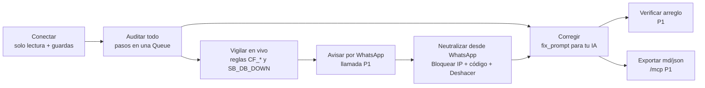

## 01. Visión, propuesta de valor y pitch

> **Quién lee esto.** El chat ORQUESTADOR (Giovanni: pitch, video, textos de entrega), el chat FRONT (textos de marca dentro de la app) y el BACK como contexto. **Fuente de verdad:** `decisiones/00-decisiones-canonicas.md` (citado como «Canon §N»). Esta sección no redefine alcance, nombres ni prioridades: los convierte en mensaje. Lo técnico vive en las secciones 03 a 16 y aquí solo se remite por número.
> **Marcas.** `[verificado: URL]` = comprobado en esa fuente por los informes R01–R17 o el benchmark v5. `[no verificado]` = no se dice en voz alta hasta comprobarlo. `[propuesta]` = cifra nuestra que se mide en el ensayo.
> **Regla del pitch:** ninguna cifra se dice en voz alta si no está `[verificado]` o si no la medimos nosotros en un ensayo (consulta de §01.4). Ningún P1 o P2 se presenta como hecho.
> **Alineación (sáb 24-oct, 04:00).** Si algo de aquí choca con `alineacion/00-hechos-y-criterios.md`, gana ese archivo. **Hecho (sab 03:45)** marca lo que ya está en producción o en la carpeta. §01.6 usa la redacción oficial nueva de los criterios; §01.12 (qué encontrará el agente del juez), §01.13 (impacto frente al status quo) y §01.14 (evidencia de ejecución) son nuevas.
> **Re-alineación (sáb ~05:30) con A7, A8 y A9.** Workers **Free** (frase de eficiencia: «VanGUARD entero corre en el plan gratuito de Cloudflare: 10 ms de CPU por petición»); 0 USD en efectivo; **WhatsApp primero**: el aviso por WhatsApp y la aprobación de «Bloquear IP» desde WhatsApp son el centro del pitch (P0) y la **llamada de voz es P1**, así que en todo este texto la llamada se dice solo si V-09 la da por «Listo»; el ZIP (P1) se analiza en el navegador («tu código nunca sale de tu navegador»); el guion sigue la historia de los fixtures (Parte A9) y el tramo 1:00–2:10 de S16 §16.7.

### 01.1 Nombre, one-liner y frases canónicas

| Pieza | Texto exacto | Dónde va |
|---|---|---|
| Nombre | **VanGUARD** (GUARD en mayúsculas). Nunca «Vanguard», «VANGUARD» ni «Van Guard» en texto visible. En código e infraestructura va en minúsculas: Worker `vanguard`, paquetes `@vanguard/*` (Canon §5) | UI, pitch, jsonc, README |
| Las 3 frases del equipo | 1. «Somos una herramienta digital que protege tu producto.» 2. «Analizamos tu sistema contra los puntos débiles existentes y los corregimos.» 3. «Evaluamos tu ecosistema con inteligencia artificial y blindamos tu producto en tiempo real.» | Pantalla de acceso; la frase 1 entra en el segundo 10 del pitch de 3 min |
| One-liner (congelado, Canon §1) | «Conecta tu Supabase, tu Cloudflare y tu repo de GitHub: una IA audita todo tu ecosistema, detecta puntos débiles y ataques, y te avisa al instante por WhatsApp o llamada.» | jsonc, `<meta name="description">`, pantalla de acceso |
| Posicionamiento (Canon §1, ajustado por A8: WhatsApp primero) | «Aikido y los advisors de Supabase te dicen qué está mal configurado. VanGUARD te avisa por WhatsApp cuándo alguien lo está aprovechando, te deja bloquearlo desde ahí mismo y te da el arreglo listo para tu IA, sin pedirte nunca una clave que pueda escribir.» (Antes decía «te llama»: la llamada es P1 y solo vuelve a la frase si V-09 la da por «Listo») | Cierre del pitch; respuesta a «¿y Aikido?» |
| Frase de portada | «Encontramos lo que un atacante vería en tu Supabase, tu Cloudflare y tu código, te avisamos en segundos cuando alguien lo intenta y te damos el arreglo.» | Subtítulo de la pantalla de acceso; video |
| Frase con dato (abre el pitch) | «Una de cada diez apps del escaparate de Lovable dejaba leer su base de datos con la llave pública. El escáner que salió después solo miraba si RLS estaba encendida, no si funcionaba.» [verificado: https://superblocks.com/blog/lovable-vulnerabilities] | Segundo 0 de ambos pitches |
| URLs (Canon §4) | Producto y API: `https://officialvanguard.com` (apex; API, webhooks, ingesta y `/mcp` como rutas bajo el apex, sin `api.` ni `mcp.`). `www` → 301 al apex. Víctima: `https://demo.officialvanguard.com`. Respaldo: `https://vanguard.giovannizm14.workers.dev` | Todo enlace del pitch, del video y de los textos de entrega |

**Estado del dominio. Hecho (sab 03:45)** (Parte A1 y A2 de `00-hechos-y-criterios.md`; re-comprobado sáb 24-oct a las 03:58 de Caracas con `curl --resolve officialvanguard.com:443:104.21.53.192` y DoH de `dns.google`) [verificado: https://dns.google/resolve]:
- **Zona y DNS:** zona `officialvanguard.com` activa en Cloudflare (plan Free), NS `martin`/`ziggy.ns.cloudflare.com`. El dominio sigue registrado en Squarespace y no hace falta transferirlo: solo se movieron los nameservers. **DNSSEC activo**: DS `2371 13 2` publicado y la respuesta valida (`"AD":true`). Correo no suplantable: TXT `v=spf1 -all` y `_dmarc` con `p=reject; sp=reject; adkim=s; aspf=s`.
- **TLS:** SSL Full (strict), Always Use HTTPS (`http://` → 301 a `https://`), TLS mínimo 1.2 (con `--tls-max 1.1` la conexión falla) y TLS 1.3.
- **Worker y despliegue:** el Worker `vanguard` sirve la página provisional de `site/` en el apex y en `www`, con la CSP de `site/_headers` (`default-src 'none'; …; frame-ancestors 'none'`). Respaldo: `https://vanguard.giovannizm14.workers.dev` (200). **Despliegue continuo con Workers Builds** desde el espejo `Giova144-git/VanGUARD`, rama `main`: un push publica en unos 15 s. No hay GitHub Actions.
- **Respuestas de hoy:** `/` → 200. Lo que no es un asset (`/api/health`, `/.env`, `/wp-login.php`) → **404** desde las 02:25.

**Pendiente:**
- `www` → 301 al apex. Hoy `www` es Custom Domain del Worker y sirve los mismos assets, así que `https://www.officialvanguard.com/x?y=1` da 404 en vez de 301 (S03 §03.4, paso 4).
- Regla de rate limit en `/api/`, que sustituye a Bot Fight Mode. Bot Fight Mode está apagado a propósito porque rompería los webhooks.
- HSTS, el domingo a las 07:00.
- `/api/health` en JSON, que llega con el esqueleto de las 10:00 (V-01).
- Prueba de humo del BACK a las 08:00 (Parte A7 #7): cola con 3 pasos de 40 fetches y CPU medida en Workers Observability. VanGUARD corre en **Workers Free** (decisión de Giovanni, sáb ~04:30); lo que no quepa en 10 ms va a una Edge Function de Supabase. Workers Paid no es un pendiente: es último recurso y lo decide Giovanni.

Si en esta laptop `curl` sin `--resolve` muestra `Server: Squarespace`, es caché DNS local: sigue pasando a las 03:58. Se arregla con `ipconfig /flushdns` y repitiendo. Los resolvedores públicos ya devuelven IPs de Cloudflare (`dns.google`: `104.21.53.192` y `172.67.217.242`).

**Nombre en la voz (P1: la llamada llega después de que WhatsApp funcione de punta a punta, Parte A8).** El TTS puede deletrear «GUARD» como siglas. En la llamada, el nombre de la marca **no** va en `dynamic_variables`: `empresa` es el nombre de la **org cliente** (`orgs.name`, p. ej. «Tienda Demo» en la org de demo; S12 §12.7 y el cuerpo de ElevenLabs de S15). La marca vive en el texto fijo del agente que Gabriel crea a mano en ElevenLabs (`first_message`: «Hola, te llamo de VanGUARD…» y el system prompt): ahí se escribe con la grafía fonética **«Vánguard»**. El mismo agente sirve para la llamada por la **cuenta de prueba de Twilio** (solo números verificados del equipo; anuncia «trial account») y para el plan B sin costo, la **voz dentro de la app por WebRTC** (B1 de S12 §12.12, sin número); la misma grafía va en el texto de Twilio `<Say>` (B2). Pagar Twilio solo con aprobación explícita de Giovanni (Parte A8). Las plantillas `packages/core/templates/voice.ts` no nombran la marca (solo arman `resumen`). La pantalla siempre muestra «VanGUARD». Que ElevenLabs lea «Vánguard» bien en español está [no verificado]: se oye en la primera llamada de prueba de Gabriel, ya en el tramo P1.

Constantes de marca, para que FRONT no las reescriba a mano (S14 puede cambiar la ruta del archivo, pero no los textos):

```ts
// apps/web/src/lib/marca.ts  (dueño: FRONT, P0)
export const MARCA = {
  nombre: 'VanGUARD',
  oneliner:
    'Conecta tu Supabase, tu Cloudflare y tu repo de GitHub: una IA audita todo tu ecosistema, detecta puntos débiles y ataques, y te avisa al instante por WhatsApp o llamada.',
  portada:
    'Encontramos lo que un atacante vería en tu Supabase, tu Cloudflare y tu código, te avisamos en segundos cuando alguien lo intenta y te damos el arreglo.',
  frases: [
    'Somos una herramienta digital que protege tu producto.',
    'Analizamos tu sistema contra los puntos débiles existentes y los corregimos.',
    'Evaluamos tu ecosistema con inteligencia artificial y blindamos tu producto en tiempo real.',
  ],
  url: 'https://officialvanguard.com',
  equipo: 'team-22 · Platanus Hack 26 Caracas · track AI Security',
} as const;
```

### 01.2 El problema, con incidentes reales

Una startup de 2 a 10 personas lanza en días sobre Supabase, Cloudflare y GitHub, muchas veces con código escrito por una IA. Cada proveedor muestra su parte en su propio panel, en inglés, por un correo semanal o por Slack. Nadie mira las tres capas a la vez, y nadie avisa a las 4 de la mañana.

| # | Incidente | Dato citable | Fuente | Qué lo habría detectado en VanGUARD |
|---|---|---|---|---|
| 1 | **CVE-2025-48757** (Lovable + Supabase, may-2025) | 170 de 1.645 apps (≈ 10 %) con tablas legibles con la anon key; 303 endpoints expuestos. El escáner que salió después solo comprobaba que RLS existiera | [verificado: https://superblocks.com/blog/lovable-vulnerabilities], [verificado: https://cvemon.intruder.io/cves/CVE-2025-48757] | `SB_RLS_DISABLED` y `SB_POLICY_ALLOW_ALL` (P0), advisor `rls_disabled_in_public` (P0) |
| 2 | **Lovable, feb–abr 2026** | Una regresión del backend reactivó el acceso público a chats y código de proyectos públicos del 3-feb al 20-abr | [verificado: https://www.techloy.com/lovable-walks-back-initial-statement-that-it-wasnt-breached-offers-what-happened-on-april-2/] | Concepto de `SB_EXPOSURE_REGRESSION` (P1) y re-auditoría diaria `0 10 * * *` (P1). Va en la hoja de ruta, no como hecho |
| 3 | **Moltbook** (Wiz, 2026) | Llave de Supabase con lectura y escritura en el JavaScript del cliente y base sin protección: unos 1,5 M de tokens de API y decenas de miles de correos expuestos | [verificado: https://securitybrief.co.uk/story/moltbook-vibe-coded-flaw-exposed-ai-chats-keys] | `CB_SECRET_*` si la llave está en el repo y `SB_RLS_DISABLED` (P0). El escaneo del bundle ya publicado es P2: no se promete |
| 4 | **Symbiotic Security** (abr-2026) | 1.072 sitios con Supabase: 98 % con al menos una falla; 172 dejaban borrar registros sin autenticación | [verificado: https://www.symbioticsec.ai/blog/we-scanned-1-072-vibe-coded-apps-98-had-security-flaws] | `SB_POLICY_ALLOW_ALL` (P0: política con `qual='true'` o `with_check='true'` para `anon`/`public` en cualquier `cmd`) |
| 5 | **GitGuardian, informe 2026** | Unos 29 M de secretos nuevos en GitHub público en 2025 (+34 %); los de Supabase +992 %; commits hechos con Claude Code con 3,2 % de fuga frente a 1,5 % de base | [verificado: https://thehackernews.com/2026/03/the-state-of-secrets-sprawl-2026-9.html] | `CB_ENV_COMMITTED`, `CB_GITIGNORE_NO_ENV`, `CB_SECRET_*` (P0) |
| 6 | **PHP2Shell** (21-oct-2026, esta semana) | Dos RCE en el motor de PHP, CVSS 9,2; millones de intentos en horas; Cloudflare activó reglas WAF incluso en el plan gratis | [verificado en benchmark v5 §1.1: https://thehackernews.com/2026/10/php2shell-exploit-attempts-hit-millions.html] | **No decir «detectamos PHP2Shell»**: la versión del motor PHP del servidor no la vemos. Sí: `CF_PATH_SCAN`/`CF_UA_TOOL` (P0) ven el escaneo previo y `CF_WAF_01` (P0 tardío, sáb 19:00) verifica que el Managed Ruleset gratuito esté desplegado |
| 7 | **Escape.tech** (oct-2025) | 5.600 apps vibe-coded: más de 2.000 vulnerabilidades de alto impacto y más de 400 secretos expuestos | [verificado: https://escape.tech/blog/methodology-how-we-discovered-vulnerabilities-apps-built-with-vibe-coding/] (cifras vía terceros) | Solo para preguntas del jurado, citado «según Escape» |

**No se cita:** el 39,3 % de Vibe App Scanner [no verificado] ni el «70 % de internet» de PHP2Shell (es exposición potencial según Wiz, no sitios comprometidos; benchmark v5 §1.1).

**Por qué ahora** (tres hechos que el jurado puede comprobar):
1. **Desde el 6-oct-2026 Supabase tiene PAT con alcance de proyecto** (`sbp_fc…`) [verificado: https://supabase.com/changelog/scoped-personal-access-tokens-ga]. Por primera vez se puede auditar un Supabase sin pedir una clave que escriba. VanGUARD se apoya en eso (Canon §10.2).
2. **Las llaves heredadas `anon` y `service_role` de Supabase desaparecen a finales de 2026** [verificado: https://supabase.com/blog/supabase-security-2025-retro]. Todas las apps van a tocar sus llaves en los próximos meses, y es justo cuando se filtran.
3. **La ventana entre aviso y ataque se acorta.** Cloudflare vio intentos contra PHP2Shell antes del parche público (benchmark v5 §1.1). La cifra «45 minutos tras el anuncio» es de una sola fuente: se dice «según Cloudflare» o no se dice.

**El problema en una frase (para el pitch):** «Las startups lanzan en días sobre Supabase, Cloudflare y GitHub. Sus fallas son conocidas y sus ataques hacen ruido, pero cada señal vive en un panel distinto, en inglés, y nadie la mira a las 4 de la mañana.»

### 01.3 Usuario objetivo

| Perfil | Quién es | Dolor concreto | Qué usa de VanGUARD | `role` en la org | Canal |
|---|---|---|---|---|---|
| **A. Fundador técnico o CTO** de una startup de LatAm (2–10 personas) | Su stack es Supabase + Cloudflare + GitHub y él es «el de seguridad» por descarte | No tiene tiempo para revisar cuatro paneles ni para leer 30 lints | Conexiones, «Auditar todo», Incidentes, «Bloquear IP» (también aprobado desde WhatsApp), prompt de corrección | `owner` | WhatsApp (llamada, P1) |
| **B. Vibe coder** (Lovable, Bolt, Cursor, Claude Code) | Hizo la app con IA y no sabe qué es RLS | No entiende los advisors ni sabe qué pedirle a su IA | Guía de 4 pasos por conexión, «Copiar para mi IA», exportar en Markdown | `owner` | WhatsApp |
| **C. No técnico** (CEO, COO, CFO) | Decide y paga; no lee logs | Necesita saber «¿estamos bien?» en una frase | Resumen con puntaje y cobertura, WhatsApp en español con botones. Si es `admin`, aprueba «Bloquear IP» desde el mismo WhatsApp («Sí, bloquear» + código de un solo uso). Llamada en español (P1) | `admin` o `viewer` | WhatsApp (llamada, P1) |
| **D. Dev de guardia** | Recibe la alerta y la cierra | Pierde tiempo reconstruyendo qué pasó | Línea de tiempo del incidente, hallazgos, `/mcp` desde su IA (P1) | `admin` | WhatsApp |
| **E. Jurado** | Entra sin cuenta a evaluar | Quiere ver datos reales sin registrarse | Botón «Ver demo en vivo» (rótulo de S14 §14.9): `viewer` anónimo en la org de demo «Tienda Demo». No lanza auditorías ni gasta IA (Canon §2, Acceso) | `viewer` | — |

**Primeros usuarios previstos:** Cuadra y SAGA (Parte V, decisión 6). SAGA es producto propio del equipo y las 5 entrevistas siguen sin hacerse, así que en el pitch se dice «primeros usuarios previstos», nunca «clientes». Ninguno de los dos es blanco de la demo (Canon §11).

**Fuera de foco:** empresas con SOC, Datadog o Kubernetes, que ya tienen Cleric, Resolve AI o Datadog Bits (R15 §1), y equipos que quieren agentes que escriban en producción sin revisión.

### 01.4 Propuesta de valor

> **Para** startups que viven en Supabase, Cloudflare y GitHub y no tienen equipo de seguridad, **VanGUARD es** un panel que, con tres conexiones de solo lectura, audita todo el ecosistema con un botón, vigila los ataques en vivo y avisa por WhatsApp en español, con la corrección lista para su IA (la llamada de voz es P1). **A diferencia de** los linters y escáneres (Supabase Security Advisor, Aikido, escáneres de vibe coding), no se queda en la foto: avisa mientras alguien ataca y deja cortar el ataque en el borde desde el propio WhatsApp, con un código de un solo uso, de forma reversible. Y todo en el plan gratuito de Cloudflare.



| # | Promesa | Lo que la cumple (Canon) | Cómo se mide / meta | Prio |
|---|---|---|---|---|
| 1 | Conectar sin miedo | Guardas de entrada (§10.3), tokens de solo lectura, `••••last4`, cifrado de sobre con KEK partida (§10.1) | 0 claves con escritura obligatorias; prueba de fuga con `vg_test_LEAK_7Q2X` = 0 apariciones | P0 |
| 2 | Un botón para todo | `POST /api/orgs/:org/scans {kind:'full_audit'}` → auditoría en pasos encadenados por una Queue (`supabase`, `cloudflare`, `repo`, `psi`, `resumen_ia`; ≤ 40 subpeticiones por paso; Parte A7 #2). Para el FRONT, el estado y el progreso de `ScanRun` no cambian | Puntaje en ≤ 30 s y auditoría `succeeded` en ≤ 4 min (objetivos de S15 15.17 y S16, hito 13:00–15:00) [propuesta]; puntaje con cobertura | P0 |
| 3 | Enterarte en segundos | Sensor de ingesta firmado (la víctima manda lotes de ≤ 100 eventos o cada 2 s) + reglas `CF_*` sobre `vg_edge_window` + WhatsApp por Kapso en sandbox (§9). La llamada de ElevenLabs es P1. Con solo el token de Cloudflare es un pulso cada 5 min | `ms` de `whatsapp_sent` en `timeline[]` ≤ 30 s [propuesta; la historia de los fixtures usa +8,4 s, que no es una medición] | P0 (llamada P1) |
| 4 | Cortar el ataque desde WhatsApp | `block_ip` con simulación, aprobado con el botón de WhatsApp «Sí, bloquear» + código de un solo uso (o el código en la app) y «Deshacer» (§10.5; S12 §12.9; decisión abierta 10 resuelta, Parte A8) | `mitigated_at − started_at` ≤ 120 s en el ensayo [propuesta] | P0 |
| 5 | Arreglar sin saber de seguridad | IA-1 `fix_prompt` (`claude-sonnet-5-5`) con prueba de aceptación y filtro `untrusted.ts` | ~0,033 USD por prompt (estimación R12, se mide con `count_tokens`) | P0 |
| 6 | Tu IA, no la nuestra | Exportar md/json y «Copiar para mi IA»; `/mcp` con tokens `vgk_` | Export sin secretos (prueba de redacción en `pnpm test`, reproducible en un clon limpio) | P0 / P1 |
| 7 | Honestidad | Puntaje siempre junto a «vemos N de 4 fuentes» | — | P0 |

**Cifras del cronómetro para el pitch** (ORQUESTADOR, tras cada ensayo; en el pitch se usa la **mediana de 3 ensayos**). **Fuente principal:** el `timeline[]` de `GET /api/orgs/:org/incidents/:id` (contrato de S15): `{t_whatsapp}` = `ms` del primer ítem `kind:'whatsapp_sent'`, `{t_bloqueo}` = `ms` de `kind:'action_executed'` y, solo si la llamada (P1) está en producción, `{t_llamada}` = `ms` de `kind:'call_started'`, todos medidos desde `kind:'attack_start'` (primer paquete del atacante), divididos entre 1000 y redondeados. **Contraste** en el editor SQL del proyecto `accshmgmfrqrxubpuxcl` (el único proyecto Supabase del producto: dev y prod son el mismo en el hackatón, Parte A3), solo con columnas del DDL de S05 (`incidents`, `notifications`, `orgs`); mide desde `started_at` (alta del incidente), así que puede dar unos segundos menos que el `timeline`:

```sql
select i.code, i.title, i.severity, i.started_at,
       extract(epoch from (i.notified_at - i.started_at))::int as s_hasta_aviso,
       extract(epoch from ((select min(n.sent_at) from public.notifications n
                            where n.incident_id = i.id and n.channel = 'whatsapp') - i.started_at))::int as s_hasta_whatsapp,
       extract(epoch from ((select min(n.sent_at) from public.notifications n
                            where n.incident_id = i.id and n.channel = 'voice') - i.started_at))::int as s_hasta_llamada,
       extract(epoch from (i.acked_at     - i.started_at))::int as s_hasta_ack,
       extract(epoch from (i.mitigated_at - i.started_at))::int as s_hasta_bloqueo
from public.incidents i
join public.orgs o on o.id = i.org_id
where o.is_demo and i.started_at > now() - interval '2 hours'
order by i.started_at desc;
```

Si una cifra sale `null` o falta su ítem en `timeline[]`, no se dice en el pitch.

**Costos unitarios** (respuesta a «¿es viable?»). **Presupuesto en efectivo del hackatón = 0 USD** (Parte A8): fuera de lo ya pagado (dominio) y de las llaves que ya tienen (Kapso, ElevenLabs), no se paga nada; Claude sale de los 250 USD de créditos (≈ 100 desarrollo, 60 demo, 90 reserva, con tope por workspace en la consola de Anthropic). Las cifras de abajo son el costo **unitario** de referencia para un cliente, no un gasto de este fin de semana:

| Concepto | Costo | Fuente |
|---|---|---|
| Auditoría completa con síntesis IA-2 (`claude-opus-5-5`) | ~0,21 USD en caché caliente (S11 11.7: 0,212; el Canon §8 estimaba 0,31), pagados con créditos de Claude → la bolsa de demo de 60 USD da para unas 190–280 | Estimación S11 11.7 y 11.16 [propuesta: medir con `count_tokens` el sábado y luego leer el costo real de `ai_usage`] |
| Prompt de corrección IA-1 | ~0,033 USD (créditos de Claude) | Igual |
| WhatsApp en la demo (P0) | **0 USD en efectivo**: sandbox de Kapso **sin recarga**. Aun así no es gratis: desde el 1-oct-2026 los mensajes de servicio enviados desde el sandbox gastan el crédito incluido del proyecto de Kapso (Free trae 2 USD) y con saldo ≤ 0 Kapso pausa los envíos. Antes de cada ensayo se mira que el saldo siga positivo y se cuentan los envíos | R14 §1.1 [verificado: https://docs.kapso.ai/docs/whatsapp/meta-message-billing.md] |
| Alerta crítica con llamada de 90 s a un móvil +58 (**P1**) | En el hackatón, **0 USD**: Twilio en **cuenta de prueba** (solo llama a números verificados del equipo y anuncia «trial account»; permiso a +58 [no verificado]) o, si no sirve, voz dentro de la app por WebRTC, sin número. Costo de referencia para un cliente con número pagado: ElevenLabs ≈ 0,12 USD (1,5 min × 0,08 USD/min fuera de los 75 min del Starter) + Twilio 2 min × 0,1739 USD = 0,35 USD (Twilio redondea cada llamada al minuto siguiente) ≈ **0,47 USD**, más el LLM del agente [no verificado: su costo]. Pagar Twilio solo con aprobación explícita de Giovanni | [verificado: https://www.twilio.com/en-us/voice/pricing/ve], [verificado: https://elevenlabs.io/pricing/agents] (vía R14 §2.1), [verificado: https://support.twilio.com/hc/en-us/articles/223132307-How-do-you-round-minutes-for-billing] |
| Infraestructura | **0 USD/mes de infraestructura propia**: Workers Free + Supabase Free + zona Cloudflare Free (DNSSEC, TLS y WAF administrado sin costo) + dominio ya pagado. «VanGUARD entero corre en el plan gratuito de Cloudflare: 10 ms de CPU por petición» (la espera de red no cuenta); lo que no cabe en un paso va a una Edge Function de Supabase, también Free. Sin R2: el ZIP (P1) se analiza en el navegador. El costo variable se queda en canales e IA (filas de arriba) | Parte A7 y A8 [verificado: https://developers.cloudflare.com/workers/platform/limits/] |

El precio de venta no está decidido (Parte V, pregunta 19): **no se dice ninguno en el pitch**.

### 01.5 Diferenciadores y ángulo de originalidad

**Lo que ya existe** (lo construimos, pero no se vende como nuevo; R15 §3). Un juez técnico tumba cualquiera de estos en un minuto si lo llamamos «innovación»:

| Pieza | Quién ya la tiene | Cómo la presentamos |
|---|---|---|
| Lint de RLS, vistas `security definer`, funciones expuestas | Supabase Security Advisor (gratis, 30 lints), Aikido | «Consumimos los advisors por API (`/advisors/security`) y les sumamos la explotabilidad por SQL (`has_table_privilege('anon', …)`), la prioridad y el arreglo» |
| Probar RLS con la anon key | Vibe App Scanner, SupaExplorer, Aikido pentest y otros | No se menciona en P0 (el sondeo activo es P1) |
| CVE de dependencias | Dependabot, Snyk, Socket, Aikido | «Usamos OSV; lo nuestro es explicarlo en llano y ligarlo al resto del ecosistema» |
| Secretos en el repo | GitHub push protection, GitGuardian | «Igual que ellos, más la huella HMAC para detectar *tus propias* llaves» (P1, `CB_KEY_REUSE`) |
| Llamada al de guardia | EZ OnCall (demo de hackatón con ElevenLabs y Twilio, benchmark v5 §2.4) | «La voz no es el invento: lo es *qué* dice y que nunca aprueba nada» |

**Lo nuestro.** R15 §1 no lo encontró en ningún competidor, pero lo marca como «ausencia en la búsqueda del 24-oct, no prueba que no exista». Por eso se dice «no lo vimos en», nunca «nadie lo hace»:

| # | Diferenciador | Prueba en la demo (Canon §11) | Prio |
|---|---|---|---|
| D1 | **Del ataque al bloqueo en un solo flujo, por WhatsApp**: incidente agrupado por IP → WhatsApp interactivo en español en < 30 s → «Bloquear IP» con simulación, aprobado desde el WhatsApp con botón + código de un solo uso, y deshacer, con cronómetro visible. La llamada en español al subir a crítica es P1 | 1:00–2:10 | P0 (llamada P1) |
| D2 | **Seguridad propia como característica**: guardas que rechazan `sb_secret_`, JWT `service_role`, `ghp_` y Global API Key; KEK partida entre Vault y el Worker; la regla decide y no el modelo; `supabase/tests/rls.sql`, que el chat BACK corre con el MCP tras cada migración y cuyo resultado queda en el mensaje del commit (06.11) | 0:00–0:20 (rechazo en vivo) y 2:40–3:00 | P0 |
| D3 | **Dogfooding**: VanGUARD vigila su propia zona `officialvanguard.com` con un token de solo lectura | 2:40–3:00. Se dice «auditada en verde» **solo** si `CF_TLS_01/02/03` y `CF_WAF_01` (P0 tardío del sáb 19:00, S08 08.7) corren en producción; si no, «nuestra zona está conectada y su tráfico se ve en el pulso» | P0 conexión / P1 auditoría |
| D4 | **Puntaje honesto**: el 0–100 siempre va junto a «vemos N de 4 fuentes» | 0:20–1:00 | P0 |
| D5 | **El arreglo, para tu IA**: prompt con contexto, pasos y prueba de aceptación; export md/json con la evidencia marcada como dato no confiable; servidor `/mcp` de solo lectura | 0:20–1:00 y 2:10–2:40 | P0 / P1 (`/mcp`) |
| D6 | **Español y WhatsApp para no técnicos** (y voz, P1): el mercado de AI SRE habla en inglés y por Slack (R15 §1.1) | Todo el guion | P0 (voz P1) |
| D7 | **Privado y frugal por diseño**: «VanGUARD entero corre en el plan gratuito de Cloudflare: 10 ms de CPU por petición» (Parte A7); del repo solo se leen los archivos de riesgo (lockfiles, `.env*`, configuraciones), nunca el árbol entero; y si subes un ZIP (P1), «tu código nunca sale de tu navegador». R15 no comparó esto con los competidores [no verificado: si alguno corre gratis o analiza en el navegador]: se dice como propiedad nuestra, no como «no lo vimos en» | 2:40–3:00 (frase del plan gratuito); el ZIP solo si V-09 lo da por «Listo» | P0 / P1 (ZIP) |

**Hoja de ruta que suma originalidad** (se nombra en los últimos 10 s del pitch y en el README, nunca como hecho): regresión de exposición tras cada deploy (`SB_EXPOSURE_REGRESSION`, P1), correlación entre capas borde + base + deploy (P2), exposición con explotación en curso por los logs de Supabase (P2), Vercel como proveedor monitoreado (P2).

> **Decisión abierta (Giovanni, dom 07:00; recogida en la portada):** R15 §5 puntúa la regresión de exposición (87) y la correlación entre capas (87) como las ideas más originales, y el Canon las deja en P1 y P2. Sin cambiar esas prioridades, propongo que **`SB_EXPOSURE_REGRESSION` sea el primer P1 que se ataque el domingo a las 07:00**, antes que PSI o el ZIP. Reutiliza el SQL 1 de `SB_RLS_DISABLED` (comparar la última `scan_run` con la anterior), cuesta S–M y da la demo de 40 s de R15 §6.2: commit con `alter table public.pedidos disable row level security;` → rojo → WhatsApp → prompt → verde. Lo decide Giovanni.

**Respuestas preparadas para el jurado** (ORQUESTADOR las ensaya; máximo 25 s cada una):

| Pregunta probable | Respuesta | Evidencia que se puede mostrar |
|---|---|---|
| «¿Esto no es Aikido?» | Aikido parte del código y la configuración y entrega hallazgos para devs. Nosotros además vigilamos el tráfico en vivo, avisamos por WhatsApp en español y desde ese mismo WhatsApp dejamos cortar el ataque con un código de un solo uso. Y nunca pedimos una clave que escriba (R15 §4.3) | Incidente en vivo; rechazo de `sb_secret_` |
| «Supabase ya da los advisors gratis» | Los usamos por su API, no los copiamos. Les sumamos si `anon` puede leer de verdad, la prioridad, el prompt de corrección y el aviso | Hallazgo `SB_ADVISOR_*` junto a `SB_RLS_DISABLED` |
| «¿Y si les roban la base?» | En la base solo hay texto cifrado. La KEK sale de un secreto de Vault **y** de una pimienta que vive en Cloudflare: hay que robar dos sistemas. El AAD ata cada cifrado a su org y su conexión (Canon §10.1) | Pruebas Vitest de `crypto.ts`; `SECURITY.md` |
| «¿Inyección de prompts desde logs, UA o el repo?» | El motor de reglas decide la alerta, su severidad y su canal. El modelo no tiene herramientas, recibe la evidencia cercada como `<datos_no_confiables>` y su salida pasa por un filtro determinista | `packages/core/rules`, `untrusted.ts`, pruebas de inyección en `pnpm test` (cargas de 06.4) |
| «¿Sirve para atacar a otros?» | Todo es de solo lectura. La única escritura (bloquear una IP) va sobre la zona del propio token y con código. Las pruebas activas solo corren contra dominios verificados de la org, y el simulacro solo contra `demo.officialvanguard.com` | Canon §10.5 y §11 |
| «¿Por qué no MCP para todo?» | El monitoreo tiene que ser determinista y no gastar tokens, así que va por REST y GraphQL. El MCP es la cara hacia tu IA: nuestro `/mcp` y los oficiales en solo lectura (Canon §10.4) | Pantalla «Llevar a tu IA» |
| «¿Y si Claude se cae o se acaba el crédito?» | Las alertas salen igual con plantillas. Hay topes diarios, una escalera de degradación y un interruptor de corte (Canon §8) | `GET /api/orgs/:org/ai/usage` (P1) |
| «¿Tiempo real con solo pegar un token?» | No: con el token de Cloudflare vemos un pulso cada 5 minutos (y, desde el P1-a del domingo, `CF_IP_FLOOD`/`CF_UA_TOOL` sobre ese pulso; la pantalla lo dice). El aviso en segundos sale del sensor de ingesta firmado con HMAC que se pone en la app, que es lo que vieron en la demo (S02 §02.1 punto 5). La app manda esos eventos en lotes (≤ 100 eventos o cada 2 s, Parte A7 #5) | Conexión «Tu app (ingesta)»; `POST /ingest/v1/events` |
| «¿Cuánto cuesta un cliente?» | La tabla de costos unitarios de §01.4 | — |
| «¿De verdad una IA audita? ¿Quién identifica el stack?» | Las reglas detectan y Claude prioriza y explica. El stack y las versiones salen de manifiestos y lockfiles (reglas, sin adivinar), los CVE de OSV por versión exacta y las fallas de Supabase y Cloudflare de reglas reproducibles; Claude recibe todo eso cercado como dato, nombra el stack en el resumen, ordena por riesgo real, encuentra cadenas entre módulos y escribe el arreglo. Una IA que adivina versiones inventa CVE (00.5 #12) | Resumen IA-2 con el stack nombrado; `detectarStack()` en `core/rules/codebase.ts` |
| «¿Me llegará el WhatsApp (o la llamada) a mí si creo mi org?» | Solo a teléfonos verificados: es la defensa contra usar VanGUARD para llamar a terceros. En esta entrega la verificación la hace el equipo (06.9; si la decisión abierta 12 de 00.7 la sube a P0 tardío, se verifica escribiendo un código por WhatsApp). Sus incidentes sí se ven al instante en la app | Ajustes con la chapa «Sin verificar»; E27 → 409 `unverified` |
| «¿Y la CPU de Supabase?» | La leemos cada minuto por la Management API y `SB_CPU_HIGH` avisa si pasa del 90 % tres minutos seguidos (P0 tardío; si no llegó a producción, se dice que es lo siguiente). La acción propuesta hoy son las consultas de diagnóstico listas para copiar; el prompt por incidente es P1 o hoja de ruta (decisión abierta 13) | Cifra «CPU» del módulo Supabase |
| «Mi agente encontró Aikido, Vibe App Scanner y el Security Advisor» | Bien: están nombrados en nuestro README y los usamos o los igualamos. Cada uno mira una capa y entrega una lista. Lo distinto son las 3 frases de §01.12, y las tres se ven en esta demo | README «Qué es distinto»; tabla de §01.12 |
| «¿Qué es real y qué es simulado?» | Real: el dominio, el Worker, la ingesta, las reglas, el WhatsApp (sandbox de Kapso) con la aprobación del bloqueo, el bloqueo en Cloudflare, la llamada solo si llegó a producción (P1) y la medición de Rendimiento (PageSpeed Insights del sábado, cargada por script). Simulado a propósito: la víctima y sus fallas, sus secretos falsos y el atacante, que es nuestro script lanzado desde otra red (su tráfico sí pasa de verdad por Cloudflare). Lo que no está en producción figura como «Hoja de ruta» | Bloque «Qué es real y qué es simulado a propósito» y tabla «Estado de la entrega» de §01.10 |
| «¿Esto es eficiente? ¿Cuánto les cuesta correrlo?» | «VanGUARD entero corre en el plan gratuito de Cloudflare: 10 ms de CPU por petición.» La espera de red no cuenta, así que la auditoría va en pasos encadenados por una cola, cada uno con su propio presupuesto; el monitor corre directo en el Cron; el panel se actualiza por Realtime de Supabase, que no gasta peticiones del Worker; y la app manda la ingesta en lotes. Lo que no cupiera en 10 ms va a una Edge Function de Supabase, también gratis | CPU por invocación en Workers Observability (V-17); `wrangler.jsonc` sin `limits` |
| «¿Mi código pasa por sus servidores?» | Del repo solo leemos los archivos de riesgo (lockfiles, `.env*`, configuraciones), con un token de solo lectura de un único repo, nunca el árbol entero. Los secretos que encontramos se guardan enmascarados. Si V-09 da el ZIP (P1) por «Listo»: «si subes un ZIP, se analiza en tu navegador: tu código nunca sale de tu navegador; a nosotros solo llegan las dependencias y los hallazgos enmascarados» | Pestaña de red del navegador al subir el ZIP (P1): solo sale E23 `POST …/zip-result`, sin el archivo; hallazgos `CB_SECRET_*` con `[SECRET:<regla>]` |

### 01.6 Criterios del jurado → qué los cubre → cómo se demuestra

Los jueces revisan con agentes: cada criterio tiene que verse **en la demo y en el repo o el deploy**. La primera columna copia la pregunta oficial del jurado tal cual (Parte B). La evidencia de cada fila es algo que un agente puede comprobar solo, sin creernos.

| Criterio (peso) y pregunta oficial | Qué del producto la responde | Cómo se demuestra en la demo (Canon §11) | Evidencia verificable para el agente del juez | Lo que lo hundiría |
|---|---|---|---|---|
| **Originalidad (15 %)**: *«¿Están creando algo nuevo? Si le pregunto a mi agente, ¿encuentra algo muy similar que ya ha sido creado?»* | El delta de §01.12, en 3 frases que se ven en la demo: solo permisos de lectura (el PAT de Supabase con alcance de un proyecto, GA desde el 6-oct-2026) con rechazo en vivo de claves que escriben, y una IA que relaciona hallazgos de proveedores distintos; un ataque en vivo convertido por una regla en un WhatsApp en español, desde el que se aprueba un bloqueo reversible (la llamada es P1); el arreglo para la IA del cliente. Es D1, D2, D3, D5 y D6 de §01.5. Lo que ya existe se declara consumido (tabla «Lo que ya existe» de §01.5) | 1:00–2:10 (ataque → aviso → bloqueo) y 2:40–3:00 (dogfooding) | README, apartado «Qué es distinto», con la tabla de parecidos de §01.12 y sus enlaces. Si el agente del juez encuentra a Aikido o a Vibe App Scanner, ya los encuentra nombrados por nosotros y con el delta al lado. `THREAT_MODEL.md` | Vender como nuevo el lint de RLS, la prueba con la anon key, el escaneo de CVE o la llamada de voz. Decir «nadie lo hace» en vez de «no lo vimos en» |
| **Ambición (20 %)**: *«¿Apuntan a resolver algo grande? ¿Qué tanto se están desafiando y empujando los límites?»* | El problema es la ola de apps hechas con IA por equipos sin especialista: el 98 % de 1.072 sitios con Supabase tenía al menos una falla (§01.2 #4). Cubre 4 módulos (`supabase`, `cloudflare`, `codebase`, `performance`) y 3 proveedores. El límite que empujamos en 36 h es el ciclo completo, del primer paquete del atacante al bloqueo confirmado, en ≤ 120 s [propuesta], con un producto que se vigila a sí mismo. Hoja de ruta: Vercel, correlación entre capas, regresión de exposición y PR automáticos | 0:20–1:00 (3 fuentes en una auditoría) y los 10 s de hoja de ruta | `ARQUITECTURA.md` con diagrama; `packages/contracts` (contrato tipado de API, estado, ingesta y realtime que comparten FRONT y BACK); `packages/core/rules/*.ts`; hoja de ruta del README con su prioridad marcada | Prometer en voz alta P1 o P2 que no están; un alcance que el repo no respalda |
| **Ejecución (20 %)**: *«¿Qué tanto lograron avanzar y crear en esta hack? ¿Es el avance esperado para un equipo talentoso, con 36 horas y herramientas de IA de frontera?»* | Lo ya desplegado antes de las 04:00 del sábado (§01.14: dominio con DNSSEC y TLS endurecido, despliegue continuo con Workers Builds, monorepo y contrato con 24 pruebas en verde) más lo que entra hasta el domingo. Todo es superficie que funciona en el dominio, no maquetas, y se marca qué es real y qué es simulado. Botón «Ver demo en vivo»; video de respaldo | Todo el guion en vivo **sobre el apex**: fuera de `officialvanguard.com` el envío real de WhatsApp y llamada y el `confirm` de acciones responden 403 (Canon §4, Entornos), así que en `*.workers.dev` el tramo 1:00–2:10 solo sale en video | Comandos de la lista de abajo. Historial de commits del repo `platanus-hack/platanus-hack-26-ve-team-22`: pequeños, por chat y con mensajes que dicen qué cambió. Con el esqueleto, `version` de `/api/health` igual al SHA desplegado. Cronómetro del `timeline[]` (§01.4). Tabla «Estado de la entrega» | Demo en vivo desde `*.workers.dev` (alertas en 403); `/.env` respondiendo 200; demo caída sin video; tres commits gigantes al final; «Listo» en algo simulado |
| **Impacto (20 %)**: *«¿Qué tanto mejora la vida de las personas? ¿Es un salto importante vs el status quo?»* | Startups de LatAm sin equipo de seguridad, con perfiles no técnicos, en español y por WhatsApp. §01.13 lo cuantifica: hoy el aviso de Supabase es un correo semanal en inglés; con VanGUARD llega un WhatsApp en español en segundos y desde ahí mismo quien decide aprueba el bloqueo (la llamada que lo explica en voz es P1). Por auditoría con IA ~0,21 USD, sobre 0 USD/mes de infraestructura propia (plan gratuito de Cloudflare y de Supabase); la llamada costaría ≈ 0,47 USD con número pagado (§01.4) | 0:00–0:20 (dato de CVE-2025-48757) y 1:00–2:10 (cronómetro y WhatsApp con la aprobación del bloqueo) | `project-description.md` con el problema, la tabla de §01.13 y las fuentes enlazadas; cifras del cronómetro medidas (mediana de 3 ensayos) | Cifras sin fuente; llamar «clientes» a Cuadra y SAGA; prometer un ahorro que no se midió |
| **Aspecto técnico (25 %)**: *«¿Hay ingeniería real detrás de su solución? ¿Los métodos usados tienen sentido en la solución? ¿Es una solución robusta, eficiente, segura?»* | Worker en el plan Free con assets + Hono + Cron + Queue con pasos encadenados (Edge Function de Supabase de respaldo para el paso que no quepa en 10 ms de CPU) + ZIP analizado en el navegador (P1); reglas puras con pruebas; sobre AES-256-GCM con KEK partida; huella HMAC; RLS por `org_id` con pruebas SQL; webhooks firmados verificados en tiempo constante; IA con salida estructurada, caché, topes y fallback. **Por qué cada método** (una línea por método en `ARQUITECTURA.md`; ver lista debajo de la tabla) | 0:00–0:20 (rechazo de la clave) y 2:40–3:00 (seguro por diseño) | **Robusto:** `contracts.test.ts` (24/24 hoy) y el resto de Vitest, reproducibles con `pnpm install --frozen-lockfile && pnpm test` en un clon limpio; `supabase/tests/rls.sql` corrido tras cada migración, con su resultado en el mensaje del commit (06.11); Vitest de `crypto.ts` (un byte cambiado lanza); reintento por mensaje y DLQ en la cola (S04); alertas que salen sin IA. **Eficiente:** «VanGUARD entero corre en el plan gratuito de Cloudflare: 10 ms de CPU por petición»; CPU por invocación medida en Workers Observability (prueba de humo de las 08:00 y V-17); unas 18 operaciones de cola por auditoría (Parte A7 #2); menos peticiones: Realtime de Supabase en P0, polling de respaldo a 10 s solo con la pestaña visible e ingesta en lotes (≤ 100 eventos o cada 2 s; Parte A7 #5); monitor por minuto directo en el Cron, sin cola; costo de IA por auditoría leído de `ai_usage` (S11 11.16). **Seguro:** `SECURITY.md`, `THREAT_MODEL.md` y nuestra zona endurecida, comprobable con los `curl` de abajo | Un secreto real en el historial de git; una tabla de `public` sin RLS en `accshmgmfrqrxubpuxcl`; un método que no se puede justificar en una frase |

**Por qué el método tiene sentido** (respuesta a la pregunta oficial de Aspecto técnico; se dice en una frase cada una y el detalle vive en su sección):
- **La regla decide la alerta y el modelo la explica.** Es determinista, no gasta tokens por evento y un log malicioso no puede apagar una alerta (S09, S11).
- **OSV por versión exacta, no NVD.** NVD sin llave admite 5 peticiones cada 30 s y desde el 15-abr-2026 solo enriquece una parte de los CVE (S02 §02.2, fila S6).
- **Cifrado de sobre con KEK partida entre Vault y el Worker.** Para leer una credencial hay que robar dos sistemas.
- **Auditoría en pasos encadenados por la Queue `vg-jobs`** (supabase, cloudflare, repo, psi, resumen_ia; Parte A7 #2). Cada paso es su propia invocación con ≤ 40 subpeticiones, se reintenta por mensaje y termina en la DLQ si falla del todo, y repetirlo no duplica hallazgos (`vg_upsert_findings`). Así cabe en Workers Free; el Workflow `vg-scan` solo vuelve si la prueba de humo de las 08:00 lo justifica [no verificado].
- **Edge en Workers, en el plan gratuito.** El sensor de ingesta y el bloqueo viven en el mismo borde que recibe el ataque, con 10 ms de CPU por petición (la espera de red no cuenta) y sin costo fijo.
- **ZIP analizado en el navegador** (P1, Parte A7 #1). Los lockfiles y la búsqueda de secretos se procesan en el navegador (`leerZip` de `@vanguard/core`, con fflate) y al API solo llegan las dependencias y los hallazgos ya enmascarados, por E23 `POST …/scans/:scan_run_id/zip-result` (esquema `ZipResult`, ≤ 1 MB; S15): el código del cliente nunca sale de su navegador y no hace falta R2.
- **WhatsApp primero, voz después** (Parte A8). El aviso y la aprobación del bloqueo viajan por el mismo canal, que el no técnico ya usa: botón + código de un solo uso, canjeado de forma atómica (S12 §12.9). La voz (P1) explica, pero nunca aprueba nada.
- **Contrato tipado compartido.** FRONT y BACK trabajan en paralelo contra los mismos esquemas y fixtures.

**Lo que hará un agente del jurado.** El ORQUESTADOR lo corre en Git Bash con `curl`, que funciona en este equipo pese a Norton. Lo corre tras el primer push del esqueleto, porque Workers Builds lo despliega solo, y otra vez el domingo a las 10:00. Todo debe pasar. El comentario «hoy» de cada línea dice lo que dio a las 03:58 del sábado:

```bash
curl -sI https://officialvanguard.com | head -n 1                         # HTTP/1.1 200 o HTTP/2 200 (según el curl) · hoy: 200
curl -s  https://officialvanguard.com/api/health                          # {"ok":true,"version":"…","time":"…"} (JSON, no HTML) · hoy: 404 (llega con el esqueleto)
curl -sI "https://www.officialvanguard.com/x?y=1" | grep -iE '^(HTTP|location)'   # 301 y location: https://officialvanguard.com/x?y=1 · hoy: 404 (falta S03 §03.4 paso 4)
curl -sI http://officialvanguard.com | head -n 1                          # HTTP/1.1 301 (Always Use HTTPS) · hoy: 301
curl -s -o /dev/null -w '%{http_code}\n' https://officialvanguard.com/.env # 404 (S06 SEG-04) · hoy: 404
curl -sI https://officialvanguard.com | grep -ci '^content-security-policy' # 1 (CSP presente) · hoy: 1
curl -s -o /dev/null -w '%{http_code}\n' --tls-max 1.1 https://officialvanguard.com   # 000 (TLS < 1.2 rechazado) · hoy: 000
curl -s "https://dns.google/resolve?name=officialvanguard.com&type=DS" | grep -o '"AD":true'          # DNSSEC valida · hoy: sí
curl -s "https://dns.google/resolve?name=_dmarc.officialvanguard.com&type=TXT" | grep -o 'p=reject'   # DMARC estricto · hoy: sí
git log -p --all | grep -cE 'sb_secret_[A-Za-z0-9_-]{20,}|sk-ant-(api|admin)[0-9]{2}-[A-Za-z0-9_-]{20,}|github_pat_[A-Za-z0-9_]{20,}|ghp_[A-Za-z0-9]{36}'   # 0
pnpm install --frozen-lockfile && pnpm test                               # verde · hoy: @vanguard/contracts 24/24 (sáb 03:56, Parte A6)
```

Con el esqueleto se añade una línea más que ata el deploy al repo. El `version` de `/api/health` (`VG_VERSION`, tomado de `WORKERS_CI_COMMIT_SHA` en el deploy command) tiene que coincidir con `git rev-parse HEAD` de `main` [no verificado: sintaxis del `--var` en el shell del build, Parte A2]. Si no coincide, el último push no se desplegó.

El `grep` exige un cuerpo de longitud real después de cada prefijo, así que no cuenta el código fuente de las reglas (`/\b(sk-ant-(?:api03|admin01)-…/`, `github_pat_\w{82}`, `redact()`) que sí contiene esos prefijos: probado el sábado contra el historial actual (0) y contra las regex de S09 y S06 (0). Un `grep` con el prefijo pelado (`sk-ant-|github_pat_`) daría falso positivo en cuanto exista `packages/core/src/secrets/`.

**Secretos falsos de la víctima (antes objeción, ya resuelta):** `demo/repo-vulnerable/` no guarda ningún valor con forma de secreto; `demo/sembrar-repo.mjs` los genera por concatenación (`'sb_' + 'secret_' + …`) y los empuja solo al repo privado `vanguard-demo-victima` (S09 §09.13, S06 objeción de `demo/repo-vulnerable/`). Las pruebas de Vitest arman sus literales igual.

### 01.7 Pitch de 60 s (texto literal)

Unas 140 palabras. Habla Giovanni y Carlos pasa las pantallas.

| Tiempo | Se dice | Se ve |
|---|---|---|
| 0–10 s | «Una de cada diez apps del escaparate de Lovable dejaba leer su base de datos con la llave pública. Y el escáner que salió después solo miraba si la protección estaba encendida, no si funcionaba.» | Portada de `officialvanguard.com` |
| 10–20 s | «Las startups lanzan en días sobre Supabase, Cloudflare y GitHub. Cada uno avisa en su propio panel, en inglés, y nadie mira a las cuatro de la mañana.» | Tres tarjetas de Conexiones |
| 20–40 s | «VanGUARD conecta los tres con permisos de solo lectura. Si pegas una clave que puede escribir, la rechaza. Y con un botón audita todo: tablas abiertas, secretos en el repo, dependencias con CVE, ataques en el borde.» | Rechazo de una `sb_secret_` falsa → Resumen con el puntaje en rojo |
| 40–55 s | «Cuando alguien ataca, decide un motor de reglas, no la IA: en segundos te escribe por WhatsApp, en español, y desde ahí mismo apruebas el bloqueo de la IP con un código. Claude te da el arreglo listo para tu IA.» | Incidente con cronómetro → WhatsApp en el teléfono → «Sí, bloquear» → «mitigado» |
| 55–60 s | «VanGUARD: lo que tus proveedores ven por separado, vigilado en un solo lugar, y corriendo entero en el plan gratuito de Cloudflare. officialvanguard.com.» | Logo y URL |

La llamada (P1) no entra en el pitch de 60 s ni aunque llegue: no cabe y el centro es WhatsApp. «Corriendo entero en el plan gratuito de Cloudflare» es la versión corta de la frase de eficiencia (Parte A7 #8); habla de nuestra infraestructura, no de un precio (no se dice ninguno, §01.4). Si el ensayo se pasa de 60 s, es lo primero que se quita.

### 01.8 Pitch de 3 min (texto literal, sobre el guion del Canon §11)

**Papeles** [propuesta]: Giovanni narra; Carlos maneja la pantalla desde la laptop del proyector, en el wifi del evento y abierta en `https://officialvanguard.com` (nunca en `*.workers.dev`: ahí los envíos reales dan 403); Andrés lanza el simulacro desde **su** laptop (`node scripts/ataque.mjs https://demo.officialvanguard.com --rps 20 --segundos 90 --ua "sqlmap/1.8" --admin-desde 25`, invocación canónica de S12 §12.11: `/admin` empieza a los 25 s para que el WhatsApp llegue antes que la subida a crítica) conectada al hotspot del teléfono de **Daniel**; Gabriel sostiene el teléfono que recibe el WhatsApp y en el que aprueba el bloqueo (contacto con `whatsapp` de «Tienda Demo», y el `voice` de mayor prioridad si la llamada P1 entra; con la cuenta de prueba de Twilio su número tiene que estar verificado), con su pantalla duplicada en el proyector. Motivos: (1) la IP Access Rule bloquea la IP en toda la zona (S02 Z3), así que la laptop del proyector nunca comparte red con el atacante; (2) el teléfono que hace de hotspot no es el que recibe los avisos, porque en redes sin VoLTE una llamada entrante (P1) corta los datos y el simulacro moriría antes del bloqueo [no verificado: VoLTE en Movistar, Digitel y Movilnet]. **Historia de referencia** (fixtures, Parte A9; S14 §14.19 la usa igual): org «Tienda Demo», puntaje 20 en rojo con 4 de 4 fuentes, incidente `A1F3C9` desde 203.0.113.7: nace high, WhatsApp a +8,4 s, sube a crítica a +26,1 s y llamada a +27,5 s (P1). Son datos de prueba, no mediciones: no se dicen en el pitch. **Marcadores:** `{puntaje}`, `{t_whatsapp}`, `{t_bloqueo}` y, solo con la llamada P1 en producción, `{t_llamada}` se rellenan con la mediana de 3 ensayos (fuente: `timeline[]`, §01.4). Si alguno no está medido, se dice «en segundos», sin número. Meta: 2:50 en el ensayo y ninguno por encima de 2:55, para tener margen.

| Tiempo | Se dice | Se ve | Si falla |
|---|---|---|---|
| 0:00–0:20 | «Una de cada diez apps del escaparate de Lovable dejaba leer su base de datos con la llave pública. Somos VanGUARD, una herramienta que protege tu producto. Conectamos Supabase, Cloudflare y GitHub solo con permisos de lectura. Miren: pego una clave secreta de Supabase, falsa, y VanGUARD la rechaza y explica por qué.» | Conexiones: tres tarjetas «solo lectura» con `••••last4`; se pega una `sb_secret_` falsa → la pre-guarda del FRONT la frena **sin petición de red** y muestra la explicación (S14 14.10; el BACK respondería `422 key_rejected` si llegara, 16.7) | Captura |
| 0:20–1:00 | «Un solo botón: Auditar todo. VanGUARD revisa la base, el borde y el código a la vez. Puntaje: {puntaje}, en rojo, y al lado, siempre, la cobertura: vemos {N} de cuatro fuentes.» (se lee de la pantalla; con la medición de Rendimiento sembrada serán cuatro de cuatro, S15 15.9) « Arriba, lo más grave: la tabla de pedidos se puede leer sin iniciar sesión; hay un .env con una clave service_role en el repo; una dependencia con un CVE conocido y una función pública sin freno. Es nuestra app víctima, sembrada a propósito. Pido el arreglo: Claude escribe un prompt con los pasos y la prueba de aceptación, y lo copio para mi IA.» | Progreso `supabase → cloudflare → repo → resumen_ia`; Resumen con «Ahora»; «Generar prompt de corrección» → «Copiar para mi IA» | Auditoría previa guardada; prompt en caché |
| 1:00–2:10 | «Ahora, el ataque. Andrés lanza un escaneo contra demo.officialvanguard.com desde otra red. *(pausa)* El tráfico se dispara y se abre un incidente: escaneo de rutas con una herramienta de ataque conocida. Lo decide una regla, no el modelo. *(llega el WhatsApp)* Este es el momento: WhatsApp a los {t_whatsapp} segundos, en español, explicando qué pasa. Bloquear esta IP: VanGUARD primero simula el efecto y le manda a Gabriel un WhatsApp con el botón y un código de un solo uso. *(Gabriel toca «Sí, bloquear»)* Aprobado desde el teléfono… y el atacante ya recibe 403. Incidente mitigado, sin abrir ningún panel.» **Solo si la llamada (P1) está «Listo» en V-09**, antes del bloqueo: *(suena el teléfono)* «Como el ataque llegó al panel de administración sin sesión, subió a crítico y además nos llama.» *(10 s de la voz por el altavoz)*. Si no entró, la llamada no se menciona | Incidente con cronómetro y gráfica de tráfico; teléfono en el proyector con el WhatsApp; «Bloquear esta IP» → simulación → segundo WhatsApp con «Sí, bloquear»/«Cancelar» y el código → «mitigado» (S16 §16.7) | Si el WhatsApp no llega: banner en la app y código en la app (`delivery:'in_app'`, solo en la org `is_demo`; S12 §12.9); si nada responde, **video**. Si en el ensayo el borde corta el UA `sqlmap/1.8` antes de la víctima (S02 Z2), se ensaya y se dice con el plan B de S12 §12.11, `--ua "nikto/2.5.0"` («otra herramienta de ataque conocida»). Si la llamada P1 entra pero WhatsApp y llamada llegan juntos (el `/admin` cayó en la primera ventana), se dice «WhatsApp y llamada a los {t_whatsapp} segundos» |
| 2:10–2:40 | «La línea de tiempo lo resume: primer paquete, WhatsApp a los {t_whatsapp} segundos, bloqueo aprobado por WhatsApp a los {t_bloqueo}.» (con la llamada P1: «llamada a los {t_llamada}» antes del bloqueo) «Y si tu equipo trabaja con otra IA, exportas todo en Markdown, sin secretos, y se lo pasas tal cual.» | Línea de tiempo; «Exportar para tu IA» | — |
| 2:40–3:00 | «Seguro por diseño: la regla decide y no el modelo. Tokens de solo lectura y claves cifradas con una llave partida entre Supabase Vault y Cloudflare. Y eficiente: VanGUARD entero corre en el plan gratuito de Cloudflare, con 10 milisegundos de CPU por petición, y vigila su propia zona, officialvanguard.com. Lo que sigue: Vercel y la correlación entre capas. Somos VanGUARD.» | Módulo Cloudflare con nuestra zona (frase según la condición de D3 en §01.5); CPU por invocación de Workers Observability (V-17) en una captura de 3 s si el ensayo da tiempo; cierre con logo y URL | Si no hay medición de V-17, la frase de eficiencia se dice igual (el plan Free es un hecho de la cuenta, Parte A7) pero sin mostrar captura |

**Insertos condicionados del pitch de 3 min** (cada uno entra solo si V-09 lo da por «Listo» en producción; si entran, se quita tiempo de 2:10–2:40):
- **ZIP en el navegador (P1)**, al final de 0:20–1:00: «Y si prefieres subir tu código en un ZIP, se analiza en tu navegador: tu código nunca sale de tu navegador.» (unos 6 s).
- **Llamada (P1)**, dentro de 1:00–2:10, como dice la fila. Nunca desplaza al WhatsApp: el recorte del guion empieza por la llamada y por el ZIP, nunca por WhatsApp.

### 01.9 Textos para `platanus-hack-project.jsonc`

Se conservan los comentarios de la plantilla. `project-name`, `project-oneliner-spanish` y `deploy-url` **no se tocan** (Canon §1). Solo cambia `project-description-spanish`. La descripción actual promete cosas P1 (ZIP, tablas hinchadas, CPU y disco, configuración de Cloudflare, Lighthouse histórico) y un agente del jurado lo va a contrastar con el repo. Por eso hay **dos versiones**: la P0 entra ya (sáb 12:00) y la final se decide el domingo a las 10:00.

**Versión P0** (valor exacto, una sola línea):

```jsonc
"project-description-spanish": "VanGUARD es un panel de seguridad para startups que viven en la nube. Conectas, con permisos de solo lectura, tu proyecto de Supabase, tu zona de Cloudflare y un repo de GitHub; VanGUARD rechaza cualquier clave capaz de escribir y guarda las demás cifradas. Con un botón audita todo el ecosistema: tablas con RLS desactivada y legibles sin sesión, políticas que dejan pasar a cualquiera, funciones públicas sin freno de tasa, archivos .env subidos, credenciales filtradas en el código y dependencias con vulnerabilidades conocidas (OSV/CVE), y lo resume en un puntaje de blindaje que siempre dice qué fuentes no pudo ver. Un motor de reglas vigila en tiempo real el tráfico de tu app con un sensor de ingesta firmado: ante escaneos de rutas, herramientas de ataque, IPs insistentes o accesos al panel de administración abre un incidente y avisa en segundos por WhatsApp (Kapso), en español, y desde ese mismo WhatsApp se aprueba el bloqueo de la IP en Cloudflare con un código de un solo uso y opción de deshacer. Claude escribe para cada hallazgo un prompt de corrección listo para la IA del equipo, y todo se exporta en Markdown o JSON para auditar con cualquier IA. Corre entero en el plan gratuito de Cloudflare Workers (10 ms de CPU por petición), en officialvanguard.com, y vigila su propia zona.",
```

«En tiempo real» va atado al sensor de ingesta a propósito: con solo el token de Cloudflare el pulso es cada 5 min (S02 T02-11). La llamada de voz ya no está en la versión P0 (es P1, Parte A8): entra con su inserto de la versión final. El texto se validó el sábado ~05:30 dentro de un jsonc de prueba con el mismo `JSON.parse` del comando de abajo (1.302 caracteres con la frase del plan gratuito de la Parte A7 #8 y el aviso «WhatsApp primero», imprime `ok`).

**Versión final:** cada inserto entra solo si su condición se cumple **en producción** (`https://officialvanguard.com`) el domingo a las 10:00.

| Inserto (dónde) | Condición para incluirlo |
|---|---|
| «(o subes un ZIP, que se analiza en tu navegador: tu código nunca sale de él)» después de «un repo de GitHub» | El ZIP se abre en el navegador con `leerZip` de `@vanguard/core` (fflate): `POST /scans {kind:'zip', filename, size_bytes}` solo crea la `scan_run`, y E23 `POST /api/orgs/:org/scans/:scan_run_id/zip-result` (esquema zod `ZipResult`, cuerpo ≤ 1 MB; contrato de S15) recibe solo las dependencias y los hallazgos enmascarados, sin R2 ni subida del archivo; y la auditoría `zip` sale con hallazgos |
| «, y si es crítico también llama por voz (ElevenLabs)» después de «por WhatsApp (Kapso), en español» | La llamada (P1) suena en producción al subir a crítica por la cuenta de prueba de Twilio (ítem `call_started` en el `timeline[]` de un ensayo). Si lo que funciona es el plan B, la voz dentro de la app por WebRTC, el inserto dice «, y si es crítico también habla por voz dentro de la app (ElevenLabs)» |
| «, la CPU del servidor de Supabase» después de «(OSV/CVE)» (P0 tardío); «, la salud del servidor de Supabase (CPU, disco y conexiones)» solo si además corren `SB_DISK_HIGH`/`SB_CONN_HIGH` (P1) | `metric_samples` con filas `sb_cpu_pct` (y `sb_disk_pct`/`sb_conn_pct` para la frase larga) de `vanguard-demo` en la última hora |
| «IPs y user agents insistentes» en vez de «IPs insistentes», y quitar «con un sensor de ingesta firmado» como única vía | `CF_IP_FLOOD` y `CF_UA_TOOL` del pulso GraphQL (P1-a, §08.6) abren incidente en producción con solo el token de Cloudflare; si además corre `CF_UA_INSISTENT` (P1), «user agents insistentes aunque no sean herramientas» |
| «, la configuración de TLS, DNS y WAF de Cloudflare» después de «(OSV/CVE)» (o del inserto anterior) | Hallazgos `CF_TLS_*` / `CF_DNS_*` / `CF_WAF_01` en la última auditoría |
| «, el rendimiento histórico con Lighthouse (PageSpeed Insights)» después de «(OSV/CVE)» y de los insertos anteriores, siempre antes de «, y lo resume» (sin una segunda «y») | `perf_runs` con 2 o más filas y `PF_REGRESSION` calculado |
| «, también desde su propio servidor MCP de solo lectura» después de «cualquier IA» | `POST /mcp` con un `vgk_` responde `tools/list` |

Comprobación de que el archivo sigue siendo válido (sin binarios nuevos; con el jsonc actual imprime `ok` [verificado: sáb 24-oct]). Solo quita comentarios de línea completa: no admite comentarios al final de una línea con valor, `/* */` ni comas finales, así que no se añaden:

```bash
node -e "JSON.parse(require('fs').readFileSync('platanus-hack-project.jsonc','utf8').replace(/^\s*\/\/.*$/gm,''));console.log('ok')"
```

### 01.10 Texto para `project-description.md`

Reemplaza el archivo entero. La tabla «Estado de la entrega» la actualiza el ORQUESTADOR el domingo a las 10:00 con la misma regla de §01.9: «Listo» solo si funciona en producción. La separación entre real y simulado vive **solo** en el bloque «Qué es real y qué es simulado a propósito» (las referencias de 00.9 y 16.10 apuntan ahí); el FAQ de §01.5, §01.14 y el pitch usan sus mismas palabras.

```markdown
# VanGUARD

> Conecta tu Supabase, tu Cloudflare y tu repo de GitHub: una IA audita todo tu ecosistema, detecta puntos débiles y ataques, y te avisa al instante por WhatsApp o llamada.

**Pruébalo:** https://officialvanguard.com → «Ver demo en vivo» (solo lectura, con los datos de nuestra app víctima; si el acceso anónimo no está activo, la cuenta de demo va en el README).

## El problema

Una startup lanza en días sobre Supabase, Cloudflare y GitHub, muchas veces con código escrito por IA. Las fallas son conocidas y los ataques hacen ruido, pero cada señal vive en un panel distinto, en inglés, y nadie la mira a las 4 de la mañana.

- 170 de 1.645 apps del escaparate de Lovable dejaban leer su base con la llave pública ([CVE-2025-48757](https://superblocks.com/blog/lovable-vulnerabilities)); el escáner que salió después solo miraba si RLS estaba encendida.
- De 1.072 sitios con Supabase, 172 dejaban borrar registros sin autenticación ([Symbiotic Security](https://www.symbioticsec.ai/blog/we-scanned-1-072-vibe-coded-apps-98-had-security-flaws)).
- Los secretos de Supabase filtrados en GitHub público crecieron un 992 % en 2025 ([GitGuardian, vía The Hacker News](https://thehackernews.com/2026/03/the-state-of-secrets-sprawl-2026-9.html)).

Hoy el resumen de seguridad de Supabase llega en un [correo semanal](https://supabase.com/blog/supabase-security-2025-retro) a los dueños de la organización, en inglés y para quien sepa leer un lint. VanGUARD avisa por WhatsApp en segundos, en español, a quien decide, y la acción se aprueba ahí mismo.

## Qué hace

- **Conexiones de solo lectura.** Un PAT de Supabase limitado a un proyecto, un token de Cloudflare de lectura y un PAT fine-grained de un solo repo. Si pegas una clave que puede escribir (`service_role`, `sb_secret_`, PAT clásico, Global API Key), VanGUARD la rechaza y explica por qué.
- **Auditoría con un botón.** Revisa la base, el borde y el código a la vez y lo resume en un puntaje de blindaje que siempre dice cuántas fuentes pudo ver.
- **Supabase:** tablas con RLS desactivada y legibles por `anon`, políticas que dejan pasar a cualquiera, funciones públicas sin freno de tasa, los advisors de seguridad y rendimiento, y la salud del proyecto.
- **Cloudflare:** escaneos de rutas, user agents de herramientas de ataque, IPs insistentes y accesos al panel de administración, en vivo con el sensor de ingesta firmado de tu app (con solo el token de Cloudflare, un pulso cada 5 minutos).
- **Codebase:** `.env` subidos, `.gitignore` que no los ignora, credenciales filtradas en el código y dependencias con vulnerabilidades conocidas (OSV). Del repo solo se leen los archivos de riesgo (lockfiles, `.env*`, configuraciones), nunca el árbol entero. Subir un ZIP que se analiza en tu navegador, sin que tu código salga de él, sigue la tabla «Estado de la entrega».
- **Rendimiento:** una medición real de Lighthouse (vía PageSpeed Insights) de nuestra app de demostración; medir tu app bajo demanda y el histórico por versión, según la tabla «Estado de la entrega».

## Alertas, acciones y corrección

Un motor de reglas, y no el modelo, decide cuándo hay un incidente y qué tan grave es. Agrupa los eventos por atacante y escribe por WhatsApp, en español, con botones («Lo estoy viendo», «Silenciar 1 h»). «Bloquear IP» primero simula el efecto y se aprueba desde el propio WhatsApp («Sí, bloquear», con un código de un solo uso) o desde la app con ese código; siempre se puede deshacer. La llamada de voz en español para incidentes críticos sigue la tabla «Estado de la entrega».

Claude escribe para cada hallazgo un prompt de corrección con los pasos y una prueba de aceptación, listo para pegar en la IA de tu equipo. Todo se exporta en Markdown o JSON, sin secretos, para auditar con cualquier IA.

## Seguro por diseño

- Las credenciales se cifran con AES-256-GCM (cifrado de sobre). La clave maestra se deriva de un secreto de Supabase Vault **y** de una pimienta que vive en Cloudflare: robar la base no basta.
- Una huella HMAC con pimienta permite reconocer una llave ya conectada sin descifrar nada. Usarla para detectar tus propias llaves filtradas en tu repo (`CB_KEY_REUSE`) sigue la tabla «Estado de la entrega».
- La evidencia que llega al modelo va redactada y marcada como dato no confiable; el modelo no tiene herramientas.
- Topes diarios de gasto de IA e interruptor de corte: si la IA se apaga, las alertas salen igual.
- VanGUARD se audita a sí mismo: `supabase/tests/rls.sql` se corre contra nuestra base tras cada migración y su resultado queda en el mensaje del commit; las pruebas se reproducen con `pnpm install --frozen-lockfile && pnpm test` en un clon limpio; y su propia zona `officialvanguard.com` la vigila el módulo Cloudflare.
- Nuestra zona está endurecida y cualquiera lo comprueba: DNSSEC, TLS 1.2 como mínimo, HTTPS obligatorio, SPF `-all`, DMARC `p=reject` y una CSP estricta.

## Qué es distinto

Si buscas «seguridad para apps hechas con IA» vas a encontrar varios productos. Aikido, Snyk y Socket revisan el código y sus dependencias. GitGuardian busca secretos. El Security Advisor de Supabase y el Security Center de Cloudflare revisan la configuración. Hay escáneres de RLS para apps hechas con IA, como Vibe App Scanner, y agentes «AI SRE», como Cleric o Datadog Bits, pensados para equipos con Kubernetes y Slack. Cada uno mira una capa y entrega una lista.

VanGUARD no reemplaza esos lints: los consume. Lo que no vimos en ninguno (búsqueda del 24-oct-2026, que no prueba que no exista) es el ciclo completo para una startup sin especialista:

1. Solo pedimos lo que deja leer: para Supabase, el token con alcance de un solo proyecto que existe desde el 6-oct-2026; cualquier clave que pueda escribir se rechaza en el acto. Y la IA no entrega tres listas: relaciona hallazgos de proveedores distintos (una clave `service_role` subida al repo anula la RLS de tu Supabase) en una auditoría con un puntaje que dice cuántas fuentes vio.
2. Cuando alguien ataca, una regla determinista (no el modelo) abre el incidente, y en segundos llega un WhatsApp en español que explica qué pasa; desde ese mismo WhatsApp se aprueba el bloqueo con un código de un solo uso.
3. El bloqueo en el borde se simula antes y se puede deshacer. Cada hallazgo sale con un prompt de corrección, con su prueba de aceptación, para la IA del propio equipo.

## Estado de la entrega

| Funcionalidad | Estado |
|---|---|
| Conexiones con guardas, auditoría de un botón, puntaje con cobertura | Listo |
| Incidentes en vivo, WhatsApp, «Bloquear IP» aprobado desde WhatsApp o desde la app, con deshacer | Listo |
| Llamada de voz en español para incidentes críticos | (domingo 10:00: «Listo» si suena en producción por la cuenta de prueba de Twilio o como voz dentro de la app; si no, «Hoja de ruta». P1) |
| Prompt de corrección por hallazgo y exportar a cualquier IA | Listo |
| CPU del servidor de Supabase con aviso cuando pasa del 90 % | (domingo 10:00: «Listo» si `SB_CPU_HIGH` corre en producción; P0 tardío del sábado 19:00) |
| Prompt de corrección para incidentes (p. ej. CPU alta) | (domingo 10:00: «Listo» o «Hoja de ruta»; hoy la acción propuesta es copiar las consultas de diagnóstico) |
| Avisos reales a teléfonos verificados | Listo · en esta entrega la verificación del teléfono la hace el equipo; la verificación automática por WhatsApp es (domingo 10:00: «Listo» o «Hoja de ruta») |
| Stack del repo detectado por reglas y explicado por la IA en el resumen de la auditoría | Listo (los chequeos de código por framework con IA son hoja de ruta) |
| RAM, disco y conexiones de Supabase, configuración de Cloudflare (DNS), detección en vivo con solo el token de Cloudflare, ZIP analizado en el navegador, histórico de rendimiento y comparativa, servidor MCP, detección de tus propias llaves filtradas | (domingo 10:00: «Listo» o «Hoja de ruta», una fila por pieza) |
| Regresión de exposición tras cada deploy, correlación entre capas, tiempos de build, Vercel | Hoja de ruta |

## Qué es real y qué es simulado a propósito

- **Real:** el dominio, el Worker, la ingesta firmada, las reglas y los incidentes, el WhatsApp (por el sandbox de Kapso) con la aprobación del bloqueo, el bloqueo de la IP con la API de Cloudflare y su «Deshacer», la llamada de voz si figura como «Listo» en «Estado de la entrega» (por la cuenta de prueba de Twilio, que lo anuncia al empezar, o dentro de la app), y la medición de Rendimiento: PageSpeed Insights medido de verdad el sábado y cargado por script.
- **Simulado a propósito:** la app víctima `demo.officialvanguard.com` y sus fallas, sembradas por nosotros; sus secretos, que son falsos; el atacante, que es nuestro script lanzado desde otra red (su tráfico sí pasa de verdad por Cloudflare); y la plantilla de WhatsApp aprobada por Meta, pendiente, por eso los mensajes salen del sandbox.

## Stack

VanGUARD entero corre en el plan gratuito de Cloudflare: 10 ms de CPU por petición. Cloudflare Workers (assets estáticos, API con Hono, Cron y Queues con la auditoría en pasos encadenados) en `officialvanguard.com`, con despliegue continuo por Workers Builds (cada push a `main` se publica en unos 15 s) · React 19, Vite 8, Tailwind 4 y shadcn/ui · Supabase (Postgres con RLS, Auth, Realtime, Vault, pg_cron) · Claude API (Sonnet 5.5 y Opus 5.5, salida estructurada, caché y topes) · Kapso (WhatsApp) · ElevenLabs (voz, según «Estado de la entrega») · OSV.dev · PageSpeed Insights.

## Equipo

team-22, Platanus Hack 26 Caracas, track AI Security: Carlos Bastidas, Giovanni Zarbo De Michele, Daniel Alejandro Barreda López, Andrés Valero y Gabriel Enrique García Ruíz.
```

### 01.11 Tareas de esta sección

| ID | Tarea | Prio | Dueño | Hecho cuando | Límite |
|---|---|---|---|---|---|
| V-01 | **Hecho (sab 03:45), salvo `/api/health`** (§01.1): el apex sirve `site/index.html` + `site/_headers` desde el Worker `vanguard` y, desde las 02:25, responde 404 a todo lo que no es un asset. Lo despliega Workers Builds en cada push a `main` del espejo `Giova144-git/VanGUARD`; no hay que lanzar ningún deploy a mano. Falta solo `/api/health` en JSON: o el script provisional de abajo (opcional) o, directamente, el esqueleto de las 10:00 (F-02 de S14 + E1 de S15), conservando el Custom Domain del apex y `"workers_dev": true`. Estado real del repo: `site/index.html`, `site/_headers` y `apps/api/wrangler.jsonc` (el provisional: sirve `../../site` y declara apex y `www` como Custom Domains) están **versionados** en `main`; no existe `provisional/`. El commit del esqueleto reescribe ese wrangler (S03 03.4 paso 2, con el orden de `www`); `site/` sale en el commit que cambia `assets.directory` a `../web/dist` (00.7 #11, resuelta) | P0 | ORQUESTADOR | `curl -s https://officialvanguard.com/api/health` → JSON `{"ok":true,…}`; `/.env` → 404; `/` → 200 con la portada | sáb 09:00 |
| V-02 | Poner la versión P0 de `project-description-spanish` (§01.9) y validar el jsonc con el comando de `node` | P0 | ORQUESTADOR | Imprime `ok` | sáb 12:00 |
| V-03 | Reemplazar `project-description.md` por el texto de §01.10 | P0 | ORQUESTADOR | En `main` y en el espejo | sáb 12:00 |
| V-04 | `apps/web/src/lib/marca.ts` (§01.1) y portada `/` según S14 §14.9: `MARCA.nombre`, `MARCA.portada`, las 3 `MARCA.frases` y los botones «Ver demo en vivo» y «Entrar» de 56 px (`h-14`); en `apps/web/index.html`, `<title>VanGUARD</title>` y `<meta name="description">` con el one-liner exacto | P0 | FRONT | Se ve en el deploy y con fixtures | sáb 10:00 (con F-02 de S14) |
| V-05 | Rellenar siempre `incidents.started_at`, `notified_at`, `acked_at`, `mitigated_at` y `notifications.sent_at`, y emitir en `timeline[]` los ítems `attack_start`, `whatsapp_sent` y `action_executed` con su `ms` (contrato de S15); `call_started` cuando exista la llamada (P1) | P0 | BACK | Tras un ensayo, `timeline[]` trae `attack_start`, `whatsapp_sent` y `action_executed` (más `call_started` con la llamada P1) y la consulta de §01.4 devuelve las cifras | sáb 17:30 |
| V-06 | Escribir «Vánguard» (grafía fonética) en el `first_message` y el system prompt del agente de ElevenLabs (lo usan la cuenta de prueba de Twilio y la voz dentro de la app por WebRTC) y en el texto de Twilio `<Say>` (B2); `empresa` en `dynamic_variables` sigue siendo `orgs.name` (S12 §12.7) | P1 (la llamada es P1, Parte A8) | Gabriel (panel de ElevenLabs; lo coordina el chat ORQUESTADOR) | La llamada de prueba pronuncia bien el nombre | Después de que WhatsApp funcione de punta a punta (hito de las 17:30 del sábado); si no entró el sábado, dom 07:00–10:00 (S16 §16.1) |
| V-07 | Tres ensayos cronometrados del pitch de 3 min; rellenar `{puntaje}`, `{t_whatsapp}`, `{t_bloqueo}` (y `{t_llamada}` solo con la llamada P1) con la mediana. Antes de cada ensayo, mirar que el saldo del sandbox de Kapso siga positivo (§01.4) | P0 | ORQUESTADOR | 3 ensayos seguidos de 2:55 o menos (meta 2:50), antes del video, con el WhatsApp y la aprobación del bloqueo funcionando en los 3 | sáb 22:00 |
| V-08 | Correr la lista de «lo que hará un agente del jurado» (§01.6) tras el primer deploy real y otra vez antes de entregar | P0 | ORQUESTADOR | Todos los comandos dan lo esperado | sáb 20:00 y dom 10:00 |
| V-09 | Decidir la versión final del jsonc (tabla de §01.9) y la tabla «Estado de la entrega» | P1 | ORQUESTADOR | Ninguna frase promete algo que no responde en producción | dom 10:00 |
| V-10 | Ensayar las 16 respuestas al jurado (§01.5) | P1 | ORQUESTADOR | Cada una en 25 s o menos | dom 10:00 |
| V-11 | Reemplazar `project-logo.png`: hoy es el logo genérico «PH26 ↗ CARACAS» amarillo sobre negro (1000×1000, 67 KB) [verificado: archivo del repo]; S16 §16.9 lo da por hecho y no lo está. Logo de VanGUARD de 1000×1000 y ≤ 500 KB, con el violeta de marca de S14 (`#7C3AED`), diseñado en SVG y exportado a PNG desde el navegador o Figma, sin binarios nuevos | P1 | ORQUESTADOR | PNG de 1000×1000 y ≤ 500 KB con la marca; se copia a `apps/web/public/logo.png` (O-03 de S14) | dom 10:00 |
| V-12 | Etiquetas Open Graph en `apps/web/index.html`: `og:title` VanGUARD, `og:description` con el one-liner, `og:url` `https://officialvanguard.com`, `og:image` con URL **absoluta** `https://officialvanguard.com/og.png` de 1200×630 [propuesta] y peso pequeño (WhatsApp puede no mostrar imágenes grandes [no verificado: límite exacto]) | P1 | FRONT | Vista previa correcta al pegar la URL en WhatsApp | dom 10:00 |
| V-13 | README raíz conciso: one-liner, URL, «Ver demo en vivo», cómo correrlo, «Qué es distinto» y enlaces a `ARQUITECTURA.md`, `SECURITY.md` y `THREAT_MODEL.md`; lo redacta una persona del equipo (S16 §16.9) | P1 | ORQUESTADOR | En `main` | dom 10:00 |
| V-14 | Video de 60 s con el texto de §01.7, aparte del video de respaldo de la demo | P2 | ORQUESTADOR | — | — |
| V-15 | Simular al agente del juez: preguntar a dos agentes con búsqueda web (un chat de Claude y otro distinto) «¿existe algo muy similar a VanGUARD?», pasándoles la URL y el one-liner. Anotar qué nombran. Lo que no esté en la tabla de §01.12 se añade con su delta, o se corrige la frase que ese parecido tumbe | P1 | ORQUESTADOR | La tabla de §01.12 cubre todo lo que nombren los dos agentes | sáb 20:00 |
| V-16 | **Hecho (sáb ~05:00, commit `e7398f6`, Parte A9)**: raíz del monorepo y `packages/contracts` en `main` de los dos repos. Versionar lo hecho de madrugada. A las 03:58 `packages/`, `scripts/`, `package.json`, `pnpm-lock.yaml`, `pnpm-workspace.yaml`, `tsconfig.base.json`, `.npmrc` y `.env.example` estaban sin seguimiento en git, y `.gitignore` estaba modificado. Se agregan **por ruta**, nunca con `git add -A` (Parte A4). El `package-lock.json` suelto de la raíz no entra: el repo es pnpm, y dos lockfiles pueden confundir al build [no verificado: cómo elige Workers Builds cuando hay dos]. Sin ese commit, el agente del juez no ve el contrato ni sus 24 pruebas (§01.14) | P0 | ORQUESTADOR | `git ls-files packages/contracts` lista los esquemas y la prueba, y están en `main` y en el espejo | sáb 09:00 |
| V-17 | Evidencia de la frase de eficiencia («VanGUARD entero corre en el plan gratuito de Cloudflare: 10 ms de CPU por petición», Parte A7 #8): tras la prueba de humo del BACK (08:00) y tras un ensayo completo, anotar de Workers Observability la CPU por invocación (petición HTTP, Cron y consumo de la cola) y las peticiones del día, y guardar una captura para el video y la ronda de preguntas. Si un paso se movió a la Edge Function de Supabase, la frase se dice igual y se añade «lo que no cabe va a una Edge Function de Supabase, también gratis» | P0 | ORQUESTADOR (cifras del BACK) | Cifras y captura anotadas en el informe del ensayo; ninguna invocación del ensayo cortada por CPU | sáb 20:00 (con V-08) |

**Página provisional** (V-01). El HTML **ya existe** y está publicado: `site/index.html` (sin JS, estilos en línea) y `site/_headers` (CSP `default-src 'none'; style-src 'unsafe-inline'; …`, que sí permite esos estilos). No se reescribe; solo un ajuste opcional (P2): su `<meta name="description">` trae un one-liner recortado y debería llevar el exacto de §01.1. Lo que falta es el script (opcional: el esqueleto de las 10:00 lo hace innecesario), porque el Worker provisional solo sirve assets; desde las 02:25 ya responde 404 a `/api/health` y `/.env` en vez de la portada. Con `main` presente y **sin** `not_found_handling`, lo que no casa con un asset pasa al script [verificado: https://developers.cloudflare.com/workers/static-assets/#routing-behavior]. **Si se usa**, no se crea ninguna carpeta `provisional/`: el script va en `apps/api/src/provisional.js` y se añade `"main"` al `apps/api/wrangler.jsonc` versionado, que ya existe (los dos bloques de abajo muestran el contenido; el jsonc real conserva la ruta `"../../site"` y, hasta el paso 2b de S03 03.4, también la ruta de `www`):

```js
// apps/api/src/provisional.js (ORQUESTADOR, opcional) · vive fuera de site/ para no publicarse como asset
export default {
  fetch(req) {
    const { pathname } = new URL(req.url);
    if (pathname === '/api/health')   // misma forma que E1 de S15
      return Response.json({ ok: true, version: 'provisional', time: new Date().toISOString() });
    return new Response('No encontrado', { status: 404 });   // /.env, /.git/config, /api/* y demás
  },
};
```

```jsonc
// apps/api/wrangler.jsonc (versionado) · rutas relativas a este archivo; se despliega solo: push a main → Workers Builds (`npx wrangler deploy -c apps/api/wrangler.jsonc`, ~15 s). Con "main" ya se pueden cargar secretos de runtime en el panel (Parte A2)
{
  "name": "vanguard",
  "main": "src/provisional.js",
  "compatibility_date": "2026-10-20",
  "compatibility_flags": ["nodejs_compat"],
  "workers_dev": true,
  "routes": [{ "pattern": "officialvanguard.com", "custom_domain": true },
             { "pattern": "www.officialvanguard.com", "custom_domain": true }],   // se quita en el paso 2b de S03 03.4
  "assets": { "directory": "../../site" },
  "observability": { "enabled": true }
}
```

Hoy `www` sirve la misma portada porque el `apps/api/wrangler.jsonc` versionado lo declara como Custom Domain de `vanguard` [verificado: archivo del repo]. **Decisión (S03 §03.4, pasos 2 y 4):** se quita del Worker en el orden 2a → 2b → 2c (primero el registro proxied de relleno y la Redirect Rule 301, luego quitar `www` de `routes` en el commit del esqueleto, luego `curl`), porque quitar un Custom Domain borra su registro; es la siguiente tarea P0 del ORQUESTADOR. Alternativa válida si falta tiempo: dejarlo como Custom Domain y añadir `{ "pattern": "www.officialvanguard.com", "custom_domain": true }` a `routes` [no verificado: si wrangler quita los Custom Domains que no figuran en `routes`], porque la Redirect Rule de S03 §03.4 paso 4 vive en la fase `http_request_dynamic_redirect`, la primera de la zona, y devuelve el 301 antes de llegar al Worker [verificado: https://developers.cloudflare.com/ruleset-engine/reference/phases-list/].

### 01.12 Qué encontrará el agente del juez

La pregunta oficial de Originalidad es literalmente «si le pregunto a mi agente, ¿encuentra algo muy similar?». Lo va a encontrar. La defensa es que lo encuentre **ya nombrado por nosotros** en el README, con lo que hace de verdad y con un delta que se puede comprobar en la demo. La fuente es el mapa competitivo de R15 §1 (búsqueda del 24-oct, cada fila con su URL verificada allí); lo que R15 no comprobó sigue marcado.

| Lo que encontrará | Qué hace de verdad (R15 §1) | Qué no le vimos hacer | Cómo lo tratamos |
|---|---|---|---|
| **Aikido Security** | Código, nube y runtime para startups en un panel; conecta organizaciones de Supabase por OAuth [no verificado: alcance de ese permiso]; su agente de pentest prueba RLS y buckets; AutoFix abre PR | Cruzar el tráfico de Cloudflare con la base; avisar por WhatsApp y aprobar ahí mismo el bloqueo; pedir solo el PAT de un proyecto y rechazar en vivo las claves que escriben | Es el competidor más cercano. Respuesta «¿Esto no es Aikido?» de §01.5 |
| **Snyk, Socket, Dependabot, Semgrep** | Dependencias con CVE, paquetes maliciosos, SAST; Snyk se volcó al código generado por IA | Nada del borde ni de la base | Usamos OSV por versión exacta; ahí no competimos |
| **GitGuardian, push protection de GitHub** | Secretos en repos | Reconocer las llaves del propio cliente por huella (`CB_KEY_REUSE`, P1) | `CB_SECRET_*` hace lo mismo que ellos |
| **Supabase Security Advisor** | 30 lints, correo semanal a los dueños, API `advisors/security` | Probar si `anon` lee de verdad; un aviso que despierte a alguien | Lo consumimos por su API (`SB_ADVISOR_*`) |
| **Cloudflare Security Center** | «Security Insights» por cuenta o zona (DNS colgantes, errores de DMARC) en el panel | Avisar fuera del panel; relacionarlo con la base y el repo | Leerlo es hoja de ruta (CF-15, P2) |
| **Escáneres de RLS para apps hechas con IA** (Vibe App Scanner, SupaExplorer, Perufitlife/supabase-security, actores de Apify) | Prueban la anon key en una sola pasada | Vigilancia continua, aviso y acción | La prueba activa es P1 y no se vende como nueva |
| **Agentes «AI SRE»** (Cleric, Resolve AI, Datadog Bits AI, incident.io) | Investigan incidentes con IA para equipos de SRE con Kubernetes, Datadog y Slack | Una startup de 3 personas sobre Supabase; español; WhatsApp | Fuera de foco (§01.3). Además, en VanGUARD el modelo no decide |
| **EZ OnCall** (demo de hackatón) | Llamada al de guardia con ElevenLabs y Twilio | Detección propia; acción confirmada con código | La voz no es el invento |
| **Security Scan de Lovable** | Escaneo antes de publicar, dentro de Lovable | Vigilar después de publicar y fuera de Lovable | Complementario |

**Lo que R15 no encontró:** un producto que conecte Supabase, Cloudflare y GitHub en un mismo panel, audite con IA y avise por WhatsApp (y, si hace falta, por voz). Es una ausencia en la búsqueda del 24-oct y no prueba que no exista, así que se dice «no lo vimos», nunca «nadie lo hace».

**El delta en 3 frases verificables en la demo** (se dicen así, y cada una tiene su minuto en el guion del Canon §11):
1. «Solo te pedimos lo que deja leer: para Supabase, el token con alcance de un solo proyecto que existe desde el 6-oct-2026, y si pegas una clave que escribe la rechazamos delante de ti. Y la IA no te da tres listas: relaciona hallazgos de proveedores distintos, como una `service_role` en el repo que anula la RLS de tu Supabase.» Se ve en 0:00–1:00 (rechazo en vivo y resumen IA-2 de la auditoría; caso E13 de S11). Se apoya en un hecho reciente y comprobable («Por qué ahora» #1 de §01.2) en vez de en «un panel para todo», que Aikido también ofrece. Si el agente del juez tumba la parte del token, el peso pasa a las frases 2 y 3, que no dependen de ella.
2. «Cuando alguien ataca, una regla y no el modelo abre el incidente, y en segundos te llega un WhatsApp en español que explica qué pasa; desde ese mismo WhatsApp apruebas el bloqueo con un código de un solo uso.» Se ve en 1:00–2:10, con cronómetro. Es el centro de la demo (Parte A8). «Y si es crítico, te llama» se añade solo si la llamada (P1) está «Listo» en V-09.
3. «El bloqueo en el borde se simula antes y se puede deshacer, y cada hallazgo trae el prompt de corrección, con su prueba de aceptación, para tu propia IA.» Se ve en 1:00–2:40.

**Lo que no se dice como delta aunque suene mejor:** la correlación entre Supabase, Cloudflare y el repo en un mismo incidente (P2, hueco 1 de R15 §4.1) y la re-prueba tras cada deploy (`SB_EXPOSURE_REGRESSION`, P1). Van en la hoja de ruta hasta que corran en producción. Si el P1 del domingo a las 07:00 llega (decisión abierta de §01.5), la frase 1 suma «y la vuelve a probar tras cada cambio». El servidor `/mcp` entra en la frase 3 solo si V-09 lo da por «Listo». Si el ZIP (P1) llega a producción, la frase 1 suma «y si subes un ZIP, tu código nunca sale de tu navegador» (Parte A7 #1), que es una diferencia frente a Snyk y Aikido [no verificado: si alguno ofrece análisis local en el navegador]. Relacionar hallazgos en el resumen de una auditoría (IA-2, P0) no es lo mismo que correlacionar capas en un incidente en vivo (P2): solo lo primero se dice.

**Párrafo listo:** es el apartado «Qué es distinto» de §01.10, el mismo texto en `project-description.md` y en el README. Versión hablada de unos 20 s para la ronda de preguntas: «Si le preguntan a su agente, va a encontrar a Aikido, al Security Advisor de Supabase y a escáneres de RLS. Los usamos o hacemos lo mismo. Lo que no encontramos en ninguno es lo que acaban de ver: solo permisos de lectura, con el token de un proyecto y el rechazo en vivo de claves que escriben; una IA que relaciona lo que ve en Supabase con lo que hay en el repo; un ataque convertido en un WhatsApp en español desde el que se aprueba un bloqueo reversible; y el arreglo listo para su IA. Todo en el plan gratuito de Cloudflare.»

### 01.13 Impacto frente al status quo

Responde a la pregunta oficial de Impacto: *«¿Es un salto importante vs el status quo?»*. Solo usa cifras ya citadas en este plan o medidas en el ensayo. `[propuesta]` es una meta que se cambia por la mediana medida antes de decirla.

| Momento | Status quo (sin VanGUARD) | Con VanGUARD (P0) | Fuente o cómo se mide |
|---|---|---|---|
| Enterarse de una mala configuración | Correo semanal de seguridad a los dueños de la org de Supabase, en inglés, más una alerta puntual al crear una tabla sin RLS | Auditoría de 3 fuentes con un botón: puntaje en ≤ 30 s y auditoría completa (`succeeded`) en ≤ 4 min [propuesta: objetivos de S15 15.17 y S16], priorizada y explicada en español | [verificado: https://supabase.com/blog/supabase-security-2025-retro]; duración de la `scan_run` |
| Enterarse de un ataque en curso | En Cloudflare Free la única alerta push de seguridad es la de DDoS L7; la de eventos de seguridad es de planes superiores [verificado: https://developers.cloudflare.com/notifications/notification-available/] (S08 08.13). Un escaneo con `sqlmap` no avisa a nadie si nadie abre el panel | WhatsApp en español en ≤ 30 s [propuesta]; llamada si es crítico (P1) | `{t_whatsapp}` (y `{t_llamada}` con la llamada P1) del `timeline[]`, mediana de 3 ensayos (§01.4) |
| Cortar el ataque | Entrar al panel de Cloudflare y crear a mano una IP Access Rule, sabiendo qué IP | «Bloquear IP» aprobado desde el WhatsApp con botón y código de un solo uso, con simulación y deshacer, en ≤ 120 s desde el primer paquete [propuesta] | `{t_bloqueo}` |
| Arreglar | Leer el lint en inglés y averiguar qué pedirle a la IA | Prompt con pasos y prueba de aceptación, ~0,033 USD por prompt | `count_tokens` (S11) |
| Ventana de exposición documentada | CVE-2025-48757: 45 días sin arreglo hasta su publicación. Regresión de Lovable: 76 días, del 3-feb al 20-abr-2026 | Re-auditoría diaria y re-prueba tras cada cambio, con ventana objetivo ≤ 24 h: **hoja de ruta (P1)**, no se dice como hecho | §01.2 #1 y #2; R15 §2 |
| Quién puede actuar | El «de seguridad por descarte» (perfil A); el CEO no entiende el lint | El no técnico (perfil C) recibe un WhatsApp en español y, si es `admin`, aprueba el bloqueo desde ese mismo WhatsApp con un código | Demo 1:00–2:10 |
| Costo marginal por cliente | No se compara con precios de terceros: sin precio de venta propio (Parte V, pregunta 19) la comparación no es justa | ~0,21 USD por auditoría con IA, WhatsApp por Kapso y 0 USD/mes de infraestructura propia (Workers Free, Supabase Free, zona Free); la llamada (P1) costaría ≈ 0,47 USD con número pagado. En el hackatón, 0 USD en efectivo (Parte A8) | §01.4; S11 11.7; costo real de IA desde `ai_usage` tras el ensayo |

**Tamaño del problema** (§01.2): el 98 % de 1.072 sitios con Supabase tenía al menos una falla, y el 16 % (172) dejaba borrar registros sin autenticación. El 10 % (170 de 1.645) de las apps del escaparate de Lovable tenía tablas legibles con la llave pública. **Para quién:** los perfiles A, B y C de §01.3, es decir, equipos de 2 a 10 personas sin especialista, que no leen inglés técnico ni miran paneles de madrugada.

**Frase de impacto** [propuesta: puede sustituir la de 10–20 s del pitch de 60 s si el ensayo la mantiene en tiempo]: «Hoy, el aviso de Supabase es un correo semanal en inglés. Con VanGUARD fueron {t_whatsapp} segundos, por WhatsApp y en español, y el bloqueo se aprobó desde ahí.» Se dice solo con `{t_whatsapp}` medido; si no, «en segundos».

### 01.14 Evidencia de ejecución: lo ya desplegado

Responde a la pregunta oficial de Ejecución con hechos que el agente del juez puede comprobar sin pedirnos nada. Todo lo de esta tabla estaba **Hecho (sab 03:45)** (Parte A de `00-hechos-y-criterios.md`) y se re-comprobó a las 03:58.

| Pieza | Estado | Cómo lo comprueba cualquiera |
|---|---|---|
| Dominio `officialvanguard.com` en una zona de Cloudflare | Hecho (sab 03:45) | `curl -sI https://officialvanguard.com` → 200 y `server: cloudflare` |
| DNSSEC | Hecho (sab 03:45) | `dns.google` → `"AD":true`; DS `2371 13 2` |
| HTTPS obligatorio y TLS mínimo 1.2 | Hecho (sab 03:45) | `http://` → 301; con `--tls-max 1.1` no conecta |
| SPF `-all` y DMARC `p=reject` | Hecho (sab 03:45) | TXT del apex y de `_dmarc` en `dns.google` |
| Portada provisional con CSP estricta; 404 en todo lo que no es asset | Hecho (sab 03:45) | `curl` de §01.6 |
| Despliegue continuo con Workers Builds (push → build de ~15 s → publicado) | Hecho y probado (sab 03:45) | Commits de `main`: el doble push los lleva al repo de los jueces y al espejo que despliega. Con el esqueleto, `version` de `/api/health` = SHA de `main` |
| Proyecto Supabase `accshmgmfrqrxubpuxcl` (Postgres 17, us-west-2) | Hecho, con `public` vacío y sin migraciones | Se ve cuando el BACK versione `supabase/migrations` y `supabase/tests/rls.sql`, con el resultado de `rls.sql` en el mensaje de cada commit de migración |
| Monorepo pnpm y `packages/contracts` v0 (esquemas de API, estado, ingesta y realtime, fixtures y prueba) | Hecho y versionado en `main` de los dos repos (commit `e7398f6`, sáb ~05:00, Parte A9; V-16) | En un clon limpio: `pnpm install --frozen-lockfile` (48 paquetes, 0 `.exe`) y `pnpm test` → `@vanguard/contracts` 24/24. Las pruebas se corren en local antes de cada commit; no hay CI de pruebas (Workers Builds solo despliega) |
| Lo que falta, dicho como falta | `www` → 301, `/api/health` en JSON, rate limit en `/api/`, HSTS, la prueba de humo del BACK en Workers Free (08:00) con su CPU medida (V-17), el proyecto víctima `vanguard-demo` y `PerfRunExt` en `packages/contracts` (tarea del ORQUESTADOR antes del congelamiento de las 11:00, Parte A9) | §01.1 |

**Regla de evidencia para el pitch y el README:** cada frase sobre avance tiene detrás un comando, un commit o una cifra del `timeline[]`. «Listo» en la tabla «Estado de la entrega» (§01.10) significa que responde en producción. Lo real y lo simulado se nombran con las mismas palabras en el pitch, en el FAQ de §01.5 y en el README: las del bloque «Qué es real y qué es simulado a propósito» de §01.10. Simulados a propósito: la víctima y sus fallas, sus secretos falsos, el atacante (nuestro script desde otra red) y la plantilla de Meta pendiente. La medición de Rendimiento **no** es simulada: es PageSpeed Insights medido de verdad el sábado y cargado por script (S10 10.11).

---
