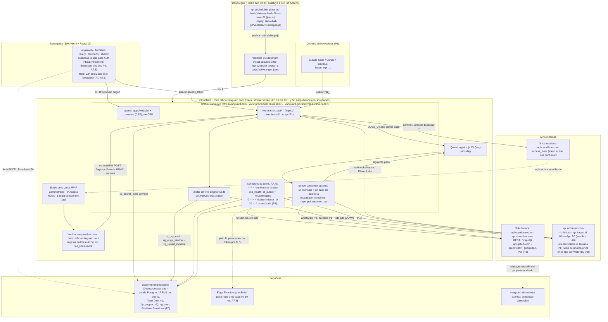
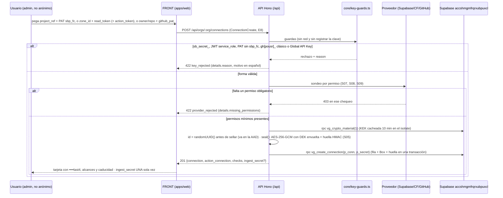
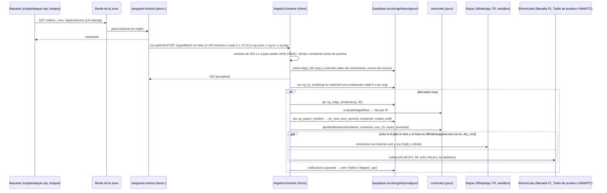
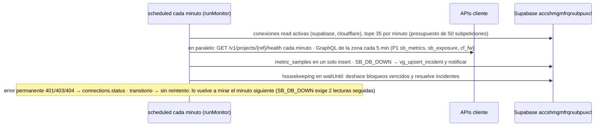
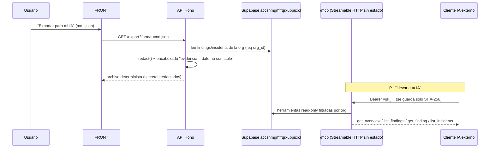
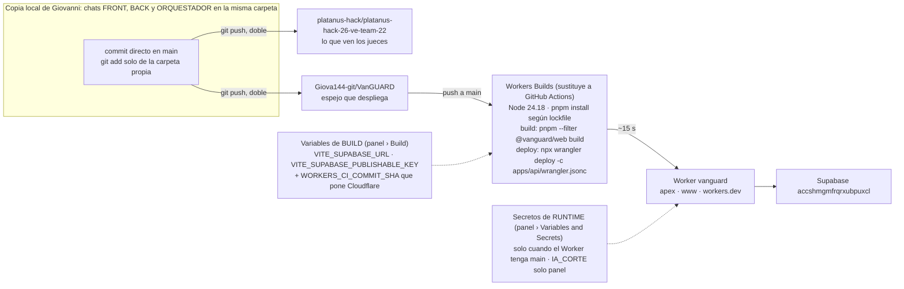

## 04. Arquitectura del sistema

> **Alcance de esta sección.** Cómo encajan las piezas de VanGUARD, los flujos de punta a punta, el modelo de ejecución de trabajos (cron, cola por pasos, Workflow como alternativa, reintentos, timeouts), el tiempo real, el aislamiento multi-tenant, la observabilidad propia, la topología de despliegue y el reparto FRONT/BACK/ORQUESTADOR. No repite el stack (S03), el modelo de datos y cifrado (S05), ni la lógica interna de cada módulo (S07–S13): remite a ellas por número. Fuente de verdad: `decisiones/00-decisiones-canonicas.md` (se citan sus §); en caso de choque entre secciones mandan el **contrato de S15** y el **DDL de S05**, y esta sección los sigue. Convención de marcas igual que las canónicas: `[verificado: URL]`, `[no verificado]`, `[propuesta]`, más `[observado: hora]` = comprobado hoy por la revisión de esta sección (DoH, `curl` y API de Cloudflare de solo lectura) y **Hecho (sab 03:45)** = ejecutado y verificado de madrugada (insumo de alineación, Parte A), que manda sobre cualquier texto anterior del plan. Cada tarea lleva prioridad **P0/P1/P2** y dueño **FRONT / BACK / ORQUESTADOR**. **Workers Free (decisión A7, sáb ~04:30):** el producto entero corre en el plan gratuito (10 ms de CPU por invocación, la espera de red no cuenta; 50 subpeticiones externas por invocación; sin `limits` ni Tail Workers); la cola encadena los pasos de auditoría, los monitores corren directo en el Cron, el ZIP se analiza en el navegador (sin R2) y el Workflow `vg-scan` queda como alternativa [no verificado]. Workers Paid solo como último recurso y lo decide Giovanni (A7.7).

### 04.1 Principios de arquitectura (no se negocian)

1. **Un solo origen, un solo Worker.** El producto entero (SPA + API + cron + cola + MCP) corre en el Worker `vanguard` sobre `https://officialvanguard.com`. Mismo origen para la SPA y la API: **sin CORS, sin cookies cruzadas** (canónicas §4, R17 §0). [verificado: https://developers.cloudflare.com/workers/static-assets/]
2. **La regla decide; el modelo redacta.** El motor de reglas de `@vanguard/core` (puro, probado con Vitest) decide si se alerta, con qué severidad y por qué canal. El modelo (S11) solo explica, resume y redacta, nunca en la ruta crítica de la alerta (canónicas §8, §9; S12). Una inyección en un log **no puede** apagar una alerta porque el modelo no tiene esa herramienta.
3. **Determinista para monitorear, IA para comunicar.** Monitoreo y auditoría van por REST/GraphQL directos; el MCP jamás entra en el bucle de monitoreo (canónicas §10.4, S13).
4. **Solo lectura hacia el cliente.** Tokens con alcance de lectura; la única escritura es «Bloquear IP» (y su «Deshacer») con conexión `kind='action'` y confirmación de dos pasos (canónicas §10.5, S08, S12, S15 E20–E22).
5. **Aislamiento por `org_id` en cada capa.** RLS en Postgres, `.eq('org_id', ctx.orgId)` en cada consulta admin, AAD del cifrado atado a la org (canónicas §6, §7, S05, S06).
6. **Seguro aun degradado.** Si la IA se apaga o un endpoint beta falla, el sistema cae a plantillas y a «sin mirar» (nunca a «verde»): nunca finge cobertura (canónicas §9.2, S06).
7. **Cabe en el plan gratuito (A7).** Cada invocación (petición, Cron o mensaje de cola) tiene 10 ms de CPU y 50 subpeticiones externas; esperar a Supabase, GitHub o Anthropic no gasta CPU. Por eso el trabajo largo se parte en **un mensaje de cola por paso** (cada uno con ≤ 40 subpeticiones), el ZIP se lee **en el navegador** y lo que no quepa en 10 ms pasa a una **Edge Function de Supabase** (A7.3). Nada depende de `limits.cpu_ms`, que en Free no se puede subir [verificado: https://developers.cloudflare.com/workers/platform/limits/].

### 04.2 Diagrama de componentes



**Lectura rápida.** El navegador baja la SPA de los **assets** (gratis, sin CPU) y pide **todos los datos a `/api/*`** con el Bearer de Supabase; `supabase-js` solo hace Auth y Realtime (los dos P0 desde A7.5) y **nunca lee tablas** (S14 regla L2): una sola fuente, validada con zod. El cliente nunca recibe un `sb_secret_`; toda escritura en la base la hace el Worker con `sb_secret_` tras validar el rol (canónicas §7, S15.3). La víctima reporta cada petición por **una sola vía de datos en P0**: `ctx.waitUntil(POST /ingest/v1/events)` firmado con HMAC (S15 E30), **en lotes de ≤ 100 eventos o cada 2 s** (A7.5; `IngestBatch` ya admite hasta 100), y el **motor en vivo corre en esa misma invocación de `/ingest`**, no en la cola (S15.9, canónicas §9.1). Los monitores por conexión (salud de Supabase, pulso GraphQL de Cloudflare; S15.7) corren **directo en el Cron** de cada minuto, sin cola: encolarlos gastaría ~13.000 operaciones de cola al día de las 10.000 de Free (A7.4). La cola `vg-jobs` [propuesta: nombre] solo encadena los **pasos de auditoría**, un mensaje por paso. **Sin Tail Workers** (A7.6: hoja de ruta): ni `tail()` en `vanguard` ni `tail_consumers` en la víctima, así que la única fuente de `edge_hits` es la ingesta firmada (una segunda vía contaría dos veces cada petición y dispararía las reglas a la mitad del umbral).

### 04.3 Flujo — conectar un servicio (P0, BACK + FRONT)



- **Guardas de entrada** en `packages/core/src/key-guards.ts` (canónicas §10.3) y sondeo por permiso por integración (S07, S08, S09). Además: `409 conflict` si la misma huella ya está conectada en la org; `502 provider_unavailable` si el proveedor no responde (S15 E8).
- **Cloudflare con `action_token`** crea **dos** filas (`kind:'read'` y `kind:'action'`, mismo `meta.zone_id`) y devuelve la segunda en `action_connection` (S15 E8). La conexión `ingest` no llama a ningún proveedor: genera `vgi_…`, lo sella como cualquier credencial y lo devuelve una sola vez.
- **FRONT (P0):** tres tarjetas grandes con guía de 4 pasos y botón «Probar conexión» (`POST .../connections/:id/test`, E9). Botones ≥ 56 px (S14). Un usuario anónimo («Ver demo») no ve el formulario: la API le responde 403 a todo `POST/PUT/PATCH/DELETE` (S15.3).
- **BACK (P0):** validación, cifrado y persistencia. El `ingest_secret` se muestra una sola vez y nunca vuelve a salir.

### 04.4 Flujo — auditoría de un botón «Auditar todo» (P0, BACK; UI de progreso FRONT)

```mermaid
sequenceDiagram
  participant F as FRONT
  participant A as API Hono
  participant DB as Supabase accshmgmfrqrxubpuxcl
  participant Q as Queue vg-jobs
  participant C as consumidor (un paso por invocación)
  participant CLI as APIs cliente (SB/CF/GitHub/OSV)
  participant IA as Claude (S11)
  F->>A: POST /api/orgs/:org/scans {kind:'full_audit'} (E11)
  A->>DB: topes del día (Caracas) y 409 si hay otra del mismo kind en curso
  A->>DB: insert scan_runs (queued, steps=[pending...])
  A->>Q: JOBS_Q.send({v:1, kind:'scan', scan_run_id, org_id, paso:'supabase'}) (solo ids, nunca tokens)
  A-->>F: 202 {scan_run_id} (si send falla: scan_runs failed y 502)
  Note over F: Realtime Broadcast invalida ['scan', id] (P0); respaldo: polling de GET /scans/:id cada 10 s con la pestaña visible
  Q->>C: mensaje supabase
  C->>CLI: advisors + SQL 1-3 read-only
  C->>DB: vg_upsert_findings + steps[i] done + progress 30
  C->>Q: send paso cloudflare
  Q->>C: mensaje cloudflare
  C->>CLI: GET /zones/{z} y settings: CF_ZONE_01 · P1 CF_DNS/TLS/WAF
  C->>DB: vg_upsert_findings + progress 45
  C->>Q: send paso repo
  Q->>C: mensaje repo
  C->>CLI: solo archivos de riesgo + OSV (04.6)
  C->>DB: vg_upsert_findings + progress 75
  C->>Q: send paso puntaje
  Q->>C: mensaje puntaje
  C->>DB: score + coverage + progress 90 (el rojo se ve aquí, antes de la IA)
  C->>Q: send paso resumen_ia
  Q->>C: mensaje resumen_ia
  C->>IA: IA-2 Opus 5.5 (plantilla si falla)
  C->>DB: scan_runs.summary + progress 95 · fin: status succeeded + progress 100
  DB-->>F: Broadcast org:org_id invalida ['scan', id]
```

- **Pasos y avance: los de S15.8** (manda; los reintentos ahora son por mensaje, punto siguiente): `supabase` 30 · `cloudflare` 45 · `repo` 75 (o `zip` en su propio `kind`) · P1 `psi` 85 (en `full_audit` solo lanza un `scan_run` hijo `kind:'lighthouse'` sin esperarlo) · `puntaje` 90 (escribe `score` y `coverage` **antes** de la IA) · `resumen_ia` 95 (con guion bajo, igual que canónicas §2) · `fin` 100 (solo cambia `status`). `puntaje` es un mensaje propio de la cola (va tras el último paso de datos) y `fin` corre al final del mensaje `resumen_ia`; ninguno de los dos está en `steps[]` ni en `ScanStep` del contrato (S15.8). Un paso sin conexión queda `skipped`; uno que falla queda `failed` y su módulo entra en `coverage.missing`; la auditoría termina `succeeded` salvo que fallen todos (S15 E12). `resumen_ia` se omite si no hay hallazgos abiertos.
- **Un mensaje por paso (A7.2).** El mensaje es el `JobMsg` de S15.8 (regla 1, manda): `{v:1, kind:'scan', scan_run_id, org_id, paso, cursor?}`, solo ids; el campo del mensaje es `paso` (no `step`), y `steps[]` y `scan_runs.step` del contrato no cambian; **cada paso descifra su token dentro de su invocación** y el estado vive en `scan_runs` y `findings`, nunca en la cola. Con `max_batch_size: 1` cada paso es su propia invocación, con sus 10 ms de CPU y su presupuesto propio de **≤ 40 subpeticiones** (margen sobre las 50 de Free); si un paso necesita más, guarda su avance y se re-encola a sí mismo con `cursor` (S15.8 regla 3) sin tocar `ScanStep`. Coste: ~18 operaciones de cola por auditoría (A7.2) de las 10.000/día de Free. **Para el FRONT no cambia nada:** `ScanRun`, `steps[]`, `progress` y `status` son los mismos de S15 (E11, E12) y de `packages/contracts`; la cola es un detalle interno del BACK. Hallazgos por la RPC `vg_upsert_findings` (S15.12). La lógica vive en `apps/api/src/scans/*.ts` y las reglas puras en `packages/core/src/rules/*` (S07–S10).
- **Robustez del encadenado (S15.8 reglas 2 y 4, mandan):** transitorio (red, 429, 5xx, timeout) → `m.retry({delaySeconds: 10 * 2 ** (m.attempts - 1)})` mientras no pase el límite de su paso, que el código cuenta con `m.attempts` (`supabase` y `cloudflare` 2, `repo` 1, `puntaje` 1, `resumen_ia` 1, `zip` 0); `max_retries: 3` de la cola es solo el techo. Con 401/403/404/422 o con los reintentos agotados, el consumidor marca el paso `failed` (su módulo entra en `coverage.missing`), encola el siguiente y hace `ack`, así la auditoría sigue. Lo que agote los `max_retries` de la cola (p. ej. el Worker cae por CPU) va a `vg-jobs-dlq`; el mismo `queue()` la consume (distingue por `batch.queue`), marca ese paso `failed` con `error_code:'dlq'` y encola el siguiente; el cron horario (P1) es la segunda red y marca `failed` las `scan_runs` `running` sin avance desde hace más de 15 min (S15.7). **Idempotencia por `(scan_run_id, paso)`**: el consumidor reclama el paso con la RPC `vg_claim_step(p_scan, p_paso, p_retomar)` (`pending → running`, devuelve `true` solo a quien la gana); `p_retomar` (`m.attempts > 1` o con `cursor`) deja retomar un paso `running`; si devuelve `false`, solo `ack`. Orden dentro del paso: resultados → `JOBS_Q.send(siguiente)` → `steps[i] = done` → `ack`. `vg_upsert_findings` es un upsert, así que repetir un paso no duplica hallazgos. **Alternativa:** el Workflow `vg-scan` (un `step.do` por paso, con los mismos reintentos de S15.8) solo si la prueba de humo de las 08:00 demuestra que cada paso corre en su propia invocación con su propio presupuesto [no verificado] (A7.2).
- **Puntaje y cobertura** con `packages/core/src/score.ts` (canónicas §9.2, S15.9): siempre «vemos N de 4 fuentes» junto al número; con `seen = 0`, `score` y `band` son `null`.
- **Topes:** la 4.ª `full_audit` del día de `America/Caracas` → `429 budget_exceeded` (org de demo: 20 [propuesta S15]); `409` si ya hay un `scan_run` del mismo `kind` `queued`/`running` creado hace < 15 min; viewer o anónimo → 403 (S15 E11).

### 04.5 Flujo — ataque en vivo → regla → incidente → alerta → bloqueo confirmado (P0, BACK; UI FRONT)

Son **tres caminos distintos** y no se mezclan: el caliente (ingesta, segundos) decide los incidentes `CF_*`; el frío (Cron de cada minuto, sin cola, A7.4) vigila conexiones de clientes; la acción va siempre por la API con confirmación. Ni el Cron ni la cola evalúan las reglas de borde (S15.7, S15.9).

**A. Camino caliente: ingesta → motor en vivo (P0).**



**B. Camino frío: Cron → `runMonitor` directo, sin cola (P0 `sb_health` y `cf_pulse`; P1 el resto; A7.4).**



**C. Acción confirmada «Bloquear IP» (P0 en la app y, desde A8, también por botón de WhatsApp + código de un solo uso: la decisión abierta 10 se adelanta al sábado; el detalle lo fijan S12 y S15 E20).**

```mermaid
sequenceDiagram
  participant AD as Admin (app)
  participant K as Kapso
  participant A as API Hono
  participant DB as Supabase accshmgmfrqrxubpuxcl
  participant CF as api.cloudflare.com (token action)
  participant WAF as Borde de la zona
  AD->>A: POST /actions/propose {incident_id, kind:'block_ip', target} (E20)
  A->>A: core/ip.ts: /32 o /128, no privada, no documentación, no la del operador
  A->>DB: 1 fila en approvals (in_app, HMAC(FPK, otp|id|código)) + 2 whatsapp con sha256(nonce), 10 min (todo P0 desde A8)
  A->>K: interactivo Sí bloquear / Cancelar con el código (P0, A8; si falla: delivery in_app, solo org de demo)
  A-->>AD: simulación {approval_id, efecto, avisos, expires_at, delivery}
  alt confirmar en la app (P0)
    AD->>A: POST /actions/:approvalId/confirm {code} (E21, solo officialvanguard.com)
  else botón Sí bloquear (P0, A8)
    K->>A: POST /webhooks/kapso (firma verificada, 200 inmediato, proceso en waitUntil)
  end
  A->>DB: vg_redeem_approval (canje atómico de un solo uso, from = recipient)
  A->>CF: POST /zones/{zone_id}/firewall/access_rules/rules (mode block)
  CF-->>WAF: regla activa: el atacante recibe 403 sin llegar a la víctima
  A->>DB: actions executed (provider_ref, previous {connection_id, zone_id, existed}, expires_at +1 h) · incidente mitigated
  AD->>A: POST /actions/:actionId/undo (E22) → DELETE de la regla
```

- **Reloj:** Cron `* * * * *` (UTC) → `runMonitor` directo + `housekeeping` (S15.7, sin cola desde A7.4). Los crons tardan **hasta 15 min** en propagar: desplegarlos en el esqueleto de las 10:00 [verificado: https://developers.cloudflare.com/workers/configuration/cron-triggers/].
- **Agrupación:** las cuatro reglas `CF_*` de una IP comparten incidente (`dedupe_key = sha256hex(org_id|edge|ip)`); **solo se renotifica si sube la severidad**; un incidente resuelto que reaparece antes de 10 min se reabre sin llamada (canónicas §9.1, S15.9).
- **Presupuesto de `waitUntil` en `/ingest`:** 30 s **compartidos** por todas las `waitUntil` de la petición; lo que no termine se cancela [verificado: https://developers.cloudflare.com/workers/runtime-apis/context/]. Por eso WhatsApp (plazo 8 s) y llamada (10 s, P1) salen **en paralelo** (`Promise.allSettled`) y el total estimado queda < 20 s con las 4 RPC. En Free esa misma invocación tiene además **10 ms de CPU y 50 subpeticiones**: verificar el HMAC, 4 RPC y 1–2 envíos son ~7 subpeticiones y casi todo es espera de red, que no cuenta (A7) [no verificado: CPU real; se mide en Workers Observability]. Se mide en el hito de las 17:30; si pasa de 20 s, plan B en «Decisiones de arquitectura» (punto 3) y S15.7 (mensaje `{kind:'eval', org_id}` de `vg-jobs`).
- **Acción de escritura:** dos pasos con código de un solo uso (solo se guarda el hash, caduca a los 10 min, 5 intentos, canje atómico, `from` del webhook = `recipient`); la voz nunca aprueba (canónicas §10.5, S15 E20–E22). `confirm`, el envío real y `notifications/test` exigen `hostname === new URL(APP_ORIGIN).hostname` (`officialvanguard.com`); fuera de ese host el despachador escribe `status:'failed', error:'dry_run'` (S15.3). Que el WAF corte antes de que la petición llegue al Worker de la víctima está [no verificado]: se ensaya el sábado (S15.10).
- La víctima llama a `https://officialvanguard.com/ingest/v1/events` con `fetch()` dentro de la misma zona, sin service binding [verificado: https://developers.cloudflare.com/workers/configuration/routing/custom-domains/].
- **Ingesta en lotes (A7.5), P0 · ORQUESTADOR (víctima) + BACK (E30):** la víctima junta los eventos en memoria del isolate y la petición que llena 100 eventos, o la que abrió el lote al cumplirse 2 s, lo envía firmado en su `ctx.waitUntil` [propuesta: mecanismo; no verificado: cómo reparte Cloudflare las peticiones entre isolates; si un isolate muere se pierde a lo sumo un lote, aceptable en demo]. Cuenta: un simulacro de 20 req/s durante 1 min son ~1.200 eventos y ~30 `POST /ingest` en vez de 1.200 (las 100.000 peticiones/día de Free son de la cuenta y las comparten `vanguard` y `vanguard-victima` [no verificado: alcance del tope]). Coste en el reloj: hasta 2 s más en el camino caliente, dentro del objetivo de A8 (WhatsApp en < 30 s; la historia de los fixtures lo pone a +8,4 s, A9, que no es una medición).

### 04.6 Flujo — análisis de repo / ZIP (P0 repo; P1 ZIP; BACK + FRONT)

```mermaid
sequenceDiagram
  participant F as FRONT (navegador)
  participant A as API Hono
  participant C as consumidor vg-jobs (paso repo)
  participant GH as api.github.com
  participant OSV as api.osv.dev
  participant EF as Edge Function de Supabase (plan B)
  participant DB as Supabase accshmgmfrqrxubpuxcl
  alt repo GitHub (P0)
    F->>A: POST /scans {kind:'repo'} (o dentro de full_audit)
    A->>C: JOBS_Q.send({scan_run_id, paso:'repo'})
    C->>GH: rama por defecto, sha del último commit y árbol de ese commit
    C->>C: elige solo archivos de riesgo: lockfiles, .env*, .gitignore, configs (~20, con tope de tamaño; lista en S09) — nunca el árbol entero
    C->>GH: GET del contenido de cada archivo elegido, por sha
    Note over C,EF: si la prueba de humo de las 08:00 dice que no cabe en 10 ms de CPU, el paso entero corre en EF (CPU de segundos): el Worker le pasa el token descifrado por TLS en la llamada y EF no lo guarda (A7.3)
  else ZIP (P1, A7.1)
    F->>A: POST /scans {kind:'zip', filename, size_bytes} (E11: solo crea el scan_run en queued con step waiting_result, sin encolar)
    A-->>F: 202 {scan_run_id}
    F->>F: leerZip de @vanguard/core (fflate) en el navegador: extrae los lockfiles, busca secretos con las mismas reglas de core y enmascara con redact()
    F->>A: POST /scans/:scan_run_id/zip-result (E23) con ZipResult, cuerpo ≤ 1 MB: dependencias y hallazgos ya enmascarados (el código no sale del navegador, sin R2 ni PUT uploads/zip)
    A->>C: JOBS_Q.send({scan_run_id, paso:'zip'}) para la parte OSV (ZipResult va en scan_runs.params.zip, no en el mensaje)
  end
  C->>C: solo repo: core/secrets/scan.ts: CB_ENV_COMMITTED, CB_GITIGNORE_NO_ENV, CB_SECRET_* (vista 4+4 y huella HMAC); en ZIP ya lo hizo el navegador
  C->>OSV: POST /v1/querybatch (package-lock.json, composer.lock · P1 pnpm-lock.yaml) + GET /v1/vulns/{id} dentro del presupuesto
  C->>DB: vg_upsert_findings (evidencia redactada) · steps[i] done · encola el siguiente paso
```

- **Repo acotado (A7.3), P0:** solo los archivos que deciden hallazgos (lockfiles, `.env*`, `.gitignore`, configuraciones), ~20 con tope de tamaño por archivo, pedidos por **sha** con el PAT de solo lectura; con 3 lecturas de contexto + ~20 archivos + OSV cabe en las ≤ 40 subpeticiones del paso, y lo que no quepa va a una continuación del mismo paso (re-encolado con `cursor`, S15.8 regla 3) o a `coverage` parcial, nunca a un error. Por qué tiene sentido: los hallazgos P0 de S09 salen de esos archivos, y no bajar el `zipball` entero evita descomprimir megas en 10 ms de CPU. El escáner (`core/secrets/scan.ts`) es el mismo para repo y ZIP y lleva una **lista de permitidos** para nuestros propios marcadores de redacción (`[SECRET:<regla>]`, `postgres://…:[REDACTADO]@`, `••••`), para que auditar nuestro propio repo (dogfooding) no dispare `CB_SECRET_GENERIC` ni `CB_SECRET_POSTGRES_URL` (A9; la lista exacta la fija S09). El `zipball` + `fflate` en el Worker de la versión anterior del plan **no se usa** en Free. Detalle de reglas, regex, lista de archivos y OSV en **S09**.
- **ZIP en el navegador (A7.1), P1 — contrato de S15 E23 (manda):** el navegador abre el archivo con `leerZip` de `@vanguard/core` (`fflate`, JS puro) y al API solo llega la lista de dependencias y hallazgos ya enmascarados, así que **sin R2, sin subida y sin bucket**: el `PUT …/uploads/zip` (subida del binario) se elimina y E23 pasa a ser `POST /api/orgs/:org/scans/:scan_run_id/zip-result` con el esquema zod `ZipResult` (cuerpo ≤ 1 MB, el `bodyLimit` general). **`ScanCreate` no cambia:** `kind:'zip'` sigue siendo `{kind:'zip', filename, size_bytes}` y solo crea el `scan_run` (datos del historial y tope que el navegador aplica antes de abrir el archivo); lo único nuevo en `packages/contracts` es `ZipResult` (con `ZipDep` y `ZipFinding`), que el ORQUESTADOR añade **antes del congelamiento de las 11:00**, porque después solo entran campos opcionales. Nada del ZIP viaja dentro de `POST /scans`. Argumento de producto y de seguridad: «tu código nunca sale de tu navegador». Los topes de S09 (archivo ≤ 1 MB, total ≤ 40 MB, ≤ 20 000 entradas, rutas hostiles) protegen ahora la pestaña del usuario. El API **revalida** lo que recibe (zod estricto y tamaños) y el paso `zip` lo trata como dato hostil: vuelve a enmascarar, solo acepta `CB_ENV_COMMITTED`, `CB_GITIGNORE_NO_ENV` y `CB_SECRET_*`, y `CB_DEP_VULN` lo decide solo el servidor con OSV (S15 E23). Como `lint:imports` (S03.8) prohíbe hoy `@vanguard/core` en `apps/web`, S03.8/S09 deben abrir la excepción para el lector puro o sacarlo a un subpaquete importable por la SPA [no verificado: decisión pendiente].
- Memoria del isolate: **128 MB** [verificado: https://developers.cloudflare.com/workers/platform/limits/]. CPU: **10 ms por invocación en Free y no se puede subir** (sin `limits.cpu_ms`, A7.6); el paso `repo` es el más expuesto y por eso se mide primero en la prueba de humo de A7.7.

### 04.7 Flujo — corrida de Lighthouse (P1, BACK + FRONT)

```mermaid
sequenceDiagram
  participant F as FRONT
  participant A as API Hono
  participant DB as Supabase accshmgmfrqrxubpuxcl
  participant C as consumidor vg-jobs
  participant PSI as PageSpeed Insights v5
  F->>A: POST /scans {kind:'lighthouse', url, strategy} (E11, P1)
  A->>DB: ¿la URL es de una zona Cloudflare activa de la org o de verified_domains? (0009, P1)
  alt no
    A-->>F: 422 (anti-SSRF: VanGUARD no mide sitios ajenos)
  else sí
    A->>DB: insert scan_runs
    A->>C: JOBS_Q.send({scan_run_id, paso:'psi-' + strategy})
    A-->>F: 202 {scan_run_id}
    C->>PSI: psi-<strategy> (3 repeticiones en paralelo; key=PSI_API_KEY, plazo 130 s por llamada)
    PSI-->>C: lighthouseResult (un 429 → m.retry con delaySeconds)
    C->>DB: perf_runs (scores, lcp/tbt/cls/fcp/si/ttfb, lighthouse_version)
    C->>DB: perf-compare: compareRuns contra la línea base → PF_REGRESSION en findings (p_complete=false)
  end
```

- **PSI, no la librería `lighthouse`** (necesita lanzar Chrome, imposible en un Worker; R17 §4.3). Cada `scan_run` `lighthouse` mide **una** estrategia con `psi-<strategy>` seguido de `perf-compare` en el mismo mensaje (esperar a Google no gasta CPU; el consumidor de cola tiene 15 min de reloj). En Free lo caro es **parsear** el `lighthouseResult`, que pesa del orden de MB: se piden solo los campos necesarios con el parámetro `fields` de las APIs de Google [no verificado en PSI v5] y, si aun así no cabe en 10 ms, va un mensaje por repetición (A7.7 lo mide). La verificación de dominio la hace la **API antes de encolar** (S15 E11: URL fuera de los dominios de la org → 422); dentro de `full_audit` (P1) el paso `psi` lanza un hijo `kind:'lighthouse'` por estrategia y no lo espera, y queda `skipped` si la org no tiene zona Cloudflare activa ni dominio verificado (S15.8, modelo de S10). Umbrales y `compareRuns` en **S10**.
- **P0:** la pantalla Rendimiento muestra la fila **sembrada** de `perf_runs` (tabla creada en `0007`, S05.3); «Medir ahora» es P1.

### 04.8 Flujo — exportar a cualquier IA / MCP propio (P0 export; P1 MCP; BACK + FRONT)



- **Export (P0):** `GET /api/orgs/:org/export?format=md|json` (E25), Markdown y JSON deterministas, todo por `redact()`, encabezado que marca la evidencia como dato no confiable + «Copiar para mi IA»; el viewer también puede exportar. Esquema público estático en `GET /api/schemas/vanguard-export.v1.json` (E35) (canónicas §2, S13, S15).
- **MCP propio (P1):** servidor `/mcp` Streamable HTTP **sin estado** montado en Hono (`@modelcontextprotocol/server` 2.3.1, R17 §11.5), tokens `vgk_` por org (tabla `mcp_tokens` en `0009`), resultados envueltos en `{"untrusted_data": …}` y binding `RL_MCP` (S13). `/mcp` y `/mcp/*` están en `run_worker_first`. El detalle de herramientas y los MCP oficiales en lectura están en **S13** y canónicas §10.4.

### 04.9 Modelo de ejecución de trabajos

| Trabajo | Dónde corre | Disparo | Límites, timeout y reintentos | Prio · Dueño |
|---|---|---|---|---|
| API, probar conexión, encolar auditorías, export, MCP, webhooks | `fetch` del Worker (Hono) | petición HTTP | Reloj sin límite mientras el cliente siga conectado; **CPU 10 ms por petición en Free** (la espera de red no cuenta) y **50 subpeticiones externas** (+1.000 a servicios de Cloudflare), sin forma de subirlos (A7); `ctx.waitUntil` extiende ≤ 30 s tras responder, **compartidos** por todas sus promesas [verificado: https://developers.cloudflare.com/workers/runtime-apis/context/ y https://developers.cloudflare.com/workers/platform/limits/] | P0 · BACK |
| **Motor en vivo** (`engine/live.ts`): ventana, reglas `CF_*`, incidente, notificación | `ctx.waitUntil` de `POST /ingest/v1/events` | cada lote de la víctima (≤ 100 eventos o cada 2 s, A7.5); evalúa ≤ 1 vez cada 5 s por org (`vg_try_eval`) | dentro de los 30 s de `waitUntil` y de los 10 ms de CPU de esa invocación; ~7 subpeticiones (04.5); WhatsApp y llamada (P1) en paralelo; sin reintento de la llamada (no duplicar) | P0 · BACK |
| Monitores por conexión (`runMonitor`) + `housekeeping` | `scheduled('* * * * *')` → `runMonitor` **directo, sin cola** (A7.4): `sb_health` cada minuto y `cf_pulse` cada 5 min (P0); `sb_metrics`, `cf_fw` (P1) en el mismo recorrido; `housekeeping` en `waitUntil` (deshace bloqueos con `expires_at < now()`, resuelve incidentes `cloudflare` sin eventos en 15 min y `SB_DB_DOWN` con 2 lecturas sanas) | Cron por minuto (UTC) | Cron: 10 ms de CPU y 50 subpeticiones por invocación, 15 min de reloj [verificado: limits]. Tope de **35 conexiones por minuto** [propuesta] (35 lecturas + ~7 de listado, escritura y `housekeeping`, dentro de 50); más allá, hoja de ruta: repartir por `minuto % k`. Transitorio → sin reintento (lo vuelve a mirar el minuto siguiente); permanente 401/403/404 → `connections.status` | P0 · BACK |
| Mantenimiento por hora | `scheduled('0 * * * *')` | cada hora (UTC) | [propuesta: contenido] lo que no necesita minuto y no cabría en el presupuesto del minuto: `sb_exposure` (P1, prueba activa con varias peticiones) y aviso de tokens por caducar; si el domingo no tiene contenido, no se declara | P1 · BACK |
| Re-auditoría diaria | `scheduled('0 10 * * *')` → `startScheduledAudits` (inserta `scan_runs` `daily_audit` y `JOBS_Q.send` del primer paso por org) | 06:00 de Caracas | respeta los topes de E11 | P1 · BACK |
| Auditoría / repo / PSI / resumen IA | `queue` consumer de `vg-jobs` [propuesta: nombre], **un mensaje por paso** (A7.2); del ZIP solo la parte OSV (el análisis corre en el navegador, 04.6) | `JOBS_Q.send({v:1, kind:'scan', scan_run_id, org_id, paso})` (`JobMsg` de S15.8) desde E11, E23, la re-auditoría y el paso anterior | `max_batch_size` 1 (cada paso con su propia invocación: 10 ms de CPU y ≤ 40 subpeticiones), `max_retries` 3 (techo de la cola; el límite de cada paso lo aplica el código con `m.attempts`, S15.8), DLQ `vg-jobs-dlq` con su propio consumidor (`max_batch_size` 1: marca el paso `failed` con `error_code:'dlq'` y encola el siguiente; la DLQ se crea sola si no existe [verificado: https://developers.cloudflare.com/queues/configuration/dead-letter-queues/]); transitorio → `m.retry({delaySeconds: 10 * 2 ** (m.attempts - 1)})`; permanente o reintentos agotados → paso `failed`, encola el siguiente y `ack`; idempotencia por `(scan_run_id, paso)` con `vg_claim_step` (04.4); consumidor: 15 min de reloj [verificado: https://developers.cloudflare.com/workers/wrangler/configuration/]. Free: Queues incluidas, 10.000 operaciones/día, retención 24 h; ~18 operaciones por auditoría (A7) | P0 (`psi` P1) · BACK |
| Alternativa: Workflow `vg-scan` | un `step.do` por paso, con los reintentos de S15.8 | `SCAN_WF.create({id: scan_run_id, params})` | **Solo si** la prueba de humo de las 08:00 demuestra que cada paso corre en su propia invocación con su propio presupuesto [no verificado] (A7.2). Free: 3.000 pasos/día, 10 ms de CPU por invocación [verificado: https://developers.cloudflare.com/workflows/reference/pricing/] | decisión del BACK a las 08:00 |
| Retención y caducidad | `pg_cron` en el proyecto `accshmgmfrqrxubpuxcl` (`0008_rls_retention.sql`) | `vg-purge-edge-hits` (cada hora, 24 h), `vg-purge-daily` (07:15 UTC: `metric_samples` 7 d, `webhook_events`, `approvals`, `notifications` 30 d, historial 90 d, anónimos 7 d), `vg-expire-connections` (cada 10 min) | ver S05.10 | **P0** · BACK |

**Reglas de ejecución clave:**
- **Cada corrida que el usuario ve como nueva** («Verificar arreglo» E16, re-auditoría diaria, otra `full_audit`) crea **otra fila** `scan_runs` y, por tanto, otro `scan_run_id`; la clave de idempotencia de la cola es `(scan_run_id, paso)`, así que un mensaje repetido nunca rehace un paso terminado (04.4). Si se usara la alternativa del Workflow: el ID de instancia es único y no se reutiliza ni tras terminar [verificado: https://developers.cloudflare.com/workflows/build/rules-of-workflows/], se usa `scan_run_id` y `instance.restart()` solo para reintentar a mano esa misma corrida. **P0 · BACK.**
- `POST /api/orgs/:org/scans` inserta la fila `scan_runs` y luego `JOBS_Q.send` del primer paso; si el envío falla, marca la fila `failed` y responde 502 (S15 E11). **P0 · BACK.**
- La cola `pgmq` de R16 **ya no se usa**: no hay proceso permanente que la sondee; `scan_runs` queda como estado visible y fuente del Broadcast (canónicas §15 #11). No se escriben esas migraciones. **BACK.**
- **Desarrollo local** (`dev-node.ts`): el doble de `JOBS_Q.send` llama a `runJob` en línea (`runScanInline` de `scans/index.ts`: mismos pasos, en serie, sin reintentos) y `runMonitor` se dispara con un `setInterval` local de 60 s, igual que el Cron lo llama directo en producción (S15.8 regla 10, R17 §11.4).
- **`apps/api/wrangler.jsonc` consolidado** (P0 · ORQUESTADOR lo escribe a las 09:00; el BACK le pide los bindings al ORQUESTADOR —no hay PR: commit directo en `main`— y no toca `name`, `routes`, `assets` ni `vars`, S15.15). Parte del archivo provisional que ya despliega Workers Builds (`name`, `compatibility_*`, `workers_dev`, `routes` apex + `www`, `observability`; **Hecho (sab 03:45)**), **quita `www` de `routes`** (03.7) y le añade `main`, `vars`, los 3 crons, la cola y `ratelimits`. **Sin `limits`, sin `r2_buckets`, sin `workflows` y sin Tail Workers** (A7.1, A7.2, A7.6). Junta R17 §6.1, S03.7 (dominio), S06 (`run_worker_first` y `ratelimits`) y este 04.9:

```jsonc
{
  "$schema": "https://unpkg.com/wrangler@4.152.0/config-schema.json",
  "name": "vanguard",                                  // el Worker ya existe en la cuenta (página provisional, 04.13)
  "main": "src/worker.ts",
  "compatibility_date": "2026-10-20",
  "compatibility_flags": ["nodejs_compat"],
  "workers_dev": true,                                 // explícito: con routes se inferiría false y se pierde el respaldo
  "preview_urls": false,                               // [propuesta] sin previews: commit directo en main y Workers Builds solo construye main (04.11)
  "routes": [ { "pattern": "officialvanguard.com", "custom_domain": true } ],   // solo el apex, igual que S03.7. Hoy www también es Custom Domain
                                                                                  // (estado provisional, Hecho sab 03:45); pasa a relleno proxied + Redirect Rule 301
                                                                                  // en este mismo commit, en el orden único de S03.4 paso 2 / S08 §08.11 (04.13)
  "assets": {
    "directory": "../web/dist", "binding": "ASSETS", "not_found_handling": "single-page-application",
    "run_worker_first": ["/api/*", "/ingest/*", "/webhooks/*", "/mcp", "/mcp/*", "/.*", "/.well-known/*", "!/.well-known/security.txt"]   // "/.*": /.env y /.git → 404 de Hono (S06); /.well-known/oauth-* → 404 JSON, no la portada (S13); security.txt lo sirven los assets (la negación con ! gana, verificado en S06 06.11)
  },
  "observability": { "enabled": true, "head_sampling_rate": 1 },
  "upload_source_maps": true,
  // sin "limits": en Free no se puede subir cpu_ms ni subrequests (A7.6)
  "triggers": { "crons": ["* * * * *", "0 * * * *", "0 10 * * *"] },   // monitor por minuto · mantenimiento por hora · re-auditoría diaria (A7.4; Free: 5 por cuenta)
  "queues": {
    "producers": [ { "binding": "JOBS_Q", "queue": "vg-jobs" } ],      // [propuesta: nombre] solo pasos de auditoría (A7.2); los monitores no usan cola (A7.4)
    "consumers": [ { "queue": "vg-jobs", "max_batch_size": 1,         // un paso por invocación: 10 ms de CPU y <= 40 subpeticiones propias
                     "max_retries": 3, "dead_letter_queue": "vg-jobs-dlq" },   // techo de la cola; el límite de cada paso lo aplica el código (S15.8)
                   { "queue": "vg-jobs-dlq", "max_batch_size": 1 } ]          // cierre de la DLQ: paso failed con error_code 'dlq' y encola el siguiente
  },
  // sin "workflows" (vg-scan solo si A7.7 lo aprueba), sin "r2_buckets" (ZIP en el navegador, A7.1), sin tail_consumers ni tail() (A7.6)
  "ratelimits": [
    { "name": "RL_API",    "namespace_id": "1001", "simple": { "limit": 300, "period": 60 } },   // S15 15.3 y S06 06.9
    { "name": "RL_COSTLY", "namespace_id": "1002", "simple": { "limit": 10,  "period": 60 } },
    { "name": "RL_INGEST", "namespace_id": "1003", "simple": { "limit": 300, "period": 10 } }
  ],
  "vars": { "VG_ENV": "production", "APP_ORIGIN": "https://officialvanguard.com" }   // SUPABASE_URL y demás secretos: panel de Cloudflare tras el primer deploy con main (04.13); VG_VERSION: --var en el deploy command
}
```

`worker.ts` exporta `fetch: app.fetch`, `scheduled` y `queue` (R17 §11.1); **no** exporta `tail` y solo re-exportaría `ScanWorkflow` desde `workflow.ts` si se elige la alternativa del Workflow (entonces se añade el bloque `workflows`). `scheduled` mira `event.cron` y llama a `runMonitor` + `housekeeping` (minuto), al mantenimiento (hora) o a `startScheduledAudits` (diaria). `queue` despacha por `batch.queue`: `runJob` para `vg-jobs` y el cierre de la DLQ para `vg-jobs-dlq` (S15.8 regla 4). La cola `vg-jobs` se crea **una vez y antes** del push del esqueleto (si no existe, el deploy de Workers Builds falla [no verificado: Wrangler 4 podría aprovisionarla sola]): desde el panel (Queues › Create) o la API de Cloudflare con `curl` [no verificado: si la CLI `cf` crea colas]; la DLQ se crea sola (tabla de arriba). No hay bucket que crear. Que el binding `ratelimits` funcione en Free está [no verificado]: si el deploy lo rechaza, se quita y queda solo la regla de rate limit de la zona (04.13). Ya no hay CI propio: nunca con wrangler local en Windows (04.13). Que `/.*` y la negación `!` funcionen en `run_worker_first` lo da S06 como [verificado: https://developers.cloudflare.com/workers/static-assets/binding/]; se comprueba con `curl -s -o /dev/null -w "%{http_code}" https://officialvanguard.com/.env` → `404`.

### 04.10 Tiempo real

- **P0 — Realtime Broadcast (sube de P1 por A7.5).** Es la vía principal de frescura porque **no gasta peticiones ni CPU del Worker** (Free: 100.000 peticiones/día y 10 ms de CPU por petición). Canal privado `org:<org_id>`; triggers `realtime.broadcast_changes` sobre `scan_runs`, `findings`, `incidents`, `notifications` y política sobre `realtime.messages` (migración `0008b_realtime.sql`, P0, que se aplica después de `0008` y antes de las 13:00; su texto y su horario los fija S05.13; payload y claves a invalidar en S15.6; esquemas ya en `packages/contracts/src/realtime.ts`, **Hecho (sab 03:45)**). **Nunca** se emite nada de `edge_hits`, `metric_samples`, `connections`, `connection_secrets`, `approvals`, `contacts` ni `ai_usage` (volumen o datos sensibles). El FRONT solo invalida la query correspondiente, así que **no cambia ningún componente**; si el canal no llega a `SUBSCRIBED` en 10 s, queda solo el polling (S14). «Allow public access» de Realtime **desactivado** [verificado: https://supabase.com/docs/guides/realtime/authorization]. **P0 · BACK (SQL) + FRONT (suscripción).**
- **P0 — polling de respaldo a 10 s (A7.5).** TanStack Query consulta `overview`, `incidents`, `traffic` y, mientras corre una auditoría, `scans/:id` cada **10 s** y **solo con la pestaña visible** (`refetchIntervalInBackground: false`). Cuenta: ~4 peticiones cada 10 s = ~24/min por pestaña, frente a las ~90/min del polling a 3 s y 2 s de la versión anterior; una pestaña olvidada en segundo plano gasta 0. Una pestaña visible las 24 h serían ~34.600 peticiones/día, un tercio de las 100.000/día de Free (los assets no cuentan): por eso el respaldo no baja de 10 s. **P0 · FRONT.**
- Límites Free: 200 conexiones concurrentes, 100 msg/s, broadcast 256 KB, 2 M msg/mes — de sobra para la demo [verificado: https://supabase.com/docs/guides/realtime/limits].

### 04.11 Multi-tenant

- **Modelo:** toda entidad lleva `org_id`; el usuario pertenece a `org_members` con rol `owner`/`admin`/`viewer` (canónicas §6, S05).
- **Tres cercos simultáneos** (defensa en profundidad, S06):
  1. **RLS en Postgres** con `private.user_org_ids()`/`user_admin_org_ids()` (`security definer`, `search_path=''`); `revoke all` a `anon`/`authenticated` sobre `connection_secrets`, `approvals`, `edge_hits`, `edge_eval_state`, `ai_usage`, `webhook_events` (canónicas §6, S05.2). La SPA no lee tablas (S14 L2): estas políticas son defensa en profundidad y la base de la autorización de Realtime (P0 desde A7.5, 04.10).
  2. **API:** `supabase.auth.getClaims(token)` **lo primero** (nunca `getSession()` en servidor, R17 §10), luego la membresía (`:org` de otra org → **404**, no 403, para no confirmar que existe), luego el rol, luego el cliente admin con `.eq('org_id', ctx.orgId)` también al leer por id de ruta — anti-IDOR, con prueba `test:idor` sobre dos orgs (canónicas §7, S15.3). En `/ingest` la org sale de la conexión firmada, nunca del cuerpo. **P0 · BACK.**
  3. **Cripto:** `AAD = vanguard|v1|org_id|connection_id|provider|kind`: copiar un `Box` a otra org hace fallar el descifrado (canónicas §10.1, S05).
- **Org de demo** (`is_demo`): el viewer anónimo (`signInAnonymously()` + `POST /api/demo/join`, E4; la RPC `join_demo_org()` es el plan B) no lanza auditorías ni gasta IA; techos de gasto propios (canónicas §2, §8). **P0 · BACK (RPC) + FRONT.**
- **Previews: hoy no hay.** Se commitea directo en `main` (sin PR) y Workers Builds solo construye `main` del espejo; el `wrangler.jsonc` de 04.9 deja `preview_urls: false` [propuesta] para no dejar Version URLs con los secretos de producción. Si se reactivan (builds de ramas no productivas de Workers Builds [no verificado: comando por defecto] o `--preview-alias pr-N`), vale lo que sigue y **la guarda de host se programa igual desde P0**. Las previews comparten base y secretos con producción. Rutas, Cron Triggers y consumidores de cola **apuntan solo a producción**, pero una preview **sí puede producir** mensajes a la cola de producción (y crear instancias de un Workflow de producción, si se eligiera la alternativa), que corren el código desplegado en `main` [verificado: https://developers.cloudflare.com/workers/previews/resources/; la página describe la función Previews, y para las Version URLs de `--preview-alias` vale lo mismo porque solo la versión desplegada recibe cron y cola: inferencia]. Consecuencias: (1) `notifications/test`, el envío real y `confirm` responden 403 / `dry_run` fuera de `officialvanguard.com` (S15.3); (2) **todo productor de `JOBS_Q`** que encole algo que envía (p. ej. `escalate` o el plan B `eval`, P1) aplica la misma guarda de host antes de encolar, porque el consumidor de producción enviaría de verdad; (3) en una preview `POST /scans` funciona pero gasta topes e IA de la org real. Las Version URLs no aparecen en Workers Logs [verificado: https://developers.cloudflare.com/workers/versions-and-deployments/version-urls/].

### 04.12 Observabilidad propia

| Pieza | Cómo | Prio · Dueño |
|---|---|---|
| `request_id` en cada respuesta y en el cuerpo de error `{error:{code,message,request_id}}` | Middleware `request-id.ts` de Hono (`cf-ray` o `randomUUID`); se correlaciona con Workers Logs (S15.3) | P0 · BACK |
| Workers Logs (invocaciones, excepciones, `console`) | `observability.enabled=true`, `head_sampling_rate=1` en `wrangler.jsonc`; en **Free** (nuestro plan, A7): 200 000 eventos/día y 3 días de retención (Paid: 20 M/mes y 7 días); el precio cambia el 1-dic-2026 [verificado: https://developers.cloudflare.com/workers/observability/logs/workers-logs/]. No cubre las Version URLs de las previews | P0 · ORQUESTADOR (config) + BACK |
| Source maps | `upload_source_maps=true` (R17 §6.1) | P0 · ORQUESTADOR |
| `redact()` antes de registrar | `log()` = `console.log(JSON.stringify(redact({...})))`; ningún log lleva tokens, cuerpos de terceros, cabeceras, teléfonos completos ni trazas (canónicas §7, S15.3) | P0 · BACK |
| Libro de gasto IA (`ai_usage` + panel «Gasto IA hoy») | Reserva con `vg_ai_reserve` antes de llamar y liquidación después (S15.10); la UI lee `GET /ai/usage` (E28) | P0 (registro) / P1 (panel) · BACK + FRONT |
| Prueba de fuga (al cerrar Conexiones, 13:00) | Guardar el token falso `vg_test_LEAK_7Q2X`, buscarlo en Workers Logs, `postgres_logs` y todas las respuestas → 0 apariciones (canónicas §10.1, S15.14). Canónicas la ponen a las 08:00, pero a esa hora todavía no existe el cifrado | P0 · BACK |
| Salud de nuestros Workers (dogfooding) | **Sin Tail Workers** (A7.6: hoja de ruta), así que no hay `tail()` ni `wk_requests`/`wk_errors` por esa vía. P2: GraphQL `workersInvocationsAdaptive` (errores y CPU p99 de `vanguard` y `vanguard-victima`, R17 §9.1) [no verificado: disponible en Free] | P2 · BACK |
| CPU por invocación (que todo cabe en Free) | Prueba de humo de A7.7 a las 08:00: cola con 3 pasos de 40 `fetch` cada uno y medir CPU por invocación en Workers Observability; después, revisar la CPU p99 de `fetch`, `scheduled` y `queue` en cada hito. Si algo pasa de 10 ms: ese paso a Edge Function de Supabase (A7.3) | P0 · BACK |
| VanGUARD se audita a sí mismo | `supabase/tests/rls.sql`: 0 tablas de `public` sin RLS, funciones `security definer` sin `search_path`, etc. (canónicas §6). Ya no hay CI propio (Workers Builds solo construye y despliega): el chat BACK lo corre contra `accshmgmfrqrxubpuxcl` por el MCP de Supabase (`execute_sql` y advisors) al cerrar cada hito de migraciones, y el resultado queda en el repo como evidencia | P0 · BACK |
| Pruebas antes de publicar [propuesta] | Build command de Workers Builds `pnpm test && pnpm --filter @vanguard/web build`: si falla un test de `contracts` o `core` (Vitest en Node, sin `.exe`), el build falla y el dominio sigue con la versión anterior. El log de cada build queda en el panel | P0 · ORQUESTADOR |
| Qué versión está viva | `VG_VERSION` = `WORKERS_CI_COMMIT_SHA`, pasada con `--var` en el deploy command (las variables de build no llegan al runtime); `GET /api/health` (E1) la devuelve y se compara con el último commit de `platanus-hack/platanus-hack-26-ve-team-22` | P0 · ORQUESTADOR |

### 04.13 Topología de despliegue y entornos

**Topología** (resumen; el diagrama y la tabla completa están en canónicas §4):

| Pieza | Dónde | URL / id |
|---|---|---|
| Producto (SPA+API+cron+cola+MCP) | Worker `vanguard` en plan Workers **Free** (decisión A7: se queda en Free también con el backend; Paid solo como último recurso, A7.7). Hoy sirve la provisional `site/` | `https://officialvanguard.com` (Custom Domain, **Hecho (sab 03:45)**); `www` también es Custom Domain hoy (provisional, pasa a 301) + respaldo `https://vanguard.giovannizm14.workers.dev` |
| App víctima | Worker `vanguard-victima` (pendiente, 16:00), Free, sin `tail_consumers` (A7.6) | `https://demo.officialvanguard.com` |
| Base del producto | Supabase, **un solo proyecto** «hackaton 22», us-west-2, Postgres 17; dev y prod son el mismo (sustituye a `vanguard-prod`/`vanguard-dev`: migraciones una sola vez, IDOR con usuarios de prueba ahí). **Hecho (sab 03:45)**: creado con `public` vacío y el chat BACK conectado por MCP (`.mcp.json`) | ref `accshmgmfrqrxubpuxcl` · `https://accshmgmfrqrxubpuxcl.supabase.co` |
| Base de la víctima | Supabase Free `vanguard-demo`, aparte (cuenta de Gabriel), **pendiente** | otro `<ref>`, secretos falsos, PAT de solo lectura |
| Repo víctima | GitHub privado `vanguard-demo-victima` | PAT fine-grained de ese repo |
| Repos del producto | `platanus-hack/platanus-hack-26-ve-team-22` (el que ven los jueces) y espejo `Giova144-git/VanGUARD` (el que despliega). **Hecho (sab 03:45)**: `git push` desde la copia de Giovanni empuja a los dos; solo esa copia tiene el doble push | `origin` con dos URL de push |
| CI/CD | **Workers Builds** de Cloudflare (no GitHub Actions: no existen `.github/workflows/deploy.yml`, el bucle `--secrets-file` ni secretos de Actions). Conectado al espejo, rama `main`, root `/`; Node 24.18, pnpm 10.34.7 por `packageManager`, instala según `pnpm-lock.yaml`. **Hecho (sab 03:45)**: push → build (~15 s) → publicado en el dominio | build command vacío hoy → `pnpm --filter @vanguard/web build` con `apps/web`; deploy command `npx wrangler deploy -c apps/api/wrangler.jsonc` |
| Zona DNS | `officialvanguard.com` en Cloudflare, plan Free, cuenta `eda2c45921f84ec5add25f379bbdbfb5`, zona `14d12778b0249e6d6854a67876c37e72`; registrador Squarespace (sin transferencia; bloqueo ICANN hasta el 2026-12-23). **Hecho (sab 03:45)**: zona activa y DNSSEC | nameservers `martin.ns.cloudflare.com`, `ziggy.ns.cloudflare.com` |

**Cómo llega un commit al dominio (Hecho sab 03:45; antes: GitHub Actions + `deploy.yml`):**



**Dónde vive cada variable** (sustituye a «secretos y vars de Actions»; catálogo de nombres en S03.6):

| Tipo | Dónde se carga | Cuándo | Ejemplos y reglas |
|---|---|---|---|
| Variables de build del FRONT | Workers Builds › Settings › Build › Build Variables and Secrets | ya (no dependen de `main`) | `VITE_SUPABASE_URL`, `VITE_SUPABASE_PUBLISHABLE_KEY`: Vite las incrusta en el bundle, son públicas por diseño (la publishable aplica RLS). **Nunca** un `sb_secret_` ahí |
| Variables que pone el build | Cloudflare, en cada build | cada push a `main` del espejo | `WORKERS_CI_COMMIT_SHA`, `WORKERS_CI_BRANCH`, `WORKERS_CI_BUILD_UUID`. No llegan al runtime: `VG_VERSION` se pasa con `--var` en el deploy command |
| Vars de runtime no secretas | `vars` de `apps/api/wrangler.jsonc` (versionado) | con el esqueleto | `VG_ENV`, `APP_ORIGIN` |
| Secretos de runtime | panel (Workers & Pages › `vanguard` › Settings › Variables and Secrets) o API de Cloudflare; nunca en el repo | **después** del primer deploy con `main` (Cloudflare no deja agregar variables a un Worker solo de assets); sobreviven a los deploys siguientes | `SUPABASE_URL`, `SUPABASE_SECRET_KEY`, `VG_KEK_PEPPER`, `ANTHROPIC_API_KEY`, Kapso, ElevenLabs, Twilio… `IA_CORTE` solo de panel |

- **Deploy command con versión [propuesta]:** `npx wrangler@4.152.0 deploy -c apps/api/wrangler.jsonc --var VG_VERSION:$WORKERS_CI_COMMIT_SHA` [no verificado: sintaxis exacta del shell del build]. Fijar la versión de wrangler (la misma del `$schema` de 04.9) evita que un build tome otra versión sin que nadie la elija; ningún `package.json` declara wrangler (Norton, abajo). **ORQUESTADOR.**
- **Lockfile:** Workers Builds instala según `pnpm-lock.yaml`; quien agregue una dependencia lo regenera con `pnpm install --lockfile-only` (no baja binarios) o el build falla y el dominio sigue con la versión anterior. **Todos los chats.**
- **Antes del esqueleto — prueba de humo de CPU (08:00, BACK, A7.7):** una cola de prueba con 3 pasos de 40 `fetch` cada uno y medir la CPU por invocación en Workers Observability. Si algo no cabe en 10 ms, ese paso se diseña como Edge Function de Supabase (A7.3); el resultado decide también si el Workflow `vg-scan` entra como alternativa. Workers Paid solo si Giovanni lo decide como último recurso. [no verificado: con qué Worker se despliega la prueba antes del esqueleto, sin wrangler local; lo fija S16].
- **Orden del esqueleto (09:00–10:00, ORQUESTADOR + BACK):** (1) cola `vg-jobs` creada (04.9; la DLQ se crea sola; no hay bucket); (2) preparar `www` → 301 (relleno proxied y Redirect Rule) en el orden único que fijen S03.4 paso 2 y S08 §08.11, porque el mismo commit quita `www` de `routes` (ver «Lo que falta», punto 2); (3) push del commit del esqueleto → Workers Builds despliega; `curl -s https://officialvanguard.com/api/health` → `{"ok":true,"version":"<sha>",…}` (E1 no toca Supabase, así que responde aunque falten secretos); (4) cargar los secretos de runtime en el panel y probar una ruta que lea Supabase; (5) los crons tardan hasta 15 min en propagar (04.5).
- **Víctima [propuesta]:** segundo Worker `vanguard-victima` con su propia conexión de Workers Builds al mismo espejo (deploy command `npx wrangler deploy -c apps/victima/wrangler.jsonc`; filtrar por rutas `apps/victima/**` si el panel lo permite [no verificado]). Sin `tail_consumers` (A7.6), así que su despliegue ya no depende de que `vanguard` exporte nada: solo de que `/ingest/v1/events` responda.

- **Subdominios (decisión única, canónicas §4):** producto y API en el **apex**; `/api`, `/ingest`, `/webhooks`, `/mcp` son rutas bajo el apex gracias a `run_worker_first` (mismo origen, sin CORS). **No** se crean `api.` ni `mcp.`. `www` redirige al apex con Redirect Rule 301. La víctima en `demo.`. Todas las URLs externas (Supabase Auth, webhooks de Kapso y ElevenLabs, ingesta, MCP, export) son las de la tabla de S03.4. **ORQUESTADOR.**
- **Estado del dominio — Hecho (sab 03:45):** delegación a Cloudflare hecha (NS `martin`/`ziggy`), zona activa en Free, **DNSSEC activo** (DS keyTag 2371, algoritmo 13, digest 2, pegado en Squarespace y validando en Google DNS). Ajustes ya aplicados: **SSL Full (strict)**, **Always Use HTTPS**, **TLS mínimo 1.2**, TLS 1.3, Automatic HTTPS Rewrites, `security_level` medium, `browser_check` on; TXT `v=spf1 -all` y `_dmarc` `p=reject; sp=reject; adkim=s; aspf=s`. **Bot Fight Mode apagado a propósito:** en Free no admite excepciones y rompería los webhooks de Kapso, ElevenLabs y GitHub; lo sustituye la regla de rate limit de `/api/`. El apex y `www` son Custom Domains del Worker `vanguard` y sirven la **página provisional** `site/` (CSP de `site/_headers`), desplegada por Workers Builds. **Pendiente:** (1) `GET /api/health` responde **404** hasta el esqueleto (sin fallback de SPA; [observado: 04:58]); (2) `www` responde 200 en vez de 301 al apex [observado: 04:58]; (3) `demo.` no existe; (4) revisar las reglas administradas del WAF y crear la regla de rate limit en `/api/`; (5) HSTS el domingo 07:00; (6) DKIM nulo opcional. S16.5 y S03.4 deben recoger este estado.
- **Lo que falta, en orden (ORQUESTADOR, P0, antes de las 10:00; detalle de cada paso en S03.4):** (1) primer deploy real de `vanguard` **por Workers Builds** (push del esqueleto con el `wrangler.jsonc` de 04.9, en el orden de arriba): mismo nombre de Worker, así que reemplaza la provisional y conserva el Custom Domain del apex; comprobar `curl -s https://officialvanguard.com/api/health` → JSON con `version`; (2) `www` → 301 con cuatro piezas: registro proxied de relleno, `www` fuera de `routes` en el commit del esqueleto, Custom Domain `www` fuera del panel y Redirect Rule 301 `https://www.*` → `https://${1}` conservando la query. **El orden no se fija aquí:** es el de S03.4 paso 2 y S08 §08.11, que hoy difieren (S03.4 crea el relleno antes de quitar el Custom Domain; S08 quita primero) y deben quedar con uno solo. Después, comprobar `curl -sI "https://www.officialvanguard.com/x?y=1"` → `301` a `https://officialvanguard.com/x?y=1`. Es el montaje que documenta Cloudflare para `www` con Custom Domains [verificado: https://developers.cloudflare.com/workers/configuration/routing/custom-domains/, citado en S03.4 paso 4]; el `www` como Custom Domain de hoy es solo el estado provisional; (3) Custom Domain `demo.officialvanguard.com` para `vanguard-victima` (16:00); (4) seguridad de la zona (tabla de S03.4): **SSL Full (strict), Always Use HTTPS, TLS mínimo 1.2 y TLS 1.3 → Hecho (sab 03:45)**; pendiente revisar el Free Managed Ruleset del WAF y **una** regla de rate limit (Free: 1 regla, conteo preajustado por IP, periodo 10 s, mitigación 10 s, acción Block [verificado: https://developers.cloudflare.com/waf/rate-limiting-rules/]) con umbral **por encima del simulacro** (20 req/s = 200 por 10 s; Free no filtra por host, así que también cuenta `/api/productos` de `demo.`): valor único del plan, `http.request.uri.path contains "/api/"`, **400/10 s**, bloqueo 10 s (S15 15.3, S06 06.9, S03 03.4); la Configuration Rule `bic: false` solo para `demo.` (S03 03.4 paso 7); **Bot Fight Mode off → Hecho (sab 03:45)** (servimos API, ingesta y webhooks y en Free no se puede saltar con reglas, S03.4); SPF `-all` y DMARC `p=reject` → **Hecho (sab 03:45)**, se conservan (más estrictos que el `p=quarantine` de canónicas), DKIM nulo opcional [propuesta S03]; **HSTS en P1** (domingo 07:00, solo si apex, `www` y `demo.` responden bien por HTTPS); (5) DNSSEC: ya activo vía Cloudflare, **no tocar** en Squarespace. La transferencia de registrador **no** se hace (bloqueo de 60 días tras el registro, y no hace falta).
- **Respaldo:** `https://vanguard.giovannizm14.workers.dev` sigue vivo (`workers_dev: true`) con las mismas rutas; allí `confirm`, el envío real y `notifications/test` responden 403/`dry_run` (S15). El `deploy-url` del jsonc **no se cambia**.
- **Entornos (canónicas §4):** sin bloques `env.*`. **Producción** = versión que Workers Builds despliega desde `main` del espejo `Giova144-git/VanGUARD` (el mismo commit que `main` de `platanus-hack/…` por el doble push). **Previews:** hoy no hay (04.11). **Base:** dev y prod usan el mismo proyecto `accshmgmfrqrxubpuxcl`; las pruebas (IDOR, fuga) usan usuarios y orgs de prueba en él. **Local — Hecho (sab 03:56):** `pnpm install --frozen-lockfile` en la raíz instala 48 paquetes con 0 `.exe` (solo los addons `.node` de Rolldown y LightningCSS) y `typecheck` + `vitest run` de `@vanguard/contracts` pasan (24/24). **Local:** Vite en `:5173` con proxy de `/api`, `/ingest` y `/mcp` a `:8787` (`VITE_API_PROXY` con `loadEnv`, S03.7; Hono en Node 24, `node --env-file=.dev.vars --watch src/dev-node.ts`); víctima en `:8788`; `VITE_USE_FIXTURES=1` permite al FRONT trabajar sin BACK.
- **Windows/Norton (R17 §7):** ningún `package.json` declara `wrangler`, `@cloudflare/vite-plugin`, `miniflare`, `agents` ni `@cloudflare/vitest-pool-workers`; wrangler solo corre en el build de Workers Builds (Linux de Cloudflare) o, si hiciera falta, en Codespaces; nunca en este equipo (se quitaron los `workerd.exe` de la CLI `cf` y los `fastlist.exe` de pnpm global); `worker-configuration.d.ts` **escrito a mano** por el BACK y versionado (S15.2: interfaz `CloudflareBindings` con los bindings de 04.9, `JOBS_Q` incluido; nadie corre `wrangler types` en este equipo); ningún agente genera `.exe` ni toca Norton. Norton **no** bloquea los MCP (corrección de Giovanni): conector Cloudflare, MCP de Supabase y CLI `cf` se usan con normalidad. Ningún chat de IA lee `.env`, `.dev.vars` ni `.env.*.local` (solo `.env.example`). **ORQUESTADOR + BACK.**

### 04.14 Reparto FRONT / BACK / ORQUESTADOR

| Capa | Carpeta | Dueño | Qué construye en esta arquitectura |
|---|---|---|---|
| SPA | `apps/web` | **FRONT** | Cascarón con módulos, Conexiones con guías (04.3), UI de progreso de auditoría (04.4), Incidentes con cronómetro (04.5), Export (04.8), suscripción Realtime Broadcast (P0) con polling de respaldo a 10 s solo con la pestaña visible (04.10) y, en P1, análisis del ZIP en el navegador con `leerZip` (`fflate`) y envío de `ZipResult` a E23 `zip-result` (04.6). Sin dependencias de Cloudflare. (S14) |
| API + Worker | `apps/api` | **BACK** | `app.ts` (Hono), `worker.ts` (fetch/scheduled/queue, sin `tail`), `rutas/*`, `engine/*` (motor en vivo tras `/ingest`), `monitors.ts` (`runMonitor` directo en el Cron), `scans/*` (un handler por paso de la cola `vg-jobs`; `workflow.ts` solo si se elige la alternativa del Workflow), `notify/*`, `actions/*`, `ia/*`, `mcp.ts`, `dev-node.ts`. Modelo de ejecución (04.9), multi-tenant en API (04.11), observabilidad (04.12). (S15) |
| Víctima | `apps/victima` | **ORQUESTADOR** (canónicas §13, S15.1) | Worker de demo (`/`, `/login`, `/api/productos`, `/admin` sin auth) con `ctx.waitUntil(POST /ingest)` firmado y en lotes (A7.5), sin `tail_consumers` (A7.6). El **BACK** garantiza el contrato de ingesta (E30). |
| Compartido | `packages/contracts` | **ORQUESTADOR** | Copia literal de los esquemas zod de S15.5 + fixtures + `database.types.ts`. **v0 Hecho y subido (commit `e7398f6`, sáb ~05:00, A9):** `comun.ts`, `api.ts`, `estado.ts`, `ingest.ts`, `realtime.ts`, `index.ts`, 20 fixtures de S14 §14.19 y `contracts.test.ts` (24/24 en este equipo). Falta, **antes de las 11:00 (ORQUESTADOR):** `PerfRunExt` (§10.9, A9) y el esquema `ZipResult` de E23 (`zip-result`, 04.6; `ScanCreate` no cambia); `database.types.ts` sale de las migraciones del BACK. Contratos congelados el sábado 11:00; después solo campos opcionales (canónicas §5). |
| Núcleo | `packages/core` | **BACK** (el chat BACK escribe las primitivas `crypto.ts`, `redact.ts`, `untrusted.ts`, `key-guards.ts`, `otp.ts`, `egress.ts` con pruebas, más las funciones de export `redactForExport`, `fenceMd` y `escapeMdInline` de S13; el ORQUESTADOR revisa el commit, S15.1); `perf/` es del ORQUESTADOR hasta el sáb 18:30 (S10); **BACK** el resto (`rules/*`, `score.ts`, `severity.ts`, `ip.ts`, `secrets/*`, `lockfiles/*`, `templates/*`) (S15.1) | La seguridad vive aquí, pura (sin Cloudflare ni Supabase) y probada con Vitest en Node; `apps/web` tiene prohibido importar `@vanguard/core` (regla `lint:imports`, S03.8). Dueño único de las primitivas: el chat BACK, en todas las secciones. (S05, S06, S15) |
| Esquema | `supabase/` | **BACK** | Único escritor del esquema en el proyecto `accshmgmfrqrxubpuxcl` (migraciones una sola vez, por el MCP de Supabase ya conectado); migraciones `0001`–`0009` más `0008b_realtime.sql` (P0, tras `0008`), RLS, Vault, `pg_cron`, seeds y `rls.sql` (04.12) (S05). |
| Infra y despliegue | raíz (**Hecho (sab 03:45)**: `package.json`, `pnpm-workspace.yaml`, `.npmrc`, `tsconfig.base.json`, `.gitignore`, `.env.example`, `scripts/lint-imports.mjs`, `pnpm-lock.yaml`), `apps/api/wrangler.jsonc` (04.9; el BACK le pide los bindings), `scripts/ataque.mjs`, `demo/`; sin `.github/` (no hay Actions); pieza **temporal versionada** `site/` (página provisional que sirve el `apps/api/wrangler.jsonc` provisional, también versionado; no existe `provisional/`): `site/` se queda mientras sea lo que sirve el Worker y **sale en el commit que cambia `assets.directory`** a `../web/dist` (00.7 #11, resuelta) | **ORQUESTADOR** | Monorepo, zona en Cloudflare, dominio y conexión de Workers Builds (los tres **Hecho (sab 03:45)**); pendiente: build y deploy command definitivos (04.13), cola `vg-jobs` (sin bucket: A7.1; sin Paid: A7), `www` → 301, guion del pitch y del video (los graban y presentan las personas). (S03, S16) |

**Quién es cada chat (Hecho (sab 03:45)):** FRONT, BACK y ORQUESTADOR son **sub-chats de Giovanni** en el mismo proyecto y la misma carpeta local; el ORQUESTADOR les manda las asignaciones y no se delegan a otras personas. Commit **directo en `main`** (la rama `giova` ya no se usa); cada chat hace `git add` solo de sus carpetas (`git add apps/web`, `git add apps/api supabase packages/core`…), **nunca `git add -A`**; push solo cuando Giovanni lo pide. Las personas del equipo (Carlos, Daniel, Andrés, Gabriel) hacen el trabajo humano: cuentas externas (Kapso, Twilio, ElevenLabs, proyecto víctima), red team, QA, README escrito a mano, video y pitch.

**Contrato de colaboración (canónicas §5):** un chat nunca edita la carpeta de otro; si el FRONT necesita un campo, lo pide al ORQUESTADOR, que cambia `packages/contracts`, avisa a los dos y actualiza los fixtures. El contrato API completo (rutas, auth, cuerpos, errores) está en **S15**; la especificación de pantallas del FRONT en **S14**.

### 04.15 Dependencias de arranque (resumen; cronograma completo en S16)

| Hora (sáb) | Hito de arquitectura | Depende de | Dueño |
|---|---|---|---|
| Sáb 03:45 | **Hecho:** zona y DNSSEC, Worker `vanguard` con Custom Domains apex + `www`, despliegue continuo por **Workers Builds** desde el espejo (push → ~15 s → dominio; sustituye al «hola mundo» por Actions), doble push, proyecto Supabase `accshmgmfrqrxubpuxcl`, monorepo y `packages/contracts` v0 | — | ORQUESTADOR |
| 08:00–09:00 | Pruebas de humo: **CPU en Free (A7.7: cola con 3 pasos de 40 `fetch`, CPU por invocación en Workers Observability)**; SQL read-only + advisors sobre la víctima; `signInAnonymously()`; `vite dev` con React y Tailwind en Windows (la instalación y Vitest ya pasan, **Hecho (sab 03:56)**) | cuentas | BACK, FRONT, ORQUESTADOR |
| 10:00 | Esqueleto desplegado por Workers Builds en el apex con el `wrangler.jsonc` de 04.9 (orden en 04.13): `GET /api/health` → JSON con `version` = SHA, `scheduled` con los 3 crons, `queue` de `vg-jobs` y su DLQ; secretos de runtime cargados en el panel **después** de ese deploy; `www` → 301 | cola `vg-jobs` creada antes del push; relleno de `www` (S03.4 paso 2) | ORQUESTADOR + BACK |
| 11:00 | Contratos congelados (antes: `PerfRunExt` y `ZipResult` de E23 en `packages/contracts`, A9 y 04.6; `ScanCreate` no cambia); migraciones `0001`–`0003` | esqueleto | ORQUESTADOR, BACK |
| 13:00 | Conexiones con cifrado de punta a punta (04.3) + migraciones `0004`–`0008` (incluye `pg_cron`) y `0008b_realtime.sql` (P0, tras `0008`) + prueba de fuga | contratos | BACK |
| 15:00 | Auditoría por pasos en la cola `vg-jobs` con `supabase`, `repo` (solo archivos de riesgo), `resumen_ia` y cierre (04.4) + IA-1; Realtime Broadcast (P0, A7.5) | conexiones | BACK |
| 16:00 | Víctima en `demo.officialvanguard.com` con ingesta HMAC en lotes (04.5 A), sin `tail_consumers` | contrato de ingesta | ORQUESTADOR + BACK |
| 17:30 | Motor en vivo, incidente, **WhatsApp de punta a punta** (P0, A8: aviso en < 30 s, centro de la demo; Kapso en sandbox), «Bloquear IP» en la app y por botón de WhatsApp + código de un solo uso (A8); `sb_health` y `cf_pulse` directo en el Cron (04.5 B y C); medir el tiempo de `waitUntil` y la CPU por invocación | ingesta, cuentas de Gabriel, conexión `action` de nuestra zona | BACK |
| Dom 07:00–10:00 | P1: llamada de voz (A8: solo después de WhatsApp de punta a punta; Twilio de prueba o, si no sirve, voz en la app por WebRTC; pagar Twilio solo con aprobación de Giovanni), ZIP en el navegador, PSI con `verified_domains` (`0009`), `/mcp`, escalamiento a 45 s, HSTS. Tail Workers queda en hoja de ruta (A7.6) | P0 cerrado | BACK, FRONT, ORQUESTADOR |

**Decisiones de arquitectura** (tomadas por el orquestador en la fusión final; ninguna cambia el contrato de S15):

1. **Sin `tail()` y una sola fuente de `edge_hits`** (A7.6; antes: `tail()` P1). Tail Workers queda en hoja de ruta. La única fuente de `edge_hits` es `POST /ingest/v1/events`: con dos vías cada petición contaría dos veces y las reglas dispararían a la mitad del umbral (canónicas §2, S08, S15.7; S12.1 ya está alineado).
2. **Previews:** la duda de canónicas §4 queda resuelta [verificado: https://developers.cloudflare.com/workers/previews/resources/]: crons y consumidores no corren en previews, pero una preview sí puede **producir** a la cola (y crear instancias de un Workflow, si se usara). Por eso la guarda de host se aplica también a todo productor de `JOBS_Q` que encole algo que envía (04.11). Hoy no hay previews (`preview_urls: false` [propuesta]); la guarda se mantiene por si se reactivan.
3. **Presupuesto de `waitUntil` (30 s) del motor en vivo.** Si en el hito de las 17:30 evaluar y enviar pasa de 10 ms de CPU o de 20 s de reloj, plan B (P1): E30 solo inserta y encola un mensaje `{v:1, kind:'eval', org_id}` en `vg-jobs` (deduplicado por `vg_try_eval`) y el consumidor (15 min de reloj) evalúa y envía en su propia invocación. Ya está en el `JobMsg` de S15.8 (regla 1, aditivo). Los monitores no usan mensaje de cola: `runMonitor` corre directo en el Cron (A7.4).
4. **Regla de rate limit de la zona.** Free no filtra por host: el umbral debe quedar por encima del simulacro (≥ 200 por 10 s desde una IP). Valor único: 400/10 s (S06, S15, S03.4 ya corregido).
5. **`RL_API`.** S06 calculó ~90/min por pestaña con el polling a 3 s; con 120/60 s, dos pestañas darían 429. Decidido: 300/60 s, ya en el `wrangler.jsonc` de 04.9. Con el polling a 10 s de A7.5 (~24/min por pestaña, 04.10) el margen es mucho mayor; el valor no cambia.
6. **Prueba de fuga:** canónicas §10.1 la fecha a las 08:00, pero el cifrado no existe hasta las 13:00; se corre al cerrar Conexiones (S15.14).
7. **CI/CD = Workers Builds, no GitHub Actions — Hecho (sab 03:45).** Motivos: ningún token de despliegue de Cloudflare queda guardado en GitHub (el repo de los jueces es de una organización ajena y tiene varios colaboradores); la instalación sigue el lockfile; los secretos de runtime viven solo en Cloudflare y sobreviven a los deploys (se pierde el bucle `--secrets-file`, que ya no hace falta). Riesgo: un push que llegue solo a `platanus-hack/…` no cambia el dominio; `version` de `/api/health` lo delata.
8. **Un solo proyecto Supabase (`accshmgmfrqrxubpuxcl`) — Hecho (sab 03:45).** En 36 h, separar dev y prod duplicaba migraciones y secretos sin aportar aislamiento real (el aislamiento del producto es por `org_id`, 04.11). Las pruebas destructivas o de IDOR usan orgs y usuarios de prueba; la víctima `vanguard-demo` sigue aparte porque simula a un cliente.
9. **Workers Free, no Paid (A7, decisión de Giovanni, sáb ~04:30).** Encaja con la carga real: casi todo es espera de red (que no cuenta como CPU) y los assets son gratis e ilimitados. Lo que cambia: los monitores corren directo en el Cron (encolarlos gastaría ~13.000 operaciones/día de 10.000), la auditoría va en un mensaje de cola por paso (≤ 40 subpeticiones cada uno), el ZIP se lee en el navegador (sin R2), sin `limits` ni Tail Workers, polling a 10 s y Realtime en P0. Plan B si un paso no cabe en 10 ms: Edge Function de Supabase (A7.3). Workers Paid solo como último recurso y lo decide Giovanni (A7.7).

### 04.16 Por qué cada método tiene sentido y cómo se comprueba (criterio «Aspecto técnico»)

El jurado pregunta si hay ingeniería real, si los métodos tienen sentido y si la solución es robusta, eficiente y segura. Esta tabla da, por cada pieza de la arquitectura, la razón del método y una prueba que un juez (o su agente) puede repetir. Ninguna cifra se inventa: lo que todavía no se mide dice «se mide».

| Método | Por qué tiene sentido aquí | Robustez · eficiencia · seguridad | Evidencia verificable |
|---|---|---|---|
| Un Worker en el edge, mismo origen (04.1 #1) | La SPA son archivos estáticos y la API es sobre todo E/S hacia APIs de terceros (Supabase, Cloudflare, GitHub, Anthropic): no hay cómputo pesado que pida un servidor. Mismo origen = sin CORS ni cookies cruzadas | Assets sin CPU; un solo artefacto que desplegar; **0 USD de infraestructura** (A8). Frase para el jurado (A7.8): «VanGUARD entero corre en el plan gratuito de Cloudflare: 10 ms de CPU por petición»; sin servidor que parchear; la zona propia pone WAF y rate limit delante de nuestra API (dogfooding) | `curl -sI https://officialvanguard.com` (cabeceras `cf-ray` y CSP de `_headers`); `curl -s https://officialvanguard.com/api/health` → `version`; **CPU p99 por invocación de `fetch`, `scheduled` y `queue` en Workers Observability** frente a los 10 ms (se mide en la prueba de humo de las 08:00 y en cada hito; sin cifra todavía) |
| Camino caliente: motor en vivo en el `waitUntil` de `/ingest` (04.5 A) | Una alerta de ataque vale por segundos; pasar por la cola añadiría un salto y su `max_batch_timeout` sin ganar nada | HMAC en tiempo constante **antes** de parsear y org sacada de la conexión firmada (nadie inyecta eventos ajenos); `vg_try_eval` limita a 1 evaluación cada 5 s por org, así el costo no crece con la inundación; dedupe por IP y renotificación solo si sube la severidad; plan B medido (decisión 3) | Cronómetro de tiempo-a-alerta en la demo: primer `edge_hits` → WhatsApp `sent` (objetivo < 30 s, A8; se mide a las 17:30; sin cifra todavía: el +8,4 s de los fixtures es la historia de la demo, A9, no una medición) |
| Camino frío: Cron → `runMonitor` directo, sin cola (04.5 B, A7.4) | Un chequeo de salud por minuto es una sola lectura por conexión: encolarlo gastaría ~13.000 operaciones de cola al día (más que las 10.000 de Free) sin ganar nada, porque el minuto siguiente ya es el reintento | Lecturas en paralelo con `Promise.allSettled` (un proveedor caído no frena a los demás); error permanente → `connections.status` (no reintenta lo que no va a funcionar); `SB_DB_DOWN` exige 2 lecturas seguidas (un fallo suelto no despierta a nadie); tope de 35 conexiones por minuto [propuesta] dentro de las 50 subpeticiones | `metric_samples` con una muestra por minuto y conexión; CPU p99 de `scheduled` en Workers Observability |
| Auditoría por pasos en la cola `vg-jobs` (04.4, 04.6, 04.7; A7.2) | Una auditoría son varios pasos contra APIs lentas o con cuota; en Free cada invocación tiene 10 ms de CPU y 50 subpeticiones, así que **un mensaje por paso** da a cada paso su propio presupuesto y un paso que falla no repite los que ya terminaron | Reintento por mensaje (`m.retry` con espera creciente, hasta 2 por paso según S15.8; techo `max_retries: 3`) y DLQ `vg-jobs-dlq` con su propio cierre; **idempotencia por `(scan_run_id, paso)`** (reclamo condicional `pending → running` con `vg_claim_step`; upsert de hallazgos); el mensaje solo lleva ids y cada paso descifra su token dentro; esperar a PSI o a Claude no gasta CPU; el puntaje se escribe antes de la IA; ~18 operaciones de cola por auditoría | `GET /api/orgs/:org/scans/:id` muestra `steps[]` con estado y avance; DLQ `vg-jobs-dlq` vacía en el panel de Queues |
| ZIP analizado en el navegador (04.6, A7.1) | Para buscar secretos y versiones de dependencias no hace falta que el código viaje: el navegador del usuario tiene CPU de sobra y el Worker tiene 10 ms | **Seguro:** el código fuente nunca sale del navegador, así que VanGUARD no puede filtrarlo ni guardarlo; **eficiente:** sin R2, sin subida y sin descomprimir en el Worker; el API revalida con zod lo que recibe | En la pestaña Red del navegador, «Subir ZIP» hace `POST /scans` (`kind:'zip'`, solo `filename` y `size_bytes`) y después `POST …/scans/:scan_run_id/zip-result` (E23) con `ZipResult` ≤ 1 MB: solo dependencias y hallazgos enmascarados, ningún byte del archivo (P1) |
| Reglas deterministas en `@vanguard/core`; el modelo solo redacta (04.1 #2) | Una alerta de seguridad tiene que ser reproducible y auditable: misma entrada, misma decisión | Código puro probado con Vitest; una inyección de prompt en un log no puede apagar una alerta (el modelo no tiene esa herramienta); si la IA cae o se corta (`IA_CORTE`), plantillas; gasto de IA acotado por `vg_ai_reserve` | `pnpm test` (Vitest ya corre en este equipo: 24/24 del contrato, **Hecho (sab 03:56)**); prueba con un log que trae una inyección y la alerta igual se dispara [propuesta, S06/S12] |
| Un proyecto Supabase con RLS y RPC atómicas (04.11) | El aislamiento que importa es entre orgs, no entre entornos | Tres cercos (RLS, `.eq('org_id')`, AAD); RPC transaccionales (`vg_create_connection`, `vg_upsert_incident`, `vg_redeem_approval`) evitan estados a medias y canjes dobles | `test:idor` sobre dos orgs; advisors de Supabase y `rls.sql` sin hallazgos sobre el propio producto (04.12) |
| Workers Builds + doble push (04.13) | El código que leen los jueces y el que corre en el dominio salen del mismo commit | Instalación según lockfile (sin deriva de versiones); ningún token de despliegue en GitHub; secretos solo en Cloudflare; un build roto no tumba lo publicado | `version` de `/api/health` = SHA del último commit de `platanus-hack/platanus-hack-26-ve-team-22`; historial de builds en el panel |

**Métricas que esta arquitectura deja medir** (para «Ejecución» e «Impacto»; se publican solo cuando estén medidas): tiempo-a-alerta (`edge_hits` → `notifications`), duración de una `full_audit` (`scan_runs`), costo de IA por auditoría (`ai_usage`), CPU p99 por invocación frente a los 10 ms de Free (Workers Observability), tiempo de push a dominio (~15 s observado en el build de prueba) y cobertura «vemos N de 4 fuentes».

**Frente a lo que encontraría el agente de un juez (solo la parte que sostiene la arquitectura; el párrafo de pitch vive en S01).** Hay escáneres que miran **una** fuente y reportan (Supabase Security Advisor, Cloudflare Security Center, Snyk, Socket, GitGuardian, Aikido) y plataformas o agentes «AI SRE» que vigilan [no verificado: capacidades actuales de cada uno; se revisa antes del pitch con V-15 de S01]. El delta que se dice en el pitch son **las 3 frases de §01.12** y no se repite aquí. Lo que esta arquitectura añade a ese delta, comprobable hoy o en P0: (a) el **camino caliente corre en el edge**, en la misma invocación de la ingesta firmada, y una regla determinista (no el modelo) pasa de una petición maliciosa a un WhatsApp en segundos (cronómetro de la fila «Camino caliente» de la tabla de arriba); la única escritura (Bloquear IP) exige código de un solo uso y se puede deshacer; (b) **el mismo commit** está en el repo que leen los jueces y en el dominio (`version` de `/api/health` = SHA, decisión 7); (c) «VanGUARD entero corre en el plan gratuito de Cloudflare: 10 ms de CPU por petición» (A7.8), con la CPU p99 de Workers Observability a la vista. Solo con su prioridad: el incidente que cruza borde, base y repo **solo si 00.7 #4 sube M24**; «Verificar arreglo» es P1 y el MCP propio entra **solo si V-09 lo da por Listo** (§01.12).


---
