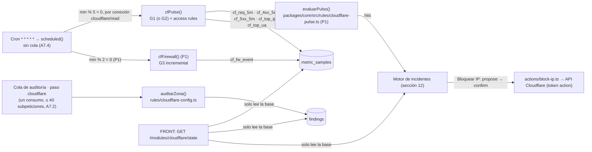

## 08. Módulo Cloudflare

> **Qué es.** El módulo que vigila una **zona** de Cloudflare del cliente: tráfico (IPs, user agents, rutas, países, 4xx/5xx), eventos del firewall, configuración de seguridad (SSL, TLS, DNS, WAF, bots) y acciones de neutralización con confirmación y «Deshacer». Fuente de verdad: decisiones canónicas §2 (fila Cloudflare), §6 (tablas), §7 (contrato), §9 (reglas) y §10 (credenciales). Aquí está **solo** lo específico de Cloudflare; el motor de incidentes y los avisos están en la sección 12, el cifrado en la 05, el contrato completo en la 15 y las pantallas genéricas en la 14.
> **Principios que no se negocian:** (1) la regla decide, nunca el modelo (§9); (2) el monitoreo va por REST + GraphQL directos, **nunca por MCP** (§10.4); (3) el token de lectura y el de acciones son **dos conexiones distintas** (`connections.kind = 'read' | 'action'`); (4) **un solo poller en el BACK**: ninguna pantalla llama a Cloudflare, el FRONT solo lee la base; (5) **dogfooding**: el módulo se demuestra sobre nuestra propia zona `officialvanguard.com` (§08.11).
> **Alineación con 15 y 05 (mandan):** archivos, colectores, métricas (nombres sin punto, convención única de 15.7), códigos de error, esquemas zod y rutas son los de la sección 15 y el DDL de la 05. Lo que esta sección pedía a 15 quedó resuelto en la fusión final (E36, `same_token`, `cloudflare_ip`, `ActionKind` ampliado, `mode`/`connection_id` en `ProposeAction`, `edge_confirmed`, `rules/cloudflare-pulse.ts`); cada pieza conserva su plan P0 que no depende de ella.
> **Marcas:** `[verificado: URL]`, `[verificado en KUADRA]` (medido por KUADRA contra una zona Free real, vía R05/R06), `[no verificado]`, `[propuesta]` (umbral o decisión nuestra), **Hecho (sáb 03:45)** (ya aplicado y comprobado en nuestra zona).
> **Estado real (sáb 03:45):** la zona `officialvanguard.com` (zona `14d12778b0249e6d6854a67876c37e72`, plan **Free**) está **activa** con DNSSEC y con casi todos los ajustes de §08.11 aplicados; el Worker `vanguard` se despliega con **Workers Builds** desde el espejo `Giova144-git/VanGUARD` (no hay GitHub Actions ni `CLOUDFLARE_API_TOKEN` de Actions). Lo que falta de la zona está en §08.11; por qué cada método tiene sentido y cómo lo comprueba un tercero, en §08.13.

### 08.1 Fuentes de datos y prioridades

| Fuente | Qué aporta | Frecuencia | Dónde corre | Prio |
|---|---|---|---|---|
| Ingesta de la víctima (`POST /ingest/v1/events` → `edge_hits`) | Reglas en vivo de 60 s por IP (`CF_ADMIN_EXPOSED`, `CF_PATH_SCAN`, `CF_UA_TOOL`, `CF_IP_FLOOD`) | cada lote de la víctima (≤ 100 eventos o cada 2 s, A7.5; ≤ 1 evaluación / 5 s / org) | ruta `/ingest/*` + `vg_edge_window` (§6) | P0 (definido en §9.1; aquí no se repite) |
| **Pulso GraphQL** (§08.5 G1/G2) | Totales, top IPs, top UA, rutas, sondeos, países, 4xx/5xx de **cualquier** zona | cada 5 min por conexión `cloudflare/read` (minuto `% 5 === 0`) | Cron `* * * * *` → `scheduled` llama **directo** a `apps/api/src/monitors.ts · cfPulse`, **sin cola** (A7.4: con cola gastaría operaciones de Queue cada minuto); cliente en `apps/api/src/scans/cloudflare.ts`; presupuesto de CPU y subpeticiones en §08.4 | P0 recoger y mostrar (la UI del módulo dice «La detección en vivo necesita el sensor de ingesta de tu app; con solo el token de Cloudflare ves cifras cada 5 min»); **P1-a** (primer bloque del domingo 07:00) `CF_IP_FLOOD` y `CF_UA_TOOL` del pulso, cuya función pura ya está en §08.6; **P1** `CF_UA_INSISTENT` (user agent insistente que no es herramienta, lo que pidió el dueño); resto de reglas del pulso P1/P2 según §08.6 |
| Eventos del firewall (§08.5 G3) | Qué frenó Cloudflare (WAF, rate limit, access rules, DDoS L7) por IP; confirma bloqueos | cada 2 min, incremental (minuto `% 2 === 0`, en el mismo `scheduled`, sin cola) | `apps/api/src/monitors.ts · cfFirewall` | P1 (y solo si G0 da `firewallEventsAdaptive.enabled` en Free, §08.10) |
| Auditoría REST de configuración (§08.7) | `CF_ZONE_01`, `CF_DNS_*`, `CF_TLS_*`, `CF_WAF_*`, `CF_BOT_*` | paso `cloudflare` de la auditoría por pasos encadenados en una Queue (A7.2: un mensaje, un consumo, ≤ 40 subpeticiones, §08.7) y «Revisar Cloudflare ahora» | `apps/api/src/scans/cloudflare.ts · auditCloudflare` + reglas puras `packages/core/src/rules/cloudflare-config.ts` | P0 `CF_ZONE_01`; **P0 tardío (sáb 19:00)** `CF_TLS_01`, `CF_TLS_02`, `CF_TLS_03` y `CF_WAF_01` (bastan para enseñar «nuestra zona en verde» en la demo); P1 `CF_DNS_01/02/05`, `CF_TLS_04/05`; resto P2 |
| Acciones (§08.8) | Bloquear IP; P1 desafiar IP, Under Attack; P2 rate limit | al confirmar | `apps/api/src/actions/block-ip.ts` (+ `approvals.ts`); guardas puras en `packages/core/src/ip.ts` | P0 `block_ip`; P1 `unblock_ip`, `under_attack_*`; P2 `rate_limit` |
| Webhook `dos_attack_l7` (§08.6) | Aviso de Cloudflare de DDoS L7 | push | `POST /webhooks/cloudflare/:conn` (E36, aceptada, §08.6) | P1 |



El sensor `tail()` sobre `vanguard-victima` ya **no** es fuente de este módulo: sin Tail Workers en el plan Free (A7.6, hoja de ruta); la víctima solo llega por la ingesta en lotes (A7.5).

### 08.2 Conexión: tokens, permisos y sondeo

**Qué pega el usuario** (E8 de la sección 15, `ConnectionCreate` de `provider:'cloudflare'`): `{zone_id, read_token, action_token?}` con `zone_id` validado por zod como `^[a-f0-9]{32}$` (solo el Zone ID; el dominio no pasa el esquema, §08.3). Con `action_token` el BACK crea **dos filas** en `connections` (mismo `meta`, `kind:'read'` y `kind:'action'`), cada una con su `connection_secrets` (sobre AES-256-GCM, sección 05), y devuelve la segunda en `action_connection`; `label` = `Cloudflare · <zone_name>` (la de acciones, `Cloudflare · <zone_name> · blindaje`). Tipos de token: se aceptan **de usuario** y **de cuenta** [verificado: https://developers.cloudflare.com/fundamentals/api/get-started/account-owned-tokens/]; la guía recomienda el de usuario «Custom token» limitado a una zona (lo puede crear cualquier miembro).

**Token de lectura (obligatorio).** Nombres tal como aparecen en el panel (Zone → recurso → nivel):

| Código (`PermCheck.permission`) | Permiso en el panel | Sondeo (GET; éxito = 200) | Si falta |
|---|---|---|---|
| `zone_read` (`required:true`) | Zone · Zone · Read | `GET /zones/{z}` | conexión rechazada (`422 provider_rejected`, `details.missing_permissions:['zone_read']`) |
| `zone_settings_read` | Zone · Zone Settings · Read | `GET /zones/{z}/settings/ssl` | `CF_TLS_*` salen «sin mirar» |
| `dns_read` | Zone · DNS · Read | `GET /zones/{z}/dns_records?per_page=5` | `CF_DNS_*` «sin mirar» |
| `analytics_read` (`required:true`) | Zone · Analytics · Read | GraphQL G0 (§08.5) sin `errors[]` de permiso | sin pulso: rechazada (`422 provider_rejected`) |
| `firewall_read` | Zone · Firewall Services · Read | `GET /zones/{z}/firewall/access_rules/rules?per_page=5` | no se excluyen del pulso las IPs que ya bloquean reglas ajenas (los bloqueos de VanGUARD salen de `actions` y no dependen de esto) |
| `waf_read` | Zone · Zone WAF · Read | `GET /zones/{z}/rulesets/phases/http_request_firewall_custom/entrypoint` (**404 = sin reglas, cuenta como OK**) | `CF_WAF_*` «sin mirar» |
| `bot_read` (opcional) | Zone · Bot Management · Read | `GET /zones/{z}/bot_management` | `CF_BOT_01` «sin mirar» |

Nombres de permisos [verificado: https://developers.cloudflare.com/fundamentals/api/reference/permissions/]; que la variante de zona de access rules y rulesets acepte «Firewall Services» está [verificado en KUADRA] y «Zone WAF» [no verificado]: por eso se piden los dos y **manda el sondeo**, no la documentación.

**Token de acciones («Modo blindaje», opcional):** Zone · Firewall Services · **Edit** (P0, bloquear IP) [verificado en KUADRA]; Zone · Zone Settings · **Edit** (P1, Under Attack) [verificado: https://developers.cloudflare.com/api/resources/zones/subresources/settings/methods/edit/]; Zone · Zone WAF · **Edit** (P2, rate limit y reglas custom) [no verificado]. Nunca se entrega al MCP ni al modelo (§10.4).

**Lo que no podemos comprobar (decirlo en la UI):** Cloudflare no deja que un token liste sus propios permisos sin «API Tokens Read», así que **no podemos garantizar que el token de lectura no tenga además escritura** [no verificado: no hay endpoint de introspección sin ese permiso]. La tarjeta muestra «Solo lectura: según tu guía; Cloudflare no nos deja comprobarlo». Tampoco se prueba la escritura del token de acciones hasta la primera confirmación (si da 403 → acción `failed` con «Te falta el permiso Firewall Services · Edit en el token de acciones»); su sondeo al conectar es solo el `GET` de access rules (canónicas §10.2). P2 (necesita una ruta que el contrato no tiene): botón «Probar escritura» con consentimiento explícito que crea y borra una access rule `challenge` sobre `192.0.2.1` [no verificado: que Cloudflare acepte IPs de documentación].

**Validación al conectar** (`apps/api/src/rutas/connections.ts`, en este orden; corta en el primer fallo duro):
1. **Guardas** (`packages/core/src/key-guards.ts`, §10.3): quitar `Bearer ` y espacios; rechazar Global API Key (`cfk_…` o 37–45 hex [verificado: https://developers.cloudflare.com/fundamentals/api/get-started/token-formats/]) → `422 key_rejected` con `details.reason:'global_api_key'`; rechazar `read_token === action_token` («Usa dos tokens distintos: uno de lectura y otro de acciones») → `422 key_rejected` con `details.reason:'same_token'` (ya en la lista de E8). Huella HMAC ya conectada en la org (§10.1) → **`409 conflict`** (E8), no 422.
2. **Verificar token:** `GET /client/v4/user/tokens/verify` → `result.status === 'active'` [verificado: https://developers.cloudflare.com/api/resources/user/subresources/tokens/methods/verify/]. Si responde **401** (código `1000`, lo normal con un token **de cuenta**), se hace primero el paso 3: si la zona responde 200, se toma `result.account.id` y se prueba `GET /client/v4/accounts/{account_id}/tokens/verify` [verificado: https://developers.cloudflare.com/api/resources/accounts/subresources/tokens/methods/verify]; si la zona también falla, `422 provider_rejected` («Cloudflare no reconoce este token»). `expires_on` → `connections.expires_at` [no verificado el campo, §05]. `disabled`/`expired` → `422 provider_rejected`.
3. **Zona** (§08.3). 4. **Sondeo** de la tabla, en paralelo con `Promise.allSettled`, timeout 20 s cada uno (el de `lib/http.ts` para Cloudflare, sección 15.3). 5. **G0** (límites GraphQL) y **G0b** (¿existe `clientIP` como dimensión?). Con la zona `pending`, un error de G0 que **no** sea de permiso no rechaza la conexión: `analytics_read` queda `{ok:false, error_code:'invalid'}`; el pulso corre igual y, cuando G1 responda sin error, `cfPulse` pone `capabilities.analytics_read:true`. 6. Guardar con `vg_create_connection()` (§05). En Workers Free, E8 entero son ≈ 11–13 subpeticiones externas (verify 1–2, zona 1, sondeos REST 5, G0 y G0b 2, huella y guardado 2–3), dentro de las 50 por petición y sin cola [propuesta, a medir].

**Qué se guarda** (sin tocar el esquema de §05: `capabilities` es `Record<string, boolean>` en `ConnectionPublic` y en `NewConnection`, así que todo lo que no es booleano va en `meta`):

```jsonc
// connections (kind 'read')
"scopes": ["zone_read","zone_settings_read","dns_read","analytics_read","firewall_read","waf_read"],  // solo los confirmados
"meta": { "zone_id": "14d12778b0249e6d6854a67876c37e72", "zone_name": "officialvanguard.com",
          "account_id": "…", "plan": "free", "zone_status": "active", "token_type": "user",
          "cf_graphql": { "max_duration_s": 2592000, "max_page_size": 10000, "not_older_than_s": 2678400 },
          "threshold_factor": 1, "watch_hosts": [], "cf_cursor": null, "cf_fw_cursor": null },
"capabilities": { "zone_read": true, "zone_settings_read": true, "dns_read": true, "analytics_read": true,
                  "firewall_read": true, "waf_read": true, "bot_read": false, "zone_active": true, "graphql_client_ip": false }
// la fila kind 'action' guarda el mismo meta (sin cursores) y capabilities {"firewall_read": true}
```

Respuesta de E8 y E9 (`checks: PermCheck[]`, esquema de 15.5): `[{permission:'zone_read', ok:true, required:true}, {permission:'analytics_read', ok:true, required:true}, {permission:'bot_read', ok:false, required:false, error_code:'forbidden'}]`. `error_code` ∈ `ProviderErrorCode` de 15.5 y nada más: `unauthorized` (401), `forbidden` (403, y también el error de permiso de GraphQL, que llega con HTTP 200), `not_found` (404), `rate_limited` (429), `unavailable` (red o 5xx), `timeout`, `invalid` (`success:false` u otro error de GraphQL). La zona `pending` **no** es un check (no es un permiso): va en `meta.zone_status` y `capabilities.zone_active:false`, y el módulo lo muestra como fila de aviso (§08.9). El FRONT traduce cada `permission` con ✗ a una frase («Te falta el permiso Zone · DNS · Read: vuelve al paso 2»).

**Guía de 4 pasos de la tarjeta** (texto de UI, FRONT P0):
1. «Abre Cloudflare → tu perfil → **API Tokens** → **Create Token** → **Create Custom Token**» (enlace `https://dash.cloudflare.com/profile/api-tokens` [no verificado: ruta del panel]).
2. «Ponle de nombre `VanGUARD lectura`. Agrega estos permisos, todos en **Read**: Zone, Zone Settings, DNS, Analytics, Firewall Services, Zone WAF (y Bot Management si aparece). En **Zone Resources** elige *Include → Specific zone →* tu dominio. Deja **Client IP Address Filtering** vacío (nuestro servidor no tiene IP fija [no verificado]). Pon fecha de caducidad».
3. «Copia el token (Cloudflare lo muestra una sola vez), pégalo aquí junto a tu **Zone ID** (32 caracteres; panel de la zona → Overview → columna derecha, bloque «API» [no verificado: ubicación]) y pulsa **Probar conexión**».
4. «Opcional — **Modo blindaje**: crea un segundo token `VanGUARD acciones` con solo *Firewall Services → Edit* sobre la misma zona (más adelante, *Zone Settings → Edit* para Under Attack, P1). Sin él, VanGUARD te da los pasos para bloquear tú mismo».

### 08.3 Selección de zona

- El campo es `zone_id` y el esquema zod de E8 solo admite el **Zone ID** (`^[a-f0-9]{32}$`): un dominio llega como `422 invalid_body` antes de tocar el BACK. Resolución: `GET /client/v4/zones/{zone_id}` (misma referencia de zones que la lista). Aceptar también el dominio (`GET /client/v4/zones?name={dominio}`, fila con `name` exacto [verificado: https://developers.cloudflare.com/api/resources/zones/methods/list/]) exige relajar el esquema: P2 (decidido). El FRONT puede validar el formato antes de enviar y explicar dónde está el Zone ID.
- 403 o 404 → `422 provider_rejected` con `details.missing_permissions:['zone_read']` y «El token no ve esta zona: en el paso 2 elige *Specific zone →* tu dominio».
- `status !== 'active'` (p. ej. `pending` mientras se mueven los nameservers; nuestra zona ya está `active` desde la madrugada del sábado, así que este caso solo se verá en zonas de clientes recién movidas y en el fixture CF-07) → se guarda igual, con `meta.zone_status` y `capabilities.zone_active:false`; el módulo pinta la fila de aviso «Tu dominio aún no apunta a Cloudflare: la analítica saldrá vacía hasta que propague». `paused === true` → hallazgo `CF_ZONE_01` (§08.7).
- `meta.plan` = `plan.legacy_id` (`free`, `pro`, `business`, `enterprise` [no verificado: valores]); si falta, `plan.name` en minúsculas. El campo `plan` está marcado como deprecado pero sigue en la respuesta (misma URL de zones).
- **Una conexión por zona.** P0: el módulo muestra la primera zona activa de la org y una chapa «+N zonas»; P2: selector de zona en la cabecera.
- `meta.threshold_factor` (`f`, por defecto 1) escala **solo** los mínimos absolutos de las reglas **por IP y por UA** del pulso GraphQL (§08.6; Ajustes P1, «factor de umbral por zona»); la evaluación de la ingesta (S15 15.9) usa `f = 1` y, si en P1 se quiere escalarla, lee otra clave, `meta.ingest_factor` (defecto 1), para no cambiar la secuencia ensayada de la demo; las reglas de zona usan `max(f, 1)` para que unas visitas sueltas no parezcan un pico. La ingesta en vivo no lo usa (sección 12: `f = 1` en P0). Zona de la demo: **0,1**. `meta.watch_hosts` (opcional): si tiene valores, las reglas por IP y por UA del pulso solo miran esos hosts; las cifras totales (peticiones, países, estados) siguen siendo de toda la zona. Nuestra zona: `["demo.officialvanguard.com"]` (§08.11).

### 08.4 Cliente HTTP, cuotas y reglas de llamada

Archivo `apps/api/src/scans/cloudflare.ts` (BACK, sección 15.2). Port de R10 §2.6 y R05 §11; solo `fetch`, corre igual en Worker y en Node 24. Lanza el `ProviderError` de `lib/http.ts` (15.3) con sus **mismos códigos** (`ProviderErrorCode` de 15.5), para que E8/E9, `runMonitor` y los pasos de la cola de auditoría traten igual a todos los proveedores. Única excepción a la política de reintentos de 15.3: un **429 de Cloudflare no se reintenta** dentro de la petición, porque Cloudflare bloquea 5 min enteros [verificado: https://developers.cloudflare.com/fundamentals/api/reference/limits/].

```ts
import { ProviderError } from '../lib/http.ts';       // 15.3: ProviderError(code, status?) + 3.er argumento opcional `motivo` (interno)
// code: 'unauthorized'|'forbidden'|'not_found'|'rate_limited'|'unavailable'|'timeout'|'invalid'
const CF = 'https://api.cloudflare.com/client/v4';
export const isoCf = (d: Date) => d.toISOString().split('.')[0] + 'Z';          // sin milisegundos [verificado en KUADRA]
const MARCAS_PERMISO = /unauthori[sz]ed|not authorized|unauthenticated|forbidden|permission|access denied|authentication error/i;
// `motivo` es interno (nunca sale al cliente): 'ventana' | código de Cloudflare recortado
const fallo = (code: ProviderError['code'], status: number, motivo = '') => new ProviderError(code, status, motivo.slice(0, 120));

async function cfFetch(token: string, path: string, init: RequestInit = {}): Promise<any> {
  let r: Response;
  try {
    r = await fetch(CF + path, { ...init, signal: AbortSignal.timeout(20_000),
      headers: { Authorization: `Bearer ${token}`, 'Content-Type': 'application/json' } });
  } catch (e) { throw fallo((e as Error)?.name === 'TimeoutError' ? 'timeout' : 'unavailable', 0); }   // nunca e.message
  if (r.status === 401) throw fallo('unauthorized', 401);
  if (r.status === 403) throw fallo('forbidden', 403);
  if (r.status === 404) throw fallo('not_found', 404);
  if (r.status === 429) throw fallo('rate_limited', 429, `retry-after ${r.headers.get('retry-after') ?? '300'}`);
  if (r.status >= 500) throw fallo('unavailable', r.status);
  try { return await r.json(); } catch { throw fallo('invalid', r.status, 'sin JSON'); }
}
export async function cfRest<T>(token: string, method: 'GET'|'POST'|'PATCH'|'PUT'|'DELETE', path: string, body?: unknown) {
  const j = await cfFetch(token, path, { method, body: body === undefined ? undefined : JSON.stringify(body) });
  if (j?.success !== true) {          // código + mensaje de Cloudflare recortado (p. ej. /duplicate_of_existing/ en §08.8); nunca el cuerpo
    const e = j?.errors?.[0]; throw fallo('invalid', 400, `${e?.code ?? 'cf'}:${String(e?.message ?? '')}`);
  }
  return j as { result: T; result_info?: { page: number; total_pages: number } };
}
export async function cfGraphql<T>(token: string, query: string, variables: Record<string, unknown>): Promise<T> {
  const j = await cfFetch(token, '/graphql', { method: 'POST', body: JSON.stringify({ query, variables }) });
  if (Array.isArray(j?.errors) && j.errors.length) {               // los errores llegan con HTTP 200 [verificado en KUADRA]
    const m = String(j.errors[0]?.message ?? '');
    if (j.errors[0]?.extensions?.code === 'budget') throw fallo('rate_limited', 429, 'budget');   // cupo GraphQL agotado
    if (/wider than|older than/i.test(m)) throw fallo('invalid', 400, 'ventana');                 // antes que permiso
    throw fallo(MARCAS_PERMISO.test(m) ? 'forbidden' : 'invalid', 400, m);
  }
  return j.data as T;
}
```

**Reglas de llamada (BACK):**
- `zoneTag` se valida con `^[a-f0-9]{32}$` y va como **variable** GraphQL; los hosts de `watch_hosts` se validan con `^[a-z0-9.-]{1,253}$` antes de interpolarse; **ningún** texto del usuario se interpola sin validar.
- Ante `rate_limited`: no reintentar; el pulso de esa conexión se marca saltado y se espera al siguiente ciclo. `unavailable`/`timeout`: tampoco se reintenta dentro de la invocación (no hay cola que reintente, A7.4, y reintentar gastaría CPU y subpeticiones del mismo Cron): `meta.cf_cursor` no avanza, esa ventana queda sin cifras (P0 no rellena hacia atrás, §08.5) y el siguiente ciclo sigue. Cada conexión corre dentro de un `Promise.allSettled`, así que el fallo de una no frena a las demás. `unauthorized`/`forbidden`/`not_found` permanentes: `connections.status` → `revoked`/`error` con `last_error` corto (15.7).
- Ante `invalid` con motivo `ventana`: volver a leer G0 y recortar la ventana a `meta.cf_graphql.max_duration_s`.
- Logs: solo `{conn, step, code, status}` vía `redact()`; nunca cuerpos, cabeceras ni el token.

**Cuota por conexión** (GraphQL: 300 consultas / 5 min por usuario o token, y cada nodo de una petición cuenta como una consulta: «zone scopes × nodos» [verificado: https://developers.cloudflare.com/analytics/graphql-api/limits/]; REST 1.200 / 5 min [verificado: https://developers.cloudflare.com/fundamentals/api/reference/limits/]). La sección 15.7 estima «~6 consultas»; la cifra real con los alias de G1 es la de esta tabla:

| Tarea | Frecuencia | GraphQL / 5 min | REST / 5 min |
|---|---|---|---|
| G1 Pulso (10 nodos con alias, o 7 + G2 si no hay `clientIP`) | 5 min | 10 | 0 |
| G3 eventos del firewall (P1, `cfFirewall`) | 2 min | 2,5 | 0 |
| Lista de access rules (para excluir IPs ya bloqueadas; máx. 5 páginas de 100) | 5 min | 0 | 1–5 |
| G0 límites | al conectar y cada 24 h | ≈ 0 | 0 |
| Auditoría (§08.7) | por auditoría (máx. 3/día) | 0 | ≈ 15 |
| **Total** | | **≈ 13 de 300** | **< 25 de 1.200** |

Con un mismo token de usuario vigilando varias zonas, el cupo es **por token**, no por zona: con ~20 zonas por token se llega al techo. Plan B documentado (P2): cabecera `X-Rate-Limit-Type: account-based`, cupo por zona y cuenta [verificado: https://developers.cloudflare.com/analytics/graphql-api/account-based-rate-limiting/].

Costo en dinero de la API de Cloudflare: 0 [no verificado como política escrita].

**Presupuesto del Worker en plan Free** (A7: el Worker se queda en Free; Workers Paid no es tarea ni decisión abierta, solo último recurso que decide Giovanni; `apps/api/wrangler.jsonc` **no** lleva `limits.cpu_ms` ni `limits.subrequests`, que en Free no se pueden subir). El pulso, `cfFirewall` (P1) y la expiración de bloqueos (§08.8) corren en `scheduled` del Cron `* * * * *`, **directo y sin cola** (A7.4; el producto usa como mucho 3 crons: monitor por minuto, mantenimiento por hora y re-auditoría diaria), y comparten esa invocación con los monitores de los otros módulos: **10 ms de CPU** (la espera de red no cuenta) y **50 subpeticiones externas** por invocación, de las que el plan se fija un techo de **40 para todo el minuto**. Supabase cuenta como externa; las llamadas a `api.cloudflare.com` también se cuentan como externas por prudencia [no verificado si Cloudflare las trata como servicio propio, que tiene cupo aparte de 1.000]. Cuenta de este módulo [propuesta, a medir]:

| Trabajo en la invocación del minuto | Cuándo | Subpeticiones externas | Nota |
|---|---|---|---|
| Leer las conexiones `cloudflare` activas con su sobre (una consulta para todas) | minutos con trabajo de Cloudflare | 1 | compartida por todos los colectores del módulo |
| `cfPulse` por conexión: G1 (G2 suma 1), access rules (1–5 páginas de 100), línea base de 12 ventanas, insert en lote de `metric_samples`, `meta.cf_cursor`, motor de incidentes (solo con hits, P1-a) | min `% 5 === 0` | 6 típico (1 página) · 11 peor caso | G0 y `GET /ips` suman 1 cada uno, una vez al día |
| `cfFirewall` por conexión (P1): G3 + insert en lote + `meta.cf_fw_cursor` | min `% 2 === 0` | 3 | coincide con el pulso en los minutos `% 10 === 0` |
| `housekeeping()`: bloqueos vencidos (§08.8) | cada minuto | ≤ 9 (consulta + sobres + 1 `DELETE` por fila, máx. 5 + escrituras en lote) | lo demás de `housekeeping()` (15.7) cuenta aparte |
| **Peor minuto con 1 conexión** (`% 10 === 0`, todo junto, refresco diario incluido) | | **≈ 26 de 40** | el resto queda para los monitores de los otros módulos |

**Cómo no pasarse** (P0, en `monitors.ts`, sin archivos nuevos): (1) un **contador de subpeticiones por invocación**: cada colector reserva su peor caso antes de empezar y, si no cabe, se salta hasta el minuto siguiente con `{conn, step, code:'budget'}` en el log, así nunca se llega al error de Cloudflare por exceso de subpeticiones; prioridad: `housekeeping()` primero (un bloqueo vencido no espera) y después el pulso de la conexión con el `cf_cursor` más viejo, para que ninguna se quede sin turno; (2) **máximo 3 conexiones de Cloudflare por invocación** [propuesta]: desde la 4.ª, cada conexión corre en el minuto `hash(connection_id) % 5` en vez de todas en el `% 5 === 0`. En el hackatón hay una sola conexión (nuestra zona), así que (2) no se activa en la demo.

**CPU.** La cara es `JSON.parse` y la agregación: G1 trae ≤ ~650 filas entre alias; G2 (plan B) hasta 5.000 filas crudas [no verificado: que G2 quepa en 10 ms]. **Se mide** en la prueba de humo del BACK de las 08:00 (A7.7) con Workers Observability (prueba de humo 7, §08.12); si algo no cabe, en este orden: (1) bajar el `limit` de G2 a 1.000 y marcar `raw_capped`; (2) repartir las conexiones entre los 5 minutos (`hash(connection_id) % 5`) aunque haya menos de 4; (3) mover el pulso a una Edge Function de Supabase (A7.3), a la que el Worker pasa el token descifrado por TLS en la llamada, sin guardarlo.

### 08.5 Consultas GraphQL exactas

Todas por `POST https://api.cloudflare.com/client/v4/graphql` con `{query, variables}` [verificado: https://developers.cloudflare.com/analytics/graphql-api/getting-started/querying-basics/]. **Ventana del pulso:** `hasta = piso5(ahora) − 2 min`, `desde = hasta − 5 min`, filtro `datetime_geq: desde, datetime_lt: hasta` (ventanas contiguas sin solapar; el retraso de 2 min cubre la latencia de la analítica [no verificado: R17 la estima en 1–3 min]). El último `hasta` procesado se guarda en `meta.cf_cursor`; si el cursor quedó atrás (> 10 min), se procesa **solo** la última ventana (no se rellena hacia atrás en P0).

**G0 · Límites de la zona** (al conectar y cada 24 h → `meta.cf_graphql` = `{max_duration_s, max_page_size, not_older_than_s}` del nodo `httpRequestsAdaptiveGroups`) [verificado: https://developers.cloudflare.com/analytics/graphql-api/features/discovery/settings/]:

```graphql
query Limites($zoneTag: string) {
  viewer { zones(filter: { zoneTag: $zoneTag }) { settings {
    httpRequestsAdaptiveGroups { enabled maxDuration maxPageSize notOlderThan availableFields }
    httpRequestsAdaptive       { enabled maxDuration maxPageSize notOlderThan }
    firewallEventsAdaptive     { enabled maxDuration maxPageSize notOlderThan }
  } } }
}
```

Desde el 2-oct-2026 los nodos adaptativos guardan ≥ 31 días en Free y Pro y admiten hasta **30 días por consulta** (antes, de 24 h a 8 días según el nodo) [verificado: https://developers.cloudflare.com/changelog/post/2026-10-02-30-days-analytics-on-every-plan/]; G0 da la cifra real de cada zona y es la que manda.

**G0b · ¿`clientIP` es dimensión agrupable?** (no lo confirma la doc; KUADRA solo lo usó en nodos crudos). `capabilities.graphql_client_ip = true` si `availableFields` contiene `dimensions_clientIP` **o** la introspección lo lista [verificado (nombre del tipo y sintaxis): https://developers.cloudflare.com/analytics/graphql-api/features/discovery/introspection/]:

```graphql
{ __type(name: "ZoneHttpRequestsAdaptiveGroupsDimensions") { fields { name } } }
```

**G1 · Pulso de 5 min** (una petición; `F` = `datetime_geq: $desde, datetime_lt: $hasta`; `H` = `clientRequestHTTPHost_in: [<watch_hosts>]` solo si `watch_hosts` no está vacío). Dimensiones, filtros `securityAction: "unknown"` y `edgeResponseStatus_geq` y métricas usados por KUADRA en Free [verificado en KUADRA]; `_lt`, `_in` como operadores [verificado: https://developers.cloudflare.com/analytics/graphql-api/features/filtering/]; que `clientRequestPath_in` y `clientRequestHTTPHost_in` filtren en este nodo [no verificado]. Los tres últimos alias van **solo** si `capabilities.graphql_client_ip = true`; si no, se quitan y se usa G2. `F` y `H` son marcadores de la plantilla: el BACK los sustituye por texto (`H` con hosts ya validados; vacío si no hay `watch_hosts`; las comas sobrantes no importan porque en GraphQL son insignificantes) antes de enviar; `$zoneTag`, `$desde` y `$hasta` viajan como variables. `porAgente` lleva `H` igual que los alias por IP: alimenta `CF_UA_TOOL`, y sin `H` las visitas del jurado con `curl` al apex abrirían incidentes en nuestra zona (§08.11).

```graphql
query Pulso($zoneTag: string, $desde: Time, $hasta: Time) {
  viewer { zones(filter: { zoneTag: $zoneTag }) {
    total: httpRequestsAdaptiveGroups(limit: 1, filter: { F }) { count avg { sampleInterval } sum { edgeResponseBytes visits } }
    porAccion: httpRequestsAdaptiveGroups(limit: 12, orderBy: [count_DESC], filter: { F }) { count dimensions { securityAction } }
    porEstado: httpRequestsAdaptiveGroups(limit: 25, orderBy: [count_DESC], filter: { F }) { count dimensions { edgeResponseStatus } }
    porPais: httpRequestsAdaptiveGroups(limit: 12, orderBy: [count_DESC], filter: { F }) { count dimensions { clientCountryName } }
    porAgente: httpRequestsAdaptiveGroups(limit: 10, orderBy: [count_DESC], filter: { F, H, securityAction: "unknown" }) { count dimensions { userAgent } }
    porRuta: httpRequestsAdaptiveGroups(limit: 15, orderBy: [count_DESC], filter: { F }) { count dimensions { clientRequestHTTPHost clientRequestPath edgeResponseStatus } }
    errores5xx: httpRequestsAdaptiveGroups(limit: 12, orderBy: [count_DESC], filter: { F, edgeResponseStatus_geq: 500 }) { count dimensions { cacheStatus coloCode } }
    topIPs: httpRequestsAdaptiveGroups(limit: 25, orderBy: [count_DESC], filter: { F, H }) { count dimensions { clientIP clientAsn clientCountryName userAgent } }
    sondeos: httpRequestsAdaptiveGroups(limit: 50, orderBy: [count_DESC], filter: { F, H, clientRequestPath_in: ["/.env", "/.git/config", "/wp-login.php", "/phpmyadmin", "/server-status"] }) { count dimensions { clientIP clientRequestPath } }
    escaneo4xx: httpRequestsAdaptiveGroups(limit: 500, orderBy: [count_DESC], filter: { F, H, edgeResponseStatus_geq: 400, edgeResponseStatus_lt: 500 }) { count dimensions { clientIP clientRequestPath } }
  } }
}
```

Notas: `topIPs` agrupa por (IP, UA) para que `CF_UA_TOOL` sepa qué IP manda ese UA; en TS se suman las filas por IP (`n`) y `uaTop` es el UA de su fila mayor (una IP que rota UA queda partida y puede caer fuera del top: aceptable en P1). `count` de los nodos *Groups* ya viene extrapolado (inferido del ejemplo oficial de intervalos de confianza [verificado: https://developers.cloudflare.com/analytics/graphql-api/features/confidence-intervals/]); si `avg.sampleInterval > 1` toda cifra se muestra con «≈» y la chapa «Muestreo 1:x». Si el cliente sirve Workers, se puede añadir `requestSource: "eyeball"` **a todos los alias por igual** [verificado: https://developers.cloudflare.com/analytics/graphql-api/migration-guides/graphql-api-analytics/] (P2, interruptor en `meta`).

**G2 · Plan B sin `clientIP` en Groups: muestra cruda y agregación en TS** (campos [verificado en KUADRA]; `limit` = `min(meta.cf_graphql.max_page_size, 5000)` interpolado como número entero, no como variable):

```graphql
query Crudo($zoneTag: string, $desde: Time, $hasta: Time) {
  viewer { zones(filter: { zoneTag: $zoneTag }) {
    httpRequestsAdaptive(limit: 5000, orderBy: [datetime_DESC], filter: { datetime_geq: $desde, datetime_lt: $hasta }) {
      datetime clientIP clientCountryName clientRequestHTTPHost clientRequestPath
      clientRequestHTTPMethodName edgeResponseStatus cacheStatus userAgent
    }
  } }
}
```

En TS se agrupa por `clientIP` (n, rutas 4xx distintas, sondeos, UA más frecuente) y cada conteo se multiplica por `total.avg.sampleInterval` de G1; con `watch_hosts`, las agregaciones por IP y por UA se filtran antes por `clientRequestHTTPHost` (mismo efecto que `H`). Si vuelven 5000 filas, la muestra está **recortada**: `labels.source = 'raw_capped'` y la UI dice «muestra parcial».

**G3 · Eventos del firewall** (P1; colector `cfFirewall`, cada 2 min desde `scheduled`, sin cola, 15.7). Campos [verificado en KUADRA]; viene muestreado. Ventana incremental: `desde = meta.cf_fw_cursor` (si es `null` o tiene más de 10 min, `ahora − 10 min`), `hasta = ahora − 1 min`; al terminar, `meta.cf_fw_cursor = hasta`. Los `datetime_geq`/`datetime_lt` contiguos evitan contar dos veces:

```graphql
query Eventos($zoneTag: string, $desde: Time, $hasta: Time) {
  viewer { zones(filter: { zoneTag: $zoneTag }) {
    firewallEventsAdaptive(limit: 1000, orderBy: [datetime_DESC], filter: { datetime_geq: $desde, datetime_lt: $hasta }) {
      action datetime rayName matchIndex ruleId description source
      clientIP clientCountryName clientAsn clientRequestHTTPHost clientRequestPath edgeResponseStatus userAgent
    }
  } }
}
```

Se agrega en TS por (`clientIP`, `action`, `source`) y se escribe **una fila `cf_fw_event` por grupo** (no por evento): `value` = n, `labels = {ip, action, rule_id, source, desc}` (`rule_id` = `ruleId` más frecuente; `desc` = `description` más frecuente, ≤ 120 car., redactada). `source` ∈ `waf`, `ratelimit`, `firewallCustom`, `firewallManaged`, `l7ddos`, `ip`/`iprules`, `botfight`… [verificado en KUADRA]. De estas filas salen `fw.byIp` y `fw.l7ddos` (= suma de `source='l7ddos'`) para las reglas de §08.6. **No se archivan eventos uno a uno en P0/P1** (tabla de archivo deduplicada por `rayName`+`matchIndex` = P2, ver §08.12).

**G4 · Confirmar un bloqueo** (P1, sin consulta extra): al construir `GET …/incidents/:id`, el BACK busca filas `cf_fw_event` con `labels.ip = <ip>`, `labels.action = 'block'` y `ts ≥ actions.created_at` de esa acción. Con `≥ 1`, la línea de tiempo añade `{kind:'edge_confirmed', label:'Cloudflare confirmó N peticiones bloqueadas'}` (valor añadido al enum `TimelineItem.kind` de 15.5).

**G5 · Serie de 7 días** (P2, línea base larga; [verificado en KUADRA]; `sum.threats` y `uniq.uniques` [no verificado en 2026]):

```graphql
query Serie7d($zoneTag: string, $desdeFecha: Date) {
  viewer { zones(filter: { zoneTag: $zoneTag }) {
    httpRequests1dGroups(limit: 7, orderBy: [date_ASC], filter: { date_gt: $desdeFecha }) { dimensions { date } sum { requests bytes threats } uniq { uniques } }
  } }
}
```

**Almacenamiento del pulso** (sin tabla nueva; nombres de métrica de la sección 15.7, que cumplen el `check` `^[a-z0-9_]{2,60}$` de §05 — convención única del plan: nada con punto; no existe una fila `cf.pulse`). Todas las filas de una ventana llevan `connection_id` = conexión `read` y `ts = hasta`:

| `metric` | Filas por ventana | `value` | `labels` |
|---|---|---|---|
| `cf_req_5m` | 1 | `total.count` | resumen de la ventana (abajo) |
| `cf_4xx_5m` | 1 | `n4xx` | `{}` |
| `cf_5xx_5m` | 1 | `n5xx` | `{miss: n5xxMiss, by_cache: [{k, n}], by_colo: [{k, n}]}` |
| `cf_top_ip` | ≤ 20 | n de esa IP | `{ip, asn, country, ua_top}` (los `labels {ip, asn, country}` de 15.7 + `ua_top`) |
| `cf_top_ua` | ≤ 10 | n de ese UA | `{ua, tool: bool}` (`tool` = casa la regex de §9.1) |

`labels` de `cf_req_5m`:

```json
{ "window_s": 300, "sample_interval": 1.0, "source": "groups", "blocked": 211,
  "by_action": [{"k":"unknown","n":18131},{"k":"block","n":211}], "by_status": [{"k":"200","n":16020},{"k":"404","n":512}],
  "by_country": [{"k":"VE","n":9120},{"k":"US","n":4410}],
  "top_paths": [{"host":"demo.officialvanguard.com","path":"/admin","status":200,"n":310}],
  "probe_hits": [{"ip":"186.92.14.7","path":"/.env","n":40}], "scan_4xx": [{"ip":"186.92.14.7","distinct_paths":37}],
  "access_rules": {"n": 3, "ours": 1} }
```

`source` ∈ `groups` | `raw` | `raw_capped` (G2 recortado). La lista completa de IPs con access rule **no** se guarda: se usa en memoria para las exclusiones de §08.6 y se descarta. UA ≤ 200 car. y rutas ≤ 300 car. sin query (los escribe el atacante, lección de KUADRA); todo pasa por `redact()`. ~4 KB + 32 filas pequeñas por ventana × 288 ventanas/día × 7 días de retención (§05) ≈ 10 MB y ~65.000 filas por zona: cabe en Supabase Free. La IP completa solo vive aquí 7 días y en `incidents.resource`; en WhatsApp y voz nunca va completa (§9.3); el enmascarado en pantalla lo fija la sección 06.

### 08.6 Detecciones: ventana, umbral, severidad y acción

**Dos capas, un solo motor.** (a) **En vivo (ingesta, 60 s):** las cuatro reglas de §9.1 con sus umbrales; no se redefinen aquí. (b) **Pulso (GraphQL, 5 min):** sirve para la zona de **cualquier** cliente (no necesita ingesta). Ambas capas producen `hits` que van al mismo motor de incidentes (sección 12) con la **misma** agrupación: reglas por IP → `dedupe_key = sha256(org_id|edge|ip)`, `resource = 'ip:<ip>'` (si la ingesta ya abrió el incidente de esa IP, el pulso solo suma `rule_ids`/`event_count`; solo se re-notifica si sube la severidad, §9.1); reglas de zona → `dedupe_key = sha256(org_id|cf|<zone_id>|<rule_id>)`, `resource = 'cf:<zone_name>'` (≤ 120 car., §05), `connection_id` = la conexión `read`. `incidents.details.source = 'ingest' | 'graphql' | 'webhook'`. El `module` del incidente lo deriva la API del prefijo `CF_` (E17).

Funciones puras en `packages/core/src/rules/cloudflare-pulse.ts` (**P1-a, primer bloque del domingo 07:00, para `CF_IP_FLOOD` y `CF_UA_TOOL`**: así un cliente que solo pega su token de Cloudflare recibe detecciones, no solo cifras; P1 el resto; ya en el árbol de 15.2 junto a `rules/cloudflare-config.ts`). **En P0** la detección en vivo existe solo por la ingesta de la víctima y la pantalla del módulo lo dice con una chapa fija «La detección en vivo necesita el sensor de ingesta de tu app» (S14 14.12), con pruebas Vitest por regla (dispara / no dispara / sin línea base). `monitors.ts · cfPulse` arma `PulsoCf` desde G1/G2 + las filas `cf_fw_event` de los últimos 5 min, y `BaseCf` desde las últimas 12 ventanas (1 h) de `cf_req_5m`, `cf_4xx_5m` y `cf_top_ua`:

```ts
export interface PulsoCf { total: number; sampleInterval: number; blocked: number; n4xx: number; n5xx: number; n5xxMiss: number;
  byCountry: { k: string; n: number }[]; topUas: { k: string; n: number }[];
  topIps: { ip: string; n: number; asn?: number; country?: string; uaTop?: string }[];
  probeHits: { ip: string; path: string; n: number }[]; scan4xx: { ip: string; distinctPaths: number }[];
  fw: { n: number; l7ddos: number; byIp: { ip: string; n: number; desc: string }[] } }
export interface BaseCf { muestras: number; medianaTotal: number; ratio4xx: number;
  sharePais: Record<string, number>; shareUa: Record<string, number> }          // de las últimas 12 ventanas (1 h)
export interface HitCf { rule_id: string; severity: 'critical' | 'high' | 'medium' | 'low'; ip?: string; hechos: Record<string, number | string> }
export function evaluarPulso(p: PulsoCf, b: BaseCf, f: number, bloqueadas: Set<string>, permitida: (ip: string) => boolean): HitCf[]
// dentro: F = Math.max(f, 1) para las reglas de zona; f tal cual para las reglas por IP y por UA
```

**Exclusiones antes de evaluar reglas por IP:** IPs con access rule vigente (el conjunto que `cfPulse` acaba de leer de la API, en memoria), IPs de Cloudflare (`GET /client/v4/ips`, caché 24 h [verificado: https://developers.cloudflare.com/api/resources/ips/methods/list/]), redes privadas o reservadas (las listas de `packages/core/src/ip.ts`, §08.8), y la lista de permitidas de la org (P2). **Línea base:** si `b.muestras < 6`, las reglas marcadas «+ base» **no disparan** (sin historia no se acusa). `f` = `meta.threshold_factor` escala los mínimos de las reglas por IP y por UA; `F = max(f, 1)` los de las reglas de zona; ninguno toca los porcentajes. Todos los umbrales son [propuesta], a calibrar el sábado con `scripts/ataque.mjs`.

| Regla (`rule_id`) | Señal del encargo | Ventana | Condición exacta | Sev. | Acción propuesta | Prio |
|---|---|---|---|---|---|---|
| `CF_IP_FLOOD` | IP con muchas llamadas | 5 min | `n(ip) ≥ max(300·f, 10 × mediana de n por IP del top)` **y** `n(ip)/total ≥ 0,20`; **critical** si además `n5xx/total ≥ 0,05` | high / critical | Bloquear IP (§08.8) | **P1-a** |
| `CF_UA_TOOL` | UA de herramienta | 5 min | UA vacío o que casa la regex de §9.1, con `n ≥ 50·f` (en `topUas`); la IP sale de `topIps.uaTop` (G1 agrupa IP+UA; G2 igual en TS) | high | Bloquear IP si una IP concentra ≥ 80 % de ese UA (incidente `ip:<ip>`); si no, incidente de zona y prompt de regla custom por UA (P2) | **P1-a** |
| `CF_UA_INSISTENT` | UA insistente (no herramienta) | 5 min + base | un UA con `≥ 30 %` del tráfico no mitigado, `n ≥ 300·f` y `share ≥ 5 × b.shareUa[ua]` (o UA nuevo) | medium | Prompt: regla custom `managed_challenge` por UA (la acción de prompt es P2; el hallazgo en la app es P1) | **P1** |
| `CF_PATH_SCAN` | Escaneo de rutas | 5 min | por IP: `probeHits ≥ 1` en `/.env`, `/.git/config`, `/wp-login.php`, `/phpmyadmin`, `/server-status`, **o** `distinctPaths(4xx) ≥ 20` | high | Bloquear IP | P1 |
| `CF_4XX_RATIO` | Ratio de 4xx | 5 min + base | `n4xx/total ≥ 0,30`, `total ≥ 500·F` y `n4xx/total ≥ 2 × b.ratio4xx` | medium | Ver top rutas 4xx; prompt | P1 |
| `CF_ORIGIN_5XX` | Ratio de 5xx (cae el origen) | 5 min | `n5xx/total ≥ 0,05` con `total ≥ 200·F` → high; `≥ 0,20` → critical. La evidencia separa `cacheStatus = 'miss'` (falla el origen) del resto [verificado en KUADRA] | high / critical | Avisar + prompt «revisa tu origen» (ninguna acción de Cloudflare lo arregla) | P1 |
| `CF_SPIKE` | Pico, posible DDoS L7 | 5 min + base | `total ≥ 3 × b.medianaTotal` **y** `total ≥ 1000·F` | high | Proponer Under Attack con reversión a 30 min (P1; sobre `officialvanguard.com` solo simulación, §08.8) | P1 |
| `CF_DDOS_L7` | Cloudflare ya mitiga un DDoS | 5 min | `fw.l7ddos ≥ 1` (filas `cf_fw_event` con `source='l7ddos'`), **o** webhook `dos_attack_l7` recibido | high | Informar; ofrecer Under Attack | P1 |
| `CF_COUNTRY_SURGE` | Países | 5 min + base | un país con `share ≥ 0,30`, `b.sharePais[país] ≤ 0,05` y `n ≥ 300·F` | medium | Prompt: regla custom `managed_challenge` con `ip.src.country eq "XX"` (bloquear por país con IP Access Rules es solo Enterprise [verificado: https://developers.cloudflare.com/waf/tools/ip-access-rules/]) | P2 |
| `CF_WAF_HITS` | IP que el WAF ya frena | 5 min | `fw.byIp[ip].n ≥ 20` | low | «Convertir en bloqueo» | P2 |

`n5xxMiss` sale del alias `errores5xx` filtrando `cacheStatus = 'miss'`. Si `sampleInterval > 1`, el aviso dice «unas N peticiones». `medium` y `low` solo van a la app (canales por severidad en §9.3).

**Webhook DDoS (P1).** Hay webhooks y alerta «HTTP DDoS Attack Alert» (`dos_attack_l7`) en todos los planes; Cloudflare manda nuestro secreto en la cabecera `cf-webhook-auth` [verificado: https://developers.cloudflare.com/notifications/get-started/configure-webhooks/ y https://developers.cloudflare.com/notifications/notification-available/]. Sin tabla ni secreto de Worker nuevos: el admin crea una conexión `provider:'ingest'` con `label:'Cloudflare DDoS'`; su secreto `vgi_…` (mostrado una vez) se pega como *Secret* del destino webhook en Cloudflare (Notifications → Destinations → Webhooks) con URL `https://officialvanguard.com/webhooks/cloudflare/<connection_id>`, y luego se crea una política `dos_attack_l7` para la zona. Para que ese secreto (que Cloudflare manda en claro en una cabecera) no sirva también para firmar `/ingest`, la conexión lleva `meta.purpose = 'cf_webhook'`: `/ingest` rechaza esas conexiones y `/webhooks/cloudflare/:conn` solo acepta esas (el campo opcional `purpose` de la variante `ingest` de `ConnectionCreate` ya está en S15 15.5). La ruta descifra el secreto de esa conexión y compara `cf-webhook-auth` con `crypto.subtle.timingSafeEqual` sobre los SHA-256 de ambos valores (la función exige longitudes iguales) **antes** de parsear; responde 200 siempre y procesa en `ctx.waitUntil`; parseo tolerante (esquema del payload [no verificado]); se guarda redactado en `webhook_events` (`provider='cloudflare'`, `external_id = sha256(cuerpo)`).

> **Resuelto en la fusión final:** la sección 15 acepta la ruta como **E36** (P1, `cf-webhook-auth` comparado con `timingSafeEqual` sobre SHA-256), `ConnectionCreate` de `ingest` admite `purpose?: 'ingest'|'cf_webhook'` (y `/ingest` rechaza `meta.purpose='cf_webhook'`), y `'cloudflare'` ya está en el `check` de `webhook_events.provider` (§05 `0005`). `run_worker_first` ya cubre `/webhooks/*`. Si no llega el domingo, `CF_DDOS_L7` sale solo de `cf_fw` (`source = 'l7ddos'`), que no necesita nada nuevo.

### 08.7 Auditoría de configuración (paso `cloudflare` de la cola de auditoría)

`apps/api/src/scans/cloudflare.ts · auditCloudflare` (el paso `cloudflare` de la auditoría por pasos encadenados en una Queue, A7.2 y 15.8; el Workflow `vg-scan` queda solo como alternativa si la prueba de humo del BACK demuestra que cada paso corre en su propia invocación [no verificado]; el estado y el progreso del `ScanRun` no cambian para el FRONT) llama a `snapshotZona(token, zoneId)`, que hace las lecturas REST con el token **read** dentro del paso (descifrado allí, regla 1 de 15.8), en paralelo (máx. 5, 15.3) y cada una con su propio error; `packages/core/src/rules/cloudflare-config.ts::auditarZona(snapshot)` devuelve filas para `vg_upsert_findings` con `module='cloudflare'`, `origin='rule'`, `confirmed=true` (sale de la API), `dedupe_key = dedupeKey(org_id, rule_id, resource)` = `sha256hex(org_id|rule_id|resource)` (función de `core/crypto.ts`, §05; el mismo `resource` ya distingue la zona), `resource = 'cf:<zona>:setting:<id>'`, `'cf:<zona>:dns:<nombre>'` o `'cf:<zona>:zone'` (≤ 300 car.), `evidence = {setting, value, expected}` redactada (la IP de origen se guarda como `/24`). El paso devuelve solo `{ok, n}`. Si una lectura falla por permiso, sus reglas salen como check `comprobado:false` («sin mirar»), **nunca** en verde. **P0 = `CF_ZONE_01`** (una lectura: `GET /zones/{z}`); **P0 tardío (sáb 19:00) = `CF_TLS_01`, `CF_TLS_02`, `CF_TLS_03` y `CF_WAF_01`** (cuatro lecturas más: `settings/ssl`, `settings/ssl_automatic_mode`, `settings/min_tls_version`, `settings/always_use_https` y el entrypoint de `http_request_firewall_managed`; reglas triviales), para que la demo enseñe «nuestra zona en verde» sin depender del domingo; `CF_DNS_*` y `CF_TLS_04/05` entran el domingo (P1, hitos de 15.14).

Lecturas: `GET /zones/{z}`; `GET /zones/{z}/settings/{ssl | min_tls_version | always_use_https | security_header | tls_1_3 | security_level | ssl_automatic_mode}` [verificado: https://developers.cloudflare.com/api/resources/zones/subresources/settings/methods/get/]; `GET /zones/{z}/dns_records?per_page=1000` [verificado: https://developers.cloudflare.com/api/resources/dns/subresources/records/methods/list/]; `GET /zones/{z}/rulesets/phases/{http_request_firewall_managed | http_request_firewall_custom | http_ratelimit}/entrypoint` (404 = sin reglas) [verificado: https://developers.cloudflare.com/api/resources/rulesets/subresources/phases/methods/get/]; `GET /zones/{z}/firewall/access_rules/rules?per_page=100&page=N` hasta `result_info.total_pages` con **tope de 5 páginas** (500 reglas; si hay más, la evidencia de `CF_WAF_03` lo dice; KUADRA solo leía 100); `GET /zones/{z}/bot_management` [verificado: https://developers.cloudflare.com/api/resources/bot_management/methods/get/].

**Presupuesto del paso** (un consumo de la cola, Workers Free: 10 ms de CPU y techo de 40 subpeticiones externas, A7.2) [propuesta, a medir]: conexión y sobre (1) + `GET /zones/{z}` (1) + ajustes (7; 4 en el P0 tardío) + DNS (1) + rulesets (3) + access rules (≤ 5) + bot management (1) + `vg_upsert_findings` (1) + progreso del `ScanRun` (1) ≈ **21**. Encolar el paso siguiente es una operación de Queue (servicio de Cloudflare, no cuenta en las 50 externas). La CPU cara es parsear hasta 1.000 registros DNS; si no cabe en 10 ms (prueba de humo del BACK, A7.7), el paso baja `per_page` a 100 con una sola página y la evidencia de `CF_DNS_*` dice «muestra parcial» (nunca verde por lo no leído); si aun así no cabe, el paso se mueve a una Edge Function de Supabase (A7.3).

| `rule_id` | Chequeo | Condición exacta | Sev. | Corrección (prompt IA-1 o plantilla) | Prio |
|---|---|---|---|---|---|
| `CF_ZONE_01` | Zona pausada (solo DNS, sin WAF ni proxy) — R10 CF-ZONE-01 | `zone.paused === true` (con `status !== 'active'` no hay hallazgo: es la fila de aviso de §08.3) | critical | Reactivar la zona | **P0** |
| `CF_DNS_01` | Origen expuesto | `A`/`AAAA`/`CNAME` con `proxiable && !proxied` y nombre web (`@`, `www`, `app`, `api`, `admin`, `dashboard`, `demo`) | high | Activar el proxy (nube naranja) | P1 |
| `CF_DNS_02` | Fuga de IP de origen | el mismo `content` en un registro con proxy y en otro sin proxy | critical | Proxy + rotar la IP del origen | P1 |
| `CF_DNS_05` | Correo suplantable | no hay TXT `v=spf1` en `@` o no hay TXT `v=DMARC1` en `_dmarc` (más de un `v=spf1` en `@` también cuenta: SPF inválido) | medium | Dominio sin correo: `v=spf1 -all`, `_dmarc` = `v=DMARC1; p=reject` y DKIM nulo `*._domainkey` = `v=DKIM1; p=` | P1 |
| `CF_TLS_01` | SSL apagado o Flexible | `ssl = off` → critical; `flexible` → high; con `ssl_automatic_mode = 'auto'` se informa como `info` | critical / high | `full` o `strict` (solo con certificado válido en el origen) | **P0 tardío** |
| `CF_TLS_02` | TLS viejo | `min_tls_version < "1.2"` | medium | `"1.2"` | **P0 tardío** |
| `CF_TLS_03` | HTTP sin redirigir | `always_use_https === "off"` | medium | `"on"` | **P0 tardío** |
| `CF_TLS_04` | Sin HSTS | `security_header.strict_transport_security.enabled === false` | low | `max_age ≥ 15552000` tras validar HTTPS | P1 |
| `CF_TLS_05` | TLS 1.3 apagado | `tls_1_3 === "off"` | low | `"on"` | P1 (una lectura más; 15.7 lo lista en P1) |
| `CF_WAF_01` | Sin reglas administradas | la fase `http_request_firewall_managed` no tiene regla `execute` habilitada. En Free el *Free Managed Ruleset* viene desplegado por defecto [verificado: https://developers.cloudflare.com/waf/get-started/], pero que aparezca como regla del entrypoint de la zona está [no verificado]: con plan `free` y 404 el hallazgo baja a `info` («Cloudflare dice aplicarlo por defecto; no lo vemos por API»), y en nuestra zona se despliega explícito (§08.11) para que la regla lo vea | high (Free sin entrypoint: info) | Desplegarlo en Security → WAF → Managed rules | **P0 tardío** |
| `CF_WAF_02` | Sin rate limit | la fase `http_ratelimit` no tiene reglas | medium | Regla sobre login o `/api/` (§08.8) | P2 |
| `CF_WAF_03` | Lista blanca peligrosa | access rule `whitelist` sobre `ip_range`, `asn` o `country` (se salta reglas custom, rate limit y reglas administradas [verificado: https://developers.cloudflare.com/waf/tools/ip-access-rules/]) | medium | Revisarla | P2 |
| `CF_WAF_04` | Cupo de reglas custom lleno | 5 de 5 en Free | info | Unir expresiones con `or` | P2 |
| `CF_BOT_01` | Bots sin freno | `fight_mode === false` y la zona **no** sirve API (sin `/api/` en `top_paths` del último `cf_req_5m`); si sirve API → sin hallazgo y check `{nombre:'Bot Fight Mode (apagado a propósito: sirves API)', n:0, comprobado:true}` (`CheckDato` no tiene rol, 15.5) | low | Bot Fight Mode (no se salta con reglas custom [verificado: https://developers.cloudflare.com/waf/feature-interoperability/]) | P2 |
| `CF_SEC_01` | Under Attack olvidado | `security_level === "under_attack"` con `modified_on` > 24 h | medium | Volver al valor previo | P2 |

No se audita `security_level` `low/medium/high`: el threat score ya es 0 [verificado: https://developers.cloudflare.com/waf/tools/security-level/]. Fuera del MVP (P2; 15.7 escribe `CF_DNS_01..05` en P1, pero estos dos necesitan resolver nombres fuera de la zona y no caben el domingo): CNAME colgante por DoH (`CF_DNS_04`), MX que delata el origen (`CF_DNS_03`), cruce con Security Insights (`GET /zones/{z}/security-center/insights`, permiso [no verificado]) y prueba activa al origen (solo con consentimiento).

### 08.8 Acciones de neutralización (confirmación y reversión)

**Reglas comunes** (flujo de dos pasos de §10.5; rutas, cuerpos y errores de E20–E22 de la sección 15, que mandan; la entrega del código por WhatsApp y el canje los define la sección 12):
- **Qué conexión de acciones se usa** (P0, sin campos nuevos en el contrato): las `provider='cloudflare', kind='action', status='active'` de la org. Si hay **una**, esa. Si hay varias, la cuyo `meta.zone_name` sea sufijo del host atacado (`meta.hostname` de la conexión `ingest` del incidente, o `meta.zone_name` de la conexión `read` si lo abrió el pulso). Si no hay **ninguna** (o ninguna casa), E20 responde **`409 conflict`** «Activa el Modo blindaje con un token de acciones» (15.4); para no ofrecer un botón que acabará en 409, el BACK, al armar `EstadoModulo`, pone en esas filas la acción `copiar` «Copiar pasos para bloquear» (instrucciones manuales para el panel, con la IP) en lugar de `confirmar`.
- `ProposeAction` es `{incident_id, kind: ActionKind, target, connection_id?, mode?}` (15.5): `ActionKind` ya es el del `check` de §05 (`block_ip`, `unblock_ip`, `under_attack_on`, `under_attack_off`, `rate_limit`) y el BACK responde 422 a los tipos aún no implementados; `mode` es `block` por defecto y `managed_challenge` («Desafiar IP») es P1.
- `propose` **nunca** escribe en Cloudflare: corre las guardas de `core/ip.ts`, crea las filas de `approvals` de E20 (tres: una `in_app` y dos `whatsapp` para los botones `ok`/`no`; los botones son **P0** desde A8, que adelanta al sábado la aprobación desde WhatsApp y resuelve la decisión 10 de 00.7) y guarda en `params` los campos de E20 (`target`, `incident_id`, `group`) **más** `{connection_id, zone_id, zone_name, target_kind, mode, ttl_s}`. `confirm` (E21) pasa por `requireProdHost` (**403** fuera de `officialvanguard.com`), canjea con `vg_redeem_approval`, usa `approval_id` como clave de idempotencia y guarda en `actions`: `provider_ref` (id de la regla de Cloudflare), `previous` (jsonb, ver tabla) y `expires_at`. Como `actions` no tiene `connection_id` (§05), **`previous` siempre lleva `connection_id` y `zone_id`** para poder deshacer sin depender del incidente.
- Errores de Cloudflare al ejecutar: 403 → `actions.status='failed'` y `200 RespuestaEscritura {ok:false, error:'Te falta el permiso Firewall Services · Edit en el token de acciones'}`; red, timeout o 5xx → `502 provider_unavailable` (E21) y la aprobación queda usada (se vuelve a proponer).
- Marca en Cloudflare: `notes`/`description` = `VanGUARD #<incident.code> · <rule_ids> · hasta <ISO>` (sin datos personales). Solo se deshace lo que lleva esa marca o lo que creó una fila de `actions`.
- Toda acción, su expiración y su reversión se añaden a la línea de tiempo del incidente (sección 12).

| `action_kind` | Llamada de ejecución | Reversión («Deshacer» o al expirar) | Duración por defecto | `previous` | Prio |
|---|---|---|---|---|---|
| `block_ip` | `POST /zones/{z}/firewall/access_rules/rules` con `{"mode":"block","configuration":{"target":"ip","value":"186.92.14.7"},"notes":"VanGUARD #A1F3C9 · CF_PATH_SCAN · hasta 2026-10-24T22:41:00Z"}` (IPv6: `"target":"ip6"`) → `result.id` [verificado: https://developers.cloudflare.com/api/resources/firewall/subresources/access_rules/methods/create/; ruta de zona verificado en KUADRA] | `DELETE /zones/{z}/firewall/access_rules/rules/{provider_ref}`; 404 = ya no estaba (OK) | 1 h (§10.5) | `{connection_id, zone_id, existed:false}` | P0 |
| `block_ip` + `mode:'managed_challenge'` | igual, `"mode":"managed_challenge"` (modos `block`, `challenge`, `whitelist`, `js_challenge`, `managed_challenge` [verificado: misma URL]) | igual | 1 h | igual | P1 |
| `unblock_ip` | `DELETE` de una access rule (propia o ajena, leída por API en ese momento) tras propose/confirm | no se deshace (se vuelve a bloquear) | — | `{connection_id, zone_id, rule: {mode, target, value, notes}}` | P1 |
| `under_attack_on` | `GET /zones/{z}/settings/security_level` (guarda el valor) y `PATCH` mismo path `{"value":"under_attack"}` [verificado: https://developers.cloudflare.com/api/resources/zones/subresources/settings/methods/edit/] | `PATCH {"value":"<previous.security_level>"}`; la fila pasa a `undone` (`under_attack_off` se usa solo para apagar un Under Attack que **no** activó VanGUARD) | 30 min [propuesta] | `{connection_id, zone_id, security_level:'medium'}` | P1 |
| `rate_limit` | `GET /zones/{z}/rulesets/phases/http_ratelimit/entrypoint`; 200 → `POST /zones/{z}/rulesets/{ruleset_id}/rules`; 404 → `PUT` del mismo entrypoint con `{"rules":[…]}` [verificado: https://developers.cloudflare.com/waf/rate-limiting-rules/create-api/ y https://developers.cloudflare.com/ruleset-engine/rulesets-api/endpoints/] | `DELETE /zones/{z}/rulesets/{ruleset_id}/rules/{rule_id}` [no verificado: ruta] | 24 h | `{connection_id, zone_id, ruleset_id}` | P2 (el `check` de `actions.kind` en §05 ya la admite) |

Detalles por acción:
- **Bloquear IP.** Duplicado → error `firewallaccessrules.api.duplicate_of_existing` [verificado en KUADRA]: se busca la regla existente (`GET …/rules?configuration.value=<ip>` [no verificado: filtro]; si no, se pagina y se filtra en TS). Si su `notes` empieza por `VanGUARD`, se adopta su id; si no, la acción queda `executed` con `previous.existed = true`, resultado «Ya estaba bloqueada por una regla tuya» y «Deshacer» no toca Cloudflare. Cloudflare recomienda reglas custom antes que IP Access Rules [verificado: https://developers.cloudflare.com/waf/tools/ip-access-rules/create/]; usamos IP Access Rules porque en Free solo hay 5 reglas custom y el tope de access rules es 50.000 por cuenta [verificado: https://developers.cloudflare.com/waf/tools/ip-access-rules/, vía R10]. Cloudflare **no** caduca estas reglas: lo hace nuestro `housekeeping()` (abajo).
- **IPv6 (hotspot de un teléfono).** P0: solo direcciones sueltas, `/32` en IPv4 o `/128` en IPv6 (`target:'ip'` o `'ip6'`); cualquier otra máscara es `422` con `details.reason:'range_too_wide'` (E20). P2: ofrecer el `/64` como `ip_range` (IPv6 admite `/32`, `/48`, `/64`; IPv4 `/16` y `/24` [verificado: URL de create]), porque las extensiones de privacidad rotan la dirección dentro del `/64`; para la demo basta la `/128`, porque el simulacro corre 90 s desde un solo proceso de Node.
- **Under Attack (P1).** Muestra un Managed Challenge a todo visitante [verificado: https://developers.cloudflare.com/waf/tools/security-level/]; por eso rompe llamadas de API, webhooks y apps móviles, que no resuelven desafíos (inferencia de R10): la simulación añade el aviso «Rompe tu API: las llamadas a /api/ recibirán un desafío» si `top_paths` del último `cf_req_5m` tiene rutas `/api/`. **Sobre la zona del propio producto (`officialvanguard.com`) `confirm` se rechaza** (`403 forbidden`, «cortaría la API y los webhooks de VanGUARD»); solo se muestra la simulación. P2: limitarlo a un hostname con una Configuration Rule `set_config` `{"security_level":"under_attack"}` y expresión `http.host eq "demo.officialvanguard.com"`, que pide *Zone · Config Rules · Edit* [verificado: https://developers.cloudflare.com/rules/configuration-rules/create-api/].
- **Rate limit (P2).** En Free: 1 regla, periodo 10 s, mitigación 10 s, característica IP; con `block` la mitigación es 10 s, y las acciones de desafío solo se admiten con `mitigation_timeout: 0` (*request throttling*: el contador vuelve a 0 al pasar el desafío) [verificado: https://developers.cloudflare.com/waf/rate-limiting-rules/parameters/]; la expresión solo puede usar la ruta [verificado: https://developers.cloudflare.com/waf/rate-limiting-rules/, vía R10]. Si la única regla de Free ya existe y no es nuestra → aviso «Tu plan solo permite una regla y ya la usas» y se ofrece el prompt para que el dueño la edite. Cuerpo: `{"description":"VanGUARD #<code> /login","expression":"(http.request.uri.path eq \"/login\")","action":"block","ratelimit":{"characteristics":["cf.colo.id","ip.src"],"period":10,"requests_per_period":20,"mitigation_timeout":10}}`.

**Guardas de la simulación** (`packages/core/src/ip.ts`, el archivo que E20 y 15.2 nombran; puro, sin `node:net`; port de las salvaguardas de KUADRA, R06 §3.4). Errores (no se puede confirmar; `422 invalid_body` con `details.reason` de E20): `not_an_ip` (incluye IPv4 mapeada `::ffff:` y octetos con cero a la izquierda), `private_ip` (10/8, 172.16/12, 192.168/16, 127/8, 169.254/16, 100.64/10, 0/8, 224/4, 240/4, fc00::/7, fe80::/10, ::1, ::/128), `documentation_range` (192.0.2/24, 198.51.100/24, 203.0.113/24, 2001:db8::/32), `cloudflare_ip` (rangos de `GET /ips`; ya en la lista de E20), `allowlisted` (lista de la org, P2), `own_ip` (la `cf-connecting-ip` de quien propone o confirma), `range_too_wide` (cualquier máscara distinta de /32 o /128 en P0). Avisos (se puede confirmar): `ProposeResponse.avisos` es `string[]` que el FRONT pinta tal cual (14.16), así que el BACK manda **frases en español**, no códigos: «Solo afecta a esta IP», «Esta IP ya tiene una regla tuya en Cloudflare», «Bloquea la IP en toda la zona <zona>, también en tu web principal», «Rompe tu API: …» (P1), «Tu plan solo permite una regla y ya la usas» (P2).

```ts
const v4 = (s: string) => { const p = s.split('.'); if (p.length !== 4 || p.some(x => !/^(0|[1-9]\d{0,2})$/.test(x) || +x > 255)) return null;
  return p.reduce((a, x) => (a << 8 | +x) >>> 0, 0); };
const enRed = (ip: number, red: string) => { const [b, m] = red.split('/'); const base = v4(b)!; const bits = +m;
  const mask = bits === 0 ? 0 : (~0 << (32 - bits)) >>> 0; return ((ip & mask) >>> 0) === ((base & mask) >>> 0); };
export const PRIVADAS_V4 = ['10.0.0.0/8','172.16.0.0/12','192.168.0.0/16','127.0.0.0/8','169.254.0.0/16','100.64.0.0/10','0.0.0.0/8','224.0.0.0/4','240.0.0.0/4'];
export const DOC_V4 = ['192.0.2.0/24','198.51.100.0/24','203.0.113.0/24'];
// simularBloqueo(entrada, {ipOperador, cloudflare: string[], permitidas: string[], yaBloqueadas: Set<string>, zona: string})
//   → { ok:true, target:'ip'|'ip6', value, efecto, avisos: string[] } | { ok:false, reason: 'not_an_ip'|'private_ip'|… }
// IPv6: expandir a 8 grupos de 16 bits y comparar prefijos con BigInt (fc00::/7, fe80::/10, ::1, 2001:db8::/32, ::ffff:0:0/96).
```

Respuesta de `propose` (E20, `ProposeResponse`): `{"approval_id":"…","efecto":"Bloquear 186.92.14.7 (/32) en la zona officialvanguard.com durante 1 h: recibirá 403","avisos":["Solo afecta a esta IP","Bloquea la IP en toda la zona officialvanguard.com, también en tu web principal"],"expires_at":"2026-10-24T21:51:00.000Z","delivery":"whatsapp","code":null}` (`delivery:"in_app"` y `code` de 6 dígitos solo si no hay contacto con WhatsApp o Kapso falla, y solo en la org `is_demo`; en las demás, 502). Respuesta de `confirm` = `RespuestaEscritura {"ok":true,"resultado":"IP bloqueada 1 h","en":"2026-10-24T21:41:07.000Z","action_id":"…"}`; de `undo` (E22) = `{"ok":true,"resultado":"Bloqueo retirado","en":"…"}`.

**Expiración** (P0; `housekeeping(env)` dentro de `scheduled` cada minuto, en `ctx.waitUntil`, como fija 15.7 — no un mensaje de cola; el Worker usa el cliente admin). Comparte el presupuesto del Cron del minuto (§08.4): **máximo 5 filas por minuto** (300 por hora, de sobra para la demo), los sobres de las conexiones implicadas en una sola consulta y las escrituras en lote, ≤ 9 subpeticiones en total:

```sql
select a.id, a.org_id, a.kind, a.target, a.provider_ref, a.previous
from public.actions a
where a.status = 'executed' and a.expires_at is not null and a.expires_at < now()
  and a.kind in ('block_ip', 'under_attack_on', 'rate_limit')
order by a.expires_at
limit 5;
```

Por fila: descifrar el token de `previous.connection_id` y revertir (una llamada a Cloudflare); al final, un solo `update actions set status='undone', undone_at=now()` en lote para las que salieron bien y una sola inserción en la línea de tiempo; si Cloudflare falla, `status='failed'` y aviso in-app «No pude quitar el bloqueo: hazlo a mano» con los pasos.

```mermaid
sequenceDiagram
  participant U as Admin (app o WhatsApp)
  participant API as Worker vanguard
  participant DB as Supabase
  participant CF as API Cloudflare
  U->>API: POST actions/propose {incident_id, kind:'block_ip', target}
  API->>DB: guardas + approvals (nonce_hash, 10 min)
  API-->>U: simulación {efecto, avisos} + botón y código de un solo uso por WhatsApp (P0, A8)
  U->>API: POST actions/:approvalId/confirm {code}
  API->>CF: POST /zones/{z}/firewall/access_rules/rules (token action)
  CF-->>API: result.id
  API->>DB: actions {executed, provider_ref, previous, expires_at}; incidente → mitigated
  Note over API,CF: cfFirewall (cada 2 min, P1) escribe cf_fw_event; G4 los cruza con la acción
  U->>API: POST actions/:actionId/undo (o housekeeping() al expirar)
  API->>CF: DELETE …/access_rules/rules/{provider_ref}
```

### 08.9 Pantallas y botones (FRONT)

El BACK arma todo en `apps/api/src/estado/cloudflare.ts` para E6 `GET /api/orgs/:org/modules/cloudflare/state`, **leyendo solo la base** (últimas filas `cf_req_5m`/`cf_4xx_5m`/`cf_5xx_5m`/`cf_top_ip`/`cf_top_ua` de la conexión `read`, `findings`, `incidents`, `actions`, `connections`); 0 llamadas a Cloudflare por petición. El FRONT lo pinta con `<PantallaModulo/>` y las secciones propias de Cloudflare que fija 14.12 (esa sección manda en la maqueta). Botones de acción principal ≥ 56 px de alto; el viewer ve los botones de escritura deshabilitados con «Solo un admin puede hacer esto». Aquí solo se fija **qué datos manda el BACK**:

| Parte de `EstadoModulo` / pantalla | Contenido y fuente | Acciones (`AccionDato.clase`) | Prio |
|---|---|---|---|
| `BarraModulo` (14.12) | Zona y plan («officialvanguard.com · Free») de `meta`; estado de la conexión («Activo · caduca 30-nov»); `hora` = `ts` del último `cf_req_5m`; «Muestreo 1:2,3» va en el `sub` de `peticiones_5m` si `sample_interval > 1` | «Revisar Cloudflare ahora» (`POST /scans {kind:'cloudflare'}`, 14.12) y «Probar conexión» (E9) los pone el FRONT | P0 |
| `cifras` | `peticiones_5m` («≈ 18.342»), `frenadas_pct` (`blocked/total`, `unidad:'%'`), `tasa_4xx` (%), `tasa_5xx` (%), `bloqueos_vanguard` (acciones `block_ip` en `executed`), `incidentes_abiertos`. `n` de los porcentajes ya en %, no en fracción | — | P0 |
| `ahora` · grupo `incidentes` | Incidentes `CF_*` abiertos (rol `mal`); `etiqueta` ≤ 40 car. (15.5), la IP en `objeto` | `confirmar` «Bloquear esta IP» con `args {incident_id, kind:'block_ip', target}` y `simula:true` si hay token de acciones; si no, `copiar` «Copiar pasos para bloquear». Siempre `navegar` «Ver incidente» (`destino {modulo:'incidents', filtro:<id>}`; `modulo` es un `id` de `NAV`, 14.5). **Sin** `prompt`: IA-1 es por hallazgo (E15 pide `finding_id`) | P0 |
| `ahora` · grupo `zona_pendiente` | Solo si `capabilities.zone_active = false`: una fila rol `aviso` «Tu dominio aún no apunta a Cloudflare» con `sub` «la analítica saldrá vacía hasta que propaguen los nameservers» | `copiar` (los dos nameservers, si el BACK los tiene de `GET /zones/{z}` → `name_servers`) | P0 |
| `ahora` · grupo `configuracion` | Hallazgos `CF_*` abiertos (rol por severidad; `rol:'mal'` solo si hay acción, 15.4) | `prompt` «Generar prompt» con `args.finding_id`; P1 «Verificar arreglo» va en el detalle del hallazgo (14.15) | P0 (`CF_ZONE_01`); P1 resto |
| `ahora` · grupos `top_ips`, `top_uas`, `top_rutas`, `top_paises` (rol `neutra`) | De las filas `cf_top_ip`, `cf_top_ua` y `labels.top_paths`/`by_country` de `cf_req_5m`; la IP o el UA (≤ 200 car.) van en `objeto`, la `etiqueta` es corta («Herramienta de ataque», «IP · VE · AS8048»); chip «herramienta» si `cf_top_ua.labels.tool` | `copiar` (IP o UA); `navegar` «Ver incidente» solo si hay uno abierto con `resource = 'ip:'+ip` | P0 |
| `ahora` · grupo `vigilar` (rol `cola`) | IPs del top que llegan al 50 % de algún umbral de §08.6 sin abrir incidente | solo `copiar` | P1 |
| `ahora` · grupo `bloqueos` (rol `neutra`) | Acciones `block_ip` de VanGUARD en `executed` con su caducidad en `sub` («caduca 22:41») | `navegar` al incidente, donde vive «Deshacer bloqueo» (14.16); `unblock_ip` de reglas ajenas = P1 | P0 |
| Tráfico en vivo | Gráfica de cubetas de 10 s de E18 `GET /traffic?seconds=300` (solo orgs con ingesta; lo pide el FRONT cada 10 s y solo con la pestaña visible, A7.5; 14.12) | — | P0 |
| `checks` («Revisado», 14.12) | Un `CheckDato` por regla de §08.7: `comprobado:true` y `n:0` solo si se leyó y no hay hallazgo; `comprobado:false, n:null` si faltó permiso o no corrió | — | P0 `CF_ZONE_01`; P1 resto |
| Qué no ves con tu plan | Lista estática de §08.10 según `meta.plan` | — | P2 (canónicas §2, Ajustes P2) |

**«Bloquear esta IP» sin modal** (P0): la confirmación ocurre **en el sitio del botón** con la máquina de estados de 14.16 (`reposo → simulando → vista → escribiendo → hecho`), que manda sobre lo que se dijera aquí (ley L6 de 14.1). En `vista`: `efecto`, los `avisos` tal cual, cuenta atrás de 10 min, campo del código de 6 dígitos y «Confirmar bloqueo»; si se aprueba desde WhatsApp (botón + código de un solo uso, P0 por A8), Realtime de Supabase (P0, A7.5) lo pasa a «hecho» solo, y de respaldo el *polling* de 10 s con la pestaña visible. Errores de guarda en texto llano desde `details.reason` (`own_ip` → «Es la IP desde la que estás conectado: no te bloqueo»). `409` sin token de acciones → «Activa el Modo blindaje con un token de acciones» y enlace al paso 4 del asistente.

**Estados vacíos y error:** sin conexión → tarjeta grande «Conecta tu Cloudflare» con la guía de §08.2; zona `pending` → la fila `zona_pendiente`; error de proveedor en el último pulso → `ok:false`, `error ∈ token_invalido|sin_permiso|limite_api|sin_conexion`, cifras con `n:null` y la última `hora` buena (regla de E6, 15.4). Fixture del FRONT: `moduleState.cloudflare` en `packages/contracts/src/fixtures/modulos.ts`, **ya publicado** con el contrato v0 (commit `e7398f6`, valida contra `EstadoModulo`). Sigue la historia de los fixtures de A9 (org «Tienda Demo», incidente `A1F3C9` desde `203.0.113.7` a las 19:01Z, WhatsApp a +8,4 s); `203.0.113.7` es una IP de documentación válida **solo** en fixtures: la API real la rechaza con `documentation_range` (E20) y en la demo la IP es la del hotspot. `FilaDato.tipo` es `incident` (unificado con S07, A9). Extracto:

```json
{ "ok": true, "hora": "2026-10-24T19:02:00.000Z", "contador": { "rojo": 1, "aviso": 0, "cola": 0 },
  "cifras": [ { "tipo": "peticiones_5m", "etiqueta": "Peticiones (5 min)", "n": 1771, "sub": "muestreo 1:1" },
              { "tipo": "tasa_5xx", "etiqueta": "Errores 5xx", "n": 0, "unidad": "%", "decimales": 2, "rol": "bien" } ],
  "ahora": [ { "grupo": "incidentes", "etiqueta": "Ataques en curso", "rol": "mal", "n": 1, "orden": 1, "filas": [
      { "clave": "9e0b…", "modulo": "cloudflare", "tipo": "incident", "rol": "mal",
        "etiqueta": "Escaneo y /admin abierto", "objeto": "203.0.113.7", "chips": ["CF_UA_TOOL", "CF_PATH_SCAN", "CF_ADMIN_EXPOSED", "CF_IP_FLOOD"],
        "sub": "1146 peticiones · /admin respondió 200 sin sesión",
        "acciones": [ { "verbo": "Bloquear esta IP", "clase": "confirmar", "principal": true, "simula": true,
                        "args": { "incident_id": "9e0b…", "kind": "block_ip", "target": "203.0.113.7" } },
                      { "verbo": "Ver incidente", "clase": "navegar", "destino": { "modulo": "incidents", "filtro": "9e0b…" } } ] } ] } ],
  "checks": [ { "nombre": "Zona activa", "codigo": "CF_ZONE_01", "n": 0, "comprobado": true },
              { "nombre": "SSL Full (strict)", "codigo": "CF_TLS_01", "n": null, "comprobado": false } ] }
```

Variantes que faltan en el fixture (CF-07): con muestreo (`sub` «≈ muestreo 1:2,3»), sin token de acciones (la fila lleva `copiar` en vez de `confirmar`), zona `pending` (grupo `zona_pendiente`) y `ok:false` con `error:'sin_permiso'`.

### 08.10 Qué se ve y qué no según el plan de Cloudflare

| Capacidad | Free | Pro | Business | Efecto en VanGUARD |
|---|---|---|---|---|
| Analítica GraphQL adaptativa (`httpRequestsAdaptiveGroups`, `httpRequestsAdaptive`, `firewallEventsAdaptive`) | Sí [verificado: https://developers.cloudflare.com/analytics/graphql-api/features/discovery/settings/] | Sí | Sí | Pulso completo en todos los planes; retención 31 d [verificado: https://developers.cloudflare.com/waf/analytics/security-events/] |
| Ventana máxima por consulta (nodos adaptativos) | 30 d desde el 2-oct-2026 (antes 1 d, lo que midió KUADRA) [verificado: https://developers.cloudflare.com/changelog/post/2026-10-02-30-days-analytics-on-every-plan/] | 30 d | se lee de G0 | El pulso usa 5 min y `cf_fw` ≤ 10 min: no les afecta; G0 manda. Los nodos agregados (`httpRequests1dGroups`, G5) conservan sus límites por plan |
| Eventos de seguridad | muestreados («sampled logs») | más detalle | más detalle | Cifras con «≈»; G3 trae una muestra. Ojo: la tabla de datasets de Log Explorer lista `firewallEventsAdaptive` como «Pro, Business y Enterprise» [verificado: https://developers.cloudflare.com/observability/logs/datasets/], aunque KUADRA lo leyó por GraphQL en Free; manda `firewallEventsAdaptive.enabled` de G0 en nuestra zona (prueba de humo 2). Si sale `false`, `cfFirewall` (P1) no se activa, G4 no confirma bloqueos y `CF_DDOS_L7` sale solo del webhook |
| `firewallEventsAdaptiveGroups` | reportado inaccesible [no verificado] | — | — | No se usa |
| IP Access Rules | Sí; país solo Enterprise | Sí | Sí | `block_ip` en todos los planes |
| Reglas custom del WAF | 5, sin regex | 20, sin regex | 100 | Reglas por UA/país (P2) con `contains`/`eq`/`in` [verificado: https://developers.cloudflare.com/waf/custom-rules/, vía R10] |
| Rate limiting | 1 regla, periodo 10 s, solo ruta, por IP; `block` con mitigación 10 s (desafíos solo con `mitigation_timeout: 0`) | 2 reglas, periodo ≤ 1 min, mitigación ≤ 1 h, host/URI/query | 5 reglas, ≤ 10 min / ≤ 1 d, método, IP, UA | `rate_limit` (P2) se adapta; en Free choca con la regla que ya tenga la zona [verificado: https://developers.cloudflare.com/waf/rate-limiting-rules/] |
| Reglas administradas | Free Managed Ruleset (desplegado por defecto) | + Cloudflare Managed Ruleset y OWASP | igual | `CF_WAF_01` [verificado: https://developers.cloudflare.com/waf/managed-rules/] |
| Bots | Bot Fight Mode | Super Bot Fight Mode [no verificado: plan exacto] | igual | `CF_BOT_01` solo mira `fight_mode` |
| Under Attack | Sí | Sí | Sí | `under_attack_on` en todos |
| Alertas push | HTTP DDoS Attack Alert | + Health Checks | + Security Events Alert | Webhook `dos_attack_l7` en todos [verificado: https://developers.cloudflare.com/notifications/notification-available/] |

Precio de Pro: 25 USD/mes mensual o 20 USD/mes anual [no verificado hoy; benchmark del equipo citando cloudflare.com/plans]. **Decisión: la zona `officialvanguard.com` se queda en Free** (así está activa desde el sáb 03:45); el pitch muestra justamente que VanGUARD saca valor de una zona Free.

### 08.11 Dogfooding: nuestra zona `officialvanguard.com`

**Configuración objetivo y estado real** (ORQUESTADOR con la CLI `cf`, P0 salvo HSTS). El dominio se registró en Squarespace Domains el 24-oct y solo se movieron los nameservers (`martin.ns.cloudflare.com`, `ziggy.ns.cloudflare.com`; el bloqueo ICANN de transferencia de registrador dura hasta el 23-dic y no hace falta transferir): la zona está activa y no hay mudanza pendiente (00.4 y 16.5). **La mayor parte de la tabla ya está aplicada (sáb 03:45)**; lo pendiente se hace antes de las 10:00, salvo HSTS (domingo 07:00). Cada fila es lo que la auditoría de §08.7 debe ver en verde en la demo: `CF_TLS_01/02/03` y `CF_WAF_01` corren desde el **P0 tardío del sábado 19:00** (bastan para el «nuestra zona en verde» del pitch); `CF_DNS_*` y `CF_TLS_04/05` desde el domingo 10:00 (P1). Los valores son los de 03.4 y 06.11, salvo dos puntos que todavía no coinciden: el **orden** de los pasos de `www` (aquí se sigue el de 03.4; 06.11 propone probar antes la Redirect Rule sola) y la hora de HSTS (03.4 admite el sáb 19:00; aquí y en 06.11, dom 07:00):

| Ajuste | Valor | Estado | Check que lo audita |
|---|---|---|---|
| SSL/TLS | **Full (strict)** (el Custom Domain del Worker emite su certificado solo) | **Hecho (sáb 03:45)** | `CF_TLS_01` |
| Always Use HTTPS · Automatic HTTPS Rewrites | on · on | **Hecho (sáb 03:45)** | `CF_TLS_03` |
| TLS mínimo · TLS 1.3 | `1.2` · on | **Hecho (sáb 03:45)** | `CF_TLS_02` · `CF_TLS_05` |
| DNSSEC | Activo con Cloudflare: DS keyTag 2371, algoritmo 13, digest type 2, pegado en Squarespace; valida en Google DNS. **Regla:** nunca apagar DNSSEC en Cloudflare ni cambiar de nameservers sin quitar antes el DS en Squarespace y esperar su TTL, o el dominio deja de resolver en todo resolutor que valide | **Hecho (sáb 03:45)** | sin check en el MVP; P2 [propuesta] `CF_DNS_06` con `GET /zones/{z}/dnssec` → `status` [verificado: https://developers.cloudflare.com/api/resources/dns/subresources/dnssec/methods/get/; permiso exacto no verificado] |
| Security Level · Browser Integrity Check (zona) | `medium` · on | **Hecho (sáb 03:45)** | no se audita (`security_level` ya no cambia nada, §08.7) |
| HSTS | `max_age = 15552000`, `include_subdomains` on, `preload` **off**, `nosniff` on; **solo cuando apex, `www` y `demo.` respondan bien por HTTPS** (P1, domingo 07:00; el navegador lo recuerda 180 días) | **Pendiente (dom 07:00)** | `CF_TLS_04` |
| WAF administrado | Free Managed Ruleset desplegado. Comprobar con `GET /zones/{z}/rulesets/phases/http_request_firewall_managed/entrypoint`: si da 404 o no trae la regla `execute`, desplegarlo explícito (Security → WAF → Managed rules), para que `CF_WAF_01` lo vea por API (§08.7) | **Pendiente: revisar** | `CF_WAF_01` |
| Rate limit (la única regla de Free) | expresión `(http.request.uri.path contains "/api/")` (o `starts_with(http.request.uri.path, "/api/")` si el editor de Free lo acepta [no verificado]), característica IP (por API: `cf.colo.id` + `ip.src`), **400 peticiones / 10 s**, `block` 10 s (valor único del plan, S15 15.3 y S06 06.9). Es lo que sustituye a Bot Fight Mode en `/api/` | **Pendiente** | `CF_WAF_02` |
| Bot Fight Mode | **off** a propósito: en Free no admite excepciones (no corre en el motor de reglas, así que no se salta con reglas custom) y desafiaría los webhooks de Kapso, ElevenLabs y GitHub y las llamadas a `/api/`; lo reemplaza la regla de rate limit de la fila anterior | **Hecho (sáb 03:45)** | `CF_BOT_01`: sin hallazgo, check «apagado a propósito» |
| Browser Integrity Check en la víctima | Configuration Rule `http.host eq "demo.officialvanguard.com"` → `bic: false` (T02-04 de 02, para que el borde no desafíe el UA `sqlmap/1.8` antes de que la víctima lo vea). [propuesta] Si Security Events muestra `bic` frenando un webhook o la ingesta (BIC desafía peticiones sin user agent o con uno no estándar [verificado: https://developers.cloudflare.com/waf/tools/browser-integrity-check/]), se amplía **la misma** regla con `or starts_with(http.request.uri.path, "/webhooks/") or starts_with(http.request.uri.path, "/ingest/")` | **Pendiente** (con `demo.`) | no se audita |
| `www` → 301 al apex | Hoy `www` es **Custom Domain del Worker**: `https://www.officialvanguard.com/` responde 200 con la misma página (contenido duplicado) y una ruta inexistente como `/x?y=1` da 404 en vez de 301 [comprobado con `curl`, sáb 04:55]. Pasos de 03.4 (paso 2), en este orden, para que `www` nunca se quede sin registro: (2a) relleno proxied `A www 192.0.2.0` y `AAAA www 100::` y Redirect Rule 301 `https://www.*` → `https://${1}` conservando ruta y query (si Cloudflare no deja crear el relleno mientras `www` es Custom Domain, crearlo justo después de 2b, en el mismo minuto); (2b) quitar `www` de `routes` en `apps/api/wrangler.jsonc` en el mismo commit que el esqueleto (ST-06) y desplegar con Workers Builds; en el panel (Domains & Routes) debe quedar solo el apex como Custom Domain; (2c) `curl -sI "https://www.officialvanguard.com/x?y=1"` → 301 a `https://officialvanguard.com/x?y=1`. Cloudflare documenta justo este montaje: un Custom Domain exige coincidencia exacta de host y la redirección se hace con un registro proxied de relleno + Redirect Rule [verificado: https://developers.cloudflare.com/workers/configuration/routing/custom-domains/] | **Pendiente** (2a: siguiente tarea P0 del ORQUESTADOR; 2b con el commit del esqueleto) | J08 (`curl`), sin check `CF_*` |
| DNS | Solo registros proxied: los de los Custom Domains (apex y `demo`) y el relleno de `www`. Lo que Cloudflare importó de Squarespace para la web (CNAME `www` → `ext-sq.squarespace.com`, A del apex) lo normal es que ya no esté, porque los Custom Domains de apex y `www` existen y un Custom Domain no se crea sobre un CNAME existente; confirmar con `cf` que no queda ningún A de Squarespace, `_domainconnect` ni nada sin proxy [no verificado]. **No** borrar los TXT de correo | **Hecho en parte** (falta `demo.` y el relleno de `www`) | `CF_DNS_01/02` |
| Correo | Conservar los TXT que ya existen (16.5, comprobado por DoH): `@` = `v=spf1 -all` y `_dmarc` = `v=DMARC1; p=reject; sp=reject; adkim=s; aspf=s` (más estricto que el `p=quarantine` de §4, y lo correcto para un dominio que no envía correo); DKIM nulo `*._domainkey` = `v=DKIM1; p=` [propuesta, como 03.4 y 06.11], opcional porque `CF_DNS_05` solo exige SPF y DMARC. Email Routing: **off** (activarlo cambia el único SPF por `v=spf1 include:_spf.mx.cloudflare.net ~all` [verificado vía 02 Z4]) | **Hecho (sáb 03:45)** SPF y DMARC; DKIM nulo pendiente y opcional | `CF_DNS_05` |

**Conexión de la org de demo** (Giovanni, dueño de la cuenta de Cloudflare, P0; el ORQUESTADOR le deja la guía de §08.2): token de lectura y token de acciones **de nuestra zona**, distintos del token de compilación de Workers Builds (lo genera Cloudflare al conectar el repo, con Workers Scripts y Workers Routes y sin permisos de firewall ni de ajustes de zona [verificado: https://developers.cloudflare.com/workers/ci-cd/builds/configuration/]; ya no existe un `CLOUDFLARE_API_TOKEN` de Actions). Giovanni los crea en el panel y los pega **solo** en la UI de VanGUARD (ni `.dev.vars`, ni `.env`, ni repo, ni chat: ningún chat de IA ve su valor). En esa conexión: `meta.threshold_factor = 0.1` y `meta.watch_hosts = ["demo.officialvanguard.com"]` (P1: se fijan con el SQL editor hasta que exista Ajustes «factor de umbral por zona»), para que las reglas por IP y por UA del pulso no abran incidentes ni manden WhatsApp por los agentes del jurado que exploran el apex con `curl` o `python-requests`; sus visitas sí salen en las cifras de la zona (peticiones, países, estados), y eso se puede contar en el pitch. Las reglas de zona usan `F = max(f, 1)`, así que unas decenas de visitas no son un «pico».

**Qué se demuestra:** (1) la auditoría de la zona en verde (cierre del pitch, §11 de las decisiones; requiere `CF_TLS_01/02/03` y `CF_WAF_01`, P0 tardío de §08.7); (2) el ataque contra `demo.officialvanguard.com` aparece primero por la ingesta (segundos) y 5–7 min después en las cifras del pulso (G1); desde **P1-a** el pulso suma su regla al **mismo** incidente por `dedupe_key`, y `cf_fw` (P1) solo si G0 confirma `firewallEventsAdaptive` en Free (§08.10); (3) «Bloquear esta IP» crea la access rule y el atacante recibe 403 en todo `officialvanguard.com` (una IP Access Rule es de zona entera: Z3 de 02); G4 lo confirma (P1, con la misma condición de G0). Por eso el ataque sale del **hotspot de un teléfono**, el portátil que proyecta nunca usa ese hotspot, y la guarda `own_ip` impide bloquear la IP de quien propone o confirma; (4) lo que el módulo dice de nuestra zona coincide con lo que cualquiera comprueba desde fuera con `curl` y DNS públicos (§08.13): el «verde» no es una afirmación nuestra, se puede contrastar.

> **Decidido** (prep. de la demo; las decisiones canónicas §11 ya no piden apagar `always_use_https` en la víctima): `always_use_https` es un ajuste de **zona**, no de hostname, y la víctima comparte zona con el producto. Apagarlo pone a la vez en rojo nuestra propia zona, que el cierre del pitch muestra en verde, y deja el producto sin redirección a HTTPS. Decisión (igual que el Hallazgo 2 de la sección 02, T02-02): **no se apaga**; el módulo Cloudflare muestra en la demo incidentes en vivo (rojo) y configuración propia en verde (dogfooding). Si se quiere enseñar un `CF_TLS_*` en rojo, que sea solo en el ensayo y con «Verificar arreglo».

> **Decidido** (rate limit de §4 de las decisiones sobre `/api/*`): en Free la expresión solo puede usar la ruta, no el host, así que la regla también cubre `demo.officialvanguard.com/api/productos`. Con un umbral bajo, Cloudflare cortaría el simulacro (20 req/s = 200 / 10 s) antes de que VanGUARD lo detecte y lo bloquee, y además podría cortar a varios jueces detrás del mismo NAT del evento. Por eso el umbral es **400 / 10 s por IP**, el valor único del plan (S15 15.3, S06 06.9, S03 03.4, S02 Z1/T02-03): sigue frenando inundaciones (> 40 req/s) sin estorbar la demo ni a los jueces tras el mismo NAT, porque cada pestaña visible del panel pide como mucho una vez cada 10 s y Realtime de Supabase no pasa por el Worker (A7.5).

### 08.12 Tareas, pruebas de humo y criterio de hecho

| ID | Tarea | Dueño | Prio | Hecho cuando |
|---|---|---|---|---|
| CF-01 | Configurar la zona según §08.11 (HSTS al final, P1). **Hecho en parte (sáb 03:45):** SSL Full (strict), Always Use HTTPS, TLS 1.2/1.3, DNSSEC, SPF/DMARC y Bot Fight Mode apagado. Faltan `www` → 301, revisar el WAF administrado, rate limit de `/api/`, `demo.` con su Configuration Rule, HSTS (dom 07:00) y DKIM nulo (opcional) | ORQUESTADOR (CLI `cf`) | P0 | Las filas de §08.11 leídas por API dan los valores; `https://officialvanguard.com` responde 200 (**ya**: página provisional publicada por Workers Builds; el respaldo `vanguard.giovannizm14.workers.dev` solo si cae el Custom Domain); los comandos de §08.13 dan lo esperado |
| CF-02 | Crear los tokens de lectura y de acciones de nuestra zona y conectarlos en la org de demo | Giovanni (panel de Cloudflare; guía del ORQUESTADOR) | P0 | E8 devuelve `201` con `action_connection` y todos los `checks` `ok` salvo `bot_read` (opcional) |
| CF-03 | Cliente `scans/cloudflare.ts` (§08.4), validación, guardas y resolución de zona (§08.2–08.3) | BACK | P0 | Pruebas con respuestas de Cloudflare grabadas: 403 → `missing_permissions`; 401 de `user/tokens/verify` + zona 200 → prueba de `accounts/…/tokens/verify`; zona `pending` → `capabilities.zone_active:false`; `read_token === action_token` → 422 `same_token`; huella repetida → 409 |
| CF-04 | `cfPulse` cada 5 min: G0 (cada 24 h), G0b, G1 o G2, access rules → `metric_samples` (`cf_req_5m`, `cf_4xx_5m`, `cf_5xx_5m`, `cf_top_ip`, `cf_top_ua`) | BACK | P0 | Filas cada 5 min por conexión que pasan el `check` de `metric`; con 429 se salta sin reintentar; la invocación del Cron con el pulso de nuestra zona y `housekeeping()` queda en ≤ 10 ms de CPU y ≤ 40 subpeticiones en Workers Observability, y el contador de §08.4 salta un colector con `code:'budget'` en vez de fallar |
| CF-05 | `block_ip`: E20/E21/E22 en `actions/block-ip.ts`, guardas en `core/ip.ts` con Vitest (cada `reason` de E20, IPv6, cero a la izquierda), expiración en `housekeeping()` | BACK | P0 | Prueba de punta a punta sobre `demo.officialvanguard.com`: 403 al atacante tras confirmar y 200 tras «Deshacer»; E20 sin token de acciones → 409 |
| CF-06 | `estado/cloudflare.ts` para E6 desde la base | BACK | P0 | Valida contra `EstadoModulo`; 0 llamadas a Cloudflare por petición; filas de incidente sin `prompt` |
| CF-07 | Fixture `moduleState.cloudflare` en `fixtures/modulos.ts`: la base **ya está** (contrato v0, `e7398f6`); faltan las variantes con muestreo, sin token de acciones, zona `pending` y `ok:false` | ORQUESTADOR | P0 | Lo validan los tests de `contracts` |
| CF-08 | Tarjeta de conexión con guía de 4 pasos y lista de `checks` | FRONT | P0 | Cada `permission` con ✗ y cada `error_code` de `ProviderErrorCode` tiene su frase; el Zone ID se valida (32 hex) antes de enviar; nunca se muestra el token |
| CF-09 | Página del módulo (§08.9, 14.12) + «Bloquear esta IP» en el sitio (14.16) + «Deshacer» con cuenta atrás en el incidente | FRONT | P0 | Funciona con el fixture y con la API real; botones ≥ 56 px; sin modal |
| CF-10 | Reglas del pulso en `rules/cloudflare-pulse.ts` con pruebas: **P1-a** (dom 07:00, primer bloque) `CF_IP_FLOOD` y `CF_UA_TOOL`; **P1** `CF_UA_INSISTENT`, `CF_PATH_SCAN`, `CF_4XX_RATIO`, `CF_ORIGIN_5XX`, `CF_SPIKE`, `CF_DDOS_L7` y `cfFirewall` cada 2 min (G3 → `cf_fw_event`). En P0, chapa «La detección en vivo necesita el sensor de ingesta» en la página del módulo (FRONT, 14.12) | BACK (+ FRONT la chapa) | P1-a / P1 | Dispara / no dispara / sin línea base por regla; una zona con solo token de Cloudflare abre `CF_IP_FLOOD` con 400 peticiones de una IP en 5 min; `curl` al apex con UA `curl/8` y `watch_hosts` de la demo **no** abre incidente |
| CF-11 | Auditoría de configuración (§08.7) en el paso `cloudflare` de la cola de auditoría (A7.2): **P0 tardío (sáb 19:00)** `CF_TLS_01/02/03` + `CF_WAF_01`; P1 `CF_DNS_01/02/05` + `CF_TLS_04/05` | BACK | P0 tardío / P1 | Sáb 19:00: nuestra zona da 0 hallazgos `CF_TLS_01/02/03` y `CF_WAF_01` (en verde en «Revisado»); una zona de prueba con SSL Flexible da `CF_TLS_01`; el consumo del paso queda en ≤ 40 subpeticiones y ≤ 10 ms de CPU. Dom 10:00: también 0 `CF_DNS_*` |
| CF-12 | G4, `mode:'managed_challenge'`, `unblock_ip`, `under_attack_on/off` (rechazo sobre nuestra zona) — solo si el orquestador amplió `ProposeAction`/`ActionKind` | BACK | P1 | — |
| CF-13 | Webhook `dos_attack_l7` (si el contrato, el `check` de `webhook_events.provider` y `purpose` se aprueban a las 11:00) | BACK + ORQUESTADOR | P1 | El botón de prueba del destino en Cloudflare [no verificado] crea un `webhook_events` |
| CF-14 | Filas de configuración en la bandeja y «Revisado» con los checks `CF_*`; aviso «Rompe tu API» en la simulación de Under Attack | FRONT | P1 | Sin cambios de UI: llegan por `EstadoModulo` (14.12) |
| CF-15 | `rate_limit`, reglas custom por UA/país, archivo de eventos (`cf_firewall_events`, migración nueva, dedupe `rayName`+`matchIndex`), selector de zona, dominio en vez de Zone ID, «Qué no ves con tu plan», reputación de IP, G5, Security Insights | BACK + FRONT | P2 | Hoja de ruta |

**Pruebas de humo, hora 1 (sábado 08:00–09:00, con `curl`, que funciona pese a Norton; los corre Giovanni en su propia terminal con los tokens en variables de entorno, nunca en archivos ni en un chat; el ORQUESTADOR le deja los comandos listos y anota los resultados que él le pase):**
1. `curl -s -H "Authorization: Bearer $CF_READ" https://api.cloudflare.com/client/v4/user/tokens/verify` → `status: active`.
2. G0 y G0b contra nuestra zona: anotar `maxDuration`, `maxPageSize`, si existe `clientIP` como dimensión (decide G1 completo o G2) y si `firewallEventsAdaptive.enabled` es `true` en Free (decide G3, G4 y la fuente de `CF_DDOS_L7`, §08.10).
3. G1 y G3 sobre la última hora: que respondan sin `errors[]`. La zona ya está `active` (delegada desde la madrugada del sábado), así que un error aquí es del token o de la consulta, no de la mudanza.
4. `GET /zones/{z}/rulesets/phases/http_request_firewall_managed/entrypoint` con el token de lectura: ¿aparece el Free Managed Ruleset como regla `execute`? Anotarlo (decide la rama Free de `CF_WAF_01`, §08.7).
5. Con el token de acciones, **desde el hotspot**: crear una access rule `block` sobre la IP del propio hotspot, comprobar que `curl -I https://officialvanguard.com/` devuelve 403 (la access rule es de zona entera, así que el apex sirve mientras `demo.` no exista; la regla corta un Worker con Custom Domain: es lo que §4 de las decisiones marca como pendiente) y borrarla con `DELETE` (la llamada a `api.cloudflare.com` no pasa por nuestra zona, así que funciona aunque el hotspot esté bloqueado). Si devuelve 200, avisar al orquestador: el bloqueo pasa a una lista negra dentro de la víctima (plan B de R17).
6. Medir el retraso real de la analítica (petición conocida → aparece en G1) y ajustar los 2 min de margen de §08.5.
7. (BACK, junto con su prueba de humo de las 08:00, A7.7; no es de `curl`) Un `scheduled` desplegado que haga el pulso de nuestra zona y `housekeeping()`: anotar en Workers Observability la CPU y las subpeticiones de la invocación del Cron y las del consumo del paso `cloudflare` de la cola. Si algo pasa de 10 ms o de 40, aplicar el orden de §08.4 o §08.7. Esa captura es la evidencia del mensaje «10 ms de CPU por petición» (§08.13).

**Criterio de hecho del módulo:** BACK: `pnpm test` en verde con las pruebas de `core/ip.ts` (P0), `rules/cloudflare-config.ts` y `rules/cloudflare-pulse.ts` (P1); el token de prueba `vg_test_LEAK_7Q2X` pegado como token de Cloudflare no aparece en logs ni respuestas (prueba de fuga de §10.1). FRONT: conexión, página y «Bloquear esta IP» en el sitio funcionan con fixture y con API real. ORQUESTADOR: la zona audita en verde (`CF_TLS_01/02/03` y `CF_WAF_01` desde el sáb 19:00; `CF_DNS_*` desde el dom 10:00), el simulacro se bloquea con «Bloquear esta IP» y se deshace, tres veces seguidas.

### 08.13 Por qué estos métodos y cómo se comprueba (criterios del jurado)

Esta subsección no añade trabajo: da a «Aspecto técnico», «Ejecución», «Impacto» y «Originalidad» lo que el módulo ya tiene, con su prueba. Las cifras «a medir» se rellenan el sábado y **no** se citan en el pitch hasta tenerlas.

**Por qué el método tiene sentido** (una línea por decisión fuerte; la alternativa es la que un juez propondría):

| Decisión | Por qué, frente a la alternativa | Evidencia comprobable |
|---|---|---|
| Pulso por **GraphQL Analytics** cada 5 min, no Logpush | Logpush ya existe en Free [verificado: https://developers.cloudflare.com/logs/logpush/], pero empuja logs crudos, con cobro por uso, a un destino que hay que pagar, guardar y procesar, y pide al cliente un permiso de edición de Logs [no verificado: nombre exacto del permiso]; GraphQL devuelve agregados listos con un token **de solo lectura**, en una petición, con ventana de 30 días en Free (§08.10). Gasta ≈ 13 de 300 consultas por token cada 5 min (§08.4) | Filas `cf_req_5m` cada 5 min en `metric_samples`; G0 de nuestra zona anotado (prueba de humo 2) |
| **Ingesta propia** (segundos) + pulso (minutos) en el **mismo** incidente | La analítica de Cloudflare llega con retraso (margen de 2 min, §08.5); la ingesta da segundos pero solo en apps que la instalan; el pulso cubre cualquier zona con solo un token. Mismo `dedupe_key`: un ataque, un incidente, un aviso | Línea de tiempo del incidente del simulacro con `source` `ingest` y, desde P1-a, también `graphql` |
| Pulso **directo en el Cron**, sin cola, en Workers **Free** | Con cola, cada pulso gastaría operaciones de Queue (10.000/día en Free) sin aportar nada: es una petición GraphQL y unas escrituras que caben en una invocación del Cron (10 ms de CPU; ≈ 26 de 40 subpeticiones en el peor minuto, §08.4); un contador por invocación salta un colector antes de pasarse, y si no cabe hay plan escrito (G2 más corto, reparto por minutos, Edge Function) | CPU y subpeticiones por invocación en Workers Observability (prueba de humo 7, §08.12) |
| **Reglas deterministas** deciden la alerta, no el modelo | Reproducibles y probadas con Vitest (dispara / no dispara / sin línea base); sin costo por evaluación; UA y rutas los escribe el atacante, así que nunca llegan a un prompt que decida | Pruebas de `rules/cloudflare-pulse.ts` y `rules/cloudflare-config.ts` (§08.12) |
| Check sin permiso = «sin mirar», **nunca** verde | Una auditoría que pinta verde lo que no pudo leer da falsa seguridad, que es peor que no auditar | `CheckDato` con `comprobado:false` en el fixture CF-07 |
| Bloquear con **IP Access Rules**, no con reglas custom | En Free hay 5 reglas custom y 50.000 access rules por cuenta (§08.8); se crean y se borran por id, con la marca `VanGUARD #código`, así que «Deshacer» nunca toca reglas ajenas | CF-05: 403 tras confirmar y 200 tras «Deshacer» |
| Acción en dos pasos con **simulación, aprobación, caducidad y Deshacer** | Un bloqueo automático puede cortar a clientes legítimos (NAT del evento) o al propio dueño: guardas `own_ip`, `cloudflare_ip`, `private_ip` y `range_too_wide`; código de un solo uso; idempotencia por `approval_id`; caduca sola a 1 h (`housekeeping()`) | Pruebas de `core/ip.ts`; fila `actions` con `expires_at` y paso a `undone` |
| **Dos tokens** (lectura y acciones), nunca al modelo ni al MCP | Mínimo privilegio: si se filtra el de lectura, nadie puede bloquear ni cambiar ajustes. El token de despliegue de Workers Builds es otro y no tiene permisos de firewall (§08.11) | Prueba de fuga `vg_test_LEAK_7Q2X` (§08.12); E8 rechaza `same_token` |
| **Un solo poller**; la pantalla solo lee la base | Cada visitante del panel no gasta cupo de la API de Cloudflare ni puede provocar un 429; un 429 se salta sin reintentar (Cloudflare bloquea 5 min, §08.4) | CF-06: 0 llamadas a Cloudflare por petición de E6 |
| **Dogfooding** sobre nuestra zona Free | El producto se audita a sí mismo y se demuestra sin pagar Pro; lo que dice de nuestra zona se puede contrastar desde fuera (tabla siguiente) | «Revisado» del módulo en verde + comandos de abajo |

**Mensaje para «eficiente»** (A7.8): «VanGUARD entero corre en el plan gratuito de Cloudflare: 10 ms de CPU por petición». Aporte del módulo: el pulso de una zona cabe en una invocación del Cron (≈ 26 de 40 subpeticiones en el peor minuto, §08.4), la auditoría de la zona en un consumo de la cola (≈ 21, §08.7) y la pantalla no llama a Cloudflare. Evidencia: la captura de Workers Observability de la prueba de humo 7 (§08.12); la frase no se cita en el pitch hasta tener esa medida.

**Evidencia verificable desde fuera** (cualquier juez o su agente; usan DNS público por HTTPS y `curl`, sin cuenta; van también en el README y en `project-description.md`):

| Qué se afirma | Comando | Resultado esperado | Estado |
|---|---|---|---|
| DNSSEC firmado y validado | `curl -s "https://dns.google/resolve?name=officialvanguard.com&type=DS"` | DS `2371 13 2 …` y `"AD": true` | **Hecho (sáb 03:45)** |
| Dominio que no envía correo blindado contra suplantación | `curl -s "https://dns.google/resolve?name=_dmarc.officialvanguard.com&type=TXT"` y lo mismo con `name=officialvanguard.com` | `v=DMARC1; p=reject; sp=reject; adkim=s; aspf=s` y `v=spf1 -all` | **Hecho (sáb 03:45)** |
| HTTP redirige a HTTPS | `curl -sI http://officialvanguard.com` | `301` con `location: https://officialvanguard.com/` | **Hecho (sáb 03:45)** |
| TLS antiguo rechazado, TLS 1.3 activo | `curl -sI --tlsv1.1 --tls-max 1.1 https://officialvanguard.com` y `curl -sI --tlsv1.3 https://officialvanguard.com` | el primero falla en el handshake; el segundo da 200 [no verificado: que el `curl` de quien pruebe admita TLS 1.1; si no, SSL Labs] | **Hecho (sáb 03:45)** |
| `www` canónico | `curl -sI "https://www.officialvanguard.com/x?y=1"` | `301` a `https://officialvanguard.com/x?y=1` | Pendiente (§08.11) |
| HSTS | `curl -sI https://officialvanguard.com` | cabecera `strict-transport-security: max-age=15552000; includeSubDomains` | Pendiente (dom 07:00) |

**Impacto, cuantificado sin inventar.** Para quién: el dueño de una app pequeña con Cloudflare Free y sin especialista de seguridad. Status quo: en Free la única alerta push de seguridad es la de DDoS L7; la alerta de eventos de seguridad es de planes superiores (§08.10) [verificado: https://developers.cloudflare.com/notifications/notification-available/]. Un escaneo con `sqlmap` o una IP que manda cientos de peticiones no avisan a nadie si nadie abre el panel. Lo que se mide el sábado (simulacro de §08.11, cronómetro de la sección 12):

| Métrica | Cómo se mide | Cota del diseño | Medido |
|---|---|---|---|
| Tiempo a alerta por ingesta | inicio del simulacro → WhatsApp recibido (canal P0, A8) | < 30 s (A8); la historia de los fixtures cuenta +8,4 s (A9) | a medir |
| Tiempo a alerta por pulso (zona sin ingesta) | primera petición → incidente `source:'graphql'` | ≤ 5 min de ventana + 2 min de retraso | a medir (prueba de humo 6) |
| Tiempo a bloqueo efectivo | «Confirmar» → primer 403 al atacante | una llamada REST | a medir (CF-05) |
| Tiempo a reversión | «Deshacer» → primer 200 | una llamada REST | a medir (CF-05) |
| Cupo de API consumido | consultas GraphQL por token cada 5 min | ≈ 13 de 300 | a medir (G0 + contador del colector) |
| Costo de cómputo del pulso | CPU y subpeticiones por invocación del Cron en Workers Observability | ≤ 10 ms de CPU y ≤ 40 subpeticiones (plan Free, §08.4) | a medir (prueba de humo 7, §08.12) |

Costo para el cliente: 0 USD extra en Cloudflare (todo corre en Free); el paso a Pro que el módulo no exige cuesta 20–25 USD/mes [no verificado hoy, §08.10]. Costo para nosotros: también 0 (Workers Free, zona Free y API de Cloudflare sin cobro [no verificado como política escrita, §08.4]; presupuesto en efectivo 0, A8).

**Originalidad: lo que encontraría el agente de un juez.** Lo parecido que existe: el Security Center / Security Insights de Cloudflare (lista problemas de configuración dentro del panel), las notificaciones de Cloudflare (en Free solo DDoS L7), el asistente de IA del panel de Cloudflare [no verificado: alcance actual], calificadores externos como SSL Labs o securityheaders.com (solo configuración y en un instante) y SIEM tipo Datadog con integración de Cloudflare (requieren Logpush y un analista) [no verificado: requisitos exactos]. Tres frases que se pueden comprobar en vivo, cada una con la condición que la hace cierta: (1) VanGUARD une en **un solo incidente** lo que ve la app (ingesta) con lo que ve el borde de Cloudflare, en vez de dos paneles separados: el pulso GraphQL suma su regla al incidente desde **P1-a** (§08.6) y los eventos del firewall solo si G0 da `firewallEventsAdaptive.enabled` en Free (prueba de humo 2, §08.10) y entra `cfFirewall` (P1); si eso no llega, en P0 la frase es «ingesta → incidente → bloqueo confirmado (403 comprobable con `curl`)», con el pulso aportando solo cifras de la zona; (2) lo explica en español llano a quien no es técnico, lo avisa por WhatsApp (la llamada de voz es P1, A8) y le ofrece la acción concreta (bloquear esta IP) ya simulada, aprobable en la app o desde el teléfono con el botón de WhatsApp y un código de un solo uso (P0 por A8), con caducidad y «Deshacer»; (3) funciona en plan **Free** con un token de solo lectura y se demuestra sobre **nuestra propia zona**, cuyo estado cualquiera comprueba con los comandos de arriba. El párrafo de originalidad del producto entero (Supabase + Cloudflare + repo) vive en la sección que lo fije; este es solo el aporte del módulo.


---
