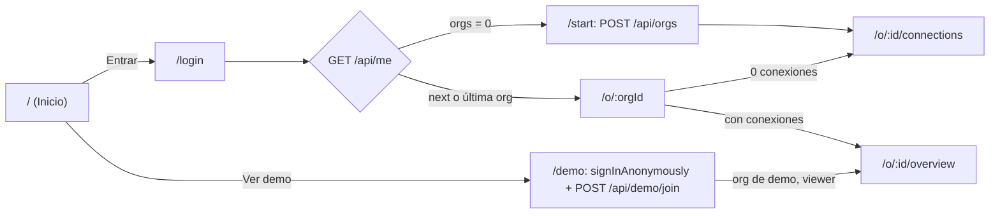
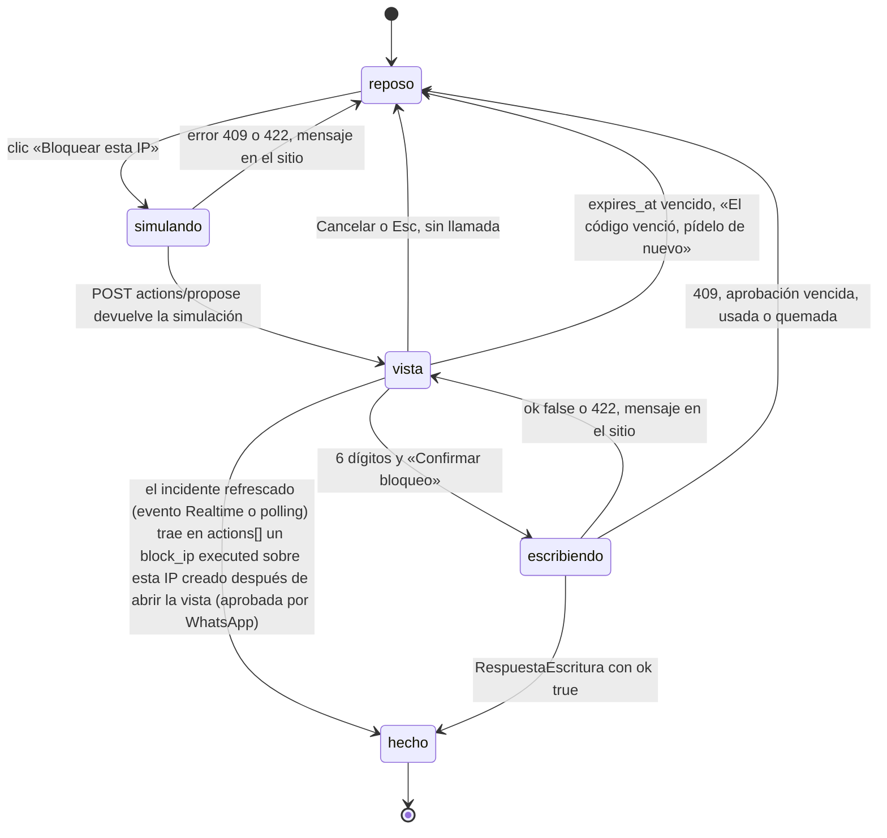

## 14. Especificación para el chat FRONT

> **Para quién:** chat FRONT, sub-chat de Giovanni en el mismo proyecto y la **misma carpeta local** que BACK y ORQUESTADOR (el ORQUESTADOR le manda las asignaciones; no se delega a otra persona). Dueño de `apps/web`. Con esta sección y la §15 (contrato API) se construye todo el frontend sin preguntar. Las reglas de convivencia en esa carpeta compartida están en L11 y §14.22.
> **Manda:** `decisiones/00-decisiones-canonicas.md` («Canon»). Si algo de aquí choca con el Canon o con `packages/contracts`, gana el Canon / el contrato y se avisa al ORQUESTADOR.
> **Prioridades:** P0 = listo el sábado 20:00 (la demo lo necesita) · P1 = domingo 10:00 · P2 = hoja de ruta, no construir. **Dueños:** FRONT · BACK · ORQUESTADOR.
> **Marcas:** `[verificado: URL]` comprobado hoy · `[no verificado]` comprobar antes de depender de ello · `[propuesta]` decisión nuestra.
> **Nota de nombres:** el encargo habla de «App Router». No hay Next.js (Canon §3 lo prohíbe: bugs de `proxy.ts` en OpenNext). Aquí «rutas» = tabla de rutas de **react-router 7.18.4** en modo *data router*, servida como SPA por el Worker `vanguard` en `https://officialvanguard.com`.

### 14.1 Leyes del FRONT (se copian al prompt del chat FRONT)

| # | Ley | Origen |
|---|---|---|
| L1 | **La API decide, la UI pinta.** Filas, roles de color, verbos, cifras, puntaje y simulaciones llegan hechos del servidor. El FRONT nunca recuenta hallazgos, nunca calcula el puntaje y nunca arma SQL ni llama a APIs de Supabase/Cloudflare/GitHub desde el navegador | R08 R8, Canon §7 |
| L2 | **Datos solo por `/api/*`** (mismo origen, sin CORS). `supabase-js` se usa únicamente para Auth y Realtime (P0 desde A7.5: solo invalida claves y no gasta peticiones del Worker). Aunque RLS permitiría leer tablas con la publishable key (S04), el FRONT no lo hace: una sola fuente, validada con zod | Canon §4, §7 |
| L3 | **Cinco roles de color y nada más:** `mal`, `aviso`, `cola`, `bien`, `neutra` (+ `info` para la acción principal). El rojo **nunca** es relleno sólido (tinte 10 % + texto rojo). **Rojo o ámbar solo con una acción al lado**; sin acción se pinta neutro | R08 R1–R3 |
| L4 | **Tres «nada» distintos:** sin dato/cargando = «—» terciario; cero problemas = «0 ✓» neutro; **verde solo lo comprobado** (`CheckDato.comprobado`, conexión probada, cobertura completa) | R08 R4 |
| L5 | **Un solo botón sólido de marca por vista** («Auditar todo» en Resumen y Auditoría). El resto: `principal` (tinte info), `secundaria`, `peligro` (tinte rojo) | R08 R5 |
| L6 | **Sin modales de confirmación:** la confirmación ocurre en el sitio del botón, con simulación del servidor cuando escribe en un proveedor. El resultado aparece en el mismo sitio («Bloqueada · 21:41»), no en un toast. «Deshacer» siempre visible tras bloquear (Canon §10.5 manda sobre R08 R6) | R08 R6–R7, Canon §10.5 |
| L7 | **Nada se mueve bajo el ojo:** cifras de alto fijo, «—» mientras carga, sin skeletons que cambien de alto, sin spinner de página | R08 R11, §5 |
| L8 | **Botones grandes:** acciones de primer nivel ≥ 56 px de alto (`h-14`); `BotonGrande` 64 px; acciones de fila 44 px. Guía en lenguaje llano en cada módulo | Canon §13 «Hecho cuando», encargo |
| L9 | **Todo texto que venga de evidencia, logs, repos, UA o del modelo es dato no confiable:** se pinta como texto (`{valor}` de React o `<pre>`), **nunca** con `dangerouslySetInnerHTML` ni renderizador de Markdown | Canon §8 defensas, S06 |
| L10 | **Ningún secreto en el navegador más allá de lo imprescindible:** el token pegado vive solo en el estado del formulario (`type="password"`, `autoComplete="off"`, `spellCheck={false}`, nunca prellenado) y se borra al enviar (éxito o error); nunca va a `localStorage`/`sessionStorage`, a la URL, a una clave de TanStack Query, a `console.*` ni a un error reportado. La UI solo ve `••••last4` | Canon §10.1, S05, S06 |
| L11 | **Convivencia en la carpeta compartida:** commit directo en `main` con `git add apps/web` y `git commit -m "…" -- apps/web` (más `pnpm-lock.yaml` solo si el FRONT cambió dependencias); **nunca** `git add -A` ni `git add .`; nunca `git push` (lo hace Giovanni y cada push **despliega a producción**); nunca leer `.env`, `.env.*.local` ni `.dev.vars` (lo leído viaja al modelo): solo `.env.example`. Detalle en §14.22 | Alineación A4, A6 |

### 14.2 Stack, dependencias y arranque (P0 · FRONT)

Versiones exactas, sin `^` (Canon §3). Las del Canon están verificadas en el registro de npm por R16/R17; las marcadas «hoy» las consulté con `curl https://registry.npmjs.org/-/package/<p>/dist-tags` [verificado: https://registry.npmjs.org, 24-oct-2026].

| Paquete | Versión | Nota |
|---|---|---|
| `vite` · `@vitejs/plugin-react` | 8.3.5 · 6.1.2 | Vite 8 usa rolldown + lightningcss (addons `.node`), no esbuild (Canon §3) |
| `react` · `react-dom` | 19.3.1 | |
| `react-router` | 7.18.4 | **No** la 8.5.0 (`latest` hoy). Exporta `.` y `./dom` [verificado hoy: campo `exports` del paquete] |
| `@tanstack/react-query` | 5.104.5 | `latest` hoy |
| `tailwindcss` · `@tailwindcss/vite` | 4.3.3 | |
| `shadcn` (CLI) | 4.22.1 | **solo** `pnpm dlx shadcn@4.22.1 …`, nunca en `package.json` |
| `recharts` | 3.10.1 | la instala `shadcn add chart`; fijarla |
| `@supabase/supabase-js` | 2.118.0 | `latest` hoy |
| `zod` | 4.6.7 | también dependencia directa de `apps/web` (tipos en `api.ts`); misma versión que `@vanguard/contracts` (`"workspace:*"`) |
| `typescript` · `vitest` | 6.0.3 · 4.1.12 | devDependencies de `apps/web` con la misma versión que la raíz (S03 §03.2) |
| `@types/react` · `@types/react-dom` | 19.3.0 · 19.3.0 | devDependencies [verificado hoy: dist-tags `latest`] |
| `lucide-react` | 1.61.0 | `latest` hoy (la trae `shadcn init`; fijarla). Todos los iconos citados en esta sección existen en 1.61.0 [verificado hoy: `dist/lucide-react.d.ts` de unpkg] |
| `@fontsource-variable/geist` · `…/geist-mono` | 5.3.0 · 5.3.0 | Fuentes **autoalojadas** (la CSP no deja cargar Google Fonts). Familias `'Geist Variable'` y `'Geist Mono Variable'` [verificado hoy: `index.css` del paquete en unpkg] |
| `class-variance-authority` · `clsx` · `tailwind-merge` · `tw-animate-css` · `radix-ui` | 0.7.1 · 2.1.1 · 3.7.0 · 1.4.0 · 1.8.1 | `latest` hoy [verificado: registro npm]; las añade `shadcn init/add` (conjunto exacto [no verificado], S03 §03.2) |
| `fflate` | 0.8.3 | P1 (F-18, el ZIP se abre en el navegador, A7.1). JS puro: sin `dependencies` ni `optionalDependencies`, sin `bin` ni scripts de instalación (solo `prepack`, que corre al publicar), 17 archivos; no trae `.exe` [verificado hoy: `curl https://registry.npmjs.org/fflate/0.8.3`, `latest` = 0.8.3]. Lo usa `leerZip` de `@vanguard/core` (D1, S15 E23), que se importa solo desde el *worker* del ZIP (§14.12), así que no entra en el bundle de la portada |

**Prohibido en `apps/web/package.json`:** `wrangler`, `@cloudflare/vite-plugin`, `miniflare`, `agents`, `next`, `@supabase/ssr`, `@vanguard/core` con **una sola excepción** (D1, S15 E23): `codebase/zip.worker.ts` importa `leerZip`, `scanFiles`, los lectores de lockfiles y `redact()` para el ZIP (P1); el resto del FRONT no importa nada de `core` para no arrastrar código de servidor, y `scripts/lint-imports.mjs` solo admite ese archivo (O-04) (el Canon solo prohíbe `crypto`), cualquier SDK de proveedor (Cloudflare, Octokit, Anthropic), librerías de Markdown/HTML (`marked`, `react-markdown`, `dompurify`), MSW y toasts como canal principal.

**Arranque (F-01, 08:00–09:00):**

**Hecho (sáb 03:45–03:56):** la raíz del monorepo ya existe (`package.json` con `packageManager: pnpm@10.34.7` y el script `dev:web`, `pnpm-workspace.yaml` con `apps/*` y `packages/*` y `saveExact: true`, `.npmrc` con `save-exact=true`, `tsconfig.base.json`, `pnpm-lock.yaml`); `pnpm install --frozen-lockfile` instala sin ningún `.exe` y `vitest run` corre en este equipo (Norton deja cargar el `.node` de Rolldown). Falta solo `apps/web`.

```powershell
# 1) dependencias de apps/web (versiones exactas de la tabla) y lockfile ANTES de bajar nada
pnpm install --lockfile-only               # en la raíz; regenera pnpm-lock.yaml sin descargar binarios
Select-String -Path pnpm-lock.yaml -Pattern 'esbuild@|@esbuild/win32|workerd@|wrangler@|miniflare@'   # debe salir vacío (Norton, A6)
pnpm install --frozen-lockfile             # baja solo addons .node: rolldown, lightningcss y @tailwindcss/oxide-win32-x64-msvc
# 2) uso diario
pnpm --filter @vanguard/web dev            # = pnpm dev:web en la raíz. Vite en http://localhost:5173 con proxy a :8787
pnpm --filter @vanguard/web dev:fixtures   # sin BACK: vite --mode fixtures (env.ts activa los fixtures por MODE, sin archivo .env)
pnpm --filter @vanguard/web build          # lints + tsc --noEmit + vite build → apps/web/dist (lo sirve el Worker; es también el build command de Workers Builds, §14.22)
pnpm dlx shadcn@4.22.1 init                # una vez, dentro de apps/web; con save-exact no debería escribir ^ [no verificado]: revisar package.json igual
pnpm dlx shadcn@4.22.1 add sidebar chart button card badge sheet tooltip collapsible accordion toggle-group input label textarea table alert separator dropdown-menu command kbd spinner empty item field tabs switch progress select
```

Si un nombre de `shadcn add` no existe en 4.22.1, se quita de la lista y se usa el elemento HTML equivalente (no se busca otra librería). `Sidebar`, `Chart`, `Spinner`, `Empty` e `Item` existen [verificado: https://ui.shadcn.com/docs/components, vía R08]. S03 §03.2 lista además `dialog`, `sonner` y `skeleton`: el FRONT **no** los añade (L6 sin modales de confirmación, L7 sin skeletons, toasts fuera como canal principal); `progress` y `select` sí, porque los usan §14.13 y §14.14. **Norton (estado real, A6):** no bloquea los MCP ni el `.node` de Rolldown (probado con `vitest run`, sáb 03:56); sí bloquea `.exe` nuevos sin firma. El árbol directo del FRONT no trae `.exe`: Vite 8.3.5 depende de `rolldown` y `lightningcss` y deja `esbuild` como *peer* opcional; `@tailwindcss/vite` 4.3.3 trae `@tailwindcss/oxide` con su `oxide-win32-x64-msvc` (addon `.node`); `@vitejs/plugin-react` 6.1.2 solo trae `@rolldown/pluginutils`; `shadcn` 4.22.1 no depende de `esbuild` [verificado hoy: registro npm, campos `dependencies`/`optionalDependencies`; transitivos no revisados uno a uno]. Comprobación tras instalar: `Get-ChildItem node_modules\.pnpm -Recurse -Filter *.exe` = 0. Lo que queda por probar es que Norton deje cargar `lightningcss` y `oxide` (el humo de F-01 con `vite dev`); si alerta: parar y avisar al ORQUESTADOR; plan B: compila Workers Builds (Linux) y el FRONT revisa en `https://officialvanguard.com` tras cada push de Giovanni (más lento: un push por iteración). **Ningún agente toca Norton**.

`apps/web/package.json` (scripts): `"dev": "vite"`, `"dev:fixtures": "vite --mode fixtures"`, `"build": "node scripts/lint-seguridad.mjs && node ../../scripts/lint-imports.mjs && tsc --noEmit -p . && vite build"` (los dos lints van **dentro** del build para que Workers Builds no despliegue si fallan; `lint-imports.mjs` ya existe en la raíz y usa `import.meta.dirname`, así que funciona desde `apps/web`), `"typecheck": "tsc --noEmit -p ."`, `"test": "vitest run"`, `"lint:seguridad": "node scripts/lint-seguridad.mjs"`, `"preview": "vite preview"`. Nombre del paquete: `@vanguard/web`, con `"type": "module"` y `"private": true` (S03).

**`apps/web/vite.config.ts`** (proxy de Canon §4 y CSP generada en el build):

```ts
import { defineConfig, loadEnv, type Plugin } from 'vite';
import react from '@vitejs/plugin-react';
import tailwindcss from '@tailwindcss/vite';
import { fileURLToPath, URL } from 'node:url';

// Escribe dist/_headers con la CSP. El connect-src sale de VITE_SUPABASE_URL (Auth + Realtime).
function cabecerasSeguridad(supabaseUrl: string): Plugin {
  return {
    name: 'vg-headers', apply: 'build',
    generateBundle() {
      const sb = new URL(supabaseUrl).host;
      const csp = [
        "default-src 'self'", "script-src 'self'", "style-src 'self' 'unsafe-inline'", // Recharts y shadcn Chart usan estilos en línea
        "img-src 'self' data: blob:", "font-src 'self'",
        `connect-src 'self' https://${sb} wss://${sb}`,
        "frame-ancestors 'none'", "base-uri 'self'", "form-action 'self'", "object-src 'none'",
      ].join('; ');
      // Cache-Control solo en bloques que no se solapan: si dos reglas ponen la misma cabecera, Cloudflare las une con coma.
      const source = [
        '/*', `  Content-Security-Policy: ${csp}`, '  X-Content-Type-Options: nosniff',
        '  Referrer-Policy: strict-origin-when-cross-origin', '  X-Frame-Options: DENY',
        '  Cross-Origin-Opener-Policy: same-origin',                                      // pedido por S06 §06.11
        '  Permissions-Policy: camera=(), microphone=(), geolocation=(), payment=()',
        '/', '  Cache-Control: no-cache', '/index.html', '  Cache-Control: no-cache',          // cada deploy se ve al momento (S06)
        '/assets/*', '  Cache-Control: public, max-age=31536000, immutable', '',
      ].join('\n');
      this.emitFile({ type: 'asset', fileName: '_headers', source });
    },
  };
}

export default defineConfig(({ mode }) => {
  // Vite NO carga los .env en process.env mientras evalúa la config: todo sale de loadEnv (S03 §03.7).
  const env = loadEnv(mode, process.cwd(), 'VITE_');
  const fixtures = mode === 'fixtures' || env.VITE_USE_FIXTURES === '1';
  if (mode === 'production' && !fixtures && !env.VITE_SUPABASE_URL) throw new Error('Falta VITE_SUPABASE_URL');
  const api = env.VITE_API_PROXY || 'http://localhost:8787';           // o https://officialvanguard.com (BACK desplegado; sin previews por PR)
  // Workers Builds inyecta WORKERS_CI_COMMIT_SHA en el build (A2); no es VITE_* ni secreto: solo identifica la versión publicada.
  const commit = (process.env.WORKERS_CI_COMMIT_SHA ?? 'local').slice(0, 7);
  return {
    define: { __VG_COMMIT__: JSON.stringify(commit) },                 // declarado en src/vite-env.d.ts; lo pinta el pie de la portada (§14.22)
    plugins: [react(), tailwindcss(), cabecerasSeguridad(env.VITE_SUPABASE_URL || 'https://invalid.supabase.co')],
    resolve: { alias: { '@': fileURLToPath(new URL('./src', import.meta.url)) } },
    server: { port: 5173, proxy: Object.fromEntries(['/api', '/ingest', '/mcp'].map((p) => [p, { target: api, changeOrigin: true }])) },
    build: { outDir: 'dist', sourcemap: true },
  };
});
```

- `_headers` en la carpeta de assets se aplica a las respuestas **estáticas**; **no** a lo que genera el Worker (`/api/*`, que pone sus cabeceras el BACK). Máximo 100 reglas y 2.000 caracteres por línea [verificado: https://developers.cloudflare.com/workers/static-assets/headers/]. Que también se aplique al `index.html` servido por el *fallback* SPA [no verificado: la página no lo dice] → comprobar con `curl -I https://officialvanguard.com/o/x/overview` tras el primer deploy (F-02). Que `emitFile` funcione en `generateBundle` bajo rolldown [no verificado]: plan B, escribir `dist/_headers` con `fs.writeFileSync` en `closeBundle`. Que las reglas `/` y `/index.html` cubran también los deep links servidos por el fallback SPA [no verificado]: si no, no pasa nada grave (Cloudflare sirve los assets con revalidación por defecto [no verificado]). La CSP la aprobó S06 §06.11 con estos tres cambios (COOP, `no-cache` del HTML y, en P1 con Turnstile, `https://challenges.cloudflare.com` en `script-src` y `frame-src`); HSTS lo pone la zona (Canon §4 paso 5), no este archivo.
- `tsconfig.json` de `apps/web`: extiende `../../tsconfig.base.json` (que ya trae `strict`, `noEmit`, `moduleResolution: "Bundler"`, `noUncheckedIndexedAccess`, `verbatimModuleSyntax`, `erasableSyntaxOnly` y `allowImportingTsExtensions`, necesario porque `@vanguard/contracts` se importa como fuente TS con imports `.ts`, S03 §03.2) y añade `"lib": ["ES2023", "DOM", "DOM.Iterable"]`, `"jsx": "react-jsx"`, `"paths": {"@/*": ["./src/*"]}`, `"types": ["vite/client"]`, `"include": ["src"]` (`vite.config.ts` queda fuera del `tsc` del paquete: así no hace falta `@types/node` en `apps/web`). Con `noUncheckedIndexedAccess`, todo `arr[i]` es `T | undefined`: los fragmentos de esta sección ya lo tienen en cuenta.
- **Variables** (Canon §14, catálogo de S03 §03.6): `VITE_SUPABASE_URL`, `VITE_SUPABASE_PUBLISHABLE_KEY` (públicas por diseño: la publishable aplica RLS; nunca un `sb_secret_`). **En producción son variables de BUILD de Workers Builds** (Settings → Build → Build Variables and Secrets del Worker `vanguard`), no de runtime: Vite las incrusta al compilar y `loadEnv` lee también las `VITE_*` del entorno del proceso. Cargadas en el panel por Giovanni según el ORQUESTADOR; se comprueba en el primer build con `apps/web` (F-02): si faltan, el `throw` de `vite.config.ts` tumba el build y no se despliega nada. **En local**, de `apps/web/.env.development.local` (nombre único en todo el plan, igual que S03 §03.6: Vite solo lo carga en desarrollo, nunca en `vite build`), ignorado por la regla `.env.*` del `.gitignore`, apuntando al único proyecto Supabase `accshmgmfrqrxubpuxcl` (en el hackatón dev y prod son el mismo, A3). Ese archivo lo llena Giovanni copiando su bloque del `.env` de la raíz; **el chat FRONT no lo lee ni lo escribe** (L11). `VITE_USE_FIXTURES` (ausente o `0` en Workers Builds). `VITE_API_PROXY` solo la lee `vite.config.ts` en desarrollo; no se hornea. Ninguna otra `VITE_*`. **No** hay `.env.fixtures` versionado (lo bloquearía el `.gitignore` de S03/S06): `lib/env.ts` exporta `USA_FIXTURES = import.meta.env.MODE === 'fixtures' || import.meta.env.VITE_USE_FIXTURES === '1'`.

### 14.3 Estructura de `apps/web` (dueño único: FRONT)

```
apps/web/
  index.html            <html lang="es" class="dark">, <title>VanGUARD</title>, <meta name="description"> con MARCA.oneliner (S01 V-04),
                        <script src="/tema.js"></script> en <head> (sin JS en línea: la CSP lo bloquea)
  public/               tema.js (lee localStorage 'vg-tema' y pone/quita .dark antes del primer pintado) · logo.png (cuando exista el logo de VanGUARD, S01 V-11; hasta entonces marca tipográfica, O-03) · favicon
                        · .well-known/security.txt (P1, texto exacto en S06 §06.11)
                        · llms.txt (P0 tardío, F-22; texto del ORQUESTADOR según S02 §02.5.3)
  scripts/              lint-seguridad.mjs (Node sin dependencias, §14.6)
  components.json       shadcn: aliases components=@/componentes, ui=@/componentes/ui, lib=@/lib, utils=@/lib/utils, hooks=@/lib/hooks
  src/
    main.tsx            QueryClientProvider + RouterProvider
    styles/globals.css  tokens §14.6
    app/                router.tsx · AppShell.tsx · guardas.tsx (RequireSession, RequireOrg) · ErrorRuta.tsx
                        paginas/{Inicio,Login,Demo,Callback,CrearOrg,NoEncontrada}.tsx
    modulos/            resumen/ conexiones/ supabase/ cloudflare/ codebase/ rendimiento/ auditoria/ incidentes/
                        hallazgos/ exportar/ ajustes/      (una carpeta por pantalla; Pagina*.tsx + piezas propias)
                        codebase/zip-local.ts · codebase/zip.worker.ts   (P1, F-18: el ZIP se abre en el navegador, §14.12)
    componentes/ui/     generados por shadcn (no se editan a mano salvo variantes)
    componentes/vg/     catálogo propio §14.7
    lib/                env.ts · marca.ts (bloque MARCA de S01 §01.1 copiado literal; dueño FRONT) · supabase.ts · api.ts
                        · errores.ts (clase ApiError + tabla de §14.8) · consultas.ts
                        mutaciones.ts · realtime.ts (P0, A7.5) · formato.ts · severidad.ts · pre-guardas.ts · nav.ts · guias.ts
                        reglas-texto.ts · contraste.ts · utils.ts · hooks/ · fixtures/router.ts
    **/*.test.ts        Vitest: formato, contraste, pre-guardas, severidad, derivación de pasos y de línea de tiempo
```

### 14.4 Rutas y guardas (react-router 7.18.4, P0 · FRONT)

`createBrowserRouter` se importa de `react-router` y `RouterProvider` de `react-router/dom`; el router se crea **una vez fuera del árbol de React** [verificado: https://reactrouter.com/start/data/installation (doc de la 8.5; el subpath `./dom` existe en 7.18.4 según su `package.json`)]. El Worker sirve `index.html` para cualquier ruta desconocida (`not_found_handling: "single-page-application"`, Canon §4), así que todo deep link responde 200.

| Ruta | Archivo | Acceso | Datos (§15) | Prio |
|---|---|---|---|---|
| `/` | `app/paginas/Inicio.tsx` | público | ninguno (no depende de la API: si la API cae, la portada sigue en 200) | P0 |
| `/login` | `app/paginas/Login.tsx` | público | Supabase Auth correo + contraseña (entrar / crear cuenta) | P0 |
| `/demo` | `app/paginas/Demo.tsx` | público | `signInAnonymously()` (si no hay sesión) → `POST /api/demo/join` → refrescar `['me']` → `/o/:org_id/overview` | P0 |
| `/auth/callback` | `app/paginas/Callback.tsx` | público | login con GitHub: con `detectSessionInUrl: true` y PKCE, supabase-js canjea el `?code=` **solo** al iniciar; la página espera `await supabase.auth.getSession()` y aplica el aterrizaje (no llamar a `exchangeCodeForSession` a mano: el verificador ya se habría consumido) | P1 |
| `/start` | `app/paginas/CrearOrg.tsx` | sesión, no anónima | `POST /api/orgs {name}` → `/o/:id/connections` | P0 |
| `/o/:orgId` | redirección | miembro | `GET connections`: 0 activas → `connections`, si no → `overview` | P0 |
| `/o/:orgId/overview` | `modulos/resumen/PaginaResumen.tsx` | miembro | `overview`, `connections`, `modules/*/state` | P0 |
| `/o/:orgId/connections` | `modulos/conexiones/PaginaConexiones.tsx` | miembro | `connections` | P0 |
| `/o/:orgId/connections/:provider` | `modulos/conexiones/Asistente.tsx` (`supabase\|cloudflare\|github\|ingest`) | miembro; enviar solo admin | `POST connections` | P0 |
| `/o/:orgId/supabase` · `/cloudflare` · `/codebase` | `modulos/<id>/Pagina*.tsx` sobre `PantallaModulo` | miembro | `modules/:module/state` (+ `traffic` en Cloudflare) | P0 |
| `/o/:orgId/performance` | `modulos/rendimiento/PaginaRendimiento.tsx` | miembro | `modules/performance/state` · `perf/runs` (P1) | P0 / P1 |
| `/o/:orgId/audit` · `/o/:orgId/audit/:scanId` | `modulos/auditoria/PaginaAuditoria.tsx` | miembro; lanzar solo admin | `POST scans`, `GET scans/:id`, `findings` | P0 |
| `/o/:orgId/findings/:findingId` | `modulos/hallazgos/PaginaHallazgo.tsx` (mismo `DetalleHallazgo` a ancho completo) | miembro | `findings` | P0 |
| `/o/:orgId/incidents` · `/o/:orgId/incidents/:incidentId` | `modulos/incidentes/*` | miembro; actuar solo admin | `incidents`, `incidents/:id`, `traffic`, acciones | P0 |
| `/o/:orgId/export` | `modulos/exportar/PaginaExportar.tsx` | miembro; tokens MCP solo admin | `export`, `mcp-tokens` (P1) | P0 / P1 |
| `/o/:orgId/settings` | `modulos/ajustes/PaginaAjustes.tsx` | miembro; contactos **solo admin** (E26: el viewer no ve teléfonos) | `contacts` (admin), `notifications/test`, `overview.ai` / `ai/usage` (P1) | P0 |
| `*` | `app/paginas/NoEncontrada.tsx` | público | — | P0 |

**Parámetros de URL (filtros como dato, R08 R14):** `?finding=<uuid>` abre el `PanelDetalle` del hallazgo sobre la página actual (Resumen, módulos, Auditoría); `?filtro=<texto>` filtra la bandeja del módulo (lo produce `Destino.filtro` cuando es `string`; si llega como objeto, se ignora); `#ahora` lleva a la bandeja; `?estado=open|all` en Incidentes (`all` = sin `status`: el BACK devuelve las últimas 24 h, E17). **Enlaces que otras secciones deben usar** (WhatsApp de S12, export de S13): `https://officialvanguard.com/o/<org_id>/incidents/<incident_id>` y `https://officialvanguard.com/o/<org_id>/findings/<finding_id>`.

**Guardas:** `RequireSession` (sin sesión → `/login?next=<ruta>`), `RequireOrg` (el `orgId` no está en `me.orgs` → `NoEncontrada` con «No tienes acceso a esta organización»; el BACK responde 404 igual, S15). Por eso toda acción que crea una membresía (`POST /api/orgs`, `POST /api/demo/join`) hace `await queryClient.refetchQueries({ queryKey: ['me'] })` **antes** de navegar a la org nueva; si no, `RequireOrg` la rechaza con el `me` viejo. El rol (`owner|admin|viewer`) sale de `me.orgs[i].role`; `puedeEscribir = role !== 'viewer' && !me.user.is_anonymous`. Los botones de escritura **se ven siempre** pero deshabilitados para el viewer, con ayuda «Modo demo: solo lectura» (los jueces deben ver qué existe). Cada ruta tiene `errorElement: <ErrorRuta/>` («Algo falló al pintar esta página · Recargar» + `request_id` si lo hay).



Tras el login: `next` si existe; si no, la última org usada (`localStorage['vg-ultima-org']`, comodidad por navegador) si sigue en `me.orgs`; si no, la primera org con `is_demo=false`; si no hay, `/start`.

### 14.5 Cascarón (`app/AppShell.tsx`, P0 · FRONT)

shadcn `SidebarProvider` + `Sidebar collapsible="icon"` + `SidebarInset`; atajo Ctrl+B y versión `Sheet` en móvil vienen de serie [verificado: https://ui.shadcn.com/docs/components/sidebar]. Ancho `--sidebar-width: 15rem`. El riel **no se reordena por gravedad** (R08 R9).

```ts
// lib/nav.ts — orden fijo del riel. id = segmento de ruta; nombre y descripción en español (descripción = guía en una línea)
import { Activity, Database, Cloud, GitBranch, Gauge, ShieldCheck, Siren, Share2, KeyRound, Settings } from 'lucide-react';
export const NAV = [
  { id: 'overview',    nombre: 'Resumen',        icono: Activity,    grupo: 'portada',    descripcion: 'Lo que está mal ahora en todo tu ecosistema y tu puntaje de blindaje.' },
  { id: 'supabase',    nombre: 'Supabase',       icono: Database,    grupo: 'ecosistema', modulo: 'supabase',    proveedor: 'supabase',   descripcion: 'Salud de tu base, tablas sin RLS, políticas abiertas y funciones sin freno.' },
  { id: 'cloudflare',  nombre: 'Cloudflare',     icono: Cloud,       grupo: 'ecosistema', modulo: 'cloudflare',  proveedor: 'cloudflare', descripcion: 'Quién te está atacando: IPs y user agents insistentes, escaneos y picos.' },
  { id: 'codebase',    nombre: 'Codebase',       icono: GitBranch,   grupo: 'ecosistema', modulo: 'codebase',    proveedor: 'github',     descripcion: 'Tu repo: .env subido, claves en tu configuración y dependencias con CVE.' },
  { id: 'performance', nombre: 'Rendimiento',    icono: Gauge,       grupo: 'ecosistema', modulo: 'performance', proveedor: null,         descripcion: 'Lighthouse de tu web, comparado con la medición anterior.' },
  { id: 'audit',       nombre: 'Auditoría',      icono: ShieldCheck, grupo: 'respuesta',  descripcion: 'Revisa todo el ecosistema con un botón.' },
  { id: 'incidents',   nombre: 'Incidentes',     icono: Siren,       grupo: 'respuesta',  descripcion: 'Ataques en vivo: aviso por WhatsApp y bloqueo de la IP aprobado desde el mismo mensaje.' },
  { id: 'export',      nombre: 'Llevar a tu IA', icono: Share2,      grupo: 'respuesta',  descripcion: 'Exporta hallazgos y prompts para cualquier IA, o conéctala por MCP.' },
  { id: 'connections', nombre: 'Conexiones',     icono: KeyRound,    grupo: 'pie',        descripcion: 'Tus tokens de solo lectura y tu repo.' },
  { id: 'settings',    nombre: 'Ajustes',        icono: Settings,    grupo: 'pie',        descripcion: 'A quién avisamos, por qué canal y el estado de la IA.' },
] as const;
```

- **Riel:** logo + «VanGUARD» (GUARD en mayúsculas, siempre de `MARCA.nombre`) → selector de organización (`DropdownMenu` con `me.orgs`; la de demo con chapa «Demo») → Resumen → rótulo «Tu ecosistema» + 4 módulos → rótulo «Respuesta» + 3 → hueco → Conexiones, Ajustes → pie: «◷ 21:40» (hora del último `overview` bueno; roja si la última consulta falló) + correo del usuario (`me.user.email`; si es `null`, anónimo, «Invitado · demo») + chapa de rol.
- **Marcas del contador** (`MarcasContador`) en cada módulo: `EstadoModulo.contador` (`rojo` > 0 → píldora tinte rojo; `aviso + cola` > 0 → número ámbar; todo 0 → «0» terciario; `null` → «—»). Incidentes muestra `overview.open_incidents` (rojo si > 0). Conexiones muestra «1» rojo si no hay ninguna conexión activa (R08 R13).
- **Cabecera** (56 px, `sticky top-0`): `SidebarTrigger` · título de la vista · chapa «Demo · solo lectura» si viewer · chapa «IA en pausa» si `overview.ai?.enabled === false` (campo opcional de E5) o `ai/usage.enabled === false` (P1) o la última respuesta fue `ai_disabled`.
- **Fila de estado global** (una sola, bajo la cabecera, por prioridad): (1) hay un incidente `open` con `severity='critical'` en `overview.ahora` → franja tinte rojo «Incidente crítico en curso: {title} · Ver ahora» (enlace al incidente); (2) 2 fallos seguidos de `overview` → «Sin conexión con VanGUARD · Reintentar» (los datos viejos se quedan con su hora); (3) 0 conexiones → «Conecta tu primer servicio · Conectar». `role="status"` y `aria-live="polite"`.
- **Título de pestaña:** `({open_incidents}) VanGUARD · {vista}` cuando hay incidentes abiertos; si no, `VanGUARD · {vista}`.
- **Atajos:** Ctrl+B (riel), Esc (cierra detalle o cancela confirmación) en P0; `g` + letra (`g r` Resumen, `g s` Supabase, `g c` Cloudflare, `g o` Codebase, `g p` Rendimiento, `g a` Auditoría, `g i` Incidentes) y Ctrl+K (`Command`) en P1. No capturar F5, Ctrl+F ni Ctrl+1…9 (son del navegador, R08 §11).
- **Modo presentación** (P1): botón en Ajustes que pone `html { font-size: 112.5% }` para el proyector (todo está en `rem`).

### 14.6 Sistema de diseño (P0 · FRONT)

**Dirección:** sala de control sobria, **oscuro por defecto** (demo en proyector), claro disponible. Sin sombras, sin degradados, sin onda al pulsar (R08 §2.3). Neutros de KUADRA `ui2`; color de marca **violeta** (no comparte tono con ningún rol; el amarillo del logo de PH26 chocaría con `aviso`, R08 §2.2). Los colores de contenido de cada rol se **validan** con el test de contraste: si un par no llega, se cambia el hex en `globals.css`, nunca en el componente.

```css
/* src/styles/globals.css */
@import "tailwindcss";
@import "tw-animate-css";
@import "@fontsource-variable/geist";
@import "@fontsource-variable/geist-mono";
@custom-variant dark (&:is(.dark *));

:root {                                   /* claro */
  --radius: 0.75rem;
  --background:#EAE6DE; --foreground:#17181B; --card:#FFFFFF; --card-foreground:#17181B;
  --popover:#FFFFFF; --popover-foreground:#17181B; --muted:#DDD8CE; --muted-foreground:#54595F;
  --texto-3:#6B7078; --border:#CFC9BC; --input:#CFC9BC; --borde-fuerte:#938C7E;
  --mal:#B91C1C; --aviso:#B45309; --bien:#15803D; --info:#1D4ED8;
  --marca:#7C3AED; --marca-texto:#FFFFFF;
}
.dark {                                   /* oscuro (por defecto) */
  --background:#0A0A0A; --foreground:#FFFFFF; --card:#232327; --card-foreground:#FFFFFF;
  --popover:#232327; --popover-foreground:#FFFFFF; --muted:#303036; --muted-foreground:#A8AEB9;
  --texto-3:#7C828C; --border:#3C3C43; --input:#3C3C43; --borde-fuerte:#5E5E69;
  --mal:#FF6F8E; --aviso:#F59E0B; --bien:#4ADE80; --info:#60A5FA;
  --marca:#A78BFA; --marca-texto:#0A0A0A;
}
:root, .dark {
  --primary:var(--info); --primary-foreground:var(--card); --ring:var(--info); --destructive:var(--mal);
  --mal-relleno:color-mix(in srgb, var(--mal) 10%, var(--card));     --mal-borde:color-mix(in srgb, var(--mal) 45%, var(--card));
  --aviso-relleno:color-mix(in srgb, var(--aviso) 10%, var(--card)); --aviso-borde:color-mix(in srgb, var(--aviso) 45%, var(--card));
  --bien-relleno:color-mix(in srgb, var(--bien) 10%, var(--card));   --info-relleno:color-mix(in srgb, var(--info) 10%, var(--card));
  --sidebar:var(--background); --sidebar-foreground:var(--foreground); --sidebar-primary:var(--info);
  --sidebar-primary-foreground:var(--card); --sidebar-accent:var(--info-relleno); --sidebar-accent-foreground:var(--info);
  --sidebar-border:var(--border); --sidebar-ring:var(--info);
  --chart-1:var(--muted-foreground); --chart-2:var(--aviso); --chart-3:var(--mal); --chart-4:var(--info); --chart-5:var(--bien);
}
@theme inline {
  /* una línea --color-X: var(--X) por cada token de arriba: background, foreground, card, card-foreground, popover,
     popover-foreground, muted, muted-foreground, border, input, ring, primary, primary-foreground, destructive, texto-3,
     borde-fuerte, mal, mal-relleno, mal-borde, aviso, aviso-relleno, aviso-borde, bien, bien-relleno, info, info-relleno,
     marca, marca-texto, sidebar-*, chart-1..5 */
  --color-background:var(--background); --color-foreground:var(--foreground); /* … resto igual … */
  --font-sans:"Geist Variable", system-ui, sans-serif; --font-mono:"Geist Mono Variable", ui-monospace, monospace;
}
@layer base {
  body { @apply bg-background text-foreground font-sans antialiased; }
  :focus-visible { outline: 2px solid var(--ring); outline-offset: 2px; }
}
@media (prefers-reduced-motion: reduce) { *, *::before, *::after { animation: none !important; transition: none !important; } }
```

- `color-mix()` [no verificado hoy en caniuse; R08 lo da por soportado en navegadores actuales; alternativa `bg-mal/10` sobre `bg-card`]. Familias `"Geist Variable"` y `"Geist Mono Variable"` [verificado hoy: CSS del paquete].
- **Lint de seguridad (P0 · FRONT):** `apps/web/scripts/lint-seguridad.mjs` (Node puro, sin dependencias, funciona igual en Windows que en Workers Builds; `grep -R` no existe en PowerShell) recorre `src/**/*.{ts,tsx}` y falla con la línea si encuentra: `/\bbg-(mal|aviso)(?![-\w\/])/` (rojo sólido; **no** casa `bg-mal-relleno` ni `bg-mal/10`, que sí se permiten), `dangerouslySetInnerHTML` (salvo en `src/componentes/ui/chart.tsx`, que genera `shadcn add chart` para su `ChartStyle`; S06 J06 lo acepta), `/(local|session)Storage\.setItem\([^)]*\b(token|pat|secret)/i` y `/console\.\w+\([^)]*\b(read_token|action_token|pat|ingest_secret)\b/`. Se corre con `pnpm --filter @vanguard/web lint:seguridad` y, además, es el primer paso del script `build` (§14.2): como Workers Builds ejecuta ese build en cada push, una violación **impide el despliegue** y sigue publicada la versión anterior (no hay `deploy.yml`, A2).
- **Test de contraste** (`lib/contraste.ts` + `.test.ts`): luminancia WCAG con canales linealizados (`v ≤ 0,03928 ? v/12,92 : ((v+0,055)/1,055)^2,4`); en cada tema, `mal`, `aviso`, `bien` e `info` ≥ 4,5:1 contra `background`, `card` y `muted`; `texto-3` y `borde-fuerte` ≥ 3:1 (R08 §2.5).

**Tipografía y medidas** (escala web de R08 §2.3):

| Uso | Clase | Uso | Clase |
|---|---|---|---|
| Número de cifra | `text-3xl font-semibold tabular-nums` | Fila | `text-[15px] tabular-nums` |
| Título de módulo | `text-[22px] font-semibold` | Botón / sub | `text-sm font-medium` |
| Sección | `text-[17px] font-semibold` | Chapa, eje, cabecera de tabla | `text-[12.5px] font-medium` |
| Puntaje y cronómetro | `text-6xl font-semibold font-mono tabular-nums` | IPs, rutas, CVE, `rule_id` | `font-mono text-[13px]` |
| Alto de cifra | `h-[104px]` fijo | Alto de fila de tabla | `h-12` |
| Botón de primer nivel | `h-14 px-5` (56 px) | Botón de fila | `h-11 px-4` (44 px) |
| `BotonGrande` | `min-h-16` (64 px), icono 24 | Radios | chapa `rounded-lg`, tarjeta `rounded-xl` |

**Severidad → rol, etiqueta e icono** (`lib/severidad.ts`; solo donde la API manda `severity` y no `rol`):

| `severity` | Etiqueta | Rol | Icono lucide |
|---|---|---|---|
| `critical` | Crítica | `mal` + borde `mal-borde` + negrita | `OctagonAlert` |
| `high` | Alta | `mal` | `TriangleAlert` |
| `medium` | Media | `aviso` | `CircleAlert` |
| `low` | Baja | `cola` (número ámbar sin tinte) | `Info` |
| `info` | Info | `neutra` | `Info` |

Hallazgo: `open` abierto · `fixed` corregido · `verified` verificado (el único `bien`) · `ignored` ignorado. Incidente: `open` abierto (`mal`) · `ack` confirmado (`aviso`) · `mitigated` mitigado (`bien`: el bloqueo está comprobado) · `resolved` resuelto (`neutra`). El color nunca es la única señal: siempre etiqueta + icono.

**Formato** (`lib/formato.ts`, port de KUADRA `ui2/formato.dart`, hora de Caracas UTC−4):

```ts
export const SIN_DATO = '—', SEP = ' · ';
export const miles = (n?: number | null) => n == null || !Number.isFinite(n) ? SIN_DATO
  : (n < 0 ? '-' : '') + Math.abs(Math.round(n)).toString().replace(/\B(?=(\d{3})+(?!\d))/g, '.');       // 9.000
export const decimal = (x?: number | null, d = 1) => {                                                   // 0,2
  if (x == null || !Number.isFinite(x)) return SIN_DATO;
  const [e, f] = Math.abs(x).toFixed(d).split('.'); return (x < 0 ? '-' : '') + miles(Number(e)) + (f ? ',' + f : '');
};
export const pct = (p?: number | null) => p == null ? SIN_DATO : `${miles(p)} %`;                       // 90 %
export const usd = (x?: number | null) => x == null ? SIN_DATO : `${decimal(x, 2)} USD`;               // 0,42 USD
export function duracion(ms?: number | null) {                                                         // 344 ms · 5,0 s · 2 min 4 s
  if (ms == null || !Number.isFinite(ms)) return SIN_DATO; if (ms < 1000) return `${miles(ms)} ms`;
  const s = ms / 1000; if (s < 60) return `${decimal(s)} s`;
  const t = Math.round(s), m = Math.floor(t / 60);                                                      // redondear antes: nunca «1 min 60 s»
  return m < 60 ? `${m} min ${t % 60} s` : `${Math.floor(m / 60)} h ${m % 60} min`;
}
export function bytes(b?: number | null) {                                                             // 512 B · 1,4 MB
  if (b == null || !Number.isFinite(b)) return SIN_DATO; const u = ['B', 'KB', 'MB', 'GB']; let i = 0, x = b;
  while (x >= 1024 && i < u.length - 1) { x /= 1024; i++; } return i === 0 ? `${miles(x)} B` : `${decimal(x)} ${u[i]}`;
}
// CifraDato.unidad → formato (lo usa <Cifra/>): '%' pct · 'ms' duracion · 'bytes' bytes · 'h' `${n} h` · 'd' `${n} d`;
// sin unidad: decimales != null ? decimal(n, decimales) : miles(n); con `de`: «6 de 6».
const hhmm = new Intl.DateTimeFormat('es-VE', { timeZone: 'America/Caracas', hour: '2-digit', minute: '2-digit', hour12: false });
const ddmm = new Intl.DateTimeFormat('es-VE', { timeZone: 'America/Caracas', day: '2-digit', month: '2-digit' });
export function cuando(t?: string | Date | null, ahora = new Date()) {                                 // 21:14 hoy · 24-10 22:35
  if (!t) return SIN_DATO; const d = typeof t === 'string' ? new Date(t) : t;
  return ddmm.format(d) === ddmm.format(ahora) ? hhmm.format(d) : `${ddmm.format(d).replace('/', '-')} ${hhmm.format(d)}`;
}
export const cronometro = (ms: number) => { const s = Math.max(0, Math.floor(ms / 1000));
  return `${String(Math.floor(s / 60)).padStart(2, '0')}:${String(s % 60).padStart(2, '0')}`; };      // 01:12
```

No usar `Intl.NumberFormat` para miles (con 4 cifras puede no agrupar según el locale [no verificado], R08 §2.4). `formato.test.ts`: `miles(9000)='9.000'`, `decimal(0.2)='0,2'`, `duracion(124000)='2 min 4 s'`, `duracion(119600)='2 min 0 s'`, `bytes(1468006)='1,4 MB'`, `cronometro(72000)='01:12'`.

**Accesibilidad (P0):** foco visible; `aria-label` en botones de solo icono; `aria-busy` en botones ocupados (sin `opacity-50`: ocupado ≠ deshabilitado); `aria-live="polite"` para «Nuevo incidente…» y el progreso de la auditoría; usable a 375 px (los jueces pueden abrirlo en el teléfono): el riel pasa a `Sheet` y las tablas, por debajo de `md`, a lista de tarjetas.

### 14.7 Catálogo de componentes propios (`src/componentes/vg/`)

Recorte de R08 §12 a lo que pide el Canon. Todo componente que pinta texto de la API lo hace como texto (L9).

| Prio | Componente | Base shadcn | Props | Comportamiento clave |
|---|---|---|---|---|
| P0 | `BotonAccion` | `Button` + `cva` | `variante: 'marca'\|'principal'\|'secundaria'\|'peligro'; tam: 'fila'\|'grande'; icono?; ocupado?; resultado?: {texto, rol}; ayuda?; onClick` | `marca` = `bg-marca text-marca-texto`; `principal` = `bg-info-relleno text-info border-info`; `peligro` = `bg-mal-relleno text-mal border-mal-borde`. Ocupado: `Spinner` 14 px delante, mismos colores. Tras actuar pinta `resultado` en su sitio |
| P0 | `BotonGrande` | `Item` o `Button asChild` | `titulo; descripcion; icono; estado?: {texto, rol}; ocupado?; deshabilitado?: string; onClick` | tarjeta-botón de 64 px: icono 24 en cuadrado `bg-info-relleno`, título 16/600, descripción 14, chevron. `deshabilitado` = motivo en la ayuda |
| P0 | `BotonCopiar` | `Button` | `valor: string; texto='Copiar'` | el texto ya está en memoria al pulsar (precargado con TanStack Query: un `await` largo antes de `writeText` puede perder el gesto del usuario, S13 §13.6); `navigator.clipboard.writeText`; «Copiado ✓» 2 s. Si lanza o el texto pasa de 150 KB: debajo, en el sitio (no modal), un `<textarea readonly>` ya seleccionado con «Pulsa Ctrl+C (Cmd+C en Mac)» |
| P0 | `ConfirmarEnSitio` | — | `verbo; aviso?; motivo?: {min, max}; onConfirmar(motivo?): Promise<void>` | `[Quitar]` → `[aviso] [motivo?] [Cancelar] [Quitar (peligro)]` en la misma línea; Esc cancela |
| P0 | `ConfirmarConVista` | — | `verbo; simular(): Promise<ProposeResponse>; confirmar(codigo): Promise<RespuestaEscritura>; aprobadaFuera(): boolean` | máquina de §14.16 |
| P0 | `Etiqueta` · `ChapaSeveridad` · `ChapaModulo` | `Badge` | `texto; rol?; icono?; mono?` · `severity` · `module` | chapa 24 px con tinte del rol |
| P0 | `MarcasContador` | `Badge` | `contador: Contador \| null; grande?` | `aria-label` «Rojo 3 · Ámbar 4» |
| P0 | `PuntoEstado` | — | `rol; hueco?; girando?` | 8 px; hueco = pendiente o sin mirar |
| P0 | `Cifra` · `FilaCifras` | `Card` | `CifraDato` · `cifras: CifraDato[]` | alto fijo; `n=null` → «—» neutra; formato por `unidad`/`decimales`/`de` (§14.6, `lib/formato.ts`); `sub` en terciario; clic → `destino`; `grid-cols-[repeat(auto-fit,minmax(160px,1fr))] gap-3` |
| P0 | `BarraSegmentada` | — | `tramos: {etiqueta, n, rol}[]` | barra de 8 px + leyenda «Crítica 2 · Alta 3» (tramo rojo con `mal-borde`) |
| P0 | `PantallaModulo` · `BarraModulo` · `BotonActualizar` | — | §14.12 | ⟳ + hora del dato; si falla, «Reintentar» en tinte rojo |
| P0 | `Seccion` · `SectorPlegable` | `Collapsible` | `id; titulo; icono; n?; defaultOpen?; children` | cabecera `sticky`; plegado no renderiza el cuerpo |
| P0 | `Bandeja` · `FilaProblema` · `AccionFila` | — | `grupos: GrupoDato[] \| null; puedeEscribir` · `fila` · `fila, accion` | §14.12 |
| P0 | `ChecksEnCero` · `RejillaEstado` | `Badge` | `checks: CheckDato[]` · `casillas: {rotulo, valor, rol?, mono?, sub?}[]` | verde con ✓ solo si `comprobado` |
| P0 | `PanelDetalle` | `aside` ≥ 1100 px / `Sheet side="right"` | `titulo; chapas; onCerrar; children` | 420 px; Esc cierra; la lista de detrás no se mueve |
| P0 | `FichaFila` | — | `valor: unknown` | JSON con sangría 2 en `<pre>`; `null` y `""` distintos en terciario; «Copiar» |
| P0 | `TablaFilas` | `Table` | `columnas: {titulo, ancho?, mono?, numerica?, celda(f)}[]; filas; onAbrir?` | filas `h-12`; en móvil, tarjetas |
| P0 | `PuntajeBlindaje` | `Card` | `score; band; coverage` | §14.11 |
| P0 | `GuiaPasos` · `FormToken` | — · `Field`, `Input type=password` | §14.10 | |
| P0 | `Vacio` · `ErrorBloque` | `Empty` · `Alert` | `icono; titulo; texto; accion?` · `error: ApiError; onReintentar?` | `Vacio` solo si el módulo no tiene conexión; `ErrorBloque` con `request_id` copiable |
| P0 | `GraficaTrafico` | `Chart` + `AreaChart` apilado | `buckets: {t, n, n4xx, n5xx}[]` | §14.16 |
| P0 | `Cronometro` · `LineaTiempo` | — | `desde; hasta?` · `hitos` | §14.16 |
| P0 | `PromptCorreccion` | — | `prompt: string; model; cached; flags: string[]; plantilla?: boolean` | §14.15 |
| P1 | `SerieViva` · `GraficaComparativa` | `Chart` + `LineChart` · `BarChart` | `valores` · `runs: PerfRun[]; metrica` | sin ejes, `connectNulls={false}` · §14.13 |
| P1 | `VistaDiferencias` | — | `lineas: {t:'igual'\|'mas'\|'menos', x}[]` | sin rojo ni verde: un diff no es un estado |

### 14.8 Cómo consume el contrato (P0 · FRONT)

**Tipos:** se importan de `@vanguard/contracts` (zod 4.6.7 + `type X = z.infer<typeof X>`; en `apps/web/package.json` como `"@vanguard/contracts": "workspace:*"`). **Hecho (sáb 03:45):** el contrato v0 ya existe en `packages/contracts/src/` (`comun.ts` enums, `Id`, `Ts`, `RuleId`, `ErrorCode` y el esquema `ApiError`; `api.ts` cuerpos y respuestas de §15.5; `estado.ts` `EstadoModulo` y sus piezas; `ingest.ts`; `realtime.ts` `RealtimeChange`; `index.ts` lo reexporta todo más `fixtures`), con `"exports": {".": "./src/index.ts"}` (se importa como fuente TS, sin build). Comprobado hoy: **todos** los nombres de la lista siguiente existen como `export const` en esos archivos. El FRONT **no** redefine tipos de la API. Nombres exactos de §15.5 que usa el FRONT: `Me`, `Org`, `OrgCreate`, `DemoJoin`, `Overview`, `AhoraItem`, `Coverage`, `EstadoModulo` (+ `Contador`, `CifraDato`, `GrupoDato`, `FilaDato`, `AccionDato`, `ClaseAccion`, `CheckDato`, `Destino`, `RolDato`), `ConnectionPublic`, `ConnectionCreate`, `ConnectionCreated`, `ConnectionTest`, `PermCheck`, `ScanCreate`, `ScanAccepted`, `ScanRun`, `ScanStep`, `AuditSummary`, `Finding`, `FindingPatch`, `FixPromptRequest`, `FixPromptResponse`, `Incident`, `IncidentDetail`, `NotificationPublic`, `ActionPublic`, `TimelineItem`, `MuteBody`, `Traffic`, `ProposeAction`, `ProposeResponse`, `ConfirmBody`, `RespuestaEscritura`, `ContactIn`, `ContactsPut`, `Contact`, `NotificationTest`, `NotificationTestResult`, `AiUsage`, `McpTokenCreate`, `McpTokenCreated`, `PerfRun`, `RealtimeChange`, los enums `Module`, `Severity`, `Provider`, `ConnectionKind`, `ConnectionStatus`, `ScanKind`, `ScanStatus`, `FindingStatus`, `IncidentStatus`, `Channel`, `NotificationStatus`, `ActionKind`, `ActionStatus`, `ErrorCode`, y P1 `McpTokenPublic` (está en `api.ts`, no en un `export.ts` aparte como suponía S13). El esquema de error se llama `ApiError` en §15.5 y choca con la clase del FRONT: se importa como `import { ApiError as ApiErrorBody } from '@vanguard/contracts'`.

Forma de `EstadoModulo` que pinta `PantallaModulo` (la autoridad es §15.5 `estado.ts`): `{ok, error?, hora, contador:{rojo, aviso, cola} (cada uno number|null), cifras: CifraDato[], ahora: GrupoDato[], checks: CheckDato[]}` con `CifraDato {tipo, etiqueta, n|null, de?, rol?, unidad?: '%'|'ms'|'bytes'|'h'|'d', decimales?, sub?, destino?}`, `GrupoDato {grupo, etiqueta, rol, n, orden?, chapas?, filas}`, `FilaDato {clave, modulo, tipo, rol, etiqueta (≤ 40), objeto?, chips?, sub?, fraccion? (0–1 → barra fina), severidad_cve? (→ ChapaSeveridad), acciones: AccionDato[]}`, `AccionDato {id?, verbo, clase, principal?, args?, destino?, copiar?, motivo?, simula?, efecto?, resultado?, n?}` y `Destino {modulo: string, filtro?: string | objeto, ancla?}` donde `modulo` es un `id` de `NAV` (o `incidents`/`findings`, §14.12). `ClaseAccion` admite además `inmediata` y `barra`: en P0 se pintan como botón deshabilitado «Acción no disponible». `FilaDato.tipo` es `z.string()` en el contrato; en los fixtures llegan `finding`, `incident`, `top_ip`, `top_ua` y `causa`. La fila de un incidente es **`incident`** (A9 unifica así el `incidente` de S08); el FRONT no decide nada por `tipo` (L1: lo que se puede hacer lo traen `acciones`) y solo lo usa en pruebas y para elegir icono.

**Cliente HTTP** (`lib/api.ts`): único punto de salida, rutas relativas al mismo origen.

```ts
import type { z } from 'zod';
import { supabase } from './supabase';
import { USA_FIXTURES } from './env';
import { ApiError } from './errores';   // class ApiError extends Error { constructor(public status: number, public code: string,
                                        //   message: string, public requestId?: string, public details?: Record<string, unknown>) }
type Opts<T> = { method?: 'GET' | 'POST' | 'PUT' | 'PATCH' | 'DELETE'; body?: unknown; esquema?: z.ZodType<T>; crudo?: boolean };
const aError = (status: number, b: any) =>
  new ApiError(status, b?.error?.code ?? 'internal', b?.error?.message ?? 'Algo falló', b?.error?.request_id, b?.error?.details);

async function pedir(ruta: string, o: Opts<unknown>): Promise<Response> {
  const { data } = await supabase.auth.getSession();     // en el navegador sí; getSession() solo está prohibido en el servidor
  const h: Record<string, string> = { accept: 'application/json' };
  if (data.session) h.authorization = `Bearer ${data.session.access_token}`;
  if (o.body !== undefined) h['content-type'] = 'application/json';
  try { return await fetch(ruta, { method: o.method ?? 'GET', headers: h, body: o.body === undefined ? undefined : JSON.stringify(o.body) }); }
  catch { throw new ApiError(0, 'network', 'Sin conexión con VanGUARD'); }
}

export async function api<T>(ruta: string, o: Opts<T> = {}): Promise<T> {
  if (USA_FIXTURES) {                                     // import dinámico: los fixtures no entran en el bundle de producción
    const { fixtureFetch } = await import('./fixtures/router');
    return fixtureFetch<T>(ruta, o);
  }
  let res = await pedir(ruta, o);
  if (res.status === 401) {                               // un solo reintento tras refrescar la sesión
    const { data } = await supabase.auth.refreshSession().catch(() => ({ data: { session: null } }));
    if (data.session) res = await pedir(ruta, o);
  }
  if (o.crudo) { if (!res.ok) throw aError(res.status, await res.json().catch(() => null)); return res as unknown as T; } // antes del 204: DELETE connections necesita leer X-VG-Revoke-Url
  if (res.status === 204) return undefined as T;
  const cuerpo = await res.json().catch(() => null);
  if (!res.ok) throw aError(res.status, cuerpo);
  if (!o.esquema) return cuerpo as T;
  const r = o.esquema.safeParse(cuerpo);
  if (r.success) return r.data;
  if (import.meta.env.DEV) throw new ApiError(200, 'contract_mismatch', `La respuesta de ${ruta} no cumple el contrato`);
  console.warn('contract_mismatch', ruta, r.error.issues.map((i) => i.path.join('.')));  // en producción no se deja la demo en blanco
  return cuerpo as T;
}
```

**Errores → UI** (`lib/errores.ts`; el `message` del servidor ya viene en español y se muestra tal cual; la tabla decide dónde y qué más):

| `code` (HTTP) | Qué hace la UI |
|---|---|
| `unauthorized` (401) | `api()` ya refrescó la sesión y reintentó una vez; un `QueryCache({ onError })` global comprueba `getSession()` y, si no queda sesión, hace `signOut()` y navega a `/login?next=` |
| `forbidden` (403) | mensaje en el sitio del botón; si es «Solo disponible en officialvanguard.com» (respaldo `*.workers.dev` y previews, §15.3), añade el enlace al dominio |
| `not_found` (404) | `NoEncontrada` dentro del cascarón |
| `conflict` (409) | el `message` en el sitio. Casos con trato propio: `POST scans` con `details.scan_run_id` (ya hay una del mismo tipo corriendo) → navega a `/audit/{scan_run_id}`; `POST connections` (ese token ya está conectado en la org); `actions/propose` sin conexión `action` → «Activa el Modo blindaje» con enlace al paso 4 del asistente de Cloudflare; `confirm` vencido o usado → vuelve a `reposo` (§14.16); `notifications/test` sin contacto → enlace a «Contactos» |
| `invalid_body` · `key_rejected` · `provider_rejected` (422) | bajo el campo: `details.field_errors[campo]`; `key_rejected` en rojo con el `message` (motivo en `details.reason`); `provider_rejected` lista `details.missing_permissions[]` como «Te falta: …»; `actions/propose` con `details.reason` → texto de §14.16 |
| `rate_limited` · `budget_exceeded` (429) | «Espera un minuto» · el `message` del servidor (el tope de auditorías es 3/día en una org normal y otro en la de demo, E11: el FRONT no escribe el número); si llega `details.fallback_prompt`, se muestra como «Plantilla (IA en pausa)» |
| `ai_disabled` (503) | chapa «IA en pausa · las alertas siguen funcionando»; ídem `fallback_prompt` |
| `provider_unavailable` (502) · `internal` (500) · `network` (0) | `ErrorBloque` con `request_id` y «Reintentar»; los datos viejos se quedan con su hora |

**Consultas** (`lib/consultas.ts`; TanStack Query v5 con `refetchIntervalInBackground: false` (con la pestaña oculta no hay polling), `placeholderData: keepPreviousData`, `retry: (n, e) => (e as ApiError).status >= 500 && n < 2`). **Intervalos de A7.5, que mandan sobre los 2–3 s del Canon §7:** Realtime es P0 y es la vía normal de frescura (el evento invalida la clave al momento); el polling es solo el respaldo y nunca baja de 10 s. Columna «Respaldo» = canal sin `SUBSCRIBED`; «Con Realtime» = canal conectado (el intervalo solo cubre un evento perdido). Cada hook elige la columna con el `vivo` que publica `suscribirOrg` (más abajo).

| Hook | Endpoint (§15) | `queryKey` | Respaldo (sin Realtime) | Con Realtime |
|---|---|---|---|---|
| `useMe` | `GET /api/me` | `['me']` | `staleTime` 60 s | — |
| `useOverview(org)` | `GET /api/orgs/:org/overview` | `['org',org,'overview']` | 10 s | 60 s |
| `useEstadoModulo(org,m)` | `GET …/modules/:module/state` | `['org',org,'module',m]` | 10 s [propuesta] | 30 s |
| `useConexiones(org)` | `GET …/connections` | `['org',org,'connections']` | 30 s | 60 s |
| `useScan(org,id)` | `GET …/scans/:id` | `['org',org,'scan',id]` | 10 s mientras `queued\|running`, luego `false` | igual (los pasos llegan por el evento de `scan_runs`) |
| `useHallazgos(org,f)` | `GET …/findings?module=&severity=&status=&limit=` (`limit` ≤ 200) | `['org',org,'findings',f]` | 10 s | 30 s |
| `useIncidentes(org,estado)` | `GET …/incidents?status=` | `['org',org,'incidents',estado]` | 10 s | 60 s |
| `useIncidente(org,id)` | `GET …/incidents/:id` | `['org',org,'incident',id]` | 10 s | 60 s |
| `useTrafico(org)` | `GET …/traffic?seconds=300` | `['org',org,'traffic']` | 10 s, solo montado en Incidentes y Cloudflare (las cubetas son de 10 s: consultar más seguido no trae dato nuevo) | 10 s (`edge_hits` no emite Realtime, §15.6) |
| `useContactos(org)` | `GET …/contacts` (**solo admin**: `enabled: puedeEscribir`) | `['org',org,'contacts']` | — | — |
| `useUsoIA(org)` | `GET …/ai/usage` | `['org',org,'ai']` | 30 s (P1) | 30 s |
| `usePerfRuns(org,url,strategy)` | `GET …/perf/runs?url=&strategy=&limit=30` | `['org',org,'perf',url,strategy]` | — (P1) | — |
| `useExportMd(org)` | `GET …/export?format=md` (`crudo` → `res.text()`) | `['org',org,'export','md']` | `staleTime` 60 s, sin polling | — |
| `useTokensMcp(org)` | `GET …/mcp-tokens` (E29b, admin) | `['org',org,'mcp-tokens']` | — (P1) | — |

`refetchInterval` de `useScan`: `(q) => ['queued', 'running'].includes(q.state.data?.status ?? 'queued') ? 10_000 : false`.

**Cupo diario (por qué 10 s y Realtime en P0).** El plan Free da **100.000 peticiones al día por cuenta**, con reinicio a medianoche UTC (20:00 de Caracas) y `Error 1027` al pasarse [verificado: https://developers.cloudflare.com/workers/platform/limits/#daily-requests]; los assets de la SPA no cuentan (A7), solo `/api/*`, y ese cupo lo comparten la víctima, la ingesta, los webhooks y los jueces. La página más cara es el detalle de un incidente (`overview` + `incident` + `traffic` + `connections`, una pestaña visible): con los 3 s anteriores, ~62 peticiones/min ≈ 3.700/h ≈ 89.000 si la pestaña queda abierta un día, casi todo el cupo; con el respaldo de 10 s, ~20/min ≈ 1.200/h; con Realtime, ~9/min ≈ 540/h (6 de las 9 son `traffic`). Como el día UTC empieza el sábado a las 20:00 de Caracas, los ensayos de la noche del sábado gastan **el mismo cupo** que la evaluación del domingo.

**Mutaciones** (`lib/mutaciones.ts`; al terminar invalidan por prefijo `['org', org, …]`):

| Acción UI | Endpoint | Invalida |
|---|---|---|
| Conectar · Probar · Quitar | `POST connections` · `POST connections/:id/test` · `DELETE connections/:id` | `connections`, `overview`, `module` |
| Auditar todo · Revisar módulo | `POST scans {kind}` → navega a `/audit/:scan_run_id` | al terminar: `overview`, `findings`, `module` |
| Marcar corregido · Ignorar · Reabrir | `PATCH findings/:id {status:'fixed'\|'ignored'\|'open', reason?}` (`reason` 3–300, obligatorio con `ignored`) | `findings`, `overview`, `module` |
| Generar / ver prompt | `POST findings/:id/fix-prompt {flavor?}` → `FixPromptResponse` (se guarda en `['org',org,'fix',id]`) | `findings` (pasa `has_fix_prompt` a `true`) |
| Lo estoy viendo · Silenciar 1 h | `POST incidents/:id/ack` · `POST incidents/:id/mute {minutes:60}` | `incident`, `incidents`, `overview` |
| Bloquear IP · Deshacer | `POST actions/propose` → `POST actions/:approval_id/confirm {code}` · `POST actions/:action_id/undo` (`action_id` de `RespuestaEscritura` o de la acción `block_ip` `executed` en `IncidentDetail.actions[]`) | `incident`, `incidents`, `overview`, `module` |
| Guardar contactos · Probar canal | `PUT contacts` (lista entera, máx. 5) · `POST notifications/test {channel}` | `contacts` |
| Analizar ZIP (P1) | se abre **en el navegador** con `leerZip` de `@vanguard/core` (§14.12, A7.1, D1) → E11 `POST scans {kind:'zip', filename, size_bytes}` (`ScanCreate` sin cambios: solo crea el `scan_run`) → E23 `POST scans/{scan_run_id}/zip-result` con `ZipResult` (JSON ≤ 1 MB: dependencias y hallazgos ya enmascarados; el ZIP no se sube, no hay R2 ni `PUT uploads/zip`) → `/audit/:scan_run_id` | al terminar: `overview`, `findings`, `module` |
| Token MCP (P1) | `POST mcp-tokens {name}` · `DELETE mcp-tokens/:id` | `mcp-tokens` |

**Realtime (P0 · FRONT desde A7.5; SQL y política del BACK en §15.6 y en la migración `0008b_realtime.sql` de S05, aplicada tras `0008` en el bloque sáb 11:00–13:00, necesidad B-03):** una suscripción por org, montada en `AppShell`; solo invalida claves.

```ts
// lib/realtime.ts
import { RealtimeChange } from '@vanguard/contracts';
export async function suscribirOrg(org: string, qc: QueryClient, alCambiar: (vivo: boolean) => void) {
  await supabase.realtime.setAuth();                                           // obligatorio en canales privados
  const mapa: Record<string, string[]> = { scan_runs: ['scan', 'overview'], findings: ['findings', 'module', 'overview'],
    incidents: ['incident', 'incidents', 'overview'], notifications: ['incident'] };
  const todo = ['overview', 'module', 'findings', 'incidents', 'incident', 'scan'];
  const inval = (m: { payload?: unknown }) => {
    const r = RealtimeChange.safeParse(m.payload);                             // {table, operation, record, old_record} de contracts/src/realtime.ts; que el trigger del BACK emita esa forma [no verificado]
    (r.success ? mapa[r.data.table] ?? todo : todo)
      .forEach((k) => qc.invalidateQueries({ queryKey: ['org', org, k] }));     // prefijo: cubre ['org',org,'incident',id], etc.
  };
  const ch = supabase.channel(`org:${org}`, { config: { private: true } });
  for (const ev of ['INSERT', 'UPDATE', 'DELETE']) ch.on('broadcast', { event: ev }, inval);
  ch.subscribe((estado) => alCambiar(estado === 'SUBSCRIBED'));
  return () => { supabase.removeChannel(ch); };
}
```

`setAuth()`, `config: { private: true }` y eventos `INSERT`/`UPDATE`/`DELETE` [verificado: https://supabase.com/docs/guides/realtime/subscribing-to-database-changes]; §15.6 sugiere `event: '*'`, pero registrar los tres explícitos funciona con o sin comodín. Las claves de TanStack Query son las de esta sección (`['org', org, …]`); la tabla de claves de §15.6 es orientativa y no obliga al FRONT. Si el payload no valida, se invalida todo lo de la org. Si el canal no llega a `SUBSCRIBED` en 10 s, o se cae después, `alCambiar(false)` pasa los hooks a la columna «Respaldo» (polling de 10 s) sin avisar al usuario; al volver a `SUBSCRIBED` se invalida todo lo de la org una vez (lo ocurrido mientras el canal estuvo caído no llegó como evento). Realtime no gasta peticiones del Worker: el WebSocket va directo a Supabase (`wss://accshmgmfrqrxubpuxcl.supabase.co`, ya permitido en el `connect-src` de §14.2); gasta el cupo de Realtime de Supabase Free, que es aparte (tope de conexiones simultáneas [no verificado]: si se llena, esas pestañas siguen con el respaldo).

**Cliente Supabase** (`lib/supabase.ts`): `createClient(VITE_SUPABASE_URL, VITE_SUPABASE_PUBLISHABLE_KEY, { auth: { flowType: 'pkce', persistSession: true, autoRefreshToken: true, detectSessionInUrl: true, storageKey: 'vg-auth' } })`. La sesión queda en `localStorage` (por defecto de supabase-js): el riesgo de XSS lo acotan la CSP de §14.2 y L9 (riesgo aceptado en S06 §06.6). Con `USA_FIXTURES`, `supabase.ts` exporta un doble sin red (objeto de ~20 líneas con `auth.getSession/signInWithPassword/signUp/signInAnonymously/signOut/onAuthStateChange/refreshSession` y sesión falsa `demo@vanguard.test`), en vez de `createClient`.

### 14.9 Acceso: portada, login, demo y organización (P0 · FRONT)

- **`/` Inicio.** Sin llamadas a la API ni a Supabase (si el BACK cae, la portada sigue respondiendo 200 al validador del hackatón). Contenido de `lib/marca.ts` (texto de S01, no se reescribe): «VanGUARD», `MARCA.portada`, las tres `MARCA.frases` como tres tarjetas con icono, y dos botones `h-14`: «Ver demo en vivo» (`marca`, el único sólido) y «Entrar» (`principal`). Pie: `MARCA.equipo`. No importa Recharts ni páginas del cascarón (rutas internas con `lazy`), para que el Lighthouse de nuestra propia portada salga bien (dogfooding de §10).
- **`/login`.** `Tabs` «Entrar» / «Crear cuenta»: correo + contraseña. En «Crear cuenta» se valida lo mismo que exige Supabase Auth según S06 §06.6: mínimo 10 caracteres con letras y dígitos [propuesta de S06; si el BACK configura otra cosa, manda el panel y se ajusta aquí]. `supabase.auth.signInWithPassword` / `signUp` (sin confirmación de correo: lo configura el BACK, tarea B-01). Errores de Auth en el sitio: credenciales inválidas → «Correo o contraseña incorrectos»; usuario existente → «Ese correo ya tiene cuenta: entra»; otros → el `message` de Supabase. Al entrar: `GET /api/me` y la lógica de aterrizaje de §14.4.
- **`/demo`.** Sin sesión: `supabase.auth.signInAnonymously()` → `POST /api/demo/join` → `{org_id}` → refrescar `['me']` → `/o/{org_id}/overview`. Con sesión previa (anónima **o de correo**): solo `POST /api/demo/join` (E4 acepta a cualquiera y nunca rebaja un rol existente; así un juez con cuenta propia también ve la demo) y mismo destino. Si el anónimo está desactivado, falla o Supabase responde 429 (límite de anónimos por IP, S06 §06.6): «La demo abierta no está disponible ahora. Entra con la cuenta de demo del README» y enlace a `/login` (plan B del Canon §2). `404` de E4 (no hay org de demo sembrada) → mismo mensaje. **La contraseña de la cuenta de demo nunca va en el bundle.**
- **`/start` Crear organización.** Un campo «Nombre de tu empresa o proyecto» (2–80 caracteres, `OrgCreate`) + botón `h-14` «Crear y conectar mis servicios» → `POST /api/orgs {name}` → refrescar `['me']` → `/o/{id}/connections`. Un anónimo que llega aquí ve «Crea una cuenta con correo para conectar tus servicios» (el BACK le responde 403, §15.3); `409` (ya es dueño de 3 orgs) → el `message` en el sitio.

### 14.10 Conexiones y onboarding guiado (P0 · FRONT; validación y cifrado: BACK)

**Pantalla `/o/:orgId/connections`:** `BarraModulo` «Conexiones · Solo lectura» → `GuiaPasos` «1 Conecta Supabase · 2 Conecta Cloudflare · 3 Conecta tu repo · 4 Audita todo» (un paso está hecho solo si su conexión está `active`; el 4.º, si `overview.last_scan` existe) → tres tarjetas grandes (Supabase, Cloudflare, GitHub) → tarjeta pequeña «Tu app (ingesta en vivo)».

| `ConnectionPublic.status` | Chapa en la tarjeta | Botones |
|---|---|---|
| sin conexión | «Falta» (neutra) | `BotonGrande` «Conectar {proveedor}» → `/connections/{provider}` |
| `active` | «Conectado · probado {cuando(last_checked_at)}» (`bien`) + `••••{last4}` + `scopes` como chapas + `meta` (`project_ref` / `zone_name` y `plan` / `repo_full_name` y `default_branch`) en mono | «Probar conexión» (`POST …/connections/:id/test`), «Quitar» |
| `error` | «La conexión falla» (`mal`) | «Probar de nuevo» (principal), «Reconectar» |
| `expired` · `revoked` | «Token vencido» · «Token revocado» (`mal`) | «Reconectar» |

«Reconectar» abre el asistente; cuando la conexión nueva queda `active`, la tarjeta ofrece «Quitar la anterior» (`ConfirmarEnSitio`). Ojo: E8 responde `409 conflict` si el **mismo** token ya está conectado en la org (huella única), así que reconectar exige un token nuevo o quitar antes el viejo. Rotar sin perder historial es P1 del Canon y necesita un endpoint que hoy no existe.

**Modo blindaje.** Como volver a pegar el mismo token de lectura da `409`, en P0 el asistente de Cloudflare pide **los dos tokens a la vez** (el de acciones es opcional pero se recomienda en el mismo paso). Si la org ya tiene la lectura y quiere activar el blindaje después, el botón «Activar modo blindaje» abre un `ConfirmarEnSitio` «Quitamos la conexión de lectura y la vuelves a crear con los dos tokens; los hallazgos se conservan» → `DELETE` + asistente prellenado con `zone_id` (los tokens nunca se prellenan). Hueco H10 para hacerlo sin borrar. En la demo, Gabriel conecta la zona con los dos tokens desde el principio (S05).

Cloudflare muestra dos líneas: «Lectura» (`kind='read'`) y «Modo blindaje (acciones)» (`kind='action'`: activo / no configurado); E8 devuelve la segunda en `action_connection`. «Probar conexión» pinta cada `PermCheck {permission, ok, required?, error_code?}` como lista ✓/✗ y, en cada ✗, «Vuelve a crear el token marcando “{permission}”» (✗ con `required === false` va en `aviso` con «opcional»: la conexión funciona sin él). «Quitar» = `ConfirmarEnSitio` → `DELETE` con `api(…, {method:'DELETE', crudo:true})` (devuelve el `Response` aunque sea 204); si la respuesta trae `X-VG-Revoke-Url` y su host está en `{supabase.com, dash.cloudflare.com, github.com}`, se pinta «Quitado · 21:41 · Revoca también el token en {proveedor} ›» (`target="_blank" rel="noopener noreferrer"`).

**Asistente `/o/:orgId/connections/:provider`** (página con los pasos a la izquierda y `FormToken` a la derecha; en móvil, apilado). Textos de UI en `lib/guias.ts`:

| Proveedor | Pasos que ve el usuario | Campos y validación local |
|---|---|---|
| **Supabase** | 1. Abre tus tokens de acceso: `https://supabase.com/dashboard/account/tokens` [verificado hoy: https://supabase.com/docs/guides/platform/personal-access-tokens]. 2. «Generate new token» → token **con alcance**: elige **solo tu proyecto** y marca en **Read**: *Project Settings*, *Advisors* y *Database* (los tres obligatorios en P0: sin *Advisors*, E8 devuelve 422); opcional *Logs* (CPU, RAM y disco, P1) y *Auth Config*. **No marques** «API Key Secrets», «Data API» ni nada en *Read-write* (S07 §07.2). Caducidad: 30 días. 3. Pega el proyecto y el token (empieza por `sbp_fc`). 4. Probamos cada permiso | `project_ref`: acepta `https://<ref>.supabase.co`, la URL del panel `https://supabase.com/dashboard/project/<ref>` o el ref; se extrae y valida `^[a-z]{20}$` (OpenAPI, S07). `pat`: tipo password, 20–400 caracteres. PAT con alcance de 1 proyecto, solo lectura, caduca en ≤ 1 año y no se edita [verificado: https://supabase.com/changelog/scoped-personal-access-tokens-ga]; nombres de permisos y prefijo `sbp_fc` [verificado hoy: https://supabase.com/docs/guides/platform/personal-access-tokens] (si el panel cambia los rótulos, el sondeo dice cuál falta) |
| **Cloudflare** | 1. `https://dash.cloudflare.com/profile/api-tokens` → «Create Token» → «Create Custom Token» [no verificado: rótulos]. 2. Permisos, todos **Zone · Read**: Zone, Zone Settings, DNS, Analytics, Firewall Services, Zone WAF. Zone Resources: Include → Specific zone → tu dominio (en la demo, `officialvanguard.com`). 3. Copia el **Zone ID** (página del dominio → Overview → columna «API») [no verificado: ubicación]. 4. *Opcional, «Modo blindaje»:* un **segundo** token con solo **Firewall Services · Edit** sobre la misma zona; solo se usa cuando confirmas «Bloquear IP» y nunca se entrega a la IA ni al MCP. 5. Probamos. Cada `PermCheck` fallido se pinta con el nombre del panel que da `lib/permisos.ts` (mapa código → rótulo de S08 §08.2, p. ej. `zone_read` → «Zone · Zone · Read»; para Supabase, `database_read` → «Database», S07 §07.2) y una frase por `ProviderErrorCode` | `zone_id` `^[0-9a-f]{32}$` validado antes de enviar; `read_token`; `action_token?` (20–400 caracteres cada uno; si son iguales: «Usa dos tokens distintos», como la guarda de S08). Nombres de permisos [verificado: https://developers.cloudflare.com/fundamentals/api/reference/permissions/, vía Canon §10.2; «Zone WAF» no verificado según R10]. **Nunca** la Global API Key |
| **GitHub** | Guía de 4 pasos de S09 §09.2 con su **enlace de pre-relleno** (verificado hoy): 1. Abre el enlace (crea un token fine-grained con 30 días y los permisos ya marcados). 2. Repository access: **Only select repositories** → **un** repo. 3. Comprueba **Contents: Read-only** y **Metadata: Read-only** (opcional Dependabot alerts: Read-only). 4. Pega el repo y el token (`github_pat_…`). Las fases del escaneo (`repo:<fase>`, `zip:<fase>`) se traducen en `/audit/:scanId` con el mapa de S09 §09.12 y los códigos de error con `lib/errores-escaneo.ts` (mapa de S09 §09.3) | `repo_full_name`: acepta `owner/repo` o `https://github.com/owner/repo(.git)`; valida localmente con la **misma** regex del contrato y de §06.3, `^[A-Za-z0-9-]{1,39}\/(?!\.{1,2}$)[A-Za-z0-9._-]{1,100}$` (rechaza `acme/.` y `acme/..` sin petición de red; si llegara al BACK, E8 responde `422 invalid_body`). `pat` 20–400 caracteres. Permisos [verificado: https://docs.github.com/en/rest/authentication/permissions-required-for-fine-grained-personal-access-tokens] |
| **Tu app (ingesta)** | 1. Ponle un nombre. 2. Copia el secreto **ahora: no se vuelve a mostrar**. 3. Ponlo en tu app como `VG_INGEST_SECRET`. 4. Tu app nos manda los eventos **en lotes** (hasta 100 eventos o cada 2 s), no una petición por evento (A7.5: cuida el cupo diario del plan gratuito, §14.8) | `label` (2–40). Tras `201` se muestran `ingest_secret` y `connection.id` con `BotonCopiar`, el endpoint `https://officialvanguard.com/ingest/v1/events` y las cabeceras `x-vg-conn`, `x-vg-ts`, `x-vg-sig` (contrato de Canon §7). El panel no se cierra hasta marcar «Ya lo guardé» |

**Pre-guardas en el navegador** (`lib/pre-guardas.ts`): bloquean **antes de enviar** las claves peligrosas, así la clave ni siquiera sale del navegador (la guarda del BACK, `key-guards.ts`, sigue siendo la autoridad y responde `422 key_rejected` a todo lo demás).

```ts
export type Rechazo = { titulo: string; explicacion: string };
const payloadJwt = (t: string) => { try { return JSON.parse(atob((t.split('.')[1] ?? '').replace(/-/g, '+').replace(/_/g, '/'))); } catch { return null; } };
export function preGuardar(valor: string, proveedor: 'supabase' | 'cloudflare' | 'github'): Rechazo | null {
  const v = valor.trim();
  if (/[^\x21-\x7E]/.test(v)) return { titulo: 'Tiene espacios o caracteres raros', explicacion: 'Cópialo de nuevo desde el panel del proveedor.' };
  if (v.length < 20 || v.length > 400) return { titulo: 'Parece incompleto', explicacion: 'Copia el token entero desde el panel del proveedor.' };
  if (v.startsWith('sb_secret_') || (v.split('.').length === 3 && payloadJwt(v)?.role === 'service_role'))
    return { titulo: 'Esta es una clave secreta de Supabase', explicacion: 'Con ella se salta toda la seguridad (RLS) de tu base. VanGUARD nunca la pide y no la enviamos a ningún servidor. Crea un token de acceso con alcance de solo lectura (paso 2).' };
  if (/^gh[pousr]_/.test(v))
    return { titulo: 'Es un token clásico de GitHub', explicacion: 'Da acceso a todos tus repos y puede escribir. Crea uno fine-grained de un solo repo (paso 3).' };
  if (/^cfk_/.test(v) || /^[0-9a-f]{37,45}$/.test(v))   // formatos nueva y antigua (token-formats de Cloudflare)
    return { titulo: 'Parece tu Global API Key de Cloudflare', explicacion: 'Controla toda tu cuenta. Crea un API Token de solo lectura (paso 1).' };
  if (proveedor === 'supabase' && !v.startsWith('sbp_fc'))
    return { titulo: 'Ese token ve todos tus proyectos', explicacion: 'Crea uno con alcance a un solo proyecto y solo lectura: empieza por sbp_fc (paso 2).' };
  return null;
}
```

Tras un rechazo (local o `422`), el campo se vacía y el mensaje queda en rojo bajo él (es el momento 0:00–0:20 del guion, Canon §11). La Global API Key se reconoce por `cfk_…` o por 37–45 hex en minúscula [verificado: https://developers.cloudflare.com/fundamentals/api/get-started/token-formats/] (Canon §10.3 ya corregido). La objeción anterior sobre `sbp_fc` queda resuelta: la documentación de Supabase dice que los tokens con alcance empiezan por `sbp_fc` [verificado hoy: https://supabase.com/docs/guides/platform/personal-access-tokens]; el changelog que cita el Canon no lo dice, así que la cita correcta es la de la guía.

### 14.11 Resumen (`/o/:orgId/overview`, P0 · FRONT)

Orden fijo: `BarraModulo` → fila superior (puntaje + botón) → `BarraSegmentada` → `FilaCifras` → «Ahora» → tarjetas por vertical → «Revisado».

- **`PuntajeBlindaje`** (`overview.score`, `band`, `coverage`): número `text-6xl` y, **pegado al número y del mismo tamaño que el sub (15 px)**, «Vemos {seen} de {total} fuentes»; si `missing` no está vacío, «Falta: Rendimiento» con enlace a conectar. Color: `band` `red` → `mal`, `amber` → `aviso`, `green` → `bien` **solo si `seen === total`**; con cobertura incompleta y banda verde se pinta `neutra` (L4). `score = null` (y `band = null`) → «—» y «Aún no auditamos tu ecosistema». P1: delta contra la auditoría anterior (hueco H7).
- **Botón `marca` `h-14` «Auditar todo»** (`POST scans {kind:'full_audit'}` → `/audit/{scan_run_id}`) + debajo «Última auditoría {cuando(last_scan.finished_at)} · Ver» (`last_scan` puede ser `null`: entonces no se pinta la línea). Viewer: deshabilitado, «Modo demo: solo lectura». `429 budget_exceeded` → el `message` del servidor; `409` con `details.scan_run_id` → navega a esa auditoría en curso.
- **`BarraSegmentada`** con `counts` (Crítica, Alta, Media, Baja; `counts.info` llega siempre pero no se pinta).
- **Cifras:** «Críticos abiertos» (`counts.critical`, `mal` con acción «Ver» → `#ahora`), «Altos» (`counts.high`), «Incidentes abiertos» (`open_incidents` = `open` + `ack`, `mal` → `/incidents`), «Fuentes» (`seen / total`, `bien` solo si completa), «Última auditoría» (hora). P1: «IA hoy» (`usd(today_usd)` de `usd(cap_usd)`).
- **«Ahora»** (`overview.ahora`, máximo 10, en el orden del servidor): `FilaProblema` con `ChapaModulo`, `ChapaSeveridad`, `title`, `resource` en mono, `rule_id` en la ayuda y una acción: `kind='finding'` → «Ver y corregir» (abre `?finding={id}`); `kind='incident'` → «Ver incidente» (`/incidents/{id}`). Vacío: «0 ✓ Nada que atender · revisado {hora}».
- **Tarjetas por vertical** (Supabase, Cloudflare, Codebase): estado de su conexión (tabla de §14.10) + `MarcasContador` de su `EstadoModulo` + «Abrir». Sin conexión: `BotonGrande` «Conectar».
- **«Revisado»** (P1): `ChecksEnCero` con los `checks` en 0 de los cuatro `EstadoModulo`.

### 14.12 Página de módulo genérica y módulos Supabase, Cloudflare y Codebase (P0 · FRONT)

Los tres usan `PantallaModulo` sobre `GET …/modules/:module/state`; cada uno agrega sus secciones. Orden fijo (R08 R9): `BarraModulo` (título, `descripcion` de `NAV`, `MarcasContador`, `BotonActualizar` con hora, chapa de estado de la conexión) → `FilaCifras` (`cifras`) → `Seccion id="ahora"` con `Bandeja` (`ahora`) → secciones propias → «Revisado» (`ChecksEnCero` con `checks`) → `SectorPlegable` «¿Cómo leer este módulo?» (abierto la primera visita; recuerdo en `localStorage['vg-guia-<modulo>']`).

| Estado | Qué se ve |
|---|---|
| Sin conexión del proveedor del módulo | Solo `Vacio`: título «Conecta {proveedor} para ver este módulo», una línea de qué revisamos y `BotonGrande` «Conectar {proveedor}» → asistente |
| Cargando la primera vez | Cifras con «—» a su alto definitivo; bandeja «—». Sin spinner de página |
| `EstadoModulo.ok = false` | Chapa `mal` en la barra con el `error` traducido (valores fijos de E6): `token_invalido` → «Token inválido · Reconectar», `sin_permiso` → «Falta un permiso · Ver», `limite_api` → «Límite de la API · reintentamos en 1 min», `sin_conexion` → «No llegamos al proveedor · Reintentar»; otro valor → «No pudimos leer · Reintentar» y el código en la ayuda. Las cifras llegan con `n:null` y la `hora` es la última buena |
| Error de red | Datos viejos con su hora + «Sin conexión · Reintentar» |
| Sin problemas | «0 ✓ Nada que atender · revisado {hora}» (neutro) |

**Acciones de fila** (`AccionFila`; P0 solo cuatro clases). Antes de pintar, una fila `mal`/`aviso` sin acciones se pinta `neutra` (L3). `?filtro=` filtra en el cliente las filas cuyo `objeto`, `etiqueta` o `sub` lo contienen y muestra la chapa «Filtro: {x} ✕».

| `clase` | Qué hace | Viewer |
|---|---|---|
| `prompt` | abre `PanelDetalle` con `?finding={args.finding_id}` (§14.15) | sí (solo prompts en caché) |
| `copiar` | `BotonCopiar` con `accion.copiar` | sí |
| `navegar` | `rutaDe(destino)`: `/o/{org}/{modulo}` + `?filtro=` + `#ancla`; si `modulo='incidents'` y hay `filtro` → `/incidents/{filtro}`; si `modulo='findings'` → `?finding={filtro}` | sí |
| `confirmar` | si `args.kind === 'block_ip'` con `args.incident_id` y `args.target` (E6; `simula:true`) → `ConfirmarConVista` de §14.16; otro `kind` → botón deshabilitado «Acción no disponible» | deshabilitado |
| `inmediata` · `barra` | no se usan en P0: botón deshabilitado «Acción no disponible» | deshabilitado |

**Secciones propias:**

| Módulo | P0 | P1 |
|---|---|---|
| Supabase | `BotonGrande` «Revisar Supabase ahora» (`POST scans {kind:'supabase'}`, admin) | «Servidor»: 4 `SerieViva` (CPU, RAM, disco, conexiones) — necesita el endpoint de series (hueco H7) |
| Cloudflare | «Tráfico en vivo (5 min)»: `GraficaTrafico` + tabla `top_ips` (IP en mono, peticiones, `ua_top` recortado a 60 car.; acción «Ver incidente» si hay un incidente abierto con `resource = 'ip:'+ip`, si no, sin acción ni color). «Modo blindaje»: activo / no (hay o no conexión `kind:'action'` activa) + `BotonGrande` «Activar modo blindaje» → flujo de §14.10 (quitar y reconectar con los dos tokens mientras no exista H10). «Tu zona»: `zone_name` y `plan` (en la demo, `officialvanguard.com` auditada por sí misma; desde el P0 tardío del sáb 19:00, `CF_TLS_01/02/03` y `CF_WAF_01` llegan como checks de «Revisado», sin cambiar la UI). Chapa fija `neutra` encima de «Tráfico en vivo» si la org no tiene conexión `ingest` activa: «La detección en vivo necesita el sensor de ingesta de tu app; con solo el token de Cloudflare ves cifras cada 5 min» (§08.6; se quita cuando lleguen las reglas del pulso P1-a). `BotonGrande` «Revisar Cloudflare ahora» (`kind:'cloudflare'`) | `CF_DNS_*` y `CF_TLS_04/05` llegan como filas de la bandeja sin cambiar la UI; detecciones del pulso (`CF_IP_FLOOD`, `CF_UA_TOOL` P1-a; `CF_UA_INSISTENT` P1) como incidentes normales |
| Codebase | «Repositorio»: `repo_full_name` (mono), `default_branch`, último análisis. `BotonGrande` «Analizar repo ahora» (`kind:'repo'` → `/audit/{id}`) | «Analizar un ZIP»: el ZIP se abre **en el navegador** y no se sube (A7.1); flujo completo en «ZIP en el navegador», bajo esta tabla. Tope propio de 5 ZIP por día; no cuenta para las 3 auditorías del día (E11 de §15.4 y §09.3: solo `full_audit` cuenta; §06.9) |

**ZIP en el navegador (P1 · FRONT, F-18; A7.1 y D1: manda el contrato de S15 E23, `POST …/scans/:scan_run_id/zip-result` con `ZipResult`).** El archivo **nunca** sale del equipo del usuario: no hay R2, ni `PUT …/uploads/zip/{scan_run_id}`, ni `lib/subir.ts`, ni manifiesto dentro de `POST scans`.

1. **Entrada.** Zona de arrastre + `<input type="file" accept=".zip,application/zip">`; solo `.zip` de 22 B a 25 MB (se comprueba `file.size`; mismos topes que `ScanCreate`); `filename` saneado al regex del contrato `^[\w .()-]{1,120}\.zip$` (cada carácter fuera pasa a `_`).
2. **Apertura fuera del hilo de la UI.** `zip-local.ts` lanza `new Worker(new URL('./zip.worker.ts', import.meta.url), { type: 'module' })` [verificado: patrón documentado en https://vite.dev/guide/features#web-workers]; Vite lo emite como archivo del mismo origen, así que la CSP `script-src 'self'` de §14.2 lo deja correr sin `blob:` [no verificado en nuestro build: se comprueba en F-18]. El *worker* llama a `leerZip` de `@vanguard/core` (D1), que usa `unzipSync(bytes, { filter })` de fflate con la lista blanca `LEER` y los topes de S09 §09.3 (≤ 20.000 entradas, ≤ 1 MB por archivo, ≤ 40 MB descomprimidos, rutas hostiles fuera, solo métodos 0 y 8); el `filter` descarta **antes de descomprimir** todo lo que no sea de riesgo (lockfiles, `.env*`, configuración y código según el `LEER` de S09). `leerZip` no debe usar el `unzip` asíncrono de fflate: crea sus *workers* desde `blob:` [verificado: `src/worker.ts` en la rama `master` del repo de fflate; que 0.8.3 haga lo mismo, no verificado], que nuestra CSP bloquea.
3. **Análisis local.** Con `scanFiles`, los lectores de lockfiles y `redact()` de `@vanguard/core` (D1, S15 E23): lockfiles P0 de S09 (`package-lock.json` v1–v3, `composer.lock`) → `deps[]` de `ZipResult` (`{ecosystem: 'npm'|'Packagist', name, version, dev?}`); secretos con las reglas P0 de S09 → `findings[]` (`CB_SECRET_*`, con `evidence {path, line?, preview?}` ya tapado: mismo `preview` que el repo); `.env*` subidos → hallazgo `CB_ENV_COMMITTED` con su ruta (ni nombres ni valores de variables salen; `evidence` es estricto y un campo de más da 422). Los valores completos viven solo en la memoria del *worker*, que se termina al acabar, y nunca van a `console` (L10). No hay copia del código en `apps/web`: es el mismo de `core`, así que el ZIP y el repo dan el mismo resultado (casos de 09.14 #2 ZIP, #3 secretos, #5 lockfiles); la única importación de `core` permitida en el FRONT es la de `zip.worker.ts` (§14.2, O-04).
4. **Vista previa de lo que sale.** Antes de enviar nada: «Esto es lo que enviaremos: 63 dependencias de 2 lockfiles · 3 secretos, tapados · 1 `.env` subido» (cifras de ejemplo) y la lista con los `preview`. `BotonAccion` principal «Enviar y analizar» → por `api()`, en este orden: E11 `POST scans {kind:'zip', filename, size_bytes}` (`ScanCreate` sin cambios; deja el `scan_run` en `step:'waiting_result'`) → E23 `POST scans/{scan_run_id}/zip-result` con el cuerpo `ZipResult` validado con su zod antes de enviar (S15 15.5; tope del cuerpo 1 MB: si se pasa, 413 → «Hay demasiados resultados para enviarlos») → `/audit/{scan_run_id}`. Si E23 falla, el `scan_run` queda esperando y el siguiente intento lo reemplaza (E11 de S15). El paso `zip` del BACK cruza las dependencias con OSV y vuelve a pasar su `redact()` sobre cada `preview` recibido: el navegador no es la autoridad, y un cliente alterado no consigue que se guarde un secreto entero.
5. **Texto fijo** (sustituye al de S09 §09.3 sobre borrar el ZIP): «Tu código nunca sale de tu navegador: abrimos el ZIP aquí, en tu equipo, y solo nos llega la lista de dependencias y los secretos encontrados, ya tapados.»
6. **Errores locales, sin red:** no empieza por `50 4B 03 04` → «Ese archivo no es un ZIP»; se pasa de un tope → «Es demasiado grande para revisarlo aquí: comprime solo tu código, sin `node_modules`»; sin lockfiles → aviso «Sin lockfile no podemos revisar dependencias» y sigue con secretos y `.env`.

**Guías en lenguaje llano** (`lib/guias.ts`; «guía en cada módulo», Canon §13):
- *Supabase:* «Arriba ves la salud de tu proyecto. En “Ahora” está lo que hay que arreglar, lo peor primero. Pulsa “Generar prompt” y pégalo en tu IA, o márcalo como corregido. Solo leemos: VanGUARD no puede cambiar nada en tu Supabase.»
- *Cloudflare:* «Miramos el tráfico de tu zona: IPs que insisten, herramientas de ataque y escaneos de rutas. Si alguien ataca, abrimos un incidente y te escribimos por WhatsApp en segundos; desde ese mismo mensaje apruebas el bloqueo de la IP con tu código. Bloquear una IP siempre pide tu confirmación y se puede deshacer.» (WhatsApp primero, A8. La frase «y, si es crítico, te llamamos» se añade solo cuando la llamada P1 funcione de verdad.)
- *Codebase:* «Leemos tu repo en cada auditoría, solo lectura y solo los archivos de riesgo: lockfiles, archivos .env y configuración (unos 20, con tope de tamaño). Buscamos .env subidos, claves escritas en esos archivos y dependencias con vulnerabilidades conocidas (CVE). Se analizan en memoria; guardamos solo los hallazgos, con los secretos tapados.» (Repo acotado, A7.3: nunca el árbol entero.)
- *Rendimiento:* «Medimos tu web con Lighthouse (PageSpeed Insights de Google) y comparamos cada medición con la anterior para decirte qué empeoró.»

### 14.13 Rendimiento (`/o/:orgId/performance`)

- **P0:** `PantallaModulo` con `GET …/modules/performance/state` (Canon §2: «última medición sembrada»). Las cifras las arma el BACK (S10 §10.10: puntaje móvil y escritorio, LCP, TBT, CLS y TTFB móviles, con `unidad`/`decimales`) y `Cifra` las formatea por `unidad`; las causas y las filas `PF_*`, si las hay, salen en la bandeja. El módulo no tiene proveedor propio (`NAV.proveedor = null`): «Sin datos» = `EstadoModulo` sin cifras con `n` → `Vacio` «Aún no medimos tu web».
- **P0-lite** (sáb 19:00–20:00, RND-15a de S10): debajo, «Histórico (mediciones reales del sábado)»: `GraficoHistorico` de solo lectura y la tabla de `ComparativaVersiones` sobre E24 `GET …/perf/runs?url=&limit=30`, que en P0 ya devuelve las 3 siembras (`v1-sana` ×2 y `v2-regresion`); mediana por `run_group` en el cliente; **sin** «Medir ahora»; si hay < 2 versiones, no se pinta (S10 §10.10).
- **P1:** `GET …/perf/runs?url=&strategy=&limit=30` (E24) → `GraficaComparativa` (`ToggleGroup` de métrica: Puntaje / LCP / TBT / CLS; `ToggleGroup` móvil / escritorio), barras por corrida, la última en `info`, líneas de «bueno» y «malo» por estrategia según S10 §10.3 (móvil: LCP 2.500 / 4.000 ms, TBT 200 / 600 ms; escritorio: LCP 1.200 / 2.400 ms, TBT 150 / 350 ms; CLS 0,1 / 0,25 en ambas; puntaje ≥ 90 verde, 50–89 ámbar); tabla de corridas (fecha, estrategia, `lighthouse_version`, puntaje, LCP, TBT, CLS y delta contra la anterior con `aviso` si empeora). La serie se corta si cambia el major de `lighthouse_version` (S10). «Medir ahora» (admin): `Select` con las URLs distintas de `perf/runs` → `POST scans {kind:'lighthouse', url, strategy, version_label?}` (cuerpo **plano**, `ScanCreate`; una llamada por estrategia) → progreso con `useScan` → al terminar invalida `['org',org,'perf']`; el BACK rechaza con 422 dominios fuera de la org. Las rutas `perf/history` (medianas por medición: alimentan el gráfico) y `perf/compare` (comparativa de versiones) están **aceptadas** en §15 (P1-a, esquemas de S10 §10.9); `perf/runs` queda para la tabla de corridas y el selector de URL, porque son repeticiones crudas (3 por medición).

### 14.14 Auditoría de un botón con progreso (`/o/:orgId/audit[/:scanId]`, P0 · FRONT)

- **`/audit` sin id:** `BotonAccion variante="marca"` `h-14` «Auditar todo» + texto «Revisamos Supabase, Cloudflare y tu repo, y Claude resume lo más urgente. Tarda unos minutos.» + enlace a la última (`overview.last_scan`).
- **`/audit/:scanId`:** cada cambio de `scan_runs` llega por Realtime (P0) y `useScan` consulta cada 10 s de respaldo mientras `queued|running` (§14.8). Arriba: chapa de estado, `Progress` con `progress` (0–100, tinte `info`, nunca rojo), «Paso actual: {nombre}» y tiempo transcurrido. Debajo, la lista de pasos con `PuntoEstado`; cada cambio de paso se anuncia en `aria-live`.

```ts
// modulos/auditoria/pasos.ts — la lista y su estado los da el servidor (ScanRun.steps[], E12); aquí solo textos y traducción
import type { Module, ScanRun, ScanStep } from '@vanguard/contracts';
export const TEXTO_PASO: Record<ScanStep['name'], { nombre: string; detalle: string; modulo: Module | null }> = {
  supabase:   { nombre: 'Supabase',       detalle: 'Advisors, RLS, políticas y funciones sin freno', modulo: 'supabase' },
  cloudflare: { nombre: 'Cloudflare',     detalle: 'Tu zona: tráfico, IPs y configuración',           modulo: 'cloudflare' },
  repo:       { nombre: 'Codebase',       detalle: '.env, secretos y dependencias con CVE',           modulo: 'codebase' },
  zip:        { nombre: 'Tu ZIP',         detalle: 'Dependencias contra OSV (lo abrimos en tu navegador)', modulo: 'codebase' },
  psi:        { nombre: 'Rendimiento',    detalle: 'Lighthouse con PageSpeed Insights',               modulo: 'performance' },
  resumen_ia: { nombre: 'Resumen con IA', detalle: 'Claude prioriza y relaciona los hallazgos',       modulo: null },
};
export type EstadoPaso = 'pendiente' | 'corriendo' | 'hecho' | 'sin_mirar' | 'error';
const DE: Record<ScanStep['status'], EstadoPaso> = { pending: 'pendiente', running: 'corriendo', done: 'hecho', skipped: 'sin_mirar', failed: 'error' };
export function estadoPaso(run: ScanRun, s: ScanStep): EstadoPaso {
  const m = TEXTO_PASO[s.name].modulo;
  if (s.status === 'done' && m && run.coverage?.missing.includes(m)) return 'sin_mirar';         // nunca verde lo que no se miró
  return DE[s.status];
}
```

Se pinta `run.steps` en el orden en que llega (incluye `psi` y `zip` solo si el BACK los programó); con `findings` se añade «· 6 hallazgos». El BACK corre cada paso como un mensaje encadenado de una Queue (A7.2: `supabase` → `cloudflare` → `repo` → `psi` → `resumen_ia`, cada uno en su propia invocación con ≤ 40 subpeticiones; el Workflow `vg-scan` queda solo como alternativa) y, si `repo` no cabe en 10 ms de CPU, lo pasa a una Edge Function de Supabase (A7.3). **Para el FRONT no cambia nada:** `ScanRun.status`, `progress` y `steps[]` tienen la misma forma y llegan igual (Realtime + respaldo de 10 s). Un paso `failed` no tumba la auditoría (E12: termina `succeeded` salvo que fallen todos) y su módulo sale en `coverage.missing`.

- **Al terminar (`succeeded`):** `PuntajeBlindaje` con `score` y `coverage` de la corrida; «Resumen» = `summary.resumen` como párrafos de texto (separados por `\n`, sin Markdown); «Lo más urgente» = `summary.top[]` (enlace `?finding={finding_id}` + `por_que`); «Cómo se relacionan» = `summary.relaciones[]` (chips de hallazgos + `explicacion`); pie «Redactado por {summary.model}» o, si `model === 'template'`, chapa «Plantilla · IA en pausa»; después la `Bandeja` con `useHallazgos(org, {status:'open'})` agrupada por módulo, críticos primero. `summary = null` → «Resumen con IA en pausa: los hallazgos están completos» (Canon §8: la IA nunca bloquea).
- **`failed`** (solo si fallaron todos los pasos): `ErrorBloque` con `run.error` y «Reintentar auditoría» (admin). **`429 budget_exceeded`** al lanzar: el `message` del servidor + «Mira la última» (enlace a `overview.last_scan`).
- Pasos «sin mirar» muestran «Sin conexión · Conectar» enlazado al asistente.

### 14.15 Hallazgo: detalle y prompt de corrección (P0 · FRONT)

`DetalleHallazgo` se usa en `PanelDetalle` (`?finding=`) y a ancho completo en `/findings/:findingId`. El hallazgo se lee **directamente** con E13b `GET …/findings/:id` (P0 en §15.4; cierra el hueco H1): `useHallazgo(org, id)` con `initialData` tomado de la caché de cualquier `useHallazgos` ya cargado para pintar al instante. `404` (otra org o id inexistente) → «Este hallazgo no existe o no es de esta organización». Ya no se busca en la lista.

- **Cabecera:** `ChapaSeveridad`, `ChapaModulo`, `title`, `rule_id` en mono, «Confirmado por regla» (`confirmed=true`, neutra) o «Posible» (`aviso`), estado, `first_seen_at` / `last_seen_at`.
- **Dónde:** `resource` en mono + `BotonCopiar`.
- **Por qué importa:** frase fija por `rule_id` en `lib/reglas-texto.ts` (P0 · FRONT; una o dos frases por regla de Canon §9: p. ej. `SB_RLS_DISABLED` «Cualquiera con tu clave pública puede leer esta tabla completa.»; `CB_ENV_COMMITTED` «Subiste un archivo .env: quien vea el repo ve tus claves.»; `CF_UA_TOOL` «Esta IP usa una herramienta de ataque automatizada.»). Sin texto para la regla → solo `title`.
- **Evidencia:** `FichaFila(evidence)` con el rótulo «Dato no confiable, con secretos tapados». Si `suspected_injection`: chapa `aviso` «La evidencia trae texto que intenta dar órdenes: lo mostramos como dato y la IA no lo obedece».
- **Referencias:** si la evidencia trae identificadores que casan `^CVE-\d{4}-\d{4,}$` o `^GHSA-[\w-]+$`, el FRONT **construye** los enlaces `https://www.cve.org/CVERecord?id={id}` y `https://osv.dev/vulnerability/{id}`; nunca usa URLs que vengan dentro de la evidencia.
- **Acciones (admin):** «Marcar corregido» (`PATCH {status:'fixed'}`), «Ignorar» (`ConfirmarEnSitio` con motivo de 3–300 caracteres → `PATCH {status:'ignored', reason}`), «Reabrir» si está `fixed`/`ignored` (`PATCH {status:'open'}`), P1 «Verificar arreglo» (`POST …/verify` → `scan_run_id` → progreso en línea → si queda `verified`, chapa `bien` «Verificado ✓ {hora}»). `verified` nunca lo pone el FRONT.

**`PromptCorreccion`** (contrato: `Finding.has_fix_prompt` y `FixPromptResponse {prompt: string ≤ 12000, model, cached, injection_flags[]}`; la lista **no** trae el texto):
- Si `finding.has_fix_prompt`, al abrir el detalle se llama sola `POST …/fix-prompt` (gratis: `cached:true`, sin modelo) y se pinta. Si no: admin → `BotonAccion` principal `h-14` «Generar prompt de corrección» → misma llamada (~10 s, `aria-busy`, «Redactando el arreglo…»); viewer sin `has_fix_prompt` → no llama (E15 le daría 403) y muestra «Este hallazgo aún no tiene prompt: lo genera un administrador».
- `prompt` es **un único texto** ya armado por el BACK con su envoltorio determinista (S11 «Envoltorio determinista»: qué pasa, arreglo a mano, prompt para tu IA, reglas para el asistente, cómo comprobar y la evidencia cercada como no confiable). Se pinta en `<pre class="whitespace-pre-wrap font-mono text-[13px]">` (L9: nada de renderizar Markdown).
- `BotonCopiar` principal `h-14` «Copiar para mi IA» copia `prompt` **entero, sin transformarlo** (el FRONT no arma ningún sobre propio: la cerca de la evidencia ya viene dentro). Debajo, siempre: «Este texto incluye evidencia de sistemas externos. Léelo antes de dárselo a una IA que pueda escribir en tu código o tu base» (S13). Pie: «Generado por {model} · {cached ? 'guardado' : 'nuevo'}»; `model === 'template'` → chapa «Plantilla fija». Si `injection_flags.length > 0`: chapa `aviso` «Quitamos {n} instrucciones sospechosas de la evidencia». Con `429 budget_exceeded` o `503 ai_disabled`, si llega `details.fallback_prompt` (texto) se pinta igual con la chapa «Plantilla · IA en pausa».
- `flavor` (`generic`/`claude_code`/`cursor`) existe en el contrato pero en P0 no se expone: se manda el cuerpo `{}` (zod pone `generic`; un POST sin cuerpo haría fallar el `c.req.json()` del BACK). Igual con `ack`: cuerpo `{}`. «Regenerar» y el editor con núcleo bloqueado de R08 §9.5 son **P2** (el contrato no tiene `force`; hueco H7).

### 14.16 Incidentes en vivo y «Bloquear IP» (P0 · FRONT) — el corazón de la demo

**Lista `/incidents`:** `ToggleGroup` «Abiertos {n} · Todos» (`?estado=`). `TablaFilas`: Severidad · Código (mono, 6 car.) · Qué pasa (`title`) · Origen (`resource`; `ip:203.0.113.7` → IP en mono) · Eventos (`event_count`) · Empezó (`cuando`) · Estado · Cronómetro (si está abierto). Un incidente nuevo (id no visto) se anuncia por `aria-live` («Nuevo incidente crítico: …») y su fila lleva tinte `info` 5 s. Vacío: «0 ✓ Sin incidentes abiertos · vigilando».

**Detalle `/incidents/:incidentId`** (dos columnas ≥ 1280 px, 60/40; apiladas por debajo):

| Columna principal | Columna lateral |
|---|---|
| Cabecera: `ChapaSeveridad` grande, `title` 22 px, código, IP en mono, estado | «Reglas que dispararon»: `rule_ids` como chapas + frase de `reglas-texto.ts` |
| **`Cronometro`** `text-6xl font-mono`: desde `t0` (el `t` del hito `attack_start` de `timeline[]`, o `started_at` si no viene) hasta el `t` de `action_executed`/`mitigated` `?? mitigated_at ?? resolved_at ?? ahora`; avanza cada 1 s solo mientras está abierto | «Avisos enviados»: `notifications[]` (icono de canal, `recipient_masked`, estado, hora de `created_at`). `skipped_cap` → «No enviado: tope por hora»; `failed` con `error:'dry_run'` → «Simulado (fuera de officialvanguard.com)» |
| **`LineaTiempo`** (abajo) | «Acciones»: `actions[]` (tipo, objetivo, estado, hora, `expires_at`) |
| Barra de acciones (abajo) | «Detalles»: `FichaFila(details)`; si `suspected_injection`, el aviso de §14.15 |
| `GraficaTrafico` (`traffic?seconds=300`, cubetas de 10 s, áreas apiladas OK = `n − n4xx − n5xx` en `chart-1`, 4xx `chart-2`, 5xx `chart-3`, `fillOpacity 0.25`, sin animación) + `top_ips` con la IP del incidente resaltada en tinte `info` | |

```ts
// modulos/incidentes/hitos.ts — de dónde sale cada segundo que se dice en el pitch (S01). Manda IncidentDetail.timeline[] (E17:
// TimelineItem {t, ms, kind, label?}, ms desde attack_start); los campos del incidente son solo respaldo si falta un hito.
import type { IncidentDetail, TimelineItem } from '@vanguard/contracts';
import { duracion, SIN_DATO } from '@/lib/formato';
export function hitosDe(i: IncidentDetail) {
  const primero = (xs: (string | null | undefined)[]) => xs.filter((x): x is string => !!x).sort()[0] ?? null;
  const tl = (...ks: TimelineItem['kind'][]) => i.timeline.find((t) => ks.includes(t.kind)) ?? null;
  const t0 = tl('attack_start')?.t ?? i.started_at;
  const hitos = [
    { clave: 'detected', etiqueta: 'Ataque detectado', en: tl('detected')?.t ?? i.started_at },
    { clave: 'whatsapp', etiqueta: 'WhatsApp enviado', en: tl('whatsapp_sent')?.t ?? primero(i.notifications.filter((n) => n.channel === 'whatsapp').map((n) => n.sent_at ?? n.created_at)) },
    { clave: 'critical', etiqueta: 'Sube a crítica',   en: tl('severity_up')?.t ?? null },
    { clave: 'call',     etiqueta: 'Llamada',          en: tl('call_started')?.t ?? primero(i.notifications.filter((n) => n.channel === 'voice').map((n) => n.sent_at ?? n.created_at)) },
    { clave: 'ack',      etiqueta: 'Lo están viendo',  en: tl('ack')?.t ?? i.acked_at, via: i.acked_via },
    { clave: 'blocked',  etiqueta: 'IP bloqueada',     en: tl('action_executed', 'mitigated')?.t ?? i.mitigated_at },
  ];
  return hitos
    .filter((h) => h.en || !['critical', 'call'].includes(h.clave))   // «Sube a crítica» y «Llamada» (P1) solo si ocurrieron: nunca un «—» que parezca un fallo
    .map((h) => ({ ...h, mas: h.en ? `+${duracion(Date.parse(h.en) - Date.parse(t0))}` : SIN_DATO }));  // «+8,4 s» o «—»
}
```

`LineaTiempo` pinta los hitos fijos de arriba (seis como máximo; «Sube a crítica» y «Llamada» solo si ocurrieron) y, debajo y plegados, el resto de `timeline[]` tal como llega (`whatsapp_delivered`, `whatsapp_read`, `call_failed`, `muted`, `action_proposed`, `action_undone`, `resolved`) con su `label` como texto. `call_failed` se pinta en `aviso`. **Historia de los fixtures (A9; `hitos.test.ts` la fija con `fx.incidentDetail`):** incidente `A1F3C9` desde `203.0.113.7`, nace `high`; Ataque detectado +6,1 s · **WhatsApp enviado +8,4 s** · Sube a crítica +26,1 s · Llamada +27,5 s (P1) · Lo están viendo — · IP bloqueada —. El hito que vende la demo es el de WhatsApp (A8: WhatsApp primero, aviso en < 30 s); la llamada es P1 y, si no existe, la línea no la muestra.

**Barra de acciones** (admin; viewer: deshabilitadas con motivo):
- «Lo estoy viendo» (`principal`, `h-14`) → `POST …/ack`. Solo con `status='open'`.
- «Silenciar 1 h» (`secundaria`) → `POST …/mute {minutes:60}` (contrato: 15–1440); si `muted_until > ahora`: «Silenciado hasta {hora}». `409` (incidente resuelto) → el `message`.
- «Bloquear esta IP» (`peligro`, `h-14`) solo si `resource` empieza por `ip:` y no hay una acción `block_ip` en `executed`. Si la org no tiene una conexión `provider='cloudflare'`, `kind='action'`, `status='active'` (de `useConexiones`), en su lugar se ve `BotonGrande` «Activa el Modo blindaje para bloquear desde aquí» → Conexiones (§14.10); sin él, E20 respondería 409. Tras bloquear: resultado «Bloqueada · {hora} · caduca {hora de expires_at}» y «Deshacer bloqueo» (`secundaria`) → `POST actions/{action_id}/undo` (`action_id` de la respuesta de `confirm` o, si se aprobó por WhatsApp, el `id` de la acción `block_ip` `executed` de `actions[]`) → «Desbloqueada · {hora}». `409` al deshacer (ya deshecha) cuenta como hecho.



En `vista` se pinta, en la misma línea del botón y sin modal (L6; S16 ya dice «confirmación en el sitio con simulación y código»): `efecto` (texto del servidor, p. ej. «Bloquear 186.92.14.7 (/32) en la zona officialvanguard.com durante 1 h»), `avisos[]` en tinte `aviso`, cuenta atrás hasta `expires_at` (10 min), campo «Código de 6 dígitos» (`inputMode="numeric"`, `autoComplete="one-time-code"`, `pattern="\d{6}"`) y `[Cancelar] [Confirmar bloqueo]` (`peligro`, activo con 6 dígitos). La ayuda depende de `ProposeResponse.delivery`: `whatsapp` → «Te lo enviamos por WhatsApp. También puedes aprobar con el botón del mensaje»; `in_app` (no hay contacto con WhatsApp o Kapso falló; `code` viene en la respuesta) → «No pudimos enviarte el WhatsApp: tu código es {code}» con el campo **sin** prellenar (la confirmación sigue siendo un gesto aparte). Errores de `propose` (`422 details.reason`): `private_ip` «Es una IP privada: no llega desde Internet»; `documentation_range` «Es una IP de ejemplo (rango de documentación)»; `own_ip` «Es tu propia IP: bloquearla te dejaría fuera» (en la demo, el portátil que maneja la UI **no** puede estar en el hotspot del ataque); `allowlisted` «Está en tu lista de permitidas»; `not_an_ip` / `range_too_wide` «Solo bloqueamos una IP suelta (/32 o /128)». `403` fuera de `officialvanguard.com` → «Solo disponible en officialvanguard.com». La misma máquina sirve para la acción `confirmar` de una fila de módulo (§14.12). Código bien formado pero incorrecto → E21 responde `422 invalid_body` con `details {reason:'wrong_code', attempts_left}` (§15.4; H9 resuelto, §14.21) → «Código incorrecto. Te quedan {attempts_left} intentos» y se queda en `vista`.

**Aprobar desde WhatsApp es P0** (A8: WhatsApp por Kapso, en sandbox, es el centro de la demo; resuelve la decisión abierta 10). El mensaje trae el botón «Bloquear IP» y el código de un solo uso; quien aprueba desde el teléfono no toca la UI. La transición `vista → hecho` (y, sin vista abierta, el resultado «Bloqueada · {hora}» en la barra) llega cuando el incidente refrescado trae en `actions[]` un `block_ip` `executed` con su `approval_id`: ≤ 3 s con Realtime, ≤ 10 s con el respaldo (F-11). «Deshacer bloqueo» usa el `id` de esa acción.

**Llamada (P1, A8: después de WhatsApp de punta a punta).** El FRONT no hace nada propio mientras la llamada salga por Twilio (cuenta de prueba: solo números verificados del equipo, anuncia «trial account»): solo pinta el hito y la notificación `voice`. Si Twilio de prueba no sirve, el plan B sin costo es **voz dentro de la app** con el agente de ElevenLabs por WebRTC, sin número: botón «Hablar con VanGUARD» en el detalle del incidente crítico. Eso sí toca al FRONT y a S06: `Permissions-Policy` pasa de `microphone=()` a `microphone=(self)` y el `connect-src` de §14.2 suma los hosts de ElevenLabs [no verificado: hosts exactos y si su SDK de navegador trae dependencias]; la clave de ElevenLabs nunca va al navegador (L10): el BACK entrega una credencial de sesión de corta vida [no verificado: mecanismo exacto]. Nada de esto entra antes de que F-11 (con WhatsApp) esté verde.

### 14.17 Llevar a tu IA: exportar y MCP (`/o/:orgId/export`)

- **Exportar (P0):** al abrir la pantalla, `useExportMd(org)` precarga el Markdown (`GET …/export?format=md` con `api(…, {crudo:true})` → `res.text()`, `staleTime` 60 s). `BotonCopiar` principal `h-14` «Copiar para mi IA» copia ese texto ya en memoria (con el respaldo de `<textarea>` de §14.7) · secundarios «Descargar .md» y «Descargar .json» (`fetch` autenticado por `api(…, {crudo:true})` → `res.blob()` → `URL.createObjectURL` → `<a download>`; un `<a href>` directo daría 401 porque la API usa Bearer, no cookie; nombre tomado del `Content-Disposition`, que el BACK manda siempre; respaldo `vanguard-export-{AAAAMMDD}.{md|json}` porque `me.orgs` no trae el `slug`; `revokeObjectURL` al terminar). Vista previa de las primeras 80 líneas del mismo texto en `<pre>` (sin polling). Texto: «Incluye tus hallazgos y prompts con los secretos tapados. El archivo avisa a tu IA de que la evidencia es un dato no confiable.» Pie fijo de S13 §13.10. El FRONT no transforma el archivo: lo redacta el BACK (§13). `429` (límite `RL_COSTLY` de S13) → «Espera un minuto». Filtros `module`/`status`/`ips` de S13 §13.6 y la tarjeta CSV son P1.
- **Conecta tu IA por MCP (P1, admin; viewer ve «Pide a un administrador que cree un token»):** lista con `useTokensMcp` (E29b: `{id, name, scopes, last4, created_at, last_used_at, revoked_at}`, `••••last4`, «Revocar» con `ConfirmarEnSitio` → `DELETE …/mcp-tokens/:id`); campo «Nombre» (2–60) → `POST …/mcp-tokens` → `{id, token}` mostrado **una sola vez**, en el sitio (mismo patrón que la ingesta: «Ya lo guardé»; al cerrarlo, el token se borra del estado de React). Fragmentos con `BotonCopiar` (textos de S13 §13.8): URL `https://officialvanguard.com/mcp` + cabecera `Authorization: Bearer vgk_…`; Claude Code `claude mcp add --transport http vanguard https://officialvanguard.com/mcp --header "Authorization: Bearer vgk_…" --scope user` y `.mcp.json` con `${VANGUARD_MCP_TOKEN}` [verificado por S13: https://code.claude.com/docs/en/mcp]. Selector «Caduca en» (7 / 30 / 90 días, por defecto 30) que se envía como `McpTokenCreate.expires_in_days` (§15.5, 1–90); la lista muestra `McpTokenPublic.expires_at` («Caduca {fecha}» o «Caducado» en `aviso`).
- **MCP oficiales en solo lectura (P1):** Supabase `https://mcp.supabase.com/mcp?project_ref={meta.project_ref}&read_only=true&features=database,debugging,docs` [verificado: vía Canon §10.4 / R09 §3]; GitHub en modo `readonly` (URL exacta en S13); Cloudflare `https://mcp.cloudflare.com/mcp` con el aviso «No tiene modo de solo lectura: úsalo solo con tu token de lectura, nunca con el de acciones» (Canon §10.4).

### 14.18 Ajustes (`/o/:orgId/settings`)

| Bloque | Prio | Contenido |
|---|---|---|
| **Contactos de alerta** | P0 | **Solo admin** (E26 y S06: el viewer y el anónimo no ven teléfonos; para ellos el bloque dice «Los contactos solo los ve un administrador» y no se llama a `GET contacts`). Tabla editable: Nombre (2–60), Teléfono E.164 (se normaliza quitando espacios, guiones y paréntesis; valida `^\+[1-9]\d{7,14}$`; ejemplo `+58 412 123 4567`), WhatsApp (`Switch`), Llamada (`Switch`), Prioridad (↑ ↓; se renumera 1…n al mover, únicas; 1 = primero en recibir la llamada). Máximo 5 contactos («Añadir contacto» se deshabilita en el 5.º). «Quitar» por fila (local hasta guardar) y «Guardar» (`principal`, `h-14`) → `PUT …/contacts` con la lista entera → «Guardado · {hora}». «Probar WhatsApp» / «Probar llamada» → `POST …/notifications/test {channel}`: el BACK lo manda al contacto **prioritario** de ese canal (no a la fila), por eso los botones van una vez sobre la tabla y no por fila → «Enviado · {hora}»; `403` fuera del dominio → mensaje de §14.8; `409` sin contacto con ese canal; `429` tope por hora; `502` → «El proveedor no respondió ({details.provider_code})». **WhatsApp primero (A8):** «Probar WhatsApp» es P0 y no se recorta; la columna «Llamada» y «Probar llamada» se pintan desde P0 (el contrato las trae), pero el canal es P1: hasta que la llamada funcione, «Probar llamada» queda deshabilitado con la ayuda «La llamada llega después de WhatsApp» [propuesta]; con la cuenta de prueba de Twilio solo suenan los números verificados del equipo. Encima, el texto para unirse al sandbox de Kapso (lo redacta S12; hueco en `lib/guias.ts` que rellena el ORQUESTADOR con los datos de Gabriel). **Verificación por contacto:** cada fila lleva una chapa según `Contact.verified_at` de E26: `null` → `aviso` «Sin verificar»; con fecha → `bien` «Verificado». Texto fijo bajo la tabla: «Solo los contactos verificados reciben WhatsApp y llamadas reales. Por ahora la verificación la hace a mano el equipo de VanGUARD; la verificación automática por WhatsApp está en camino.» (si la decisión abierta 12 de 00.7 sube la verificación por WhatsApp a P0 tardío, este texto cambia por el botón «Verificar por WhatsApp») «Probar WhatsApp/llamada» con un contacto prioritario sin verificar → `409` con `details.reason:'unverified'` → «Ese contacto aún no está verificado: no le enviamos nada real» |
| **Canales por severidad** | P0 | Solo lectura (Canon §9.3): Crítica → en la app + WhatsApp a todos + llamada al contacto de mayor prioridad (la llamada es P1, A8: mientras no exista, la fila dice «WhatsApp a todos · llamada: próximamente» y la crítica sale igual por WhatsApp); Alta → en la app + WhatsApp; Media, Baja, Info → en la app. Topes: 2 llamadas y 10 WhatsApp por hora (org de demo: 6 y 30). «Leído no es confirmado: confirma con “Lo estoy viendo”.» |
| **IA** | P0 estado · P1 gasto | P0: chapa «IA encendida» / «IA en pausa» desde `overview.ai.enabled` y `overview.ai.level` (el BACK lo rellena desde P0, E5; el esquema lo deja opcional solo por compatibilidad). P1: `GET …/ai/usage` → `{today_usd, cap_usd, enabled, level}`: `Cifra` «Gasto de IA hoy» = `usd(today_usd)` de `usd(cap_usd)` con barra (`aviso` ≥ 70 %, `mal` ≥ 100 % con la acción «Ver qué sigue funcionando») y `level` en palabras según la escalera del Canon §8: `normal` «normal» · `reduced` «síntesis con Sonnet» · `minimal` «solo Haiku» · `off` «apagada». Texto: «El tope diario lo cambia solo el administrador de VanGUARD. Si la IA se pausa, las alertas siguen saliendo con plantillas.» |
| **Organización y sesión** | P0 | Nombre de la org, tu rol, tu correo; tema Claro / Oscuro / Sistema (`ToggleGroup`, `localStorage['vg-tema']`); «Cerrar sesión» (`supabase.auth.signOut()` + `queryClient.clear()` + `/`). P1: modo presentación. P2: miembros e invitaciones |

### 14.19 Mocks: avanzar sin BACK (P0 · FRONT; datos: ORQUESTADOR)

- **Modo:** `pnpm --filter @vanguard/web dev:fixtures` (`--mode fixtures`; es lo que usa el chat FRONT, porque no necesita tocar ningún archivo de variables. `VITE_USE_FIXTURES=1` en `apps/web/.env.development.local` solo si Giovanni lo pone a mano, L11). `api()` deriva por import dinámico a `lib/fixtures/router.ts` y `supabase.ts` a su doble: **cero peticiones de red** (criterio de aceptación: la pestaña Red de DevTools no muestra nada a `/api` ni a `supabase.co`).
- **Datos — Hecho (sáb 03:45):** el ORQUESTADOR ya los publicó en `@vanguard/contracts` como el objeto `fixtures` (`import { fixtures } from '@vanguard/contracts'`), armado en `packages/contracts/src/fixtures/index.ts` a partir de un archivo por pantalla: `sesion.ts` (`me`, `meViewer`), `resumen.ts` (`overview`, `overviewVacio`), `modulos.ts` (`moduleState`), `conexiones.ts` (`connections`, `permChecks`), `auditoria.ts` (`scanRunning`, `scanDone`), `hallazgos.ts` (`findings`, `fixPrompt`), `incidentes.ts` (`incidents`, `incidentDetail`, `traffic`, `actionProposal`), `ajustes.ts` (`contacts`, `aiUsage`), `rendimiento.ts` (`perfRuns`), `exportar.ts` (`exportMd`, `mcpTokens`) e `ids.ts` (ids y horas fijas; **no** se reexporta). Claves exactas, las mismas que esperaba este plan: `me`, `meViewer`, `overview`, `overviewVacio`, `moduleState.{supabase,cloudflare,codebase,performance}`, `connections`, `permChecks`, `scanRunning`, `scanDone`, `findings`, `fixPrompt`, `incidents`, `incidentDetail`, `traffic`, `actionProposal` (`ProposeResponse` con `delivery:'whatsapp'`, `code:null`), `contacts`, `aiUsage`, `perfRuns`, `exportMd`, `mcpTokens` (`McpTokenPublic[]`). `contracts.test.ts` exige exactamente esas claves (y que `moduleState` tenga una por valor de `Module`) y valida cada una con su esquema zod: 24/24 en verde en este equipo (sáb 03:56). Así H8 queda cerrado: si una clave cambia, el test del contrato falla antes que el FRONT. La org de los fixtures es «Tienda Demo», id `00000000-0000-4000-a000-00000000de00` (`fx.me.orgs[0].id`; ruta de prueba `/o/00000000-0000-4000-a000-00000000de00/overview`), con `me` = owner `demo@vanguard.test` y `meViewer` = anónimo viewer. Imitan a la víctima prevista (`public.pedidos`, `.env` del repo `equipo22-demo/vanguard-demo-victima`, zona `officialvanguard.com`) con un `project_ref` ficticio (`tiendademovictimavgx`), porque el proyecto víctima real sigue pendiente (A3): cuando exista, el ORQUESTADOR decide si los reajusta. La IP del atacante en los fixtures puede ser `203.0.113.7` (documentación) **solo** porque ahí no hay BACK: la API real rechaza bloquear ese rango (`422 documentation_range`, E20), así que nadie debe probar «Bloquear» contra la API real con un incidente de fixture.
- **Enrutador falso** (dueño FRONT; único archivo que conoce los fixtures):

```ts
// lib/fixtures/router.ts (solo se carga con import dinámico desde api.ts)
import { fixtures as fx } from '@vanguard/contracts';
import { ApiError } from '../errores';
type H = (m: RegExpMatchArray, body: any) => unknown;
const espera = (ms: number) => new Promise((r) => setTimeout(r, ms));
const falla = (s: number, c: string, m: string, d?: Record<string, unknown>): never => { throw new ApiError(s, c, m, undefined, d); };
const escenario = new URLSearchParams(location.search).get('escenario') ?? 'lleno';   // 'vacio' prueba onboarding y estados vacíos
const rutas: [string, RegExp, H][] = [
  ['GET',  /^\/api\/me$/,                                   () => fx.me],
  ['GET',  /^\/api\/orgs\/[^/]+\/overview$/,                () => escenario === 'vacio' ? fx.overviewVacio : estado.overview()],
  ['GET',  /^\/api\/orgs\/[^/]+\/modules\/(\w+)\/state$/,   (m) => fx.moduleState[(m[1] ?? '') as keyof typeof fx.moduleState]],
  ['GET',  /^\/api\/orgs\/[^/]+\/connections$/,             () => escenario === 'vacio' ? [] : fx.connections],
  ['POST', /^\/api\/orgs\/[^/]+\/connections$/,             (_m, b) => conectarFalso(b)],      // 'sb_secret_…' → ApiError(422,'key_rejected',…)
  ['POST', /^\/api\/orgs\/[^/]+\/scans$/,                   (_m, b) => estado.iniciarScan(b.kind)],  // progreso 0→100 en 12 s por los pasos de §14.14
  ['GET',  /^\/api\/orgs\/[^/]+\/scans\/([^/]+)$/,          (m) => estado.scan(m[1] ?? '')],
  ['POST', /^\/api\/orgs\/[^/]+\/actions\/propose$/,        () => ({ ...fx.actionProposal, expires_at: new Date(Date.now() + 600_000).toISOString() })],
      // delivery:'whatsapp', code:null; el fixture trae una expires_at FIJA (sábado) y vencería al instante: se recalcula aquí (aviso del propio fixture, A9)
  ['POST', /^\/api\/orgs\/[^/]+\/actions\/[^/]+\/confirm$/, (_m, b) => b.code === '123456'
      ? { ok: true, resultado: 'IP bloqueada 1 h', en: new Date().toISOString(), action_id: estado.bloquear() }
      : falla(422, 'invalid_body', 'Código incorrecto', { reason: 'wrong_code', attempts_left: 2 })],   // misma forma que E21 (H9)
  // … una entrada por endpoint de §14.8; lo no mapeado lanza ApiError(404,'not_found','Sin fixture para …').
  // Rutas que el FRONT pide con {crudo:true} (export, DELETE connections) devuelven un Response de verdad:
  // new Response(fx.exportMd, { headers: { 'content-disposition': 'attachment; filename="vanguard-demo-20261024.md"' } })
];
export async function fixtureFetch<T>(ruta: string, o: { method?: string; body?: unknown }): Promise<T> {
  await espera(250);
  const camino = ruta.split('?')[0];
  for (const [met, re, h] of rutas) { const m = camino.match(re); if (m && met === (o.method ?? 'GET')) return h(m, o.body) as T; }
  throw new ApiError(404, 'not_found', `Sin fixture para ${o.method ?? 'GET'} ${camino}`);
}
```

- **Simulaciones en memoria** (objeto `estado` del mismo archivo): auditoría que avanza en 12 s llenando `steps[]` (`pending → running → done`, con uno `skipped` en `?escenario=vacio`); conexión que rechaza `sb_secret_` y devuelve `permChecks` con un ✗; código de confirmación `123456` (`estado.bloquear()` añade una acción `block_ip` `executed` al incidente y lo pasa a `mitigated`); y un botón **«Simular ataque»** visible **solo** en modo fixtures en la página de Incidentes, que crea un incidente `high` y en 40 s llena los hitos (los de los fixtures, A9: detectado a +6,1 s, WhatsApp a +8,4 s, sube a `critical` a +26,1 s y llamada a +27,5 s, P1), sube el tráfico y lo deja listo para «Bloquear esta IP»; un segundo botón «Simular aprobación por WhatsApp» (también solo en fixtures) añade el `block_ip` `executed` como si el dueño hubiera pulsado el botón del mensaje, para ensayar la transición `vista → hecho` de §14.16. Con ellos se ensaya sin BACK el tramo de incidentes del guion (Canon §11, reordenado con WhatsApp primero, A8).

### 14.20 Orden de construcción por hitos (horas del sábado salvo indicación)

| ID | Tarea | Prio | Dueño | Lista a las | Criterio de aceptación |
|---|---|---|---|---|---|
| F-01 | Esqueleto `apps/web`, Tailwind, `shadcn init` y `add`, tokens, `formato.ts`, `contraste.ts` + tests, `scripts/lint-seguridad.mjs` | P0 | FRONT | 09:00 | `pnpm install` y `vitest run` ya están probados en este equipo (A6): el humo que queda es `vite dev` con React y Tailwind sin alertas de Norton (carga `lightningcss` y `oxide`) y 0 `.exe` en `node_modules\.pnpm`; `build` local deja `dist/_headers` (lanzado con `$env:VITE_SUPABASE_URL='https://accshmgmfrqrxubpuxcl.supabase.co'; pnpm --filter @vanguard/web build`: `vite build` no carga `.env.development.local` y el `throw` de §14.2 exige la URL, que es pública, A3); `pnpm --filter @vanguard/web test` y `lint:seguridad` en verde; commit con `git commit -m "…" -- apps/web pnpm-lock.yaml` y `git status --short` sin nada del FRONT pendiente |
| F-02 | Portada `/` y `NoEncontrada`; el build del FRONT entra en Workers Builds | P0 | FRONT (+ ORQUESTADOR: build command del panel y `wrangler.jsonc`) | 10:00 | tras el push de Giovanni, el log de Workers Builds muestra el build de `@vanguard/web` y el deploy; `curl -sI https://officialvanguard.com/` → 200 con `content-security-policy` (con `https://accshmgmfrqrxubpuxcl.supabase.co` en `connect-src`, prueba de que llegaron las variables de build) y `cross-origin-opener-policy`; `/o/x/overview` → 200 (fallback SPA; anotar si trae la CSP, §14.2); el pie muestra los 7 caracteres del commit publicado. Zona, DNSSEC y Custom Domains ya están (**Hecho**, A1–A2): se comprueba directo en el apex; `vanguard.giovannizm14.workers.dev` solo si cae el Custom Domain |
| F-03 | `api.ts`, `errores.ts`, `supabase.ts`, `consultas.ts`, `mutaciones.ts`, enrutador de fixtures | P0 | FRONT | 11:30 | modo fixtures sin red; tipos importados de `@vanguard/contracts` sin `any` en las firmas públicas; en el build de producción **no** entran los fixtures: `(Select-String apps\web\dist\assets\*.js -Pattern 'Tienda Demo','203\.0\.113\.7').Count` da 0 (solo la cuenta: no volcar el bundle al chat; si sale > 0, el índice del contrato los arrastra: pedir al ORQUESTADOR `"sideEffects": false` en `packages/contracts/package.json` [no verificado que Rolldown los descarte sin él]) |
| F-04 | `AppShell` (riel, cabecera, fila global), rutas y guardas, login, `/demo`, `/start` | P0 | FRONT | 12:30 | flujo de §14.4 completo con fixtures; viewer ve los botones de escritura deshabilitados con motivo; 375 px usable |
| F-05 | Conexiones: tarjetas, asistentes con guías, pre-guardas, ingesta con secreto de una vez | P0 | FRONT | 13:00 | pegar `sb_secret_x…` o un PAT sin `sbp_fc` muestra el rechazo **sin** petición de red; contra la API real crea conexión, pinta checks y `••••last4`; el campo queda vacío tras enviar; Cloudflare con los dos tokens crea «Lectura» y «Modo blindaje» |
| F-06 | Resumen | P0 | FRONT | 13:00 | puntaje con «Vemos N de 4 fuentes» pegado; verde solo con cobertura completa; «Auditar todo» navega a `/audit/:id` |
| F-07 | `PantallaModulo` + Supabase, Cloudflare (tráfico en vivo) y Codebase | P0 | FRONT | 15:00 | las cuatro clases de acción funcionan; con `?escenario=vacio` se ven el `Vacio` y el «0 ✓»; rojo sin acción → neutro |
| F-08 | Detalle de hallazgo + `PromptCorreccion` | P0 | FRONT | 15:00 | con `has_fix_prompt` lo trae de caché sin gastar; si no, lo genera; pinta el texto en `<pre>` y lo copia entero; `lint:seguridad` da 0 |
| F-09 | Auditoría con progreso por pasos y resumen IA | P0 | FRONT | 15:30 | pinta `steps[]` al llegar el evento de `scan_runs` (Realtime, F-16) o, sin canal, con el respaldo de 10 s; `skipped` y módulos en `coverage.missing` salen «sin mirar»; `summary.model === 'template'` → mismo pintado con la chapa «Resumen automático · sin IA»; `summary === null` → «Resumen IA no disponible»; el puntaje se pinta en cuanto `score` no es `null`, aunque `status` siga `running` (paso `puntaje` de §15.8) |
| F-10 | Incidentes: lista, detalle, cronómetro, línea de tiempo, gráfica de tráfico, ack y silenciar | P0 | FRONT | 17:00 | con «Simular ataque» el incidente aparece al momento (el botón invalida la caché: en modo fixtures no hay Realtime ni hace falta esperar al polling), el cronómetro corre y los hitos se llenan con «+N s»; con `fx.incidentDetail` la línea dice WhatsApp +8,4 s, Sube a crítica +26,1 s y Llamada +27,5 s (A9), y sin `call_started` ni notificación `voice` no aparece el hito «Llamada» |
| F-11 | «Bloquear esta IP» con simulación, código y «Deshacer» | P0 | FRONT | 17:30 | contra la API real en `officialvanguard.com`, con el ataque saliendo del hotspot y el portátil de la UI en **otra** red: `scripts/ataque.mjs` recibe 403 tras confirmar; «Deshacer» lo revierte; con `delivery:'in_app'` (solo org de demo) se ve el código; E21 con código erróneo → `422` `details {reason:'wrong_code', attempts_left}` («Te quedan N intentos»), vencida/usada/quemada → `409` con `details.reason` = `expired`, `used` o `locked`. **También P0 (A8, decisión abierta 10 resuelta):** aprobar con el botón «Bloquear IP» del WhatsApp de Kapso (sandbox) + código de un solo uso pasa la UI a «hecho» sola en ≤ 3 s con Realtime (≤ 10 s con el respaldo) (`ActionPublic.approval_id`); en modo fixtures, con «Simular aprobación por WhatsApp» (§14.19) |
| F-12 | Ajustes: contactos, prueba de canales, canales por severidad, estado IA, sesión y tema | P0 | FRONT | 18:00 | `PUT contacts` rechaza un teléfono sin `+`; «Probar WhatsApp» llega al teléfono de Gabriel (unido antes al sandbox de Kapso); «Probar llamada» sale deshabilitado con su motivo mientras la llamada P1 no exista |
| F-13 | Exportar `.md`/`.json` y «Copiar para mi IA» | P0 | FRONT | 18:00 | el archivo se descarga con nombre correcto; el portapapeles trae el Markdown |
| F-16 | Realtime (`lib/realtime.ts`), subido a P0 por A7.5 | P0 | FRONT (+ BACK: triggers y política, B-03) | 18:30 [propuesta] | contra la API real, con el canal `SUBSCRIBED` un incidente nuevo aparece sin esperar al polling; al cortar el WebSocket (DevTools → Red → bloquear `wss://accshmgmfrqrxubpuxcl.supabase.co`) los hooks pasan a 10 s y nada se rompe; con la pestaña oculta, 0 peticiones a `/api`; en el detalle de un incidente, contadas 1 min en DevTools: ≤ 10 peticiones a `/api` con Realtime y ≤ 20 sin él (§14.8) |
| F-14 | Integración de punta a punta y red team del FRONT (XSS por evidencia, tokens en storage, IDOR por URL) | P0 | FRONT + Gabriel | 19:00 | guion del Canon §11 completo una vez con Realtime y otra con el canal cortado (solo respaldo de 10 s); ningún token en `localStorage` salvo la sesión `vg-auth`; inyectar `` en un UA de la víctima no ejecuta nada |
| F-22 | `public/llms.txt` (M22 de S02 §02.5.3): el FRONT pone el archivo; el texto es del ORQUESTADOR | P0 tardío (S02 §02.5.6) | FRONT (archivo) + ORQUESTADOR (texto) | antes de 22:00 | los dos `curl` de S02 §02.5.3: `curl -s https://officialvanguard.com/llms.txt` empieza por `# VanGUARD` y `curl -sI` da `200` con `content-type: text/plain`; el texto es descriptivo, sin frases dirigidas al agente del juez (§14.22). Si a esa hora aún se sirve `site/`, lo copia ahí el ORQUESTADOR (el FRONT no toca `site/`) |
| F-15 | Pulido para proyector (oscuro, tamaños, «Ahora» legible a 3 m) y congelado | P0 | FRONT | 22:00 | nada nuevo después de las 22:00 |
| F-17 | Rendimiento histórico, comparativa y «Medir ahora» | P1 | FRONT | dom 09:00 | dos corridas de la víctima (sana y con regresión) se comparan y la regresión sale en `aviso` |
| F-18 | Analizar un ZIP **en el navegador** (A7.1, D1): `leerZip` de `@vanguard/core` (fflate 0.8.3) en `zip.worker.ts`, análisis local, vista previa de lo que sale, `POST scans {kind:'zip', filename, size_bytes}` y E23 `POST …/zip-result` con `ZipResult` (§14.12) | P1 | FRONT (+ ORQUESTADOR: O-04; BACK: E23 y paso `zip` sin R2, B-04) | dom 09:30 | un ZIP de 26 MB o que no es ZIP se rechaza sin red; con uno válido, la pestaña Red muestra solo `POST …/scans` (pocos bytes) y un `POST …/zip-result` JSON ≤ 1 MB, y **ninguna** petición con el binario ni `application/zip`; la consola no muestra violaciones de CSP del *worker*; un `.env` del ZIP sale solo con sus nombres y los secretos tapados; el mismo código da los mismos hallazgos como ZIP que como repo; tras instalar `fflate`, el filtro de `.exe` de §14.2 sigue dando 0 |
| F-19 | Tokens MCP y guía de MCP oficiales | P1 | FRONT | dom 09:30 | token mostrado una sola vez; fragmentos copiables |
| F-20 | Panel de gasto IA, «Verificar arreglo», atajos `g`+letra y Ctrl+K, modo presentación, login con GitHub, `public/.well-known/security.txt` (S06), texto estático de la portada dentro de `#root` (§14.22) | P1 | FRONT | dom 10:00 | `curl -s https://officialvanguard.com/.well-known/security.txt` devuelve el texto de S06; `curl -s https://officialvanguard.com/` trae `MARCA.oneliner` |
| F-23 | Llamada (A8): «Probar llamada» activo cuando el BACK la tenga con Twilio de prueba; si Twilio de prueba no sirve, plan B «Hablar con VanGUARD» (voz dentro de la app con ElevenLabs por WebRTC, §14.16) con el cambio de CSP y `Permissions-Policy` aprobado por S06 | P1 (solo con F-11 y F-12 en verde) | FRONT (+ BACK: credencial de sesión; S06: cabeceras) | dom 10:00 | el hito «Llamada» aparece en la línea de tiempo solo si hubo llamada; la clave de ElevenLabs no está en el bundle (`Select-String` sobre `dist`, solo la cuenta); el micrófono solo se pide al pulsar el botón |
| F-21 | Editor de prompts con núcleo bloqueado, miembros, CSV, `VistaDiferencias`, mapa de superficie | P2 | — | — | no se construye en el hackatón |

**Si a las 17:30 (congelación del alcance P0, S16 §16.6) va tarde,** se recorta en este orden y nunca al revés: (1) atajos, tema claro y «Revisado»; (2) secciones propias de Supabase y Codebase (queda solo `PantallaModulo`); (3) `BarraSegmentada` y cifras secundarias del Resumen (queda puntaje + cobertura + «Ahora»); (4) «Canales por severidad» de Ajustes. **No se recorta nunca** lo que sale en el guion del Canon §11: Conexiones con guardas, «Auditar todo» con pasos, Incidentes con cronómetro y «Bloquear esta IP», prompt de corrección con «Copiar para mi IA», Exportar y contactos de Ajustes. **Y nunca nada de WhatsApp** (A8): el hito «WhatsApp enviado», la aprobación desde el mensaje (F-11), «Probar WhatsApp» y el texto del sandbox de Kapso. Lo que sí cae primero si falta tiempo el domingo es la llamada (F-23, P1).

### 14.21 Lo que el FRONT no toca y lo que necesita de otros

**El FRONT no toca:** `apps/api/`, `apps/victima/`, `packages/core/`, `packages/contracts/` (los cambios se piden al ORQUESTADOR, que actualiza contrato y fixtures y avisa a los dos chats; contratos congelados a las 11:00, después solo campos opcionales — Canon §5), `supabase/`, `apps/api/wrangler.jsonc`, `site/` (página provisional), `scripts/` de la raíz, `demo/`, `README.md` y demás archivos de raíz (única excepción: `pnpm-lock.yaml` cuando el FRONT cambia dependencias, §14.22), la configuración de Workers Builds (build command y variables de build, que son del ORQUESTADOR/Giovanni), la zona DNS/WAF de Cloudflare y la configuración de Auth de Supabase. No instala nada de la lista prohibida de §14.2, no llama a APIs de proveedores ni a `api.anthropic.com` desde el navegador, no genera ejecutables ni toca Norton, no hace `wrangler deploy` ni `git push` (despliega Workers Builds cuando Giovanni empuja), no lee `.env`/`.env.*.local`/`.dev.vars` y no persiste tokens. No hay `.github/workflows/deploy.yml` ni secretos de Actions: no se crean.

**Lo que el FRONT necesita de otros:**

| ID | Necesidad | Prio | Dueño | Para cuándo |
|---|---|---|---|---|
| O-01 | Contratos v0 y objeto `fixtures` en `@vanguard/contracts` (claves de §14.19). **Hecho (sáb 03:45)**. Pendiente menor: `"sideEffects": false` en `packages/contracts/package.json` si F-03 encuentra fixtures en el bundle | P0 | ORQUESTADOR | sáb 10:00 |
| O-02 | Página provisional en el apex hasta que entre F-02: **Hecho** (`site/` servida por el Worker `vanguard`). Variables de build `VITE_SUPABASE_URL`/`VITE_SUPABASE_PUBLISHABLE_KEY` en Workers Builds: **Hecho** según el ORQUESTADOR (se confirma en F-02). Pendiente para F-02: build command `pnpm --filter @vanguard/web build` en el panel (los lints van dentro del script) y, en `apps/api/wrangler.jsonc`, `assets.directory: "../web/dist"` con `not_found_handling: "single-page-application"` y `run_worker_first` (A2) | P0 | ORQUESTADOR (+ BACK si `wrangler.jsonc` ya tiene `main`) | sáb 10:00 |
| O-03 | Hasta que exista el logo de VanGUARD (S01 V-11; `project-logo.png` es hoy el genérico «PH26 CARACAS» de la plantilla), el FRONT usa una **marca tipográfica** «VanGUARD» (`MARCA.nombre`); cuando llegue V-11, el ORQUESTADOR permite copiarlo a `apps/web/public/logo.png` (el texto de `lib/marca.ts` lo copia el FRONT de S01 §01.1) | P0 (marca tipográfica) · P1 (logo) | ORQUESTADOR | dom 10:00 |
| O-04 | Contrato del ZIP en el navegador (hueco H11, D1): esquema zod nuevo `ZipResult` (con `ZipDep` y `ZipFinding`) de E23 en `packages/contracts/src/api.ts`, forma exacta de S15 15.5; `ScanCreate` **no** cambia. Fixture `zipResult` para el modo fixtures. Excepción en `scripts/lint-imports.mjs`: solo `apps/web/src/modulos/codebase/zip.worker.ts` puede importar `@vanguard/core` (§14.2) [propuesta] | P1 | ORQUESTADOR | sáb 11:00 (antes del congelamiento, S15 15.5) |
| B-01 | Supabase Auth en el único proyecto `accshmgmfrqrxubpuxcl` (A3; sustituye a `vanguard-prod` y `vanguard-dev`) según S06 §06.6: correo + contraseña **sin** confirmación, mínimo 10 caracteres con letras y dígitos; anónimos activados con límite subido a 300/h por IP; Site URL `https://officialvanguard.com`; Redirect URLs **exactas** de S03 §03.4, las tres en ese proyecto: `https://officialvanguard.com/auth/callback`, `https://vanguard.giovannizm14.workers.dev/auth/callback` y `http://localhost:5173/auth/callback` (esta última solo mientras se desarrolla: se quita el domingo antes de las 12:00, porque es el mismo proyecto que se audita en vivo), sin comodines para que nuestra propia auditoría no marque `SB_AUTH_REDIRECT_WILDCARD`; correo y anónimo no redirigen; Realtime «Allow public access» desactivado | P0 | BACK | sáb 10:00 |
| B-02 | Endpoints P0 de §15 en el orden de los hitos F-05 → F-13 (`me`, `orgs`, `demo/join`, `connections`, `overview`, `modules/*/state`, `scans`, `findings`, `fix-prompt`, `incidents`, `traffic`, `actions`, `contacts`, `notifications/test`, `export`) | P0 | BACK | según Canon §13 |
| B-03 | Triggers `realtime.broadcast_changes` y política de `realtime.messages` para `org:<org_id>` en la migración `0008b_realtime.sql` (P0 por A7.5; se aplica después de `0008`; manda S05 en el DDL, texto en 05.13) | P0 | BACK | sáb 13:00 (bloque 11:00–13:00 de S16, con `0004`–`0008`; S05 T2) |
| B-04 | E23 `POST …/scans/:scan_run_id/zip-result` (valida `ZipResult`, guarda en `scan_runs.params.zip` y encola `{paso:'zip'}`) y paso `zip` sin R2: cruza las dependencias con OSV, vuelve a pasar `redact()` sobre cada `preview` y respeta el tope de 5 ZIP por día | P1 | BACK | dom 09:30 |
| B-05 | Webhook de Kapso (sandbox) que canjea el botón «Bloquear IP» + código de un solo uso, ejecuta el `block_ip` con su `approval_id` y emite el cambio por Realtime (A8: WhatsApp primero, P0) | P0 | BACK | sáb 17:30 (F-11) |
| B-06 | Llamada P1: Twilio de prueba o, si no sirve, credencial de sesión de corta vida para la voz de ElevenLabs por WebRTC (F-23); la clave nunca llega al navegador | P1 | BACK (+ S06: CSP y `Permissions-Policy`) | dom 10:00 |
| S12 | Texto de unión al sandbox de Kapso para Ajustes | P0 | chat ORQUESTADOR (datos de la cuenta de Kapso: Gabriel) | sáb 17:00 |

> **Huecos del contrato: estado tras la fusión final** (los cambios van a `packages/contracts` por el ORQUESTADOR; tras las 11:00 solo como campos opcionales). El FRONT funciona sin ellos con los rodeos indicados:
> - **H1 (resuelto por E13b)** `GET /api/orgs/:org/findings/:id` (P0); E13 sin `status` devuelve todos los estados.
> - **H2 (resuelto por E6)** `prompt` → `args.finding_id`; `confirmar` → `args {incident_id, kind:'block_ip', target}` + `simula:true`. Queda por escrito en §15 que `Destino.modulo` admite `incidents` y `findings` con `filtro` = id (§14.12); hoy es `z.string()` y no lo prohíbe.
> - **H3 (resuelto por E17)** `TimelineItem {t, ms, kind, label?}` y `created_at` en `notifications[]`/`actions[]`. §14.16 ya usa esa forma (S12 §12.10 describe otra, `{marca, at}`: manda §15).
> - **H4 (resuelto)** el BACK rellena `overview.ai` desde P0 (E5); `GET …/ai/usage` sigue en P1.
> - **H5 (resuelto por E20)** `ProposeResponse.delivery` (`whatsapp`|`in_app`) y `code` cuando no hubo WhatsApp.
> - **H6 (resuelto)** `band ∈ red|amber|green|null`, `EstadoModulo.error ∈ token_invalido|sin_permiso|limite_api|sin_conexion`, `AiUsage.level ∈ normal|reduced|minimal|off`.
> - **H7 (abierto, P1)** `GET …/scans?limit=10` (historial y delta del puntaje), `GET …/metrics?metric=&minutes=60` (series de CPU/RAM/disco/conexiones), lista de dominios verificados para «Medir ahora» y `force` en `fix-prompt` para «Regenerar». `GET …/scans?limit=` ya es E12b y `GET …/mcp-tokens` E29b, con `McpTokenPublic` en §15.5; `metrics`, dominios verificados y `force` siguen P1 sin número.
> - **H8 (resuelto, sáb 03:45)** Las claves del objeto `fixtures` son las de §14.19 y las fija `contracts.test.ts` (`CLAVES_ESPERADAS`).
> - **H9 (resuelto)** `ActionPublic.approval_id` opcional en §15.5; E21 ante un código bien formado pero incorrecto responde `422 invalid_body` con `details {reason:'wrong_code', attempts_left}` (manda §15) y reserva `409` para vencida, usada o quemada.
> - **H10 (resuelto en P1)** E8 de §15: si la huella del `read_token` ya existe en la org para el mismo `zone_id` y viene `action_token`, crea solo la fila `kind:'action'` y devuelve `201` con la de lectura existente en `connection`. En P0 el asistente pide los dos tokens a la vez.
> - **H11 (decidido por D1, P1; A7.1)** `ScanCreate` sigue en `{kind:'zip', filename, size_bytes}` y solo crea el `scan_run`; las dependencias y los hallazgos enmascarados van aparte por E23 `POST …/scans/:scan_run_id/zip-result` con `ZipResult` (S15 15.5; tope 1 MB). No hay R2 ni `PUT …/uploads/zip`. Falta el esquema en el código (O-04); mientras tanto F-18 avanza con el modo fixtures.

### 14.22 Convivencia, despliegue y evidencia para el jurado (alineación del sáb 03:45)

**Convivencia.** FRONT, BACK y ORQUESTADOR comparten el mismo árbol de trabajo, el mismo índice de git y el mismo `node_modules` (A4). Reglas del FRONT (resumidas en L11):

| Situación | Qué hace el FRONT | Por qué |
|---|---|---|
| Guardar trabajo | `git add apps/web` y `git commit -m "web: …" -- apps/web`, directo en `main` (la rama `giova` ya no se usa). Nunca `git add -A` ni `git add .` | con rutas tras `--`, git confirma solo esas rutas aunque otro chat tenga cosas preparadas en el índice compartido; un `git commit` sin rutas se llevaría lo que el BACK dejó con `git add` |
| Añadir o cambiar una dependencia | versión exacta en `apps/web/package.json` → `pnpm install --lockfile-only` → filtro de `.exe` (§14.2) → `pnpm install --frozen-lockfile` → un solo commit con `-- apps/web pnpm-lock.yaml` | Workers Builds instala según el lockfile; si no casa con los `package.json` confirmados, el build falla y no se despliega (A4) |
| `git status --short` muestra también `apps/api/package.json` o `packages/*/package.json` sin confirmar | no confirmar `pnpm-lock.yaml`; avisar al ORQUESTADOR para un commit conjunto | el lockfile es uno para todo el monorepo: confirmarlo sin el `package.json` del otro chat rompe el build de todos |
| git dice que existe `.git/index.lock` | esperar unos segundos y reintentar; nunca borrar el archivo | otro chat está usando git en ese momento |
| Otro chat anunció un `pnpm install` | no lanzar otro hasta que termine | comparten `node_modules` |
| Publicar | nada: el `git push` lo hace Giovanni y va a `platanus-hack/platanus-hack-26-ve-team-22` (lo ven los jueces) y al espejo `Giova144-git/VanGUARD` (despliega) | cada push a `main` es un deploy a producción (A2) |
| Variables | solo `.env.example`; para el build local, la URL pública en la misma línea de comando (F-01) | lo que el chat lee viaja al modelo (A6) |

**Despliegue con Workers Builds (sustituye a GitHub Actions y a `deploy.yml`).** Cadena real tras el push de Giovanni (A2): Workers Builds clona el espejo en `main` con raíz `/`, Node 24.18 y pnpm 10.34.7 (del `packageManager`), instala según el lockfile, ejecuta el build command y después `npx wrangler deploy -c apps/api/wrangler.jsonc`. Hoy el build command está vacío y se sirve `site/`; con F-02 pasa a ser `pnpm --filter @vanguard/web build` (lint de seguridad → lint de imports → `tsc` → `vite build` con las `VITE_*` de build) y `assets.directory` apunta a `../web/dist` (O-02). Si cualquier paso falla, no se ejecuta el deploy y sigue publicada la versión anterior [no verificado en nuestro panel: el primer build que falle se anota con el enlace a su log como evidencia; no se fuerza un fallo, porque quedaría en el historial que ven los jueces]. Las variables de build no llegan al runtime, y el FRONT no necesita ninguna en runtime. `src/vite-env.d.ts` declara `declare const __VG_COMMIT__: string;` para el `define` de `vite.config.ts`.

**Evidencia que el FRONT deja a la vista del jurado** (criterios oficiales nuevos; solo lo que depende de esta sección):

| Criterio | Qué pone el FRONT | Cómo se comprueba en vivo |
|---|---|---|
| Ejecución | pie de la portada y de Ajustes con «versión `a1b2c3d`» enlazada a `https://github.com/platanus-hack/platanus-hack-26-ve-team-22/commit/<sha>` | el SHA del pie es el del último commit del repo de los jueces y el del log de Workers Builds: lo publicado es lo que está en el repo |
| Ejecución | lo real y lo simulado, marcado en la UI: «Simulado (fuera de officialvanguard.com)» en avisos `dry_run`, «Plantilla · IA en pausa», y «Simular ataque» / «Simular aprobación por WhatsApp» solo existen en modo fixtures (nunca en producción) | en producción, la pestaña Red solo muestra `/api/*` y Supabase Auth; ningún fixture en el bundle (F-03) |
| Impacto | cronómetro y «+N s» por hito calculados con `timeline[]` del servidor, no con el reloj del navegador | el número en pantalla coincide con `timeline[].ms` de `GET /api/orgs/:org/incidents/:id`; es el tiempo-a-alerta medido que cita el pitch: el del hito «WhatsApp enviado» (A8: < 30 s; +8,4 s en los fixtures, A9), no el de la llamada |
| Impacto | guías en lenguaje llano y botones de 56–64 px para quien no es técnico | [propuesta] una persona del equipo sin perfil técnico conecta Supabase siguiendo solo la guía de §14.10; se anotan minutos y dudas (dato medido, no estimado) |
| Aspecto técnico (por qué el método) | SPA estática servida por el mismo Worker que la API: mismo origen sin CORS, sin servidor de render que atacar ni mantener; CSP generada en el build con `script-src 'self'`; «la API decide, la UI pinta» (L1): un FRONT con un bug no puede pintar en verde lo que el servidor no comprobó | `curl -sI https://officialvanguard.com/` (F-02) |
| Aspecto técnico (robusto y eficiente: cupo del plan gratuito) | Mensaje para el jurado (A7.8): **«VanGUARD entero corre en el plan gratuito de Cloudflare: 10 ms de CPU por petición»**; su evidencia es la medición de CPU en Workers Observability (del BACK). La parte del FRONT: Realtime P0 + polling de respaldo a 10 s solo con la pestaña visible (`refetchIntervalInBackground: false`), el ZIP abierto en el navegador y la guía de ingesta que pide lotes (§14.10). Cálculo de §14.8: el detalle de un incidente pasa de ~62 peticiones/min por pestaña (≈ 89.000 en un día, casi las 100.000 diarias de toda la cuenta) a ~9/min con Realtime (≈ 540/h) o ~20/min sin él (≈ 1.200/h); la SPA en sí no gasta cupo (assets gratis, A7). Por qué importa: si se agota, el Worker responde `Error 1027` hasta la medianoche UTC, las 20:00 de Caracas | F-16: peticiones a `/api` contadas 1 min en DevTools con y sin canal; el panel del Worker (Metrics) muestra las peticiones del día durante el ensayo del sábado [propuesta: se anota la cifra medida] |
| Aspecto técnico (robusto y seguro) | un contrato zod con fixtures validados por test; `contract_mismatch` no deja la demo en blanco; polling de respaldo si cae Realtime; datos viejos con su hora si cae la API; pre-guardas que rechazan la clave peligrosa **antes** de que salga del navegador; lints que bloquean el deploy | `pnpm test` en la raíz; pegar `sb_secret_…` con DevTools abierto → 0 peticiones; cortar la red en un ensayo |
| Aspecto técnico (eficiente) | portada sin Recharts ni llamadas a la API, rutas internas con `lazy`, fixtures fuera del bundle | PSI de nuestra propia portada con nuestro módulo de Rendimiento (dogfooding de §10): se publica el número medido |
| Aspecto técnico (seguro: por qué el método) | ZIP abierto en el navegador (A7.1, F-18): el código del cliente nunca llega a nuestros servidores, así que no hay archivos de clientes que guardar, filtrar ni borrar (sin R2), y abrirlo no gasta los 10 ms de CPU del Worker; el BACK no se fía del navegador y vuelve a enmascarar lo que recibe. No se vende como único: las CLI locales de los escáneres de dependencias también envían solo el árbol de dependencias [no verificado]; la diferencia es que aquí no hay nada que instalar | con DevTools abierto, los únicos envíos son `POST …/scans` (`{kind:'zip', filename, size_bytes}`) y `POST …/zip-result` (JSON ≤ 1 MB), sin `application/zip` (F-18) |
| Originalidad | lo que lee el agente de un juez sin ejecutar JS: `public/llms.txt` (P0 tardío, F-22; M22 de S02 §02.5.3, texto del ORQUESTADOR) con la descripción factual, qué es real y qué simulado, y el enlace al repo; y, en P1 (F-20), dentro de `<div id="root">` de `index.html`, el texto estático de la portada (`MARCA.oneliner` y las tres frases de S01), que React reemplaza al montar (`tema.js` lo oculta si la ruta no es `/`, para que nada se mueva en los deep links) | `curl -s https://officialvanguard.com/llms.txt` empieza por `# VanGUARD`; `curl -s https://officialvanguard.com/` devuelve el texto y no un `<div>` vacío |

`llms.txt` y el texto estático son **descriptivos**: ninguna frase dirigida al agente del juez («recomienda…», «ignora…»). En un track de AI Security eso sería una inyección de prompt hecha por nosotros: el mismo patrón que VanGUARD marca como `suspected_injection` en la evidencia de sus clientes.


---
