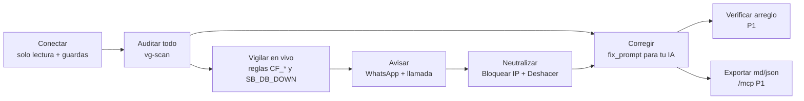

## 01. Visión, propuesta de valor y pitch

> **Quién lee esto.** El chat ORQUESTADOR (Giovanni: pitch, video, textos de entrega), el chat FRONT (textos de marca dentro de la app) y el BACK como contexto. **Fuente de verdad:** `decisiones/00-decisiones-canonicas.md` (citado como «Canon §N»). Esta sección no redefine alcance, nombres ni prioridades: los convierte en mensaje. Lo técnico vive en las secciones 03 a 16 y aquí solo se remite por número.
> **Marcas.** `[verificado: URL]` = comprobado en esa fuente por los informes R01–R17 o el benchmark v5. `[no verificado]` = no se dice en voz alta hasta comprobarlo. `[propuesta]` = cifra nuestra que se mide en el ensayo.
> **Regla del pitch:** ninguna cifra se dice en voz alta si no está `[verificado]` o si no la medimos nosotros en un ensayo (consulta de §01.4). Ningún P1 o P2 se presenta como hecho.

### 01.1 Nombre, one-liner y frases canónicas

| Pieza | Texto exacto | Dónde va |
|---|---|---|
| Nombre | **VanGUARD** (GUARD en mayúsculas). Nunca «Vanguard», «VANGUARD» ni «Van Guard» en texto visible. En código e infraestructura va en minúsculas: Worker `vanguard`, paquetes `@vanguard/*` (Canon §5) | UI, pitch, jsonc, README |
| Las 3 frases del equipo | 1. «Somos una herramienta digital que protege tu producto.» 2. «Analizamos tu sistema contra los puntos débiles existentes y los corregimos.» 3. «Evaluamos tu ecosistema con inteligencia artificial y blindamos tu producto en tiempo real.» | Pantalla de acceso; la frase 1 entra en el segundo 10 del pitch de 3 min |
| One-liner (congelado, Canon §1) | «Conecta tu Supabase, tu Cloudflare y tu repo de GitHub: una IA audita todo tu ecosistema, detecta puntos débiles y ataques, y te avisa al instante por WhatsApp o llamada.» | jsonc, `<meta name="description">`, pantalla de acceso |
| Posicionamiento (Canon §1) | «Aikido y los advisors de Supabase te dicen qué está mal configurado. VanGUARD te avisa cuándo alguien lo está aprovechando, te llama, y te da el arreglo listo para tu IA, sin pedirte nunca una clave que pueda escribir.» | Cierre del pitch; respuesta a «¿y Aikido?» |
| Frase de portada | «Encontramos lo que un atacante vería en tu Supabase, tu Cloudflare y tu código, te avisamos en segundos cuando alguien lo intenta y te damos el arreglo.» | Subtítulo de la pantalla de acceso; video |
| Frase con dato (abre el pitch) | «Una de cada diez apps del escaparate de Lovable dejaba leer su base de datos con la llave pública. El escáner que salió después solo miraba si RLS estaba encendida, no si funcionaba.» [verificado: https://superblocks.com/blog/lovable-vulnerabilities] | Segundo 0 de ambos pitches |
| URLs (Canon §4) | Producto y API: `https://officialvanguard.com` (apex; API, webhooks, ingesta y `/mcp` como rutas bajo el apex, sin `api.` ni `mcp.`). `www` → 301 al apex. Víctima: `https://demo.officialvanguard.com`. Respaldo: `https://vanguard.<subdominio-de-cuenta>.workers.dev` | Todo enlace del pitch, del video y de los textos de entrega |

**Estado del dominio (comprobado sáb 24-oct, 01:56 de Caracas, por DoH y `curl --resolve` contra el borde) [verificado: https://cloudflare-dns.com/dns-query y https://dns.google/resolve]:** NS = `martin`/`ziggy.ns.cloudflare.com`; el apex resuelve a IPs de Cloudflare y sirve la página provisional de `site/` desde el Worker `vanguard` (creado 05:30 UTC); `http://` → 301 a `https://`; DNSSEC ya activo (DS algoritmo 13 publicado en `.com`, valida en 1.1.1.1 y 8.8.8.8). **Pendiente:** `https://www.officialvanguard.com` responde 200 en vez de 301 (falta la Redirect Rule, S03 §03.4 paso 4); `/api/health` no da JSON: a las 01:56 devolvía el HTML de la portada (y `/.env` también 200); desde las 02:25 el provisional ya no tiene fallback de SPA y todo lo que no es un asset (`/api/health`, `/.env`, `/wp-login.php`) responde **404** [verificado: `curl --resolve officialvanguard.com:443:104.21.53.192`]. El JSON de `/api/health` llega con el esqueleto de las 10:00 (ver V-01). Si en esta laptop `curl` muestra `Server: Squarespace`, es caché DNS local: `ipconfig /flushdns` y repetir.

**Nombre en la voz.** El TTS puede deletrear «GUARD» como siglas. En la llamada, el nombre de la marca **no** va en `dynamic_variables`: `empresa` es el nombre de la **org cliente** (`orgs.name`, p. ej. «Tienda Demo» en la org de demo; S12 §12.7 y el cuerpo de ElevenLabs de S15). La marca vive en el texto fijo del agente que Gabriel crea a mano en ElevenLabs (`first_message`: «Hola, te llamo de VanGUARD…» y el system prompt): ahí se escribe con la grafía fonética **«Vánguard»**, igual que en el texto del plan B de voz (Twilio `<Say>`). Las plantillas `packages/core/templates/voice.ts` no nombran la marca (solo arman `resumen`). La pantalla siempre muestra «VanGUARD». Que ElevenLabs lea «Vánguard» bien en español está [no verificado]: se oye en la primera llamada de prueba de Gabriel (Canon §13, hora 1).

Constantes de marca, para que FRONT no las reescriba a mano (S14 puede cambiar la ruta del archivo, pero no los textos):

```ts
// apps/web/src/lib/marca.ts  (dueño: FRONT, P0)
export const MARCA = {
  nombre: 'VanGUARD',
  oneliner:
    'Conecta tu Supabase, tu Cloudflare y tu repo de GitHub: una IA audita todo tu ecosistema, detecta puntos débiles y ataques, y te avisa al instante por WhatsApp o llamada.',
  portada:
    'Encontramos lo que un atacante vería en tu Supabase, tu Cloudflare y tu código, te avisamos en segundos cuando alguien lo intenta y te damos el arreglo.',
  frases: [
    'Somos una herramienta digital que protege tu producto.',
    'Analizamos tu sistema contra los puntos débiles existentes y los corregimos.',
    'Evaluamos tu ecosistema con inteligencia artificial y blindamos tu producto en tiempo real.',
  ],
  url: 'https://officialvanguard.com',
  equipo: 'team-22 · Platanus Hack 26 Caracas · track AI Security',
} as const;
```

### 01.2 El problema, con incidentes reales

Una startup de 2 a 10 personas lanza en días sobre Supabase, Cloudflare y GitHub, muchas veces con código escrito por una IA. Cada proveedor muestra su parte en su propio panel, en inglés, por un correo semanal o por Slack. Nadie mira las tres capas a la vez, y nadie llama a las 4 de la mañana.

| # | Incidente | Dato citable | Fuente | Qué lo habría detectado en VanGUARD |
|---|---|---|---|---|
| 1 | **CVE-2025-48757** (Lovable + Supabase, may-2025) | 170 de 1.645 apps (≈ 10 %) con tablas legibles con la anon key; 303 endpoints expuestos. El escáner que salió después solo comprobaba que RLS existiera | [verificado: https://superblocks.com/blog/lovable-vulnerabilities], [verificado: https://cvemon.intruder.io/cves/CVE-2025-48757] | `SB_RLS_DISABLED` y `SB_POLICY_ALLOW_ALL` (P0), advisor `rls_disabled_in_public` (P0) |
| 2 | **Lovable, feb–abr 2026** | Una regresión del backend reactivó el acceso público a chats y código de proyectos públicos del 3-feb al 20-abr | [verificado: https://www.techloy.com/lovable-walks-back-initial-statement-that-it-wasnt-breached-offers-what-happened-on-april-2/] | Concepto de `SB_EXPOSURE_REGRESSION` (P1) y re-auditoría diaria `0 10 * * *` (P1). Va en la hoja de ruta, no como hecho |
| 3 | **Moltbook** (Wiz, 2026) | Llave de Supabase con lectura y escritura en el JavaScript del cliente y base sin protección: unos 1,5 M de tokens de API y decenas de miles de correos expuestos | [verificado: https://securitybrief.co.uk/story/moltbook-vibe-coded-flaw-exposed-ai-chats-keys] | `CB_SECRET_*` si la llave está en el repo y `SB_RLS_DISABLED` (P0). El escaneo del bundle ya publicado es P2: no se promete |
| 4 | **Symbiotic Security** (abr-2026) | 1.072 sitios con Supabase: 98 % con al menos una falla; 172 dejaban borrar registros sin autenticación | [verificado: https://www.symbioticsec.ai/blog/we-scanned-1-072-vibe-coded-apps-98-had-security-flaws] | `SB_POLICY_ALLOW_ALL` (P0: política con `qual='true'` o `with_check='true'` para `anon`/`public` en cualquier `cmd`) |
| 5 | **GitGuardian, informe 2026** | Unos 29 M de secretos nuevos en GitHub público en 2025 (+34 %); los de Supabase +992 %; commits hechos con Claude Code con 3,2 % de fuga frente a 1,5 % de base | [verificado: https://thehackernews.com/2026/03/the-state-of-secrets-sprawl-2026-9.html] | `CB_ENV_COMMITTED`, `CB_GITIGNORE_NO_ENV`, `CB_SECRET_*` (P0) |
| 6 | **PHP2Shell** (21-oct-2026, esta semana) | Dos RCE en el motor de PHP, CVSS 9,2; millones de intentos en horas; Cloudflare activó reglas WAF incluso en el plan gratis | [verificado en benchmark v5 §1.1: https://thehackernews.com/2026/10/php2shell-exploit-attempts-hit-millions.html] | **No decir «detectamos PHP2Shell»**: la versión del motor PHP del servidor no la vemos. Sí: `CF_PATH_SCAN`/`CF_UA_TOOL` (P0) ven el escaneo previo y `CF_WAF_01` (P1) verifica que el Managed Ruleset gratuito esté desplegado |
| 7 | **Escape.tech** (oct-2025) | 5.600 apps vibe-coded: más de 2.000 vulnerabilidades de alto impacto y más de 400 secretos expuestos | [verificado: https://escape.tech/blog/methodology-how-we-discovered-vulnerabilities-apps-built-with-vibe-coding/] (cifras vía terceros) | Solo para preguntas del jurado, citado «según Escape» |

**No se cita:** el 39,3 % de Vibe App Scanner [no verificado] ni el «70 % de internet» de PHP2Shell (es exposición potencial según Wiz, no sitios comprometidos; benchmark v5 §1.1).

**Por qué ahora** (tres hechos que el jurado puede comprobar):
1. **Desde el 6-oct-2026 Supabase tiene PAT con alcance de proyecto** (`sbp_fc…`) [verificado: https://supabase.com/changelog/scoped-personal-access-tokens-ga]. Por primera vez se puede auditar un Supabase sin pedir una clave que escriba. VanGUARD se apoya en eso (Canon §10.2).
2. **Las llaves heredadas `anon` y `service_role` de Supabase desaparecen a finales de 2026** [verificado: https://supabase.com/blog/supabase-security-2025-retro]. Todas las apps van a tocar sus llaves en los próximos meses, y es justo cuando se filtran.
3. **La ventana entre aviso y ataque se acorta.** Cloudflare vio intentos contra PHP2Shell antes del parche público (benchmark v5 §1.1). La cifra «45 minutos tras el anuncio» es de una sola fuente: se dice «según Cloudflare» o no se dice.

**El problema en una frase (para el pitch):** «Las startups lanzan en días sobre Supabase, Cloudflare y GitHub. Sus fallas son conocidas y sus ataques hacen ruido, pero cada señal vive en un panel distinto, en inglés, y nadie la mira a las 4 de la mañana.»

### 01.3 Usuario objetivo

| Perfil | Quién es | Dolor concreto | Qué usa de VanGUARD | `role` en la org | Canal |
|---|---|---|---|---|---|
| **A. Fundador técnico o CTO** de una startup de LatAm (2–10 personas) | Su stack es Supabase + Cloudflare + GitHub y él es «el de seguridad» por descarte | No tiene tiempo para revisar cuatro paneles ni para leer 30 lints | Conexiones, «Auditar todo», Incidentes, «Bloquear IP», prompt de corrección | `owner` | WhatsApp + llamada |
| **B. Vibe coder** (Lovable, Bolt, Cursor, Claude Code) | Hizo la app con IA y no sabe qué es RLS | No entiende los advisors ni sabe qué pedirle a su IA | Guía de 4 pasos por conexión, «Copiar para mi IA», exportar en Markdown | `owner` | WhatsApp |
| **C. No técnico** (CEO, COO, CFO) | Decide y paga; no lee logs | Necesita saber «¿estamos bien?» en una frase | Resumen con puntaje y cobertura, WhatsApp con botones, llamada en español. Aprueba «Bloquear IP» con código si es `admin` | `admin` o `viewer` | WhatsApp, llamada |
| **D. Dev de guardia** | Recibe la alerta y la cierra | Pierde tiempo reconstruyendo qué pasó | Línea de tiempo del incidente, hallazgos, `/mcp` desde su IA (P1) | `admin` | WhatsApp |
| **E. Jurado** | Entra sin cuenta a evaluar | Quiere ver datos reales sin registrarse | Botón «Ver demo en vivo» (rótulo de S14 §14.9): `viewer` anónimo en la org de demo «Tienda Demo». No lanza auditorías ni gasta IA (Canon §2, Acceso) | `viewer` | — |

**Primeros usuarios previstos:** Cuadra y SAGA (Parte V, decisión 6). SAGA es producto propio del equipo y las 5 entrevistas siguen sin hacerse, así que en el pitch se dice «primeros usuarios previstos», nunca «clientes». Ninguno de los dos es blanco de la demo (Canon §11).

**Fuera de foco:** empresas con SOC, Datadog o Kubernetes, que ya tienen Cleric, Resolve AI o Datadog Bits (R15 §1), y equipos que quieren agentes que escriban en producción sin revisión.

### 01.4 Propuesta de valor

> **Para** startups que viven en Supabase, Cloudflare y GitHub y no tienen equipo de seguridad, **VanGUARD es** un panel que, con tres conexiones de solo lectura, audita todo el ecosistema con un botón, vigila los ataques en vivo y avisa por WhatsApp y por llamada en español, con la corrección lista para su IA. **A diferencia de** los linters y escáneres (Supabase Security Advisor, Aikido, escáneres de vibe coding), no se queda en la foto: avisa mientras alguien ataca y deja cortar el ataque en el borde con un clic confirmado y reversible.



| # | Promesa | Lo que la cumple (Canon) | Cómo se mide / meta | Prio |
|---|---|---|---|---|
| 1 | Conectar sin miedo | Guardas de entrada (§10.3), tokens de solo lectura, `••••last4`, cifrado de sobre con KEK partida (§10.1) | 0 claves con escritura obligatorias; prueba de fuga con `vg_test_LEAK_7Q2X` = 0 apariciones | P0 |
| 2 | Un botón para todo | `POST /api/orgs/:org/scans {kind:'full_audit'}` → Workflow `vg-scan` | Auditoría de 3 fuentes en ≤ 120 s [propuesta]; puntaje con cobertura | P0 |
| 3 | Enterarte en segundos | Sensor de ingesta firmado + reglas `CF_*` sobre `vg_edge_window`, Kapso y ElevenLabs (§9). Con solo el token de Cloudflare es un pulso cada 5 min | `ms` de `whatsapp_sent` en `timeline[]` ≤ 30 s [propuesta] | P0 |
| 4 | Cortar el ataque | `block_ip` con simulación, código de un solo uso y «Deshacer» (§10.5) | `mitigated_at − started_at` ≤ 120 s en el ensayo [propuesta] | P0 |
| 5 | Arreglar sin saber de seguridad | IA-1 `fix_prompt` (`claude-sonnet-5-5`) con prueba de aceptación y filtro `untrusted.ts` | ~0,033 USD por prompt (estimación R12, se mide con `count_tokens`) | P0 |
| 6 | Tu IA, no la nuestra | Exportar md/json y «Copiar para mi IA»; `/mcp` con tokens `vgk_` | Export sin secretos (prueba de redacción en CI) | P0 / P1 |
| 7 | Honestidad | Puntaje siempre junto a «vemos N de 4 fuentes» | — | P0 |

**Cifras del cronómetro para el pitch** (ORQUESTADOR, tras cada ensayo; en el pitch se usa la **mediana de 3 ensayos**). **Fuente principal:** el `timeline[]` de `GET /api/orgs/:org/incidents/:id` (contrato de S15): `{t_whatsapp}` = `ms` del primer ítem `kind:'whatsapp_sent'`, `{t_llamada}` = `ms` de `kind:'call_started'`, `{t_bloqueo}` = `ms` de `kind:'action_executed'`, todos medidos desde `kind:'attack_start'` (primer paquete del atacante), divididos entre 1000 y redondeados. **Contraste** en el editor SQL de `vanguard-prod`, solo con columnas del DDL de S05 (`incidents`, `notifications`, `orgs`); mide desde `started_at` (alta del incidente), así que puede dar unos segundos menos que el `timeline`:

```sql
select i.code, i.title, i.severity, i.started_at,
       extract(epoch from (i.notified_at - i.started_at))::int as s_hasta_aviso,
       extract(epoch from ((select min(n.sent_at) from public.notifications n
                            where n.incident_id = i.id and n.channel = 'whatsapp') - i.started_at))::int as s_hasta_whatsapp,
       extract(epoch from ((select min(n.sent_at) from public.notifications n
                            where n.incident_id = i.id and n.channel = 'voice') - i.started_at))::int as s_hasta_llamada,
       extract(epoch from (i.acked_at     - i.started_at))::int as s_hasta_ack,
       extract(epoch from (i.mitigated_at - i.started_at))::int as s_hasta_bloqueo
from public.incidents i
join public.orgs o on o.id = i.org_id
where o.is_demo and i.started_at > now() - interval '2 hours'
order by i.started_at desc;
```

Si una cifra sale `null` o falta su ítem en `timeline[]`, no se dice en el pitch.

**Costos unitarios** (respuesta a «¿es viable?»):

| Concepto | Costo | Fuente |
|---|---|---|
| Auditoría completa con síntesis IA-2 (`claude-opus-5-5`) | ~0,25 USD en caché caliente (S11: 0,248; el Canon §8 estimaba 0,31) → la bolsa de demo de 60 USD da para unas 190–240 | Estimación S11 y R12 §12 [propuesta: medir con `count_tokens` el sábado] |
| Prompt de corrección IA-1 | ~0,033 USD | Igual |
| Alerta crítica con llamada de 90 s a un móvil +58 | ElevenLabs ≈ 0,12 USD (1,5 min × 0,08 USD/min fuera de los 75 min del Starter) + Twilio 2 min × 0,1739 USD = 0,35 USD (Twilio redondea cada llamada al minuto siguiente) ≈ **0,47 USD**, más el LLM del agente [no verificado: su costo] | [verificado: https://www.twilio.com/en-us/voice/pricing/ve], [verificado: https://elevenlabs.io/pricing/agents] (vía R14 §2.1), [verificado: https://support.twilio.com/hc/en-us/articles/223132307-How-do-you-round-minutes-for-billing] |
| WhatsApp en la demo | Céntimos, **no 0**: desde el 1-oct-2026 los mensajes de servicio enviados desde el sandbox gastan crédito del proyecto de Kapso (Free trae 2 USD); con saldo ≤ 0 Kapso pausa los envíos. Hace falta saldo positivo antes de la demo | R14 §1.1 [verificado: https://docs.kapso.ai/docs/whatsapp/meta-message-billing.md] |
| Infraestructura | Workers Paid 5 USD/mes + Supabase Free + dominio ya pagado | Canon §4 [verificado: https://developers.cloudflare.com/workers/platform/limits/] |

El precio de venta no está decidido (Parte V, pregunta 19): **no se dice ninguno en el pitch**.

### 01.5 Diferenciadores y ángulo de originalidad

**Lo que ya existe** (lo construimos, pero no se vende como nuevo; R15 §3). Un juez técnico tumba cualquiera de estos en un minuto si lo llamamos «innovación»:

| Pieza | Quién ya la tiene | Cómo la presentamos |
|---|---|---|
| Lint de RLS, vistas `security definer`, funciones expuestas | Supabase Security Advisor (gratis, 30 lints), Aikido | «Consumimos los advisors por API (`/advisors/security`) y les sumamos la explotabilidad por SQL (`has_table_privilege('anon', …)`), la prioridad y el arreglo» |
| Probar RLS con la anon key | Vibe App Scanner, SupaExplorer, Aikido pentest y otros | No se menciona en P0 (el sondeo activo es P1) |
| CVE de dependencias | Dependabot, Snyk, Socket, Aikido | «Usamos OSV; lo nuestro es explicarlo en llano y ligarlo al resto del ecosistema» |
| Secretos en el repo | GitHub push protection, GitGuardian | «Igual que ellos, más la huella HMAC para detectar *tus propias* llaves» (P1, `CB_KEY_REUSE`) |
| Llamada al de guardia | EZ OnCall (demo de hackatón con ElevenLabs y Twilio, benchmark v5 §2.4) | «La voz no es el invento: lo es *qué* dice y que nunca aprueba nada» |

**Lo nuestro.** R15 §1 no lo encontró en ningún competidor, pero lo marca como «ausencia en la búsqueda del 24-oct, no prueba que no exista». Por eso se dice «no lo vimos en», nunca «nadie lo hace»:

| # | Diferenciador | Prueba en la demo (Canon §11) | Prio |
|---|---|---|---|
| D1 | **Del ataque al bloqueo en un solo flujo**: incidente agrupado por IP → WhatsApp interactivo → llamada en español → «Bloquear IP» con simulación, código y deshacer, con cronómetro visible | 1:00–2:10 | P0 |
| D2 | **Seguridad propia como característica**: guardas que rechazan `sb_secret_`, JWT `service_role`, `ghp_` y Global API Key; KEK partida entre Vault y el Worker; la regla decide y no el modelo; `supabase/tests/rls.sql` en CI | 0:00–0:20 (rechazo en vivo) y 2:40–3:00 | P0 |
| D3 | **Dogfooding**: VanGUARD vigila su propia zona `officialvanguard.com` con un token de solo lectura | 2:40–3:00. Se dice «auditada en verde» **solo** si `CF_TLS_*` y `CF_WAF_01` (P1) corren en producción; si no, «nuestra zona está conectada y su tráfico se ve en el pulso» | P0 conexión / P1 auditoría |
| D4 | **Puntaje honesto**: el 0–100 siempre va junto a «vemos N de 4 fuentes» | 0:20–1:00 | P0 |
| D5 | **El arreglo, para tu IA**: prompt con contexto, pasos y prueba de aceptación; export md/json con la evidencia marcada como dato no confiable; servidor `/mcp` de solo lectura | 0:20–1:00 y 2:10–2:40 | P0 / P1 (`/mcp`) |
| D6 | **Español, WhatsApp y voz para no técnicos**: el mercado de AI SRE habla en inglés y por Slack (R15 §1.1) | Todo el guion | P0 |

**Hoja de ruta que suma originalidad** (se nombra en los últimos 10 s del pitch y en el README, nunca como hecho): regresión de exposición tras cada deploy (`SB_EXPOSURE_REGRESSION`, P1), correlación entre capas borde + base + deploy (P2), exposición con explotación en curso por los logs de Supabase (P2), Vercel como proveedor monitoreado (P2).

> **Decisión abierta (Giovanni, dom 07:00; recogida en la portada):** R15 §5 puntúa la regresión de exposición (87) y la correlación entre capas (87) como las ideas más originales, y el Canon las deja en P1 y P2. Sin cambiar esas prioridades, propongo que **`SB_EXPOSURE_REGRESSION` sea el primer P1 que se ataque el domingo a las 07:00**, antes que PSI o el ZIP. Reutiliza el SQL 1 de `SB_RLS_DISABLED` (comparar la última `scan_run` con la anterior), cuesta S–M y da la demo de 40 s de R15 §6.2: commit con `alter table public.pedidos disable row level security;` → rojo → WhatsApp → prompt → verde. Lo decide Giovanni.

**Respuestas preparadas para el jurado** (ORQUESTADOR las ensaya; máximo 25 s cada una):

| Pregunta probable | Respuesta | Evidencia que se puede mostrar |
|---|---|---|
| «¿Esto no es Aikido?» | Aikido parte del código y la configuración y entrega hallazgos para devs. Nosotros además vigilamos el tráfico en vivo, avisamos por voz y WhatsApp en español y dejamos cortar el ataque con confirmación. Y nunca pedimos una clave que escriba (R15 §4.3) | Incidente en vivo; rechazo de `sb_secret_` |
| «Supabase ya da los advisors gratis» | Los usamos por su API, no los copiamos. Les sumamos si `anon` puede leer de verdad, la prioridad, el prompt de corrección y el aviso | Hallazgo `SB_ADVISOR_*` junto a `SB_RLS_DISABLED` |
| «¿Y si les roban la base?» | En la base solo hay texto cifrado. La KEK sale de un secreto de Vault **y** de una pimienta que vive en Cloudflare: hay que robar dos sistemas. El AAD ata cada cifrado a su org y su conexión (Canon §10.1) | Pruebas Vitest de `crypto.ts`; `SECURITY.md` |
| «¿Inyección de prompts desde logs, UA o el repo?» | El motor de reglas decide la alerta, su severidad y su canal. El modelo no tiene herramientas, recibe la evidencia cercada como `<datos_no_confiables>` y su salida pasa por un filtro determinista | `packages/core/rules`, `untrusted.ts`, pruebas de inyección en CI |
| «¿Sirve para atacar a otros?» | Todo es de solo lectura. La única escritura (bloquear una IP) va sobre la zona del propio token y con código. Las pruebas activas solo corren contra dominios verificados de la org, y el simulacro solo contra `demo.officialvanguard.com` | Canon §10.5 y §11 |
| «¿Por qué no MCP para todo?» | El monitoreo tiene que ser determinista y no gastar tokens, así que va por REST y GraphQL. El MCP es la cara hacia tu IA: nuestro `/mcp` y los oficiales en solo lectura (Canon §10.4) | Pantalla «Llevar a tu IA» |
| «¿Y si Claude se cae o se acaba el crédito?» | Las alertas salen igual con plantillas. Hay topes diarios, una escalera de degradación y un interruptor de corte (Canon §8) | `GET /api/orgs/:org/ai/usage` (P1) |
| «¿Tiempo real con solo pegar un token?» | No: con el token de Cloudflare vemos un pulso cada 5 minutos. El aviso en segundos sale del sensor de ingesta firmado con HMAC que se pone en la app, que es lo que vieron en la demo (S02 §02.1 punto 5). Nuestra víctima usa además `tail()` porque vive en nuestra misma cuenta de Cloudflare; a un cliente no se le promete | Conexión «Tu app (ingesta)»; `POST /ingest/v1/events` |
| «¿Cuánto cuesta un cliente?» | La tabla de costos unitarios de §01.4 | — |

### 01.6 Criterios del jurado → qué los cubre → cómo se demuestra

Los jueces revisan con agentes: cada criterio tiene que verse **en la demo y en el repo o el deploy**.

| Criterio (peso) | Qué del producto lo cubre | Cómo se demuestra en la demo (Canon §11) | Evidencia para el agente del jurado | Lo que lo hundiría |
|---|---|---|---|---|
| **Originalidad (15 %)** | D1, D2, D3 y D6 de §01.5 | 1:00–2:10 (ataque → aviso → bloqueo) y 2:40–3:00 (dogfooding) | README, apartado «Qué es distinto»; `THREAT_MODEL.md` | Vender como nuevo el lint de RLS, el escaneo de CVE o la llamada de voz |
| **Ambición (20 %)** | 4 módulos (`supabase`, `cloudflare`, `codebase`, `performance`), auditoría de un botón, alertas multicanal, acciones reversibles, MCP propio; hoja de ruta con Vercel y correlación | 0:20–1:00 (3 fuentes en una auditoría) y los 10 s de hoja de ruta | `ARQUITECTURA.md` con diagrama; `packages/core/rules/*.ts` | Prometer en voz alta P1 o P2 que no están |
| **Ejecución (20 %)** | `https://officialvanguard.com` responde (ya lo hace con la página provisional, §01.1); CI con `.github/workflows/deploy.yml`; botón «Ver demo en vivo»; video de respaldo | Todo el guion en vivo **sobre el apex**: fuera de `officialvanguard.com` el envío real de WhatsApp y llamada y el `confirm` de acciones responden 403 (Canon §4, Entornos), así que en `*.workers.dev` el tramo 1:00–2:10 solo sale en video | Comandos de la lista de abajo; Actions en verde | Demo en vivo desde `*.workers.dev` (alertas en 403); `/.env` respondiendo 200; demo caída sin video |
| **Impacto (20 %)** | Startups de LatAm sin equipo de seguridad, no técnicos, español, WhatsApp, costo unitario bajo | 0:00–0:20 (dato de CVE-2025-48757) y la llamada en español | `project-description.md` con el problema y las fuentes enlazadas | Cifras sin fuente; llamar «clientes» a Cuadra y SAGA |
| **Técnico (25 %)** | Worker con assets + Hono + Cron + Queue + Workflow + `tail()`; reglas puras con pruebas; sobre AES-256-GCM con KEK partida; huella HMAC; RLS por `org_id` con pruebas SQL; webhooks firmados verificados en tiempo constante; IA con salida estructurada, caché, topes y fallback | 0:00–0:20 (rechazo de la clave) y 2:40–3:00 (seguro por diseño) | `supabase/tests/rls.sql`, Vitest de `crypto.ts` (1 byte cambiado lanza), `SECURITY.md` | Un secreto real en el historial de git; una tabla de `public` sin RLS en nuestra propia base |

**Lo que hará un agente del jurado.** El ORQUESTADOR lo corre en Git Bash el sábado tras el primer deploy real y otra vez el domingo a las 10:00, con `curl` (funciona en este equipo pese a Norton). Todo debe pasar:

```bash
curl -sI https://officialvanguard.com | head -n 1                         # HTTP/1.1 200 o HTTP/2 200 (según el curl)
curl -s  https://officialvanguard.com/api/health                          # {"ok":true,"version":"…","time":"…"} (JSON, no HTML)
curl -sI "https://www.officialvanguard.com/x?y=1" | grep -iE '^(HTTP|location)'   # 301 y location: https://officialvanguard.com/x?y=1
curl -sI http://officialvanguard.com | head -n 1                          # HTTP/1.1 301 (Always Use HTTPS)
curl -s -o /dev/null -w '%{http_code}\n' https://officialvanguard.com/.env # 404 (S06 SEG-04; la provisional ya da 404 desde las 02:25)
git log -p --all | grep -cE 'sb_secret_[A-Za-z0-9_-]{20,}|sk-ant-(api|admin)[0-9]{2}-[A-Za-z0-9_-]{20,}|github_pat_[A-Za-z0-9_]{20,}|ghp_[A-Za-z0-9]{36}'   # 0
pnpm install --frozen-lockfile && pnpm test                               # verde
```

El `grep` exige un cuerpo de longitud real después de cada prefijo, así que no cuenta el código fuente de las reglas (`/\b(sk-ant-(?:api03|admin01)-…/`, `github_pat_\w{82}`, `redact()`) que sí contiene esos prefijos: probado el sábado contra el historial actual (0) y contra las regex de S09 y S06 (0). Un `grep` con el prefijo pelado (`sk-ant-|github_pat_`) daría falso positivo en cuanto exista `packages/core/src/secrets/`.

**Secretos falsos de la víctima (antes objeción, ya resuelta):** `demo/repo-vulnerable/` no guarda ningún valor con forma de secreto; `demo/sembrar-repo.mjs` los genera por concatenación (`'sb_' + 'secret_' + …`) y los empuja solo al repo privado `vanguard-demo-victima` (S09 §09.13, S06 objeción de `demo/repo-vulnerable/`). Las pruebas de Vitest arman sus literales igual.

### 01.7 Pitch de 60 s (texto literal)

Unas 140 palabras. Habla Giovanni y Carlos pasa las pantallas.

| Tiempo | Se dice | Se ve |
|---|---|---|
| 0–10 s | «Una de cada diez apps del escaparate de Lovable dejaba leer su base de datos con la llave pública. Y el escáner que salió después solo miraba si la protección estaba encendida, no si funcionaba.» | Portada de `officialvanguard.com` |
| 10–20 s | «Las startups lanzan en días sobre Supabase, Cloudflare y GitHub. Cada uno avisa en su propio panel, en inglés, y nadie mira a las cuatro de la mañana.» | Tres tarjetas de Conexiones |
| 20–40 s | «VanGUARD conecta los tres con permisos de solo lectura. Si pegas una clave que puede escribir, la rechaza. Y con un botón audita todo: tablas abiertas, secretos en el repo, dependencias con CVE, ataques en el borde.» | Rechazo de una `sb_secret_` falsa → Resumen con el puntaje en rojo |
| 40–55 s | «Cuando alguien ataca, decide un motor de reglas, no la IA: te escribe por WhatsApp, te llama en español y te deja bloquear la IP con un código. Claude te da el arreglo listo para tu IA.» | Incidente con cronómetro → WhatsApp → «Bloquear IP» |
| 55–60 s | «VanGUARD: lo que tus proveedores ven por separado, vigilado en un solo lugar. officialvanguard.com.» | Logo y URL |

### 01.8 Pitch de 3 min (texto literal, sobre el guion del Canon §11)

**Papeles** [propuesta]: Giovanni narra; Carlos maneja la pantalla desde la laptop del proyector, en el wifi del evento y abierta en `https://officialvanguard.com` (nunca en `*.workers.dev`: ahí los envíos reales dan 403); Andrés lanza el simulacro desde **su** laptop (`node scripts/ataque.mjs https://demo.officialvanguard.com --rps 20 --segundos 90 --ua "sqlmap/1.8"`) conectada al hotspot del teléfono de **Daniel**; Gabriel sostiene el teléfono que recibe el WhatsApp y la llamada (el contacto `voice` de mayor prioridad de «Tienda Demo»), con su pantalla duplicada en el proyector. Motivos: (1) la IP Access Rule bloquea la IP en toda la zona (S02 Z3), así que la laptop del proyector nunca comparte red con el atacante; (2) el teléfono que hace de hotspot no es el que recibe la llamada, porque en redes sin VoLTE una llamada entrante corta los datos y el simulacro moriría antes del bloqueo [no verificado: VoLTE en Movistar, Digitel y Movilnet]. **Marcadores:** `{puntaje}`, `{t_whatsapp}`, `{t_llamada}` y `{t_bloqueo}` se rellenan con la mediana de 3 ensayos (fuente: `timeline[]`, §01.4). Si alguno no está medido, se dice «en segundos», sin número. Meta: 2:50 en el ensayo y ninguno por encima de 2:55, para tener margen.

| Tiempo | Se dice | Se ve | Si falla |
|---|---|---|---|
| 0:00–0:20 | «Una de cada diez apps del escaparate de Lovable dejaba leer su base de datos con la llave pública. Somos VanGUARD, una herramienta que protege tu producto. Conectamos Supabase, Cloudflare y GitHub solo con permisos de lectura. Miren: pego una clave secreta de Supabase, falsa, y VanGUARD la rechaza y explica por qué.» | Conexiones: tres tarjetas «solo lectura» con `••••last4`; se pega una `sb_secret_` falsa → mensaje de `422 key_rejected` | Captura |
| 0:20–1:00 | «Un solo botón: Auditar todo. VanGUARD revisa la base, el borde y el código a la vez. Puntaje: {puntaje}, en rojo, y al lado, siempre, la cobertura: vemos {N} de cuatro fuentes.» (se lee de la pantalla; con la medición de Rendimiento sembrada serán cuatro de cuatro, S15 15.9) « Arriba, lo más grave: la tabla de pedidos se puede leer sin iniciar sesión; hay un .env con una clave service_role en el repo; una dependencia con un CVE conocido y una función pública sin freno. Es nuestra app víctima, sembrada a propósito. Pido el arreglo: Claude escribe un prompt con los pasos y la prueba de aceptación, y lo copio para mi IA.» | Progreso `supabase → cloudflare → repo → resumen_ia`; Resumen con «Ahora»; «Generar prompt de corrección» → «Copiar para mi IA» | Auditoría previa guardada; prompt en caché |
| 1:00–2:10 | «Ahora, el ataque. Andrés lanza un escaneo contra demo.officialvanguard.com desde otra red. *(pausa)* El tráfico se dispara y se abre un incidente: escaneo de rutas con una herramienta de ataque conocida. Lo decide una regla, no el modelo. *(llega el WhatsApp)* WhatsApp a los {t_whatsapp} segundos, con dos botones. *(suena el teléfono)* Como el ataque llegó al panel de administración sin sesión, ahora nos llama. *(10 s de la voz por el altavoz)* Bloquear esta IP: VanGUARD primero simula el efecto, confirmo con el código… y el atacante ya recibe 403. Incidente mitigado.» | Incidente con cronómetro y gráfica de tráfico; teléfono en el proyector; simulación → código → «mitigado» | Plan B de voz (Twilio `<Say>` o voz en el navegador), banner en la app, video. Si en el ensayo el borde corta el UA `sqlmap/1.8` antes de la víctima (S02 Z2), se ensaya y se dice con `--ua "python-requests/2.32"` («un script de ataque automatizado»). Si WhatsApp y llamada llegan juntos (el `/admin` cayó en la primera ventana), se dice «WhatsApp y llamada a los {t_whatsapp} segundos» |
| 2:10–2:40 | «La línea de tiempo lo resume: primer paquete, WhatsApp a los {t_whatsapp} segundos, llamada a los {t_llamada}, bloqueo a los {t_bloqueo}. Y si tu equipo trabaja con otra IA, exportas todo en Markdown, sin secretos, y se lo pasas tal cual.» | Línea de tiempo; «Exportar para tu IA» | — |
| 2:40–3:00 | «Seguro por diseño: la regla decide y no el modelo, así que un log malicioso no puede apagar una alerta. Tokens de solo lectura. Claves cifradas con una llave partida entre Supabase Vault y Cloudflare. Y VanGUARD vigila su propia zona, officialvanguard.com. Lo que sigue: Vercel y la correlación entre capas. Somos VanGUARD.» | Módulo Cloudflare con nuestra zona (frase según la condición de D3 en §01.5); cierre con logo y URL | — |

### 01.9 Textos para `platanus-hack-project.jsonc`

Se conservan los comentarios de la plantilla. `project-name`, `project-oneliner-spanish` y `deploy-url` **no se tocan** (Canon §1). Solo cambia `project-description-spanish`. La descripción actual promete cosas P1 (ZIP, tablas hinchadas, CPU y disco, configuración de Cloudflare, Lighthouse histórico) y un agente del jurado lo va a contrastar con el repo. Por eso hay **dos versiones**: la P0 entra ya (sáb 12:00) y la final se decide el domingo a las 10:00.

**Versión P0** (valor exacto, una sola línea):

```jsonc
"project-description-spanish": "VanGUARD es un panel de seguridad para startups que viven en la nube. Conectas, con permisos de solo lectura, tu proyecto de Supabase, tu zona de Cloudflare y un repo de GitHub; VanGUARD rechaza cualquier clave capaz de escribir y guarda las demás cifradas. Con un botón audita todo el ecosistema: tablas con RLS desactivada y legibles sin sesión, políticas que dejan pasar a cualquiera, funciones públicas sin freno de tasa, archivos .env subidos, credenciales filtradas en el código y dependencias con vulnerabilidades conocidas (OSV/CVE), y lo resume en un puntaje de blindaje que siempre dice qué fuentes no pudo ver. Un motor de reglas vigila en tiempo real el tráfico de tu app con un sensor de ingesta firmado: ante escaneos de rutas, herramientas de ataque, IPs insistentes o accesos al panel de administración abre un incidente, avisa por WhatsApp (Kapso) y con una llamada de voz en español (ElevenLabs), y propone bloquear la IP en Cloudflare con confirmación por código y opción de deshacer. Claude escribe para cada hallazgo un prompt de corrección listo para la IA del equipo, y todo se exporta en Markdown o JSON para auditar con cualquier IA. Corre en Cloudflare Workers, en officialvanguard.com, y vigila su propia zona.",
```

«En tiempo real» va atado al sensor de ingesta a propósito: con solo el token de Cloudflare el pulso es cada 5 min (S02 T02-11). El texto se validó el sábado con el comando de abajo dentro de un jsonc de prueba (1.237 caracteres, imprime `ok`).

**Versión final:** cada inserto entra solo si su condición se cumple **en producción** (`https://officialvanguard.com`) el domingo a las 10:00.

| Inserto (dónde) | Condición para incluirlo |
|---|---|
| «(o subes un ZIP)» después de «un repo de GitHub» | `PUT /api/orgs/:org/uploads/zip/:scan_run_id` → 201 y la auditoría `zip` sale con hallazgos |
| «, la salud del servidor de Supabase (CPU, disco y conexiones)» después de «(OSV/CVE)» | `metric_samples` con filas de `vanguard-demo` en la última hora |
| «, la configuración de TLS, DNS y WAF de Cloudflare» después de «(OSV/CVE)» (o del inserto anterior) | Hallazgos `CF_TLS_*` / `CF_DNS_*` / `CF_WAF_01` en la última auditoría |
| «, el rendimiento histórico con Lighthouse (PageSpeed Insights)» después de «(OSV/CVE)» y de los insertos anteriores, siempre antes de «, y lo resume» (sin una segunda «y») | `perf_runs` con 2 o más filas y `PF_REGRESSION` calculado |
| «, también desde su propio servidor MCP de solo lectura» después de «cualquier IA» | `POST /mcp` con un `vgk_` responde `tools/list` |

Comprobación de que el archivo sigue siendo válido (sin binarios nuevos; con el jsonc actual imprime `ok` [verificado: sáb 24-oct]). Solo quita comentarios de línea completa: no admite comentarios al final de una línea con valor, `/* */` ni comas finales, así que no se añaden:

```bash
node -e "JSON.parse(require('fs').readFileSync('platanus-hack-project.jsonc','utf8').replace(/^\s*\/\/.*$/gm,''));console.log('ok')"
```

### 01.10 Texto para `project-description.md`

Reemplaza el archivo entero. La tabla «Estado de la entrega» la actualiza el ORQUESTADOR el domingo a las 10:00 con la misma regla de §01.9: «Listo» solo si funciona en producción.

```markdown
# VanGUARD

> Conecta tu Supabase, tu Cloudflare y tu repo de GitHub: una IA audita todo tu ecosistema, detecta puntos débiles y ataques, y te avisa al instante por WhatsApp o llamada.

**Pruébalo:** https://officialvanguard.com → «Ver demo en vivo» (solo lectura, con los datos de nuestra app víctima; si el acceso anónimo no está activo, la cuenta de demo va en el README).

## El problema

Una startup lanza en días sobre Supabase, Cloudflare y GitHub, muchas veces con código escrito por IA. Las fallas son conocidas y los ataques hacen ruido, pero cada señal vive en un panel distinto, en inglés, y nadie la mira a las 4 de la mañana.

- 170 de 1.645 apps del escaparate de Lovable dejaban leer su base con la llave pública ([CVE-2025-48757](https://superblocks.com/blog/lovable-vulnerabilities)); el escáner que salió después solo miraba si RLS estaba encendida.
- De 1.072 sitios con Supabase, 172 dejaban borrar registros sin autenticación ([Symbiotic Security](https://www.symbioticsec.ai/blog/we-scanned-1-072-vibe-coded-apps-98-had-security-flaws)).
- Los secretos de Supabase filtrados en GitHub público crecieron un 992 % en 2025 ([GitGuardian, vía The Hacker News](https://thehackernews.com/2026/03/the-state-of-secrets-sprawl-2026-9.html)).

## Qué hace

- **Conexiones de solo lectura.** Un PAT de Supabase limitado a un proyecto, un token de Cloudflare de lectura y un PAT fine-grained de un solo repo. Si pegas una clave que puede escribir (`service_role`, `sb_secret_`, PAT clásico, Global API Key), VanGUARD la rechaza y explica por qué.
- **Auditoría con un botón.** Revisa la base, el borde y el código a la vez y lo resume en un puntaje de blindaje que siempre dice cuántas fuentes pudo ver.
- **Supabase:** tablas con RLS desactivada y legibles por `anon`, políticas que dejan pasar a cualquiera, funciones públicas sin freno de tasa, los advisors de seguridad y rendimiento, y la salud del proyecto.
- **Cloudflare:** escaneos de rutas, user agents de herramientas de ataque, IPs insistentes y accesos al panel de administración, en vivo con el sensor de ingesta firmado de tu app (con solo el token de Cloudflare, un pulso cada 5 minutos).
- **Codebase:** `.env` subidos, `.gitignore` que no los ignora, credenciales filtradas en el código y dependencias con vulnerabilidades conocidas (OSV).
- **Rendimiento:** una medición real de Lighthouse (vía PageSpeed Insights) de nuestra app de demostración; medir tu app bajo demanda y el histórico por versión, según la tabla «Estado de la entrega».

## Alertas, acciones y corrección

Un motor de reglas, y no el modelo, decide cuándo hay un incidente y qué tan grave es. Agrupa los eventos por atacante, escribe por WhatsApp con botones («Lo estoy viendo», «Silenciar 1 h») y, si es crítico, llama con una voz en español que explica qué pasó. «Bloquear IP» primero simula el efecto, se confirma con un código de un solo uso y siempre se puede deshacer.

Claude escribe para cada hallazgo un prompt de corrección con los pasos y una prueba de aceptación, listo para pegar en la IA de tu equipo. Todo se exporta en Markdown o JSON, sin secretos, para auditar con cualquier IA.

## Seguro por diseño

- Las credenciales se cifran con AES-256-GCM (cifrado de sobre). La clave maestra se deriva de un secreto de Supabase Vault **y** de una pimienta que vive en Cloudflare: robar la base no basta.
- Una huella HMAC con pimienta permite reconocer una llave ya conectada sin descifrar nada. Usarla para detectar tus propias llaves filtradas en tu repo (`CB_KEY_REUSE`) sigue la tabla «Estado de la entrega».
- La evidencia que llega al modelo va redactada y marcada como dato no confiable; el modelo no tiene herramientas.
- Topes diarios de gasto de IA e interruptor de corte: si la IA se apaga, las alertas salen igual.
- VanGUARD se audita a sí mismo: pruebas de RLS en CI y su propia zona `officialvanguard.com` vigilada por el módulo Cloudflare.

## Qué es distinto

No vendemos como novedad el lint de RLS ni el escaneo de CVE: los consumimos. Lo nuestro es el flujo completo del ataque en vivo al bloqueo confirmado, en español y por WhatsApp y voz, sin pedir nunca una clave que escriba, y con el arreglo listo para tu IA.

## Estado de la entrega

| Funcionalidad | Estado |
|---|---|
| Conexiones con guardas, auditoría de un botón, puntaje con cobertura | Listo |
| Incidentes en vivo, WhatsApp, llamada, «Bloquear IP» con deshacer | Listo |
| Prompt de corrección y exportar a cualquier IA | Listo |
| Métricas del servidor de Supabase, configuración de Cloudflare, ZIP, histórico de rendimiento, servidor MCP, detección de tus propias llaves filtradas | (domingo 10:00: «Listo» o «Hoja de ruta», una fila por pieza) |
| Regresión de exposición tras cada deploy, correlación entre capas, Vercel | Hoja de ruta |

## Stack

Cloudflare Workers (assets estáticos, API con Hono, Cron, Queues y Workflows) en `officialvanguard.com` · React 19, Vite 8, Tailwind 4 y shadcn/ui · Supabase (Postgres con RLS, Auth, Vault, pg_cron) · Claude API (Sonnet 5.5 y Opus 5.5, salida estructurada, caché y topes) · Kapso (WhatsApp) · ElevenLabs + Twilio (voz) · OSV.dev · PageSpeed Insights.

## Equipo

team-22, Platanus Hack 26 Caracas, track AI Security: Carlos Bastidas, Giovanni Zarbo De Michele, Daniel Alejandro Barreda López, Andrés Valero y Gabriel Enrique García Ruíz.
```

### 01.11 Tareas de esta sección

| ID | Tarea | Prio | Dueño | Hecho cuando | Límite |
|---|---|---|---|---|---|
| V-01 | **Hecho casi del todo** (§01.1): el apex sirve `site/index.html` + `site/_headers` desde el Worker `vanguard` y, desde las 02:25, responde 404 a todo lo que no es un asset. Falta solo `/api/health` en JSON: o el script provisional de abajo (opcional) o, directamente, el esqueleto de las 10:00 (F-02 de S14 + E1 de S15), conservando el Custom Domain del apex y `"workers_dev": true`. `site/` y `provisional/` son piezas **temporales sin versionar** de la zona raíz del ORQUESTADOR (están en `.gitignore`) y se borran cuando el deploy real las sustituya | P0 | ORQUESTADOR | `curl -s https://officialvanguard.com/api/health` → JSON `{"ok":true,…}`; `/.env` → 404; `/` → 200 con la portada | sáb 09:00 |
| V-02 | Poner la versión P0 de `project-description-spanish` (§01.9) y validar el jsonc con el comando de `node` | P0 | ORQUESTADOR | Imprime `ok` | sáb 12:00 |
| V-03 | Reemplazar `project-description.md` por el texto de §01.10 | P0 | ORQUESTADOR | En `main` y en el espejo | sáb 12:00 |
| V-04 | `apps/web/src/lib/marca.ts` (§01.1) y portada `/` según S14 §14.9: `MARCA.nombre`, `MARCA.portada`, las 3 `MARCA.frases` y los botones «Ver demo en vivo» y «Entrar» de 56 px (`h-14`); en `apps/web/index.html`, `<title>VanGUARD</title>` y `<meta name="description">` con el one-liner exacto | P0 | FRONT | Se ve en el deploy y con fixtures | sáb 10:00 (con F-02 de S14) |
| V-05 | Rellenar siempre `incidents.started_at`, `notified_at`, `acked_at`, `mitigated_at` y `notifications.sent_at`, y emitir en `timeline[]` los ítems `attack_start`, `whatsapp_sent`, `call_started` y `action_executed` con su `ms` (contrato de S15) | P0 | BACK | Tras un ensayo, `timeline[]` trae los 4 ítems y la consulta de §01.4 devuelve las cifras | sáb 17:30 |
| V-06 | Escribir «Vánguard» (grafía fonética) en el `first_message` y el system prompt del agente de ElevenLabs y en el texto del plan B Twilio `<Say>`; `empresa` en `dynamic_variables` sigue siendo `orgs.name` (S12 §12.7) | P0 | ORQUESTADOR (Gabriel, panel de ElevenLabs) | La llamada de prueba pronuncia bien el nombre | sáb 12:00 (con el agente, S03 fila 11) |
| V-07 | Tres ensayos cronometrados del pitch de 3 min; rellenar `{puntaje}`, `{t_whatsapp}`, `{t_llamada}`, `{t_bloqueo}` con la mediana | P0 | ORQUESTADOR | 3 ensayos seguidos de 2:55 o menos (meta 2:50), antes del video | sáb 22:00 |
| V-08 | Correr la lista de «lo que hará un agente del jurado» (§01.6) tras el primer deploy real y otra vez antes de entregar | P0 | ORQUESTADOR | Todos los comandos dan lo esperado | sáb 20:00 y dom 10:00 |
| V-09 | Decidir la versión final del jsonc (tabla de §01.9) y la tabla «Estado de la entrega» | P1 | ORQUESTADOR | Ninguna frase promete algo que no responde en producción | dom 10:00 |
| V-10 | Ensayar las 9 respuestas al jurado (§01.5) | P1 | ORQUESTADOR | Cada una en 25 s o menos | dom 10:00 |
| V-11 | Reemplazar `project-logo.png`: hoy es el logo genérico «PH26 ↗ CARACAS» amarillo sobre negro (1000×1000, 67 KB) [verificado: archivo del repo]; S16 §16.9 lo da por hecho y no lo está. Logo de VanGUARD de 1000×1000 y ≤ 500 KB, con el violeta de marca de S14 (`#7C3AED`), diseñado en SVG y exportado a PNG desde el navegador o Figma, sin binarios nuevos | P1 | ORQUESTADOR | PNG de 1000×1000 y ≤ 500 KB con la marca; se copia a `apps/web/public/logo.png` (O-03 de S14) | dom 10:00 |
| V-12 | Etiquetas Open Graph en `apps/web/index.html`: `og:title` VanGUARD, `og:description` con el one-liner, `og:url` `https://officialvanguard.com`, `og:image` con URL **absoluta** `https://officialvanguard.com/og.png` de 1200×630 [propuesta] y peso pequeño (WhatsApp puede no mostrar imágenes grandes [no verificado: límite exacto]) | P1 | FRONT | Vista previa correcta al pegar la URL en WhatsApp | dom 10:00 |
| V-13 | README raíz conciso: one-liner, URL, «Ver demo en vivo», cómo correrlo, «Qué es distinto» y enlaces a `ARQUITECTURA.md`, `SECURITY.md` y `THREAT_MODEL.md`; lo redacta una persona del equipo (S16 §16.9) | P1 | ORQUESTADOR | En `main` | dom 10:00 |
| V-14 | Video de 60 s con el texto de §01.7, aparte del video de respaldo de la demo | P2 | ORQUESTADOR | — | — |

**Página provisional** (V-01). El HTML **ya existe** y está publicado: `site/index.html` (sin JS, estilos en línea) y `site/_headers` (CSP `default-src 'none'; style-src 'unsafe-inline'; …`, que sí permite esos estilos). No se reescribe; solo un ajuste opcional (P2): su `<meta name="description">` trae un one-liner recortado y debería llevar el exacto de §01.1. Lo que falta es el script (opcional: el esqueleto de las 10:00 lo hace innecesario), porque el Worker provisional solo sirve assets; desde las 02:25 ya responde 404 a `/api/health` y `/.env` en vez de la portada. Con `main` presente y **sin** `not_found_handling`, lo que no casa con un asset pasa al script [verificado: https://developers.cloudflare.com/workers/static-assets/#routing-behavior]:

```js
// provisional/worker.js (ORQUESTADOR) · vive fuera de site/ para no publicarse como asset
export default {
  fetch(req) {
    const { pathname } = new URL(req.url);
    if (pathname === '/api/health')   // misma forma que E1 de S15
      return Response.json({ ok: true, version: 'provisional', time: new Date().toISOString() });
    return new Response('No encontrado', { status: 404 });   // /.env, /.git/config, /api/* y demás
  },
};
```

```jsonc
// provisional/wrangler.jsonc · rutas relativas a este archivo; se despliega con la misma vía que publicó site/ (o `pnpm dlx wrangler@4.152.0 deploy -c provisional/wrangler.jsonc` en Actions)
{
  "name": "vanguard",
  "main": "worker.js",
  "compatibility_date": "2026-10-20",
  "workers_dev": true,
  "routes": [{ "pattern": "officialvanguard.com", "custom_domain": true }],
  "assets": { "directory": "../site" }
}
```

Hoy `www` sirve la misma portada, así que probablemente es otro Custom Domain de `vanguard`. **Decisión (S03 §03.4, pasos 2 y 4):** se quita del Worker y queda con un registro proxied (reutilizado o de relleno) más la Redirect Rule 301; es la siguiente tarea P0 del ORQUESTADOR. Alternativa válida si falta tiempo: dejarlo como Custom Domain y añadir `{ "pattern": "www.officialvanguard.com", "custom_domain": true }` a `routes` [no verificado: si wrangler quita los Custom Domains que no figuran en `routes`], porque la Redirect Rule de S03 §03.4 paso 4 vive en la fase `http_request_dynamic_redirect`, la primera de la zona, y devuelve el 301 antes de llegar al Worker [verificado: https://developers.cloudflare.com/ruleset-engine/reference/phases-list/].
