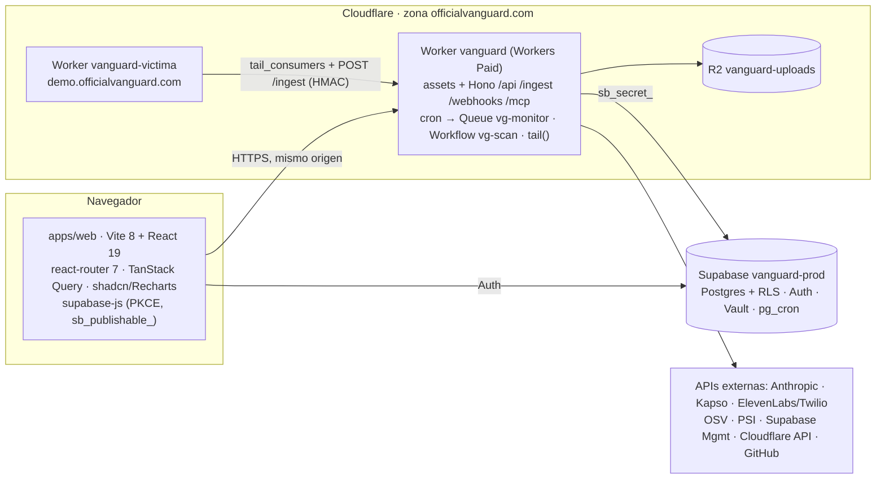

## 03. Stack tecnológico

> **Qué fija esta sección:** qué se instala (versión exacta), dónde corre, qué cuentas hay que abrir y quién, cuánto cuesta, cómo queda la zona `officialvanguard.com` en Cloudflare y qué variables de entorno existen. Sigue las decisiones canónicas §3–§5 y §14 (`00-decisiones-canonicas.md`); la arquitectura está en la 04, el cifrado en la 05, la seguridad del producto en la 06, los contratos en la 15 y el horario en la 16.
> **Regla de versiones:** exactas, sin `^` ni `~`; `pnpm install --frozen-lockfile` en CI; nunca se sube de versión mayor durante el hackatón. Todas las versiones de esta sección se comprobaron hoy (24-oct-2026, 01:30 Caracas) en el registro: [verificado: https://registry.npmjs.org/-/package/<paquete>/dist-tags]. Donde la última versión es otra, se indica y se explica por qué no se adopta.

### 03.1 Decisión por capa

| Capa | Tecnología | Versión | Por qué | Alternativa descartada |
|---|---|---|---|---|
| Runtime dev y CI | Node | 24.x (≥ 24.12) | Ejecuta TypeScript quitando tipos, sin `tsx` ni esbuild [verificado: changelog de typescript.md en nodejs.org, vía R17 §7] | `tsx`/esbuild (instalan `.exe` que bloquea Norton), Bun, Deno |
| Monorepo | pnpm workspaces | 10.34.7 | Workspaces con `--filter`, sin orquestador extra | Turborepo; pnpm 11/12 (cambia dónde se leen los ajustes, ver 03.2) |
| Lenguaje | typescript | 6.0.3 (la última es 7.0.2) | La 7.x no trae API de compilador en JS (R16 §1) | typescript 7.0.2 |
| Cómputo de producción | Cloudflare Workers **Paid** | `compatibility_date` `2026-10-20`, flag `nodejs_compat` | 30 s de CPU y 10.000 subpeticiones por invocación; Free da 10 ms y 50 [verificado: https://developers.cloudflare.com/workers/platform/limits/] | Vercel + Railway (decisión del equipo), Pages (sin Cron, Queues ni Workflows) [verificado: https://developers.cloudflare.com/workers/static-assets/migration-guides/migrate-from-pages/], Workers Free |
| Borde y dominio | Zona Cloudflare **Free** `officialvanguard.com`, Custom Domains en el apex y en `demo.` | — | WAF, rate limit y analítica de zona sobre nuestra propia app (dogfooding, 08) | Solo `*.workers.dev`: no pasa por la zona, sin WAF ni analítica [verificado: https://developers.cloudflare.com/workers/configuration/routing/workers-dev/] |
| Build del FRONT | vite + @vitejs/plugin-react | 8.3.5 + 6.1.2 | Vite 8 usa rolldown y lightningcss (addons `.node`), no esbuild (R17 §2) | Next.js 16 + OpenNext (issues abiertos #1400 y #1373 de `proxy.ts`; Windows sin soporte garantizado) [verificado: https://opennext.js.org/cloudflare] |
| UI | react, react-dom + react-router | 19.3.1 + 7.18.4 (la última es 8.5.0, del 19-oct) | SPA servida como assets: no gasta CPU del Worker | react-router 8.x (mayor recién salida) |
| Datos en el navegador | @tanstack/react-query | 5.104.5 | Polling de 2–3 s en P0; en P1 Realtime solo invalida claves (canónico §7) | SWR; Realtime desde P0 |
| Estilos y componentes | tailwindcss + @tailwindcss/vite; shadcn (CLI) | 4.3.3 + 4.3.3; 4.22.1 solo con `pnpm dlx` | Sidebar y Chart listos, componentes copiados al repo [verificado: https://ui.shadcn.com/docs/components/sidebar] | MUI, Chakra |
| Gráficos | recharts | 3.10.1 | La instala `shadcn add chart` | `@tremor/react` (exige React 18) (R16 §3.1) |
| Contratos | zod | 4.6.7 | Un esquema para validar en el BACK y tipar el FRONT | valibot, TypeBox |
| API | hono | 4.13.13 (la 5.0.0-rc existe; no se adopta) | Mismo `app` en el Worker y en Node 24 para desarrollo | itty-router, Express (no corre en Workers) |
| Cliente Supabase | @supabase/supabase-js | 2.118.0 | Soporta Workers [verificado: https://github.com/supabase/supabase-js]; en el navegador con PKCE | `@supabase/ssr` (no hay SSR) |
| Base, Auth, Vault, Realtime, cron | Supabase **Free** | Postgres 17 [no verificado: versión exacta del proyecto] | RLS por `org_id`, Vault para la KEK, `pg_cron` para limpiezas | Cloudflare D1 (sin RLS ni Auth), Neon |
| Trabajos | Cron Triggers + Queue `vg-monitor` + Workflow `vg-scan` | incluidos en Paid | Monitores por minuto y auditorías con pasos durables (R17 §4) [verificado: https://developers.cloudflare.com/workflows/reference/limits/] | `pgmq` con un proceso permanente; Durable Objects (anulan las Version URLs) |
| Archivos (P1) | R2, bucket `vanguard-uploads` | — | Binding nativo, 10 GB-mes gratis [verificado: https://developers.cloudflare.com/r2/pricing/] | Supabase Storage (1 GB, URLs firmadas) |
| Cripto | WebCrypto (AES-256-GCM, HKDF, HMAC) | nativo | Mismo código en Worker y Node 24 [verificado: https://developers.cloudflare.com/workers/runtime-apis/web-crypto/] | `node:crypto` (otro código), libsodium |
| IA | @anthropic-ai/sdk; `claude-sonnet-5-5`, `claude-opus-5-5`, `claude-haiku-5-5` | 0.137.0 (la última es 1.3.0, del 23-oct) | Trae `zodOutputFormat` en `@anthropic-ai/sdk/helpers/zod`, construido sobre `zod/v4`, y acepta zod `^4.0.0` como dependencia par opcional [verificado: https://unpkg.com/@anthropic-ai/sdk@0.137.0/helpers/zod.d.ts y https://registry.npmjs.org/@anthropic-ai/sdk/0.137.0]. Esto resuelve el [no verificado] del canónico §8 | SDK 1.x (salió el 21-oct), Fable 5.1, conector MCP en el bucle |
| ZIP en memoria | fflate | 0.8.3 | JS puro, sin dependencias | yauzl (necesita `fs`/streams de Node), jszip |
| Lockfiles (P1) | yaml | 2.9.1 | `pnpm-lock.yaml`; `package-lock.json` y `composer.lock` van con `JSON.parse` | `snyk-nodejs-lockfile-parser` (18 dependencias) (R11 §3) |
| Vulnerabilidades | API de OSV.dev por `fetch` | v1 | Gratis, sin clave, `querybatch` ≤ 1000 consultas (R11 §2.3) | NVD (5 peticiones cada 30 s), `osv-scanner` (binario) |
| Secretos en código | Regex propias en `packages/core/src/secrets/` | — | Cubre Supabase y JWT `service_role`, que gitleaks no trae (R11 §4.4) | Binario gitleaks; `secretlint` 13.0.7 solo como complemento P2 |
| Rendimiento (P1) | PageSpeed Insights API v5 por `fetch` | v5 | Lighthouse real sin lanzar Chrome | Librería `lighthouse` (necesita Chrome) |
| MCP propio (P1) | @modelcontextprotocol/server | 2.3.1 (la última es 2.4.0, del 23-oct) | `WebStandardStreamableHTTPServerTransport` sin estado montado en Hono [verificado: https://unpkg.com/@modelcontextprotocol/server@2.3.1/dist/index.d.mts]; depende de zod `^4.2.0`, que se deduplica con 4.6.7 [verificado: https://registry.npmjs.org/@modelcontextprotocol/server/2.3.1] | `agents` (arrastra esbuild), `mcp-handler` (pensado para Next) |
| WhatsApp | Kapso, REST por `fetch` | Graph v24.0 | Es la API de Meta con otra base URL; sandbox sin plantillas (R14 §1) | `@kapso/whatsapp-cloud-api` 0.4.0 (versión 0.x, no aporta nada a un `fetch`) |
| Voz | ElevenLabs Agents + número de Twilio, por `fetch` | `/v1/convai/twilio/outbound-call` | Llamada saliente con `dynamic_variables` (R14 §2) | SDK `twilio` (solo Node); Twilio `<Say>` queda como plan B |
| Pruebas | vitest | 4.1.12 (la última es 5.0.5) | Corre en Node sin `workerd` | vitest 5; `@cloudflare/vitest-pool-workers` (necesita workerd) |
| CI/CD | GitHub Actions + wrangler | wrangler 4.152.0, solo `pnpm dlx` | Nadie despliega desde Windows (R17 §7) | Workers Builds; wrangler en `package.json`; CLI `cf` (beta) |
| Tipos del Worker | @cloudflare/workers-types (tipos del runtime) + `worker-configuration.d.ts` generado **solo con los bindings** | 5.20261024.1 | Solo `.d.ts`. El archivo se genera con `pnpm dlx wrangler@4.152.0 types --env-interface CloudflareBindings --include-runtime=false` (en CI o Codespaces, nunca en Windows) y se versiona. Sin `--include-runtime=false`, wrangler 4 mete también los tipos del runtime y chocan con `@cloudflare/workers-types` [verificado: https://developers.cloudflare.com/workers/languages/typescript/] | Ejecutar `wrangler types` en cada laptop; generar el runtime y quitar `@cloudflare/workers-types` (lo fija el canónico §3) |
| API local | @hono/node-server | 2.1.5 | `node --env-file=.dev.vars --watch src/dev-node.ts` | `wrangler dev` (necesita workerd) |

**Prohibido en cualquier `package.json`:** la lista del canónico §3, más los SDK `twilio`, `@elevenlabs/*`, `@kapso/*` y `octokit` (todo va por `fetch`), y `eslint`/`prettier` en P0 (más dependencias sin valor para la demo). La regla «`apps/web` no importa `@vanguard/core`» se comprueba con un script de Node sin dependencias (03.8, ST-04).



### 03.2 Librerías npm exactas por paquete del monorepo

Los nombres de paquete son `@vanguard/<carpeta>`. Todos llevan `"type": "module"` (Node 24 trata los `.ts` según ese campo), `"private": true` y `"exports": { ".": "./src/index.ts" }` en los dos `packages/*` (canónico §5). Los paquetes internos se declaran como `"workspace:*"`. Cada paquete que ejecuta `tsc` o `vitest` en sus scripts los declara también en sus `devDependencies` con la misma versión que la raíz (`typescript` 6.0.3, `vitest` 4.1.12); pnpm los deduplica.

| Paquete (dueño) | `dependencies` | `devDependencies` | Scripts |
|---|---|---|---|
| raíz `vanguard` (ORQUESTADOR) | — | `typescript` 6.0.3, `vitest` 4.1.12, `@types/node` 24.19.2 (última 24.x; la `latest` es 26.6.5 y no corresponde a Node 24) | ver bloque abajo |
| `@vanguard/web` (FRONT; manda la tabla de S14 §14.2) | `react` 19.3.1, `react-dom` 19.3.1, `react-router` 7.18.4, `@tanstack/react-query` 5.104.5, `@supabase/supabase-js` 2.118.0, `zod` 4.6.7, `recharts` 3.10.1, `@fontsource-variable/geist` 5.3.0, `@fontsource-variable/geist-mono` 5.3.0 (fuentes autoalojadas: la CSP no deja cargar Google Fonts), `@vanguard/contracts`. Las que escribe `shadcn init/add` (versiones de hoy como referencia, se fijan sin `^`): `class-variance-authority` 0.7.1, `clsx` 2.1.1, `tailwind-merge` 3.7.0, `lucide-react` 1.61.0, `tw-animate-css` 1.4.0 y las primitivas que pida cada componente (p. ej. `radix-ui`) [no verificado: conjunto exacto que instala shadcn 4.22.1] | `vite` 8.3.5, `@vitejs/plugin-react` 6.1.2, `tailwindcss` 4.3.3, `@tailwindcss/vite` 4.3.3, `@types/react` 19.3.0, `@types/react-dom` 19.3.0, `typescript` 6.0.3, `vitest` 4.1.12 | Los de S14 §14.2: `dev`: `vite` · `dev:fixtures`: `vite --mode fixtures` · `build`: `tsc --noEmit -p . && vite build` · `typecheck`: `tsc --noEmit -p .` · `test`: `vitest run` · `preview`: `vite preview` |
| `@vanguard/api` (BACK) | `hono` 4.13.13, `@supabase/supabase-js` 2.118.0, `@anthropic-ai/sdk` 0.137.0, `zod` 4.6.7, `fflate` 0.8.3, `@vanguard/contracts`, `@vanguard/core`; P1: `@modelcontextprotocol/server` 2.3.1 | `@hono/node-server` 2.1.5, `@cloudflare/workers-types` 5.20261024.1, `typescript` 6.0.3, `vitest` 4.1.12 | `dev`: `node --env-file=.dev.vars --watch src/dev-node.ts` · `typecheck`: `tsc --noEmit -p .` · `test`: `vitest run` |
| `@vanguard/victima` (BACK, zona del orquestador) | `hono` 4.13.13 | `@hono/node-server` 2.1.5, `@cloudflare/workers-types` 5.20261024.1, `typescript` 6.0.3 | `dev`: `node --env-file=.dev.vars --watch src/dev-node.ts` (puerto 8788) · `typecheck`. Su `Env` (3 cadenas: `VG_INGEST_URL`, `VG_INGEST_CONN_ID`, `VG_INGEST_SECRET`) se escribe a mano: no necesita `worker-configuration.d.ts` |
| `@vanguard/contracts` (orquestador) | `zod` 4.6.7 | `typescript` 6.0.3, `vitest` 4.1.12 | `test`: `vitest run` (los fixtures validan contra sus esquemas) · `typecheck` |
| `@vanguard/core` (BACK) | `@vanguard/contracts`, `fflate` 0.8.3 (`leerZip` vive en `packages/core/src/zip.ts`, §09; con pnpm estricto `core` debe declararla); P1: `yaml` 2.9.1 (lockfile de pnpm) | `typescript` 6.0.3, `vitest` 4.1.12 | `test`: `vitest run` · `typecheck` |

Componentes de shadcn, una sola vez y desde `apps/web` (FRONT, P0): la lista exacta de `pnpm dlx shadcn@4.22.1 init` y `add` es la de S14 §14.2 (dueño único del FRONT); esta sección no mantiene otra. pnpm 10 no ejecuta los scripts `postinstall` de las dependencias: si avisa «Ignored build scripts» (p. ej. `@tailwindcss/oxide`), **no** se aprueba nada con `pnpm approve-builds`; los addons nativos llegan como `optionalDependencies` [no verificado: lista exacta del aviso].

Archivos raíz (ORQUESTADOR, P0):

```jsonc
// package.json
{ "name": "vanguard", "private": true, "type": "module", "packageManager": "pnpm@10.34.7",
  "engines": { "node": ">=24.12" },
  "scripts": { "dev:web": "pnpm --filter @vanguard/web dev", "dev:api": "pnpm --filter @vanguard/api dev",
    "dev:victima": "pnpm --filter @vanguard/victima dev", "typecheck": "pnpm -r --if-present typecheck",
    "test": "pnpm -r --if-present test", "build": "pnpm --filter @vanguard/web build",
    "lint:imports": "node scripts/lint-imports.mjs" },
  "devDependencies": { "typescript": "6.0.3", "vitest": "4.1.12", "@types/node": "24.19.2" } }
```

```yaml
# pnpm-workspace.yaml
packages: ["apps/*", "packages/*"]
saveExact: true          # pnpm ≥ 11 lee los ajustes aquí [verificado: https://pnpm.io/settings]
```

`.npmrc` de la raíz, una línea: `save-exact=true` (pnpm 10 todavía lee los ajustes desde `.npmrc` [no verificado hoy para 10.34.7]; tener los dos no estorba).

Con `save-exact` activo, `pnpm add` y `shadcn add` escriben versiones sin `^`. Si alguna aparece con `^`, se corrige a mano antes del commit.

`tsconfig.base.json` (los demás lo extienden). TypeScript 6.0 cambió el valor por defecto de `types` a `[]`: ya no incluye por su cuenta todos los `@types/*` instalados [verificado: https://devblogs.microsoft.com/typescript/announcing-typescript-6-0/]. Sin `"types": ["node"]`, `packages/core` no ve `crypto.subtle` ni `TextEncoder` y `typecheck` falla. Cada paquete sobrescribe `types` así. `apps/web` usa `"types": ["vite/client"]`, `"lib": ["ES2023","DOM","DOM.Iterable"]`, `"jsx": "react-jsx"`, `"paths": {"@/*": ["./src/*"]}` (S14 §14.2) e `"include": ["src"]`: `vite.config.ts` importa `node:url`, Vite lo carga sin pasar por `tsc`, y con solo `vite/client` el `typecheck` fallaría. `apps/api` y `apps/victima` usan `"types": ["@cloudflare/workers-types", "node"]` (`node` para `dev-node.ts` y `process.env`); `apps/api` además ve su `worker-configuration.d.ts` porque está en la carpeta del proyecto (no se pone `include` restrictivo):

```json
{ "compilerOptions": { "target": "ES2023", "lib": ["ES2023"], "module": "ESNext", "moduleResolution": "Bundler",
  "types": ["node"], "strict": true, "noUncheckedIndexedAccess": true, "noEmit": true, "skipLibCheck": true,
  "isolatedModules": true, "verbatimModuleSyntax": true, "erasableSyntaxOnly": true, "allowImportingTsExtensions": true,
  "resolveJsonModule": true } }
```

### 03.3 Servicios externos y cuentas a crear

Las cuentas las abre la persona indicada; la columna «Entrega» dice qué identificador o variable sale de cada una (detalle en 03.6). Los tokens de clientes (PAT de Supabase, tokens de Cloudflare y de GitHub) **nunca** van en variables de entorno: se pegan en la pantalla Conexiones y se guardan cifrados (05).

| # | Servicio | Para qué | Plan | Quién | Cuándo | Tarda | Entrega | Prio |
|---|---|---|---|---|---|---|---|---|
| 1 | Cloudflare, cuenta del equipo | Workers Paid, zona, Queues, Workflows, R2 | Paid 5 USD/mes + zona Free | Giovanni (tarjeta) | **cuenta y zona ya existen**; Workers Paid antes de las 10:00 del sábado | 10 min | `CLOUDFLARE_ACCOUNT_ID`, subdominio `*.workers.dev`. La cuenta ya tiene un único Worker, `vanguard`, creado el 24-oct a las 01:30 (Caracas), que sirve la página provisional [verificado: listado de Workers de la cuenta, 01:56]. Que el plan sea ya Paid [no verificado: solo se ve en el panel] | P0 |
| 2 | Cloudflare, token de despliegue | `wrangler deploy` desde Actions | — | Giovanni | hora 1 | 5 min | `CLOUDFLARE_API_TOKEN`: plantilla «Edit Cloudflare Workers» limitada a la cuenta y a la zona, más Queues Edit y Workers R2 Storage Edit para el bootstrap [no verificado: lista exacta, y si Workflows pide un permiso propio; si falla al crear el Custom Domain, añadir Zone › DNS Edit] | P0 |
| 3 | Cloudflare, tokens de dogfooding | Que VanGUARD vigile y actúe sobre nuestra zona como sobre un cliente | — | Gabriel | sábado 15:00 | 10 min | Ninguna variable: lectura (permisos del canónico §10.2) y acciones (Firewall Services Write) se pegan en Conexiones | P0 |
| 4 | Squarespace Domains | Registrador de `officialvanguard.com`; solo los nameservers y el registro DS | ya pagado | Giovanni | **hecho**: nameservers de Cloudflare y DNSSEC activo (03.4) | — | — | P0 |
| 5 | Supabase, cuenta del equipo | Proyectos `vanguard-prod` y `vanguard-dev` (los 2 activos que permite Free) [verificado: https://supabase.com/pricing] | Free | Daniel (BACK) | hora 1 | ~5 min por proyecto [no verificado] | `SUPABASE_URL`, `SUPABASE_SECRET_KEY`, `VITE_SUPABASE_URL`, `VITE_SUPABASE_PUBLISHABLE_KEY`; secretos de Vault `kek_v1` y `fp_pepper_v1` (05) | P0 |
| 6 | Supabase, cuenta de Gabriel | Proyecto víctima `vanguard-demo`, sembrado con fallas | Free | Gabriel | antes de las 12:00 | 5 min + semilla | PAT con alcance `sbp_fc…` de solo lectura, pegado en Conexiones | P0 |
| 7 | Anthropic Console | Workspaces `team22-dev` (límite 100 USD) y `team22-prod` (límite 150 USD), cada uno con su key; revisar el nivel en Usage › Limits (una org nueva puede estar en «Evaluation») (R12 §9 y §13.2) | créditos 250 USD | Giovanni | hora 1 | 10 min | `ANTHROPIC_API_KEY` (dev solo en `.dev.vars`; prod solo como secreto del Worker) | P0 |
| 8 | Kapso | Sandbox de WhatsApp (interactivos sin plantilla) y webhook | Free (2 USD de crédito) + recarga de 5 USD | Gabriel | antes de las 10:00 | 10 min | `KAPSO_API_KEY`, `KAPSO_PHONE_NUMBER_ID`, `KAPSO_WEBHOOK_SECRET` | P0 |
| 9 | Kapso con número propio + plantilla de Meta `alerta_seguridad_v1` | Avisar fuera de la ventana de 24 h | Free | Gabriel | pedirla antes de las 12:00 | Meta revisa «hasta 24 h», más en cuentas nuevas (R14 §0) | `KAPSO_WABA_ID` | P1 |
| 10 | Twilio | Número de EE. UU. con Voice, permiso geográfico de Venezuela, API key | Cuenta actualizada (recarga ~20 USD [no verificado: mínimo]) | Gabriel | antes de las 10:00 | 20 min | Número para ElevenLabs (P0); `TWILIO_*` para el plan B `<Say>` (P1) | P0 |
| 11 | ElevenLabs | Agente «VanGUARD» en español (90 s), número de Twilio importado, webhook post-llamada; key limitada a convai y TTS con tope de créditos | Starter (1 USD el primer mes) [verificado: https://elevenlabs.io/pricing/agents, vía R14] | Gabriel | antes de las 12:00 | 45 min | `ELEVENLABS_API_KEY`, `ELEVENLABS_AGENT_ID`, `ELEVENLABS_PHONE_NUMBER_ID`, `ELEVENLABS_WEBHOOK_SECRET` | P0 |
| 12 | GitHub | Secretos de Actions en el repo de la org (camino A) o espejo personal (camino B); repo privado `vanguard-demo-victima` y su PAT fine-grained | Free | Giovanni (repo y secretos), Gabriel (víctima) | hora 1 | 15 min | Secretos y variables de Actions (03.6) | P0 |
| 13 | GitHub OAuth App «VanGUARD Login» | Login con GitHub | Free | Daniel | domingo antes de las 10:00 | 5 min | Client ID y secret van al panel de Supabase (Authentication › Providers › GitHub), no a variables | P1 |
| 14 | Google Cloud | Proyecto con API key restringida a «PageSpeed Insights API» | gratis [no verificado: cuota oficial] | Gabriel | **sábado 15:00** (la siembra real mide a las 16:30, S10 RND-02) | 10 min | `PSI_API_KEY` | **P0** |
| 15 | GitHub Codespaces | Solo si alguien necesita `wrangler dev` real | 120 h-núcleo/mes gratis [verificado: https://docs.github.com/en/billing/concepts/product-billing/github-codespaces, vía R17] | quien lo necesite | emergencia | 5 min | — | P2 |

### 03.4 Dominio `officialvanguard.com` en Cloudflare

**Estado comprobado hoy a las 01:56 (Caracas, 05:56 UTC) y repetido a las 02:25** por DoH y con `curl --resolve` contra una IP de Cloudflare [verificado: https://cloudflare-dns.com/dns-query, https://dns.google/resolve y listado de Workers de la cuenta]. Sustituye a la foto de las 01:35 y a la de S16, que daba la migración por no empezada:
- **Delegación hecha:** `NS` = `martin.ns.cloudflare.com` y `ziggy.ns.cloudflare.com`; el SOA lo sirve Cloudflare.
- **DNSSEC ya activo:** `.com` publica `DS 2371 13 2 706EEF…` (algoritmo 13, el de Cloudflare), la zona publica sus `DNSKEY` y los resolutores devuelven `AD=1`. **Regla:** nunca apagar DNSSEC en Cloudflare ni cambiar de nameservers sin quitar antes el DS en Squarespace y esperar su TTL (6 h), porque el dominio dejaría de resolver en todos los resolutores que validan DNSSEC.
- **El apex y `www` ya resuelven a Cloudflare con proxy** (`104.21.53.192`, `172.67.217.242` y dos AAAA `2606:4700:…`). Los dos sirven la página provisional «VanGUARD» (la carpeta `site/` del repo, sin seguimiento: `index.html` + `_headers`) desde el Worker `vanguard`, el único de la cuenta, creado a las 01:30. `http://` responde 301 a `https://`. Hay dos cosas sin terminar: (a) `www` devuelve **200** con la misma página, no un 301 al apex; (b) `/api/health` no da JSON: a las 01:56 devolvía el HTML de la página (fallback de SPA) y a las 02:25 ya responde **404** (el provisional quedó sin fallback de SPA, así que `/.env` y `/wp-login.php` también dan 404 por el borde de Cloudflare) [verificado: `curl --resolve officialvanguard.com:443:104.21.53.192`]. Las dos se resuelven en ST-01 y ST-03.
- Ya existen `TXT @ "v=spf1 -all"` y `TXT _dmarc "v=DMARC1; p=reject; sp=reject; adkim=s; aspf=s"`. No hay MX, CAA ni DKIM. `demo.officialvanguard.com` todavía no existe. Con DNSSEC, Cloudflare responde NOERROR sin datos en vez de NXDOMAIN.
- Los resolutores con caché, incluido el de la laptop donde se comprobó, todavía sirven la página «Próximamente» de Squarespace hasta que venza su TTL. Para ver lo real: `ipconfig /flushdns` (PowerShell) o `curl --resolve officialvanguard.com:443:104.21.53.192 https://officialvanguard.com`.

> **Resuelto:** (canónico §4, paso 4) Un Custom Domain exige «an active Cloudflare zone» [verificado: https://developers.cloudflare.com/workers/configuration/routing/custom-domains/]. Ya no bloquea: la zona sirve tráfico con proxy y el Worker `vanguard` responde en el apex, así que el validador del hackatón ya recibe 200 en `https://officialvanguard.com`.
>
> **Decidido:** (canónico §4, paso 5, DMARC; el canónico ya está corregido) El canónico pide `p=quarantine`, pero la zona ya tiene `p=reject; sp=reject`, que es lo recomendado para un dominio que no envía correo. Se conserva `p=reject`. La regla CF-DNS-05 de R10 §6 solo comprueba que exista, así que la auditoría propia sigue en verde.
>
> **Decidido:** (canónico §4, paso 3 y S06 06.11, DNSSEC) Ya está activo. Se quita de las tareas pendientes y queda la regla de arriba.

**Pasos que faltan (ORQUESTADOR, P0; nada de esto toca el código):**
1. Panel de Cloudflare → `officialvanguard.com` → Overview: confirmar que la zona está **Active** y que el plan de Workers es **Paid** (ST-02). Para comprobar la delegación desde Git Bash: `curl -s "https://cloudflare-dns.com/dns-query?name=officialvanguard.com&type=NS" -H "accept: application/dns-json"`.
2. Workers & Pages → `vanguard` → Settings → Domains & Routes: dejar **solo** `officialvanguard.com` como Custom Domain. Si `www.officialvanguard.com` figura ahí como Custom Domain o ruta (eso explica que hoy responda 200), se quita (al quitar el Custom Domain se borra su registro). Antes de crear nada, mirar en DNS → Records qué registro sirve hoy `www` y **no duplicar**: si ya hay un `A`/`AAAA` proxied, se reutiliza en el paso 4. Borrar solo los `CNAME` de `www` y de `demo` que queden de Squarespace, porque un Custom Domain no se crea sobre un hostname con CNAME [verificado: misma página de Custom Domains]. El apex **no** se toca: hoy el validador recibe 200.
3. El primer deploy de `apps/api` desde Actions (ST-06) **reemplaza** el Worker provisional (mismo nombre `vanguard`) y deja `GET /api/health` → `{"ok":true,...}`. El Custom Domain del apex se declara en `routes` del `wrangler.jsonc` (03.7) para que ningún deploy lo quite. `vanguard-victima` → Custom Domain `demo.officialvanguard.com` con su primer deploy. Cloudflare crea el registro y un Advanced Certificate para cada hostname [verificado: misma página]. Que un deploy de wrangler sin terminal acepte pisar los ajustes de dominio hechos desde el panel [no verificado]: si el primer deploy de CI falla por eso, se quita el dominio en el panel y se vuelve a desplegar.
4. `www` (siguiente tarea P0 del ORQUESTADOR): si no quedó ningún registro reutilizable, crear `A www 192.0.2.0` y `AAAA www 100::`, ambos **proxied**, y la Redirect Rule 301 `https://www.*` → `https://${1}` conservando la query (canónico §4) [verificado: https://developers.cloudflare.com/workers/configuration/routing/custom-domains/, apartado «Redirect between www and root domain»]. Las Single Redirects son lo primero que corre entre las reglas de la zona [verificado: https://developers.cloudflare.com/rules/url-forwarding/].
5. Ajustes de seguridad de la tabla siguiente. Después, verificar con `curl -sI https://officialvanguard.com` (200), `curl -s https://officialvanguard.com/api/health` (JSON `{"ok":true,...}`), `curl -sI http://officialvanguard.com` (301 a https) y `curl -sI "https://www.officialvanguard.com/x?y=1"` (301 a `https://officialvanguard.com/x?y=1`).
6. La carpeta `site/` (página provisional, **sin versionar**: está en `.gitignore`) y el `apps/api/wrangler.jsonc` provisional son piezas temporales de la zona raíz del ORQUESTADOR; se borran cuando el primer deploy de CI (F-02 de S14 + E1 de S15) sustituya al Worker `vanguard`. Así nadie vuelve a desplegarla encima del producto.
7. **Configuration Rule para la víctima:** `http.host eq "demo.officialvanguard.com"` → **Browser Integrity Check off** (`bic: false`) [verificado: https://developers.cloudflare.com/rules/configuration-rules/settings/]. Sin ella el borde corta `User-Agent: sqlmap/1.8` con 403 y «error code: 1010» y el simulacro no llega a la víctima (comprobado con `curl -A` contra el apex, S16 16.5). Plan B: `--ua "nikto/2.5.0"`, que pasa BIC y casa `CF_UA_TOOL`. El apex conserva BIC.

| Ajuste | Valor | Dónde (panel) / id de API | Cuándo | Lo audita (R10 §6) |
|---|---|---|---|---|
| Modo SSL | Full (strict) | SSL/TLS › Overview · `ssl=strict` | P0, sábado 10:00 | CF-TLS-01 |
| Always Use HTTPS | on | SSL/TLS › Edge Certificates · `always_use_https=on` | P0 | CF-TLS-03 |
| TLS mínimo / TLS 1.3 | 1.2 / on | Edge Certificates · `min_tls_version="1.2"`, `tls_1_3=on` | P0 | CF-TLS-02, CF-TLS-05 |
| WAF administrado | Free Managed Ruleset desplegado (existe en todos los planes [verificado: https://developers.cloudflare.com/waf/managed-rules/]) | Security › Security rules › Managed rules · fase `http_request_firewall_managed`, regla `execute` | P0 (comprobar si ya viene desplegado [no verificado]; si no, desplegarlo) | CF-WAF-01 |
| Rate limit (Free: 1 regla, campos Path y Verified Bot, conteo por IP, periodo 10 s, mitigación 10 s, sin expresión de conteo propia) [verificado: https://developers.cloudflare.com/waf/rate-limiting-rules/, 01:56] | El valor de S06 06.9: `http.request.uri.path contains "/api/"`, **400 peticiones por 10 s**, bloquear 10 s. Si el editor de Free rechaza `contains` [no verificado], usar `starts_with(http.request.uri.path, "/api/")`. Free no puede filtrar por host, así que la regla cuenta también `/api/productos` y `/api/admin` de `demo.officialvanguard.com`. Por eso el umbral (40 req/s) tiene que quedar holgadamente por encima del simulacro (≤ 20 req/s en total, canónico §11): el bloqueo de la demo lo hace VanGUARD y no esta regla | Security › Security rules › Rate limiting rules · fase `http_ratelimit` | P0 | CF-WAF-02 |
| Bot Fight Mode | **off** | Security › Settings, filtro «Bot traffic» › Bot fight mode [verificado: https://developers.cloudflare.com/bots/get-started/bot-fight-mode/]. Por API **no** es un `settings/{id}`: `PUT /zones/{zone_id}/bot_management` con `{"fight_mode": false}` [no verificado hoy: forma exacta del endpoint] | P0 | CF-BOT-01 no aplica: la zona sirve API y webhooks, y Bot Fight Mode no corre en el motor de reglas, así que no se puede saltar con reglas [verificado: misma página] |
| HSTS | `max_age=15552000`, `include_subdomains=true`, `preload=false`, `nosniff=true` | Edge Certificates › HSTS · `security_header` | **P1**: el sábado a las 19:00, tras la primera prueba de punta a punta, o el domingo a las 07:00 (S06 06.11). Solo si apex, `www` y `demo` responden bien por HTTPS | CF-TLS-04 |
| SPF / DMARC / DKIM nulo | SPF y DMARC ya están; añadir `TXT *._domainkey "v=DKIM1; p="` [propuesta] | DNS › Records | P0 | CF-DNS-05 |
| Email Routing | apagado; si se activa, Cloudflare añade MX y cambia el SPF [no verificado] | Email › Email Routing | P2 | — |
| DNSSEC | **ya activo** (DS en `.com`, `AD=1`); no tocar (regla del estado de arriba) | DNS › Settings | hecho | — |
| Browser Integrity Check en la víctima | off **solo** para `demo.officialvanguard.com` (Configuration Rule, paso 7) | Rules › Configuration Rules · `bic: false` | P0, con el Custom Domain de `demo.` (sáb 15:00) | — |

Los nombres de menú del panel cambian a menudo [no verificado]. Por API hay tres familias distintas: (1) SSL, Always Use HTTPS, TLS mínimo, TLS 1.3 y HSTS son ajustes de zona, `PATCH /zones/{zone_id}/settings/{setting_id}` con cuerpo `{"value": ...}` [verificado: https://developers.cloudflare.com/api/resources/zones/subresources/settings/methods/edit/, vía R10]; (2) WAF administrado y rate limit son reglas del motor de reglas, en el punto de entrada de su fase (`/zones/{zone_id}/rulesets/phases/{fase}/entrypoint`); (3) Bot Fight Mode va por `/bot_management`. El módulo Cloudflare (S08) lee cada familia con su endpoint. La segunda capa es el binding `RL_API` del Worker, que cuenta por usuario (`u:<user_id>`) y no por IP. Valor decidido: **300/60 s** (S15 15.3, S06 06.9), porque solo el polling P0 ya pide ~90/min por pestaña.

**URLs canónicas que dependen del dominio** (nadie escribe otra; no se crean `api.` ni `mcp.`):

| Uso | URL | Dónde se configura | Dueño |
|---|---|---|---|
| Producto (SPA) y `deploy-url` | `https://officialvanguard.com` | Custom Domain del Worker `vanguard`; ya en `platanus-hack-project.jsonc` | ORQUESTADOR |
| Salud (validador y monitoreo) | `https://officialvanguard.com/api/health` | Hono | BACK |
| Respaldo | `https://vanguard.<subdominio>.workers.dev` (`"workers_dev": true`) | `wrangler.jsonc` | ORQUESTADOR |
| App víctima | `https://demo.officialvanguard.com` | Custom Domain de `vanguard-victima` | ORQUESTADOR |
| Supabase Auth, Site URL | `https://officialvanguard.com` | Supabase › Authentication › URL Configuration | BACK |
| Supabase Auth, Redirect URLs | **URLs exactas, sin comodines.** En `vanguard-prod`: `https://officialvanguard.com/auth/callback` y `https://vanguard.<subdominio>.workers.dev/auth/callback`. En `vanguard-dev`: `http://localhost:5173/auth/callback`. Supabase admite `*` y `**` [verificado: https://supabase.com/docs/guides/auth/redirect-urls], pero nuestra propia regla `SB_AUTH_REDIRECT_WILDCARD` (S07) marca como hallazgo cualquier `*`, y la auditoría de nuestro `vanguard-prod` (S06 06.12, D4) tiene que salir en verde. Solo el login con GitHub (P1) usa `redirectTo`. Correo y contraseña sin confirmación, y los anónimos, no redirigen. Las previews no tienen login con GitHub | ídem; además «Allow anonymous sign-ins» activado, «Confirm email» apagado (canónico §2) y límite de anónimos subido a 300/h por IP (S06 06.9). El claim `is_anonymous` existe en el JWT [verificado: https://supabase.com/docs/guides/auth/auth-anonymous] | BACK |
| Retorno del login (P1) | `redirectTo: https://officialvanguard.com/auth/callback` | `signInWithOAuth` en `apps/web` | FRONT |
| Callback de la OAuth App de GitHub (P1) | `https://<ref-prod>.supabase.co/auth/v1/callback`; Homepage `https://officialvanguard.com` [verificado: https://supabase.com/docs/guides/auth/social-login/auth-github, vía R16 §6.2] | GitHub › Developer settings | BACK |
| Ingesta | `https://officialvanguard.com/ingest/v1/events` | `VG_INGEST_URL` de la víctima | BACK |
| Webhook de Kapso | `https://officialvanguard.com/webhooks/kapso` | Kapso › Webhooks | Gabriel |
| Webhook post-llamada de ElevenLabs (P1) | `https://officialvanguard.com/webhooks/elevenlabs` | ElevenLabs › Agents › Webhooks | Gabriel |
| Herramienta de voz `registrar_respuesta` (P1) | `https://officialvanguard.com/api/voz/respuesta` | Herramienta webhook del agente | Gabriel |
| MCP propio (P1) | `https://officialvanguard.com/mcp` | Hono; tokens `vgk_` | BACK |
| Exportar | `https://officialvanguard.com/api/orgs/:org/export?format=md\|json` | Hono | BACK |
| CORS | **ninguno**: todo es mismo origen y ninguna ruta envía `Access-Control-Allow-Origin`. En local, el proxy de Vite evita CORS | — | BACK |

### 03.5 Costos estimados del hackatón

| Concepto | Plan | USD que salen de una tarjeta | Fuente |
|---|---|---|---|
| Cloudflare Workers Paid | 5 USD/mes; incluye 10 M peticiones, 30 M ms de CPU, Queues (1 M operaciones), Workflows, Tail Workers | 5,00 | [verificado: https://developers.cloudflare.com/workers/platform/pricing/, vía R17 §8] |
| Zona `officialvanguard.com`, Custom Domains, certificados, WAF Free, 1 regla de rate limit | Free | 0 | [verificado: https://developers.cloudflare.com/waf/rate-limiting-rules/] |
| Dominio | Squarespace Domains, ya comprado | ya pagado | precio [no verificado] |
| R2 | 10 GB-mes gratis | 0 | [verificado: https://developers.cloudflare.com/r2/pricing/] |
| Supabase (3 proyectos en 2 cuentas) | Free | 0 | [verificado: https://supabase.com/pricing] |
| Claude API | créditos del equipo | 0 en efectivo; uso previsto ≤ 160 USD (100 desarrollo + 60 demo), reserva de 90 | canónico §8; R12 §13 |
| ElevenLabs | Starter, primer mes | 1,00 | [verificado: https://elevenlabs.io/pricing/agents, vía R14] |
| Twilio | recarga + número de EE. UU. (1,15 USD/mes) + móvil a Venezuela 0,1739 USD/min | ~21,15 | precios [verificado: https://www.twilio.com/en-us/voice/pricing/ve, vía R14]; recarga mínima [no verificado] |
| Kapso | Free + recarga de crédito para mensajes de servicio | 5,00 | [verificado: https://kapso.com/pricing, vía R14] |
| PageSpeed Insights | key gratuita | 0 | [no verificado: cuota oficial] |
| GitHub Actions y Codespaces | Free | 0 | minutos de Actions en repo privado [no verificado] |
| **Total en efectivo** | | **≈ 32 USD** + dominio ya pagado | |

### 03.6 Variables de entorno: catálogo y `.env.example`

Un solo catálogo en la raíz (`.env.example`, versionado, sin valores reales). Cada paquete copia solo su bloque a su archivo local, que está en `.gitignore`: `apps/web/.env.development.local` (nombre de S14 §14.2: solo lo carga `vite` en desarrollo), `apps/api/.dev.vars` y `apps/victima/.dev.vars` (Node los lee con `--env-file`). En producción, las variables marcadas «secreta» son secretos del Worker subidos con `wrangler deploy --secrets-file` desde Actions (03.7); la excepción es `IA_CORTE`, que nunca pasa por Actions. Las marcadas «var» van en `vars` del `wrangler.jsonc`, salvo `VG_VERSION`, que inyecta el deploy. Las rutas de menú de cada proveedor son orientativas [no verificado: cambian a menudo]. `VG_INGEST_URL` y `VG_INGEST_CONN_ID` son nombres nuevos que propone esta sección (el canónico solo nombra `VG_INGEST_SECRET`). S10 y el fragmento para clientes de S02 (02.5.2) ya los usan.

```dotenv
# .env.example · catálogo de TODAS las variables de VanGUARD · formato: [tipo] paquete · qué es · dónde se obtiene · prioridad
# Valores VACÍOS en el archivo versionado (S06 06.11): el formato va en el comentario, para que ni nuestro escáner
# de secretos ni el del jurado encuentren prefijos como sb_secret_ o sk-ant- en el repo.

# ── apps/web → apps/web/.env.development.local (Vite mete en el bundle público las VITE_ que el código lee) ──
# [pública] apps/web · URL de vanguard-prod (vanguard-dev en local), forma https://<ref>.supabase.co · Supabase › Project Settings › Data API › Project URL · P0
VITE_SUPABASE_URL=
# [pública] apps/web · clave publicable sb_publishable_… (rol anon/authenticated, aplica RLS) · Supabase › Project Settings › API Keys · P0
VITE_SUPABASE_PUBLISHABLE_KEY=
# [pública] apps/web · 1 = pantallas con packages/contracts/src/fixtures, sin BACK · NO se escribe en ningún archivo:
#   la activa el modo `pnpm --filter @vanguard/web dev:fixtures` (vite --mode fixtures); el mecanismo lo fija S14 (ver S06 06.12) · P0
# VITE_USE_FIXTURES=1
# [pública, solo dev] apps/web/vite.config.ts (vía loadEnv, nunca en el bundle) · destino del proxy de /api, /ingest y /mcp ·
#   :8787 local o https://pr-N-vanguard.<sub>.workers.dev (en una preview solo funcionan las lecturas: originGuard rechaza escrituras desde localhost) · P0
VITE_API_PROXY=http://localhost:8787

# ── apps/api → apps/api/.dev.vars (Node 24 en local) · en producción, Worker "vanguard" ──
# [var] apps/api · local | production (valores que compara S15 15.3: originGuard y requireProdHost; en producción: wrangler.jsonc › vars) · P0
VG_ENV=local
# [var] apps/api · origen público para enlaces, originGuard y requireProdHost · en producción https://officialvanguard.com · P0
APP_ORIGIN=http://localhost:5173
# [var] apps/api · versión que devuelve GET /api/health (E1) · NO va en vars: la inyecta el deploy con --var (03.7); local sin valor → "dev" · P0
VG_VERSION=
# [secreta*] apps/api · URL de Supabase (vanguard-dev en local, vanguard-prod en el Worker), forma https://<ref>.supabase.co · Project URL · P0 · *no es secreta, pero el canónico §14 la trata como secreto: nunca también en vars
SUPABASE_URL=
# [secreta] apps/api · sb_secret_… (salta RLS; SOLO servidor) · Supabase › Project Settings › API Keys › Secret keys › crear «vanguard-worker» · P0
SUPABASE_SECRET_KEY=
# [secreta] packages/core/src/crypto.ts vía apps/api · salt HKDF de la KEK, mitad Cloudflare del sobre (05) ·
#   node -e "console.log(require('node:crypto').randomBytes(32).toString('base64'))" (S05) · distinta en dev y prod; no rotar sin re-cifrar · P0
VG_KEK_PEPPER=
# [secreta] packages/core/src/crypto.ts · salt HKDF de la clave de huellas HMAC · mismo comando · P0
VG_FP_PEPPER=
# [reservada P2] getKeys (S05, rotación de la pimienta): pimienta anterior durante la ventana de rotación · no se crea en el hackatón
# VG_KEK_PEPPER_PREV=
# [secreta] apps/api/src/ia/claude.ts · key del workspace team22-dev (local) o team22-prod (Worker) · platform.claude.com › Settings › Workspaces › API keys · P0
ANTHROPIC_API_KEY=
# [secreta] apps/api/src/ia/claude.ts · segunda llave del interruptor: "1" = cero llamadas al modelo (las alertas siguen con plantillas); ausente o "0" = encendida ·
#   la cambia SOLO Giovanni en el panel (Workers & Pages › vanguard › Settings › Variables and Secrets), nunca desde Actions (03.7) · P0
IA_CORTE=
# [solo dev] apps/api, pruebas test:idor contra vanguard-dev · contraseñas de idor-a@vanguard.test e idor-b@vanguard.test (S05) · nunca en producción · P0
TEST_USER_A_PASSWORD=
TEST_USER_B_PASSWORD=
# [secreta] apps/api/src/notify/kapso.ts · API key del proyecto · Kapso › proyecto › API keys · P0
KAPSO_API_KEY=
# [secreta] apps/api/src/notify/kapso.ts · phone_number_id del número que envía (sandbox en P0) · Kapso › WhatsApp › Sandbox / Numbers · P0
KAPSO_PHONE_NUMBER_ID=
# [secreta] apps/api · id de la cuenta de WhatsApp Business, para plantillas · Kapso › número propio · P1
KAPSO_WABA_ID=
# [secreta] apps/api, /webhooks/kapso · secreto HMAC de X-Webhook-Signature · Kapso › Webhooks › crear con URL https://officialvanguard.com/webhooks/kapso · P0
KAPSO_WEBHOOK_SECRET=
# [secreta] apps/api/src/notify/elevenlabs.ts · key limitada a convai y TTS, con tope de créditos · elevenlabs.io › Developers › API Keys · P0
ELEVENLABS_API_KEY=
# [secreta] ídem · id del agente «VanGUARD» · ElevenLabs › Agents › agente · P0
ELEVENLABS_AGENT_ID=
# [secreta] ídem · id del número de Twilio importado · ElevenLabs › Phone Numbers · P0
ELEVENLABS_PHONE_NUMBER_ID=
# [secreta] apps/api, /webhooks/elevenlabs · secreto de ElevenLabs-Signature · ElevenLabs › Agents › Webhooks · P1
ELEVENLABS_WEBHOOK_SECRET=
# [secreta] apps/api, plan B de voz con <Say> · Account SID (AC…) · console.twilio.com › Account Info · P1
TWILIO_ACCOUNT_SID=
# [secreta] ídem · API key (SK…) y su secreto · Twilio › Account › API keys & tokens · P1
TWILIO_API_KEY=
TWILIO_API_SECRET=
# [secreta] ídem · número de EE. UU. en E.164 (+1…) · Twilio › Phone Numbers › Active numbers · P1
TWILIO_FROM=
# [secreta] apps/api/src/scans/psi.ts · key restringida a «PageSpeed Insights API» · Google Cloud › APIs & Services › Credentials · P0 (sáb 15:00, siembra de Rendimiento)
PSI_API_KEY=
# [reservada P1, solo si el orquestador NO aprueba la tabla export_links de S13] apps/api · clave HMAC de enlaces de export firmados · mismo comando que las pimientas
# VG_SHARE_KEY=

# ── apps/victima → apps/victima/.dev.vars · en producción, Worker "vanguard-victima" ──
# [var] apps/victima · endpoint de ingesta · en producción https://officialvanguard.com/ingest/v1/events · P0
VG_INGEST_URL=http://localhost:8787/ingest/v1/events
# [var] apps/victima · id de la conexión `ingest` (cabecera x-vg-conn) · se ve al crearla en Conexiones · P0
VG_INGEST_CONN_ID=
# [secreta] apps/victima · secreto HMAC de la ingesta · se muestra UNA vez al crear la conexión `ingest` · P0
VG_INGEST_SECRET=

# ── GitHub Actions (Settings › Secrets and variables › Actions): NO van en archivos locales ──
# secrets: CLOUDFLARE_API_TOKEN (03.3 #2) · CLOUDFLARE_ACCOUNT_ID (panel › Workers & Pages › Account details)
#          + todos los [secreta] de apps/api con valores de PRODUCCIÓN, MENOS IA_CORTE + VG_INGEST_SECRET
#          + SUPABASE_PROD_READ_PAT (PAT sbp_fc… de solo lectura de vanguard-prod, para scripts/check-rls.mjs de S06 06.11) · P0
#          + SUPABASE_DB_URL_DEV (psql de rls.sql contra vanguard-dev, S05) · P1 [propuesta de S05]
# vars:    VITE_SUPABASE_URL · VITE_SUPABASE_PUBLISHABLE_KEY (de vanguard-prod) · SUPABASE_PROD_REF (ref de vanguard-prod, S06 06.11)
```

Reglas: (1) ningún código lee una variable que no esté en este catálogo; si una sección nueva necesita otra, se añade aquí antes de usarla. (2) Solo las `VITE_*` que lee `apps/web/src` llegan al navegador. (3) `VG_KEK_PEPPER` y `VG_FP_PEPPER` se generan una vez por entorno y se guardan también en el gestor de contraseñas de Giovanni: si se pierden, no se pueden descifrar las credenciales guardadas (05). (4) Las keys de Anthropic de dev y prod nunca se cruzan (canónico §8). (5) `requireProdHost` (S15 15.3) compara el host con `APP_ORIGIN`. En local `APP_ORIGIN` es `http://localhost:5173` y el proxy de Vite reescribe el host a `localhost`, así que la guarda **pasaría** en local. Para que el envío real nunca salga de una laptop, la guarda exige también `VG_ENV === 'production'` (S15 15.3 ya lo recoge).

### 03.7 Configuración de despliegue ligada al dominio

Fragmentos que el orquestador aplica sobre el `wrangler.jsonc` y el `deploy.yml` de R17 §6.1 y §6.3 (la 04 y la 15 traen el resto de bindings):

```jsonc
// apps/api/wrangler.jsonc: solo cambian estas claves
"workers_dev": true,                                                     // explícito: con routes se inferiría false
"routes": [ { "pattern": "officialvanguard.com", "custom_domain": true } ], // solo el apex; www va por Redirect Rule (03.4)
"vars": { "VG_ENV": "production", "APP_ORIGIN": "https://officialvanguard.com" },  // SUPABASE_URL NO va aquí (es secreto); VG_VERSION la pone --var
"assets": { "directory": "../web/dist", "binding": "ASSETS", "not_found_handling": "single-page-application",
  // "/.*": todo archivo o carpeta con punto (/.env, /.git/config) llega a Hono y responde 404 JSON en vez del index.html
  // del fallback de SPA (S06 SEG-04); /.well-known/* también va a Hono salvo security.txt, que sirven los assets (`*` profundo y la
  // negación con ! gana [verificado por S06 06.11]; comprobar igual con curl que /.env da 404 y /.well-known/security.txt da 200)
  "run_worker_first": ["/api/*", "/ingest/*", "/webhooks/*", "/mcp", "/mcp/*", "/.*", "/.well-known/*", "!/.well-known/security.txt"] }
// Plan B de dominio: si la zona dejara de estar active, APP_ORIGIN pasa al *.workers.dev y se redespliega (S15, cabecera)

// apps/victima/wrangler.jsonc (completo)
{ "$schema": "https://unpkg.com/wrangler@4.152.0/config-schema.json", "name": "vanguard-victima", "main": "src/worker.ts",
  "compatibility_date": "2026-10-20", "compatibility_flags": ["nodejs_compat"], "workers_dev": true,
  "routes": [ { "pattern": "demo.officialvanguard.com", "custom_domain": true } ],
  "tail_consumers": [ { "service": "vanguard" } ],                       // desplegar antes "vanguard", que tiene tail()
  "vars": { "VG_INGEST_URL": "https://officialvanguard.com/ingest/v1/events", "VG_INGEST_CONN_ID": "<uuid>" } }
```

La víctima llama a `https://officialvanguard.com/ingest/v1/events` con `fetch()`: dentro de una misma zona, un Worker puede llamar a otro que esté en un Custom Domain sin service binding [verificado: https://developers.cloudflare.com/workers/configuration/routing/custom-domains/].

En `.github/workflows/deploy.yml` (bash, el shell por defecto en `ubuntu-latest`), el paso de producción mapea cada secreto en `env:` (`NOMBRE: ${{ secrets.NOMBRE }}`) y sustituye el `for` de R17 por este. El bucle **no** sube valores vacíos, y `--secrets-file` conserva los secretos que no aparecen en el archivo [verificado: https://developers.cloudflare.com/workers/configuration/secrets/]. `IA_CORTE` queda **fuera** a propósito: si Giovanni lo pone a `1` en una emergencia, el siguiente push no debe volver a encender la IA. `VG_VERSION` entra con `--var` (fecha + commit) para que E1 diga qué versión está viva:

```bash
umask 077; f="$RUNNER_TEMP/secrets.env"; : > "$f"
for k in SUPABASE_URL SUPABASE_SECRET_KEY VG_KEK_PEPPER VG_FP_PEPPER ANTHROPIC_API_KEY \
         KAPSO_API_KEY KAPSO_PHONE_NUMBER_ID KAPSO_WABA_ID KAPSO_WEBHOOK_SECRET \
         ELEVENLABS_API_KEY ELEVENLABS_AGENT_ID ELEVENLABS_PHONE_NUMBER_ID ELEVENLABS_WEBHOOK_SECRET \
         TWILIO_ACCOUNT_SID TWILIO_API_KEY TWILIO_API_SECRET TWILIO_FROM PSI_API_KEY; do
  if [ -n "${!k}" ]; then printf '%s=%s\n' "$k" "${!k}" >> "$f"; fi
done
pnpm dlx wrangler@4.152.0 deploy --secrets-file "$f" --var "VG_VERSION:$(date -u +%Y.%m.%d)-${GITHUB_SHA::7}"; rm -f "$f"
# Paso siguiente, working-directory: apps/victima, mismo patrón solo con VG_INGEST_SECRET.
# Primera vez: desplegar la víctima sin secreto, crear la conexión `ingest` en la app, guardar el secreto en Actions y redesplegar.
```

`IA_CORTE` se cambia **solo** en el panel: Workers & Pages → `vanguard` → Settings → Variables and Secrets → `IA_CORTE` = `1`. Guardar crea y despliega una versión nueva [no verificado: que sea al instante]. No se usa `wrangler secret put` desde Windows, porque `pnpm dlx wrangler` baja `workerd`, un ejecutable que Norton bloquea (S11 ya lo recoge). La otra llave, `app_config.ia_habilitada = false`, sigue funcionando sin redesplegar.

`apps/web/vite.config.ts` (FRONT): el archivo de referencia es el de S14 §14.2 (proxy + plugin `vg-headers` que escribe `dist/_headers` con la CSP); esta sección no mantiene otra versión. Una sola corrección: S14 lee el destino del proxy de `process.env.VITE_API_PROXY`, pero Vite no carga los `.env*` en `process.env` mientras evalúa la configuración [verificado: https://vite.dev/config/]. Como S14 ya llama a `loadEnv(mode, process.cwd(), 'VITE_')`, que también recoge las `VITE_*` de la shell, la línea queda `const api = env.VITE_API_PROXY ?? 'http://localhost:8787';` (S14 §14.2 ya lee `env`).

`.gitignore` de la raíz: la unión de lo que ya tiene el repo hoy (`/docs`, `.cloudflare/`, `.wrangler/`) y de la lista de S06 06.11 (dueño: ORQUESTADOR; si las dos secciones divergen, manda esta lista, que las contiene a ambas). La carpeta `.cloudflare/` sin seguimiento guarda `cache/cloudflare-account.json` con datos de la cuenta: **no se versiona**. No se versiona ningún `.env.*` salvo `.env.example`, ni siquiera un `apps/web/.env.fixtures` sin secretos: nuestro propio `CB_ENV_COMMITTED` lo marcaría (S06 06.12).

```gitignore
/docs
# Caché local de las CLI de Cloudflare (cf, wrangler)
/.cloudflare/
.wrangler/
node_modules/
dist/
coverage/
*.log
.env
.env.*
!.env.example
.dev.vars
.dev.vars.*
!.dev.vars.example
*.pem
*.key
```

### 03.8 Tareas de esta sección

| ID | Tarea | Prio | Dueño | Hecho cuando |
|---|---|---|---|---|
| ST-01 | Zona, delegación, DNSSEC y página provisional en el apex: **hecho** a las 01:56 (03.4); el provisional ya no tiene fallback de SPA (02:25). Falta: confirmar **Active** en el panel, dejar solo el apex como Custom Domain de `vanguard` (quitar `www` si está) y borrar `site/` tras el primer deploy de CI (03.4, pasos 1, 2 y 6) | P0, ya | ORQUESTADOR | `curl -sI https://officialvanguard.com` → 200 con la portada «VanGUARD» (ya cumple); `/api/health` en JSON llega con ST-06 |
| ST-02 | Workers Paid con tarjeta; fijar el subdominio `*.workers.dev` y activar `workers_dev` en `vanguard` | P0, antes de las 10:00 | ORQUESTADOR (Giovanni) | El plan Paid se ve en el panel; el respaldo responde 200 |
| ST-03 | Ajustes de zona de 03.4 (SSL, HTTPS, TLS, WAF, rate limit 400/10 s, Bot Fight Mode apagado, `www` con placeholder y Redirect Rule, DKIM nulo), `demo.` y su Configuration Rule `bic: false` (paso 7) | P0 | ORQUESTADOR | Los 4 `curl` del paso 5 dan lo esperado; la auditoría `CF_*` de nuestra zona no da hallazgos high ni critical |
| ST-04 | Raíz del monorepo: `package.json`, `pnpm-workspace.yaml` con `saveExact`, `.npmrc`, `tsconfig.base.json`, `.gitignore` (03.7) y `scripts/lint-imports.mjs` (falla si algo en `apps/web/src` importa `@vanguard/core`) | P0 | ORQUESTADOR | CI en verde con `pnpm install --frozen-lockfile`, `typecheck`, `test` y `lint:imports` |
| ST-05 | `.env.example` (03.6) y sus copias filtradas `apps/api/.dev.vars.example`, `apps/victima/.dev.vars.example`, `apps/web/.env.example` | P0 | ORQUESTADOR | Ningún `env.X` del código queda fuera del catálogo |
| ST-06 | Secretos y vars de Actions (sin `IA_CORTE`); `deploy.yml` con el bucle y `--var VG_VERSION` de 03.7, el paso de la víctima y `worker-configuration.d.ts` regenerado con `--include-runtime=false` cuando cambie `wrangler.jsonc` | P0 | ORQUESTADOR | Un push a `main` despliega `vanguard` y `vanguard-victima`; `curl -s https://officialvanguard.com/api/health` → `{"ok":true,"version":"2026.10.24-…",…}` |
| ST-07 | Supabase `vanguard-prod` y `vanguard-dev`: claves nuevas, Auth (Site URL, Redirect URLs **exactas** de 03.4, anónimos con 300/h por IP, sin confirmación de correo), secretos de Vault | P0 | BACK | `GET /api/me` con sesión anónima devuelve `is_anonymous: true`; `uri_allow_list` de `vanguard-prod` sin `*` |
| ST-08 | Anthropic: workspaces con límite, key de prod al Worker y key de dev a `.dev.vars` | P0 | ORQUESTADOR | Una llamada de prueba por workspace aparece en Usage |
| ST-09 | `apps/web` con las versiones de 03.2, `shadcn init/add` de S14 y `vite.config.ts` de S14 con el proxy leído de `env` (03.7) | P0 | FRONT | `pnpm dev:web` arranca en Windows sin bloqueos de Norton; `build` pasa en CI |
| ST-10 | `apps/api` y `apps/victima` con las versiones de 03.2 y `dev-node.ts` en Node 24 | P0 | BACK | `pnpm dev:api` responde `/api/health` en `:8787` sin `tsx` ni wrangler |
| ST-11 | Cuentas de Kapso (sandbox y webhook), Twilio y ElevenLabs (agente y número) | P0 | ORQUESTADOR (Gabriel) | Llegan un WhatsApp interactivo y una llamada a un +58; las variables están como secretos |
| ST-12 | HSTS | P1, sábado 19:00 tras la primera prueba de punta a punta, o domingo 07:00 (S06 06.11) | ORQUESTADOR | ST-03 sin errores; apex, `www` y `demo` responden por HTTPS |
| ST-13 | Key de PSI `PSI_API_KEY` (la siembra real de Rendimiento mide a las 16:30, RND-02 de S10) | **P0, sáb 15:00** | ORQUESTADOR (Gabriel) | Secreto cargado; una llamada de prueba a PSI responde 200 |
| ST-13b | Plantilla de Meta y OAuth App de GitHub | P1 | ORQUESTADOR (Gabriel) y BACK | Variables cargadas y callback probado |
| ST-14 | Email Routing (DNSSEC ya está activo: no se toca) | P2 | ORQUESTADOR | — |
