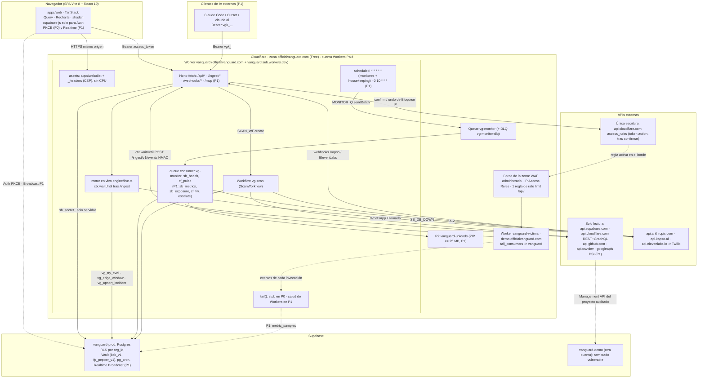
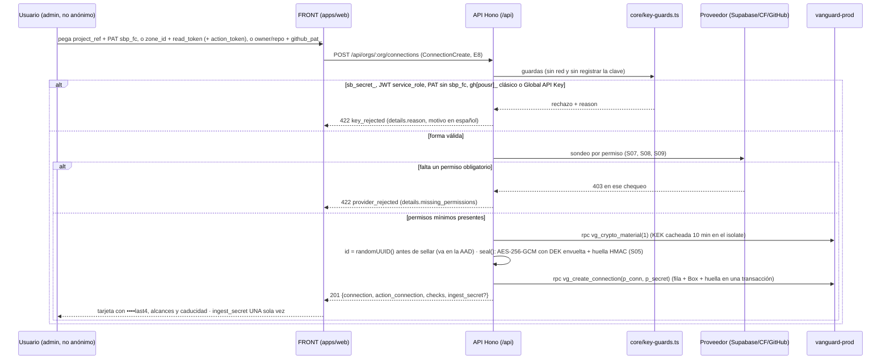
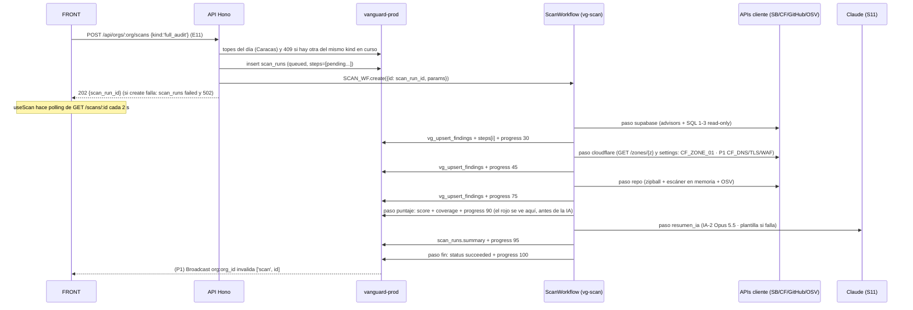
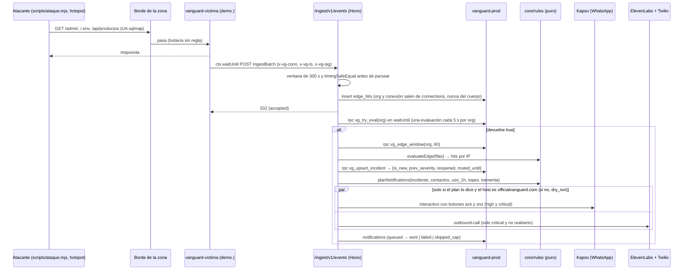
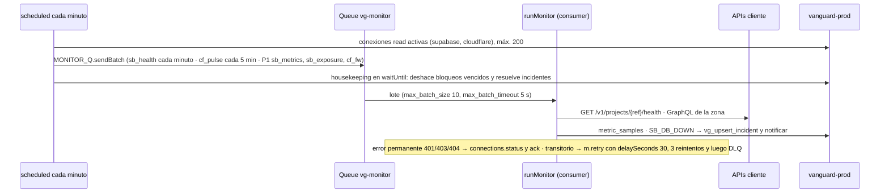
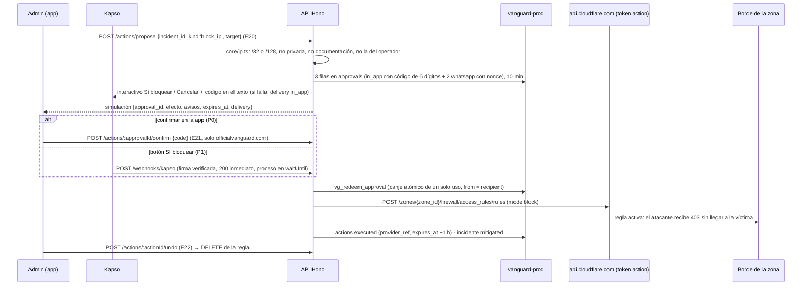
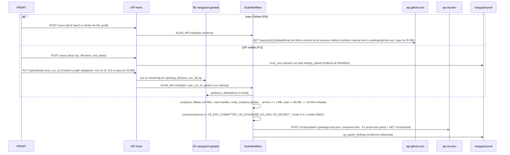
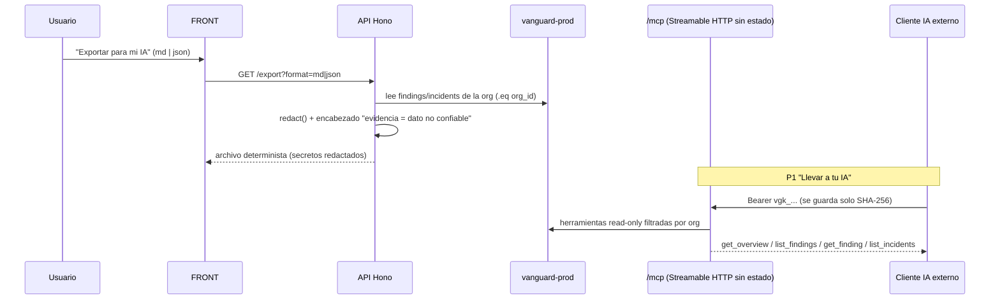

## 04. Arquitectura del sistema

> **Alcance de esta sección.** Cómo encajan las piezas de VanGUARD, los flujos de punta a punta, el modelo de ejecución de trabajos (cron, cola, Workflow, reintentos, timeouts), el tiempo real, el aislamiento multi-tenant, la observabilidad propia, la topología de despliegue y el reparto FRONT/BACK/ORQUESTADOR. No repite el stack (S03), el modelo de datos y cifrado (S05), ni la lógica interna de cada módulo (S07–S13): remite a ellas por número. Fuente de verdad: `decisiones/00-decisiones-canonicas.md` (se citan sus §); en caso de choque entre secciones mandan el **contrato de S15** y el **DDL de S05**, y esta sección los sigue. Convención de marcas igual que las canónicas: `[verificado: URL]`, `[no verificado]`, `[propuesta]`, más `[observado: hora]` = comprobado hoy por la revisión de esta sección (DoH, `curl` y API de Cloudflare de solo lectura). Cada tarea lleva prioridad **P0/P1/P2** y dueño **FRONT / BACK / ORQUESTADOR**.

### 04.1 Principios de arquitectura (no se negocian)

1. **Un solo origen, un solo Worker.** El producto entero (SPA + API + cron + cola + Workflow + MCP) corre en el Worker `vanguard` sobre `https://officialvanguard.com`. Mismo origen para la SPA y la API: **sin CORS, sin cookies cruzadas** (canónicas §4, R17 §0). [verificado: https://developers.cloudflare.com/workers/static-assets/]
2. **La regla decide; el modelo redacta.** El motor de reglas de `@vanguard/core` (puro, probado con Vitest) decide si se alerta, con qué severidad y por qué canal. El modelo (S11) solo explica, resume y redacta, nunca en la ruta crítica de la alerta (canónicas §8, §9; S12). Una inyección en un log **no puede** apagar una alerta porque el modelo no tiene esa herramienta.
3. **Determinista para monitorear, IA para comunicar.** Monitoreo y auditoría van por REST/GraphQL directos; el MCP jamás entra en el bucle de monitoreo (canónicas §10.4, S13).
4. **Solo lectura hacia el cliente.** Tokens con alcance de lectura; la única escritura es «Bloquear IP» (y su «Deshacer») con conexión `kind='action'` y confirmación de dos pasos (canónicas §10.5, S08, S12, S15 E20–E22).
5. **Aislamiento por `org_id` en cada capa.** RLS en Postgres, `.eq('org_id', ctx.orgId)` en cada consulta admin, AAD del cifrado atado a la org (canónicas §6, §7, S05, S06).
6. **Seguro aun degradado.** Si la IA se apaga o un endpoint beta falla, el sistema cae a plantillas y a «sin mirar» (nunca a «verde»): nunca finge cobertura (canónicas §9.2, S06).

### 04.2 Diagrama de componentes



**Lectura rápida.** El navegador baja la SPA de los **assets** (gratis, sin CPU) y pide **todos los datos a `/api/*`** con el Bearer de Supabase; `supabase-js` solo hace Auth (P0) y Realtime (P1) y **nunca lee tablas** (S14 regla L2): una sola fuente, validada con zod. El cliente nunca recibe un `sb_secret_`; toda escritura en la base la hace el Worker con `sb_secret_` tras validar el rol (canónicas §7, S15.3). La víctima reporta cada petición por **una sola vía de datos en P0**: `ctx.waitUntil(POST /ingest/v1/events)` firmado con HMAC (S15 E30), y el **motor en vivo corre en esa misma invocación de `/ingest`**, no en la cola (S15.9, canónicas §9.1). La cola `vg-monitor` solo lleva los monitores por conexión (salud de Supabase, pulso GraphQL de Cloudflare; S15.7). `tail()` existe desde P0 como **stub**, porque Cloudflare exige que todo Worker listado en `tail_consumers` tenga un `tail()` definido [verificado: https://developers.cloudflare.com/workers/observability/logs/tail-workers/]; en P1 escribe la salud de nuestros Workers en `metric_samples` (`wk_requests`, `wk_errors`, S15.7) y **nunca** en `edge_hits` (contaría dos veces cada petición y dispararía las reglas a la mitad del umbral).

### 04.3 Flujo — conectar un servicio (P0, BACK + FRONT)



- **Guardas de entrada** en `packages/core/src/key-guards.ts` (canónicas §10.3) y sondeo por permiso por integración (S07, S08, S09). Además: `409 conflict` si la misma huella ya está conectada en la org; `502 provider_unavailable` si el proveedor no responde (S15 E8).
- **Cloudflare con `action_token`** crea **dos** filas (`kind:'read'` y `kind:'action'`, mismo `meta.zone_id`) y devuelve la segunda en `action_connection` (S15 E8). La conexión `ingest` no llama a ningún proveedor: genera `vgi_…`, lo sella como cualquier credencial y lo devuelve una sola vez.
- **FRONT (P0):** tres tarjetas grandes con guía de 4 pasos y botón «Probar conexión» (`POST .../connections/:id/test`, E9). Botones ≥ 56 px (S14). Un usuario anónimo («Ver demo») no ve el formulario: la API le responde 403 a todo `POST/PUT/PATCH/DELETE` (S15.3).
- **BACK (P0):** validación, cifrado y persistencia. El `ingest_secret` se muestra una sola vez y nunca vuelve a salir.

### 04.4 Flujo — auditoría de un botón «Auditar todo» (P0, BACK; UI de progreso FRONT)



- **Pasos, avance y reintentos: los de S15.8** (manda): `supabase` 30 · `cloudflare` 45 · `repo` 75 (o `zip` en su propio `kind`) · P1 `psi` 85 (en `full_audit` solo lanza un `scan_run` hijo `kind:'lighthouse'` sin esperarlo) · `puntaje` 90 (escribe `score` y `coverage` **antes** de la IA) · `resumen_ia` 95 (con guion bajo, igual que canónicas §2) · `fin` 100 (solo cambia `status`). Un paso sin conexión queda `skipped`; uno que falla queda `failed` y su módulo entra en `coverage.missing`; la auditoría termina `succeeded` salvo que fallen todos (S15 E12). `resumen_ia` se omite si no hay hallazgos abiertos.
- **Cada paso descifra su token dentro del paso** y **devuelve solo `{ok, n}`** (máx. 1 MiB por resultado no‑stream [verificado: https://developers.cloudflare.com/workflows/reference/limits/]; Workflows ya admite devolver `ReadableStream`, pero VanGUARD no lo usa: todo va a Supabase). Hallazgos por la RPC `vg_upsert_findings` (S15.12). La lógica vive en `apps/api/src/scans/*.ts` y las reglas puras en `packages/core/src/rules/*` (S07–S10).
- **Puntaje y cobertura** con `packages/core/src/score.ts` (canónicas §9.2, S15.9): siempre «vemos N de 4 fuentes» junto al número; con `seen = 0`, `score` y `band` son `null`.
- **Topes:** la 4.ª `full_audit` del día de `America/Caracas` → `429 budget_exceeded` (org de demo: 20 [propuesta S15]); `409` si ya hay un `scan_run` del mismo `kind` `queued`/`running` creado hace < 15 min; viewer o anónimo → 403 (S15 E11).

### 04.5 Flujo — ataque en vivo → regla → incidente → alerta → bloqueo confirmado (P0, BACK; UI FRONT)

Son **tres caminos distintos** y no se mezclan: el caliente (ingesta, segundos) decide los incidentes `CF_*`; el frío (cron y cola, minutos) vigila conexiones de clientes; la acción va siempre por la API con confirmación. La cola **no** evalúa las reglas de borde (S15.7, S15.9).

**A. Camino caliente: ingesta → motor en vivo (P0).**



**B. Camino frío: cron → cola → monitores (P0 `sb_health` y `cf_pulse`; P1 el resto).**



**C. Acción confirmada «Bloquear IP» (P0 en la app; canje por botón de WhatsApp P1 según canónicas §2).**



- **Reloj:** Cron `* * * * *` (UTC) → `fanOutMonitors` + `housekeeping` (S15.7). Los crons tardan **hasta 15 min** en propagar: desplegarlos en el esqueleto de las 10:00 [verificado: https://developers.cloudflare.com/workers/configuration/cron-triggers/].
- **Agrupación:** las cuatro reglas `CF_*` de una IP comparten incidente (`dedupe_key = sha256hex(org_id|edge|ip)`); **solo se renotifica si sube la severidad**; un incidente resuelto que reaparece antes de 10 min se reabre sin llamada (canónicas §9.1, S15.9).
- **Presupuesto de `waitUntil` en `/ingest`:** 30 s **compartidos** por todas las `waitUntil` de la petición; lo que no termine se cancela [verificado: https://developers.cloudflare.com/workers/runtime-apis/context/]. Por eso WhatsApp (plazo 8 s) y llamada (10 s) salen **en paralelo** (`Promise.allSettled`) y el total estimado queda < 20 s con las 4 RPC. Se mide en el hito de las 17:30; si pasa de 20 s, plan B en «Decisiones de arquitectura» (punto 3) y S15.7 (`'notify'` en `MonitorMsg.kind`).
- **Acción de escritura:** dos pasos con código de un solo uso (solo se guarda el hash, caduca a los 10 min, 5 intentos, canje atómico, `from` del webhook = `recipient`); la voz nunca aprueba (canónicas §10.5, S15 E20–E22). `confirm`, el envío real y `notifications/test` exigen `hostname === new URL(APP_ORIGIN).hostname` (`officialvanguard.com`); fuera de ese host el despachador escribe `status:'failed', error:'dry_run'` (S15.3). Que el WAF corte antes de que la petición llegue al Worker de la víctima está [no verificado]: se ensaya el sábado (S15.10).
- La víctima llama a `https://officialvanguard.com/ingest/v1/events` con `fetch()` dentro de la misma zona, sin service binding [verificado: https://developers.cloudflare.com/workers/configuration/routing/custom-domains/].

### 04.6 Flujo — análisis de repo / ZIP (P0 repo; P1 ZIP; BACK + FRONT)



- Mismo escáner en memoria para `zipball` y para ZIP subido (`fflate`, JS puro; R17 §11.3, S15.10). Topes: ZIP ≤ 25 MB, archivo ≤ 1 MB, total descomprimido ≤ 40 MB (coste real por entrada), ≤ 20 000 entradas; el paso `zip` **no reintenta** (`retries.limit: 0`: un ZIP hostil no se repite). En `zip` el Workflow no se crea en E11 sino en E23, cuando el archivo ya está en R2 (S15 E11, E23). El objeto se borra al terminar el paso y una regla de ciclo de vida de 1 día en el bucket hace de red (S05.10, S06). Detalle de reglas, regex y OSV en **S09**.
- Memoria del isolate: **128 MB** [verificado: https://developers.cloudflare.com/workers/platform/limits/]. CPU por paso: 30 s por defecto, hasta 5 min con `limits.cpu_ms` [verificado: https://developers.cloudflare.com/workflows/reference/limits/]; el `wrangler.jsonc` de 04.9 lo sube a 300 000 ms para que descomprimir y escanear hasta 40 MB no corte el paso.

### 04.7 Flujo — corrida de Lighthouse (P1, BACK + FRONT)

```mermaid
sequenceDiagram
  participant F as FRONT
  participant A as API Hono
  participant DB as vanguard-prod
  participant WF as ScanWorkflow
  participant PSI as PageSpeed Insights v5
  F->>A: POST /scans {kind:'lighthouse', url, strategy} (E11, P1)
  A->>DB: ¿la URL es de una zona Cloudflare activa de la org o de verified_domains? (0009, P1)
  alt no
    A-->>F: 422 (anti-SSRF: VanGUARD no mide sitios ajenos)
  else sí
    A->>DB: insert scan_runs
    A->>WF: SCAN_WF.create({id, params})
    A-->>F: 202 {scan_run_id}
    WF->>PSI: step psi-<strategy> (3 repeticiones en paralelo; key=PSI_API_KEY, plazo 130 s por llamada)
    PSI-->>WF: lighthouseResult (un 429 lanza y el Workflow reintenta con backoff)
    WF->>DB: perf_runs (scores, lcp/tbt/cls/fcp/si/ttfb, lighthouse_version)
    WF->>DB: step perf-compare: compareRuns contra la línea base → PF_REGRESSION en findings (p_complete=false)
  end
```

- **PSI, no la librería `lighthouse`** (necesita lanzar Chrome, imposible en un Worker; R17 §4.3). Cada `scan_run` `lighthouse` mide **una** estrategia con el paso `psi-<strategy>` seguido de `perf-compare` (espera a Google sin gastar CPU). La verificación de dominio la hace la **API antes de crear el Workflow** (S15 E11: URL fuera de los dominios de la org → 422); dentro de `full_audit` (P1) el paso `psi` lanza un hijo `kind:'lighthouse'` por estrategia y no lo espera, y queda `skipped` si la org no tiene zona Cloudflare activa ni dominio verificado (S15.8, modelo de S10). Umbrales y `compareRuns` en **S10**.
- **P0:** la pantalla Rendimiento muestra la fila **sembrada** de `perf_runs` (tabla creada en `0007`, S05.3); «Medir ahora» es P1.

### 04.8 Flujo — exportar a cualquier IA / MCP propio (P0 export; P1 MCP; BACK + FRONT)



- **Export (P0):** `GET /api/orgs/:org/export?format=md|json` (E25), Markdown y JSON deterministas, todo por `redact()`, encabezado que marca la evidencia como dato no confiable + «Copiar para mi IA»; el viewer también puede exportar. Esquema público estático en `GET /api/schemas/vanguard-export.v1.json` (E35) (canónicas §2, S13, S15).
- **MCP propio (P1):** servidor `/mcp` Streamable HTTP **sin estado** montado en Hono (`@modelcontextprotocol/server` 2.3.1, R17 §11.5), tokens `vgk_` por org (tabla `mcp_tokens` en `0009`), resultados envueltos en `{"untrusted_data": …}` y binding `RL_MCP` (S13). `/mcp` y `/mcp/*` están en `run_worker_first`. El detalle de herramientas y los MCP oficiales en lectura están en **S13** y canónicas §10.4.

### 04.9 Modelo de ejecución de trabajos

| Trabajo | Dónde corre | Disparo | Límites, timeout y reintentos | Prio · Dueño |
|---|---|---|---|---|
| API, probar conexión, encolar auditorías, export, MCP, webhooks | `fetch` del Worker (Hono) | petición HTTP | Reloj sin límite mientras el cliente siga conectado; CPU 30 s por defecto, hasta 5 min con `limits.cpu_ms`; `ctx.waitUntil` extiende ≤ 30 s tras responder, **compartidos** por todas sus promesas [verificado: https://developers.cloudflare.com/workers/runtime-apis/context/ y https://developers.cloudflare.com/workers/platform/limits/] | P0 · BACK |
| **Motor en vivo** (`engine/live.ts`): ventana, reglas `CF_*`, incidente, notificación | `ctx.waitUntil` de `POST /ingest/v1/events` | cada lote de la víctima; evalúa ≤ 1 vez cada 5 s por org (`vg_try_eval`) | dentro de los 30 s de `waitUntil`; WhatsApp y llamada en paralelo; sin reintento de la llamada (no duplicar) | P0 · BACK |
| Reparto de monitores + `housekeeping` | `scheduled('* * * * *')` → `fanOutMonitors` (`MONITOR_Q.sendBatch`, ≤ 100 por llamada) y `housekeeping` en `waitUntil` (deshace bloqueos con `expires_at < now()`, resuelve incidentes `cloudflare` sin eventos en 15 min y `SB_DB_DOWN` con 2 lecturas sanas) | Cron por minuto (UTC) | Cron: 15 min de reloj [verificado: limits] | P0 · BACK |
| Re-auditoría diaria | `scheduled('0 10 * * *')` → `startScheduledAudits` (`SCAN_WF.create` por org con `daily_audit`) | 06:00 de Caracas | respeta los topes de E11 | P1 · BACK |
| Monitores por conexión (`runMonitor`) | `queue` consumer de `vg-monitor` | `MonitorMsg.kind`: `sb_health` (P0), `cf_pulse` (P0), `sb_metrics`, `sb_exposure`, `cf_fw`, `escalate` (P1) | `max_batch_size` 10, `max_batch_timeout` 5 s, `max_retries` 3, DLQ `vg-monitor-dlq` (se crea sola si no existe); transitorio → `m.retry({delaySeconds:30})`; permanente → `connections.status` y `ack`; consumidor: 15 min de reloj [verificado: https://developers.cloudflare.com/workers/wrangler/configuration/ y https://developers.cloudflare.com/queues/configuration/dead-letter-queues/] | P0 · BACK |
| Auditoría / repo / ZIP / PSI / resumen IA | Workflow `vg-scan`, un `step.do` por subtrabajo | `SCAN_WF.create({id: scan_run_id, params})` | Reintentos **por paso de S15.8**: `supabase`, `cloudflare`, `psi-*` → `{limit:2, delay:'10 seconds', backoff:'exponential'}`; `repo` → `{limit:1, delay:'10 seconds'}`; `zip` → `{limit:0}`; `resumen_ia` → `{limit:1}`; `fin` → 0. Si no se pasa config, el runtime aplica `limit:5, delay:10000, backoff:'exponential', timeout:'10 minutes'` (timeout **por intento**) [verificado: https://developers.cloudflare.com/workflows/build/sleeping-and-retrying/]. Reloj por paso ilimitado; CPU por paso 30 s, hasta 5 min; 10 000 pasos por instancia en Paid [verificado: https://developers.cloudflare.com/workflows/reference/limits/] | P0 (`zip`, `psi-*` P1) · BACK |
| `tail()` de `vanguard` | handler `tail(events)` | cada invocación de `vanguard-victima` (por su `tail_consumers`) | **P0: stub vacío** (obligatorio: un Worker en `tail_consumers` debe tener `tail()` [verificado: tail-workers]). **P1: `ingestTail`** → `metric_samples` (`wk_requests`, `wk_errors` en cubetas de 10 s) para la tarjeta «Salud de tus Workers»; **nunca** escribe `edge_hits`. Tail Workers solo en Paid | P0 stub · P1 sensor · BACK |
| Retención y caducidad | `pg_cron` en `vanguard-prod` (`0008_rls_retention.sql`) | `vg-purge-edge-hits` (cada hora, 24 h), `vg-purge-daily` (07:15 UTC: `metric_samples` 7 d, `webhook_events`, `approvals`, `notifications` 30 d, historial 90 d, anónimos 7 d), `vg-expire-connections` (cada 10 min) | ver S05.10 | **P0** · BACK |

**Reglas de ejecución clave:**
- **El ID de instancia de Workflow es único por Workflow y no se reutiliza** ni tras terminar [verificado: https://developers.cloudflare.com/workflows/build/rules-of-workflows/]: se usa `scan_run_id` (uuid, < 100 caracteres). Cada re-ejecución que el usuario ve como nueva («Verificar arreglo» E16, re-auditoría diaria, otra `full_audit`) crea **otra fila** `scan_runs` y, por tanto, otro id; `instance.restart()` solo para reintentar a mano esa misma corrida. **P0 · BACK.**
- `POST /api/orgs/:org/scans` inserta la fila `scan_runs` y luego `SCAN_WF.create`; si `create` falla, marca la fila `failed` y responde 502 (S15 E11). **P0 · BACK.**
- La cola `pgmq` de R16 **ya no se usa**: no hay proceso permanente que la sondee; `scan_runs` queda como estado visible y fuente del Broadcast (canónicas §15 #11). No se escriben esas migraciones. **BACK.**
- **Desarrollo local** (`dev-node.ts`): `SCAN_WF.create` ejecuta `runScanInline` (mismos pasos, en serie, sin reintentos) y `MONITOR_Q.send*` llama a `runMonitor` en línea (S15.8 regla 8, R17 §11.4).
- **`apps/api/wrangler.jsonc` consolidado** (P0 · ORQUESTADOR lo escribe a las 09:00; el BACK solo pide bindings por PR y no toca `name`, `routes`, `assets` ni `vars`, S15.15). Junta R17 §6.1, S03.7 (dominio), S06 (`run_worker_first` y `ratelimits`) y este 04.9:

```jsonc
{
  "$schema": "https://unpkg.com/wrangler@4.152.0/config-schema.json",
  "name": "vanguard",                                  // el Worker ya existe en la cuenta (página provisional, 04.13)
  "main": "src/worker.ts",
  "compatibility_date": "2026-10-20",
  "compatibility_flags": ["nodejs_compat"],
  "workers_dev": true,                                 // explícito: con routes se inferiría false y se pierde el respaldo
  "preview_urls": true,                                // Version URLs para --preview-alias pr-N
  "routes": [ { "pattern": "officialvanguard.com", "custom_domain": true } ],
  "assets": {
    "directory": "../web/dist", "binding": "ASSETS", "not_found_handling": "single-page-application",
    "run_worker_first": ["/api/*", "/ingest/*", "/webhooks/*", "/mcp", "/mcp/*", "/.*", "/.well-known/*", "!/.well-known/security.txt"]   // "/.*": /.env y /.git → 404 de Hono (S06); /.well-known/oauth-* → 404 JSON, no la portada (S13); security.txt lo sirven los assets (la negación con ! gana, verificado en S06 06.11)
  },
  "observability": { "enabled": true, "head_sampling_rate": 1 },
  "upload_source_maps": true,
  "limits": { "cpu_ms": 300000 },                      // solo Paid; pasos repo/zip (04.6)
  "triggers": { "crons": ["* * * * *", "0 10 * * *"] },
  "queues": {
    "producers": [ { "binding": "MONITOR_Q", "queue": "vg-monitor" } ],
    "consumers": [ { "queue": "vg-monitor", "max_batch_size": 10, "max_batch_timeout": 5,
                     "max_retries": 3, "dead_letter_queue": "vg-monitor-dlq" } ]
  },
  "workflows": [ { "name": "vg-scan", "binding": "SCAN_WF", "class_name": "ScanWorkflow" } ],
  "r2_buckets": [ { "binding": "UPLOADS", "bucket_name": "vanguard-uploads" } ],
  "ratelimits": [
    { "name": "RL_API",    "namespace_id": "1001", "simple": { "limit": 300, "period": 60 } },   // S15 15.3 y S06 06.9
    { "name": "RL_COSTLY", "namespace_id": "1002", "simple": { "limit": 10,  "period": 60 } },
    { "name": "RL_INGEST", "namespace_id": "1003", "simple": { "limit": 300, "period": 10 } }
  ],
  "vars": { "VG_ENV": "production", "APP_ORIGIN": "https://officialvanguard.com" }   // SUPABASE_URL va como secreto (S03.6)
}
```

`worker.ts` exporta `fetch: app.fetch`, `scheduled`, `queue`, `tail` (stub en P0) y re-exporta `ScanWorkflow` desde `workflow.ts` (R17 §11.1). La cola, la DLQ y el bucket se crean una vez desde CI con `pnpm dlx wrangler@4.152.0 queues create …` / `r2 bucket create …` (R17 §6.1); nunca desde Windows. Que `/.*` y la negación `!` funcionen en `run_worker_first` lo da S06 como [verificado: https://developers.cloudflare.com/workers/static-assets/binding/]; se comprueba con `curl -s -o /dev/null -w "%{http_code}" https://officialvanguard.com/.env` → `404`.

### 04.10 Tiempo real

- **P0 — polling.** TanStack Query consulta `overview`, `incidents` y `traffic` cada **3 s** con la pestaña visible, y `scans/:id` cada **2 s** mientras corre una auditoría (canónicas §7). Dos piezas móviles menos para la demo. **P0 · FRONT.**
- **P1 — Realtime Broadcast.** Canal privado `org:<org_id>`; triggers `realtime.broadcast_changes` sobre `scan_runs`, `findings`, `incidents`, `notifications` y política sobre `realtime.messages` (migración `0010_p1_realtime.sql`, S05.13; payload y claves a invalidar en S15.6). **Nunca** se emite nada de `edge_hits`, `metric_samples`, `connections`, `connection_secrets`, `approvals`, `contacts` ni `ai_usage` (volumen o datos sensibles). El FRONT solo invalida la query correspondiente, así que **no cambia ningún componente**; si el canal no llega a `SUBSCRIBED` en 10 s, sigue el polling (S14). «Allow public access» de Realtime **desactivado** desde P0 [verificado: https://supabase.com/docs/guides/realtime/authorization]. **P1 · BACK (SQL) + FRONT (suscripción).**
- Límites Free: 200 conexiones concurrentes, 100 msg/s, broadcast 256 KB, 2 M msg/mes — de sobra para la demo [verificado: https://supabase.com/docs/guides/realtime/limits].

### 04.11 Multi-tenant

- **Modelo:** toda entidad lleva `org_id`; el usuario pertenece a `org_members` con rol `owner`/`admin`/`viewer` (canónicas §6, S05).
- **Tres cercos simultáneos** (defensa en profundidad, S06):
  1. **RLS en Postgres** con `private.user_org_ids()`/`user_admin_org_ids()` (`security definer`, `search_path=''`); `revoke all` a `anon`/`authenticated` sobre `connection_secrets`, `approvals`, `edge_hits`, `edge_eval_state`, `ai_usage`, `webhook_events` (canónicas §6, S05.2). La SPA no lee tablas (S14 L2): estas políticas son defensa en profundidad y la base de la autorización de Realtime (P1).
  2. **API:** `supabase.auth.getClaims(token)` **lo primero** (nunca `getSession()` en servidor, R17 §10), luego la membresía (`:org` de otra org → **404**, no 403, para no confirmar que existe), luego el rol, luego el cliente admin con `.eq('org_id', ctx.orgId)` también al leer por id de ruta — anti-IDOR, con prueba `test:idor` sobre dos orgs (canónicas §7, S15.3). En `/ingest` la org sale de la conexión firmada, nunca del cuerpo. **P0 · BACK.**
  3. **Cripto:** `AAD = vanguard|v1|org_id|connection_id|provider|kind`: copiar un `Box` a otra org hace fallar el descifrado (canónicas §10.1, S05).
- **Org de demo** (`is_demo`): el viewer anónimo (`signInAnonymously()` + `join_demo_org()`) no lanza auditorías ni gasta IA; techos de gasto propios (canónicas §2, §8). **P0 · BACK (RPC) + FRONT.**
- **Previews por PR** (Version URLs con `--preview-alias pr-N`) comparten base y secretos con producción. Rutas, Cron Triggers y consumidores de cola **apuntan solo a producción**, pero una preview **sí puede producir** mensajes a la cola de producción y **crear instancias del Workflow de producción** (corren el código desplegado en `main`) [verificado: https://developers.cloudflare.com/workers/previews/resources/; la página describe la función Previews, y para las Version URLs de `--preview-alias` vale lo mismo porque solo la versión desplegada recibe cron y cola: inferencia]. Consecuencias: (1) `notifications/test`, el envío real y `confirm` responden 403 / `dry_run` fuera de `officialvanguard.com` (S15.3); (2) **todo productor de `MONITOR_Q`** que no sea el cron (p. ej. `escalate`, P1) aplica la misma guarda de host antes de encolar, porque el consumidor de producción enviaría de verdad; (3) en una preview `POST /scans` funciona pero gasta topes e IA de la org real. Las Version URLs no aparecen en Workers Logs [verificado: https://developers.cloudflare.com/workers/versions-and-deployments/version-urls/].

### 04.12 Observabilidad propia

| Pieza | Cómo | Prio · Dueño |
|---|---|---|
| `request_id` en cada respuesta y en el cuerpo de error `{error:{code,message,request_id}}` | Middleware `request-id.ts` de Hono (`cf-ray` o `randomUUID`); se correlaciona con Workers Logs (S15.3) | P0 · BACK |
| Workers Logs (invocaciones, excepciones, `console`) | `observability.enabled=true`, `head_sampling_rate=1` en `wrangler.jsonc`; Paid: 20 M eventos/mes incluidos y 7 días de retención (Free: 200 000/día, 3 días); el precio cambia el 1-dic-2026 [verificado: https://developers.cloudflare.com/workers/observability/logs/workers-logs/]. No cubre las Version URLs de las previews | P0 · ORQUESTADOR (config) + BACK |
| Source maps | `upload_source_maps=true` (R17 §6.1) | P0 · ORQUESTADOR |
| `redact()` antes de registrar | `log()` = `console.log(JSON.stringify(redact({...})))`; ningún log lleva tokens, cuerpos de terceros, cabeceras, teléfonos completos ni trazas (canónicas §7, S15.3) | P0 · BACK |
| Libro de gasto IA (`ai_usage` + panel «Gasto IA hoy») | Reserva con `vg_ai_reserve` antes de llamar y liquidación después (S15.10); la UI lee `GET /ai/usage` (E28) | P0 (registro) / P1 (panel) · BACK + FRONT |
| Prueba de fuga (al cerrar Conexiones, 13:00) | Guardar el token falso `vg_test_LEAK_7Q2X`, buscarlo en Workers Logs, `postgres_logs` y todas las respuestas → 0 apariciones (canónicas §10.1, S15.14). Canónicas la ponen a las 08:00, pero a esa hora todavía no existe el cifrado | P0 · BACK |
| Salud de nuestros Workers (dogfooding) | P1: `tail()` → `metric_samples` (`wk_requests`, `wk_errors`) para la tarjeta «Salud de tus Workers» (S15.7). P2: GraphQL `workersInvocationsAdaptive` (errores y CPU p99 de `vanguard` y `vanguard-victima`, R17 §9.1) | P1 / P2 · BACK |
| VanGUARD se audita a sí mismo en CI | `supabase/tests/rls.sql`: 0 tablas de `public` sin RLS, funciones `security definer` sin `search_path`, etc. (canónicas §6) | P0 · BACK |

### 04.13 Topología de despliegue y entornos

**Topología** (resumen; el diagrama y la tabla completa están en canónicas §4):

| Pieza | Dónde | URL / id |
|---|---|---|
| Producto (SPA+API+cron+cola+Workflow+MCP) | Worker `vanguard`, Workers Paid | `https://officialvanguard.com` (apex, Custom Domain) + respaldo `https://vanguard.<sub>.workers.dev` |
| App víctima | Worker `vanguard-victima` | `https://demo.officialvanguard.com` (`tail_consumers:[{service:"vanguard"}]`) |
| Base del producto | Supabase Free `vanguard-prod` | `https://<ref>.supabase.co` |
| Base de la víctima | Supabase Free `vanguard-demo` (cuenta de Gabriel) | otro `<ref>`, secretos falsos |
| Repo víctima | GitHub privado `vanguard-demo-victima` | PAT fine-grained de ese repo |
| CI/CD | GitHub Actions (ubuntu) `pnpm dlx wrangler@4.152.0 deploy --secrets-file` (camino A repo de la org o B espejo personal, se decide en la hora 1) | `.github/workflows/deploy.yml` (bucle de secretos de S03.7) |
| Zona DNS | `officialvanguard.com` en Cloudflare, plan Free; registrador Squarespace (sin transferencia) | nameservers `martin.ns.cloudflare.com`, `ziggy.ns.cloudflare.com` |

- **Subdominios (decisión única, canónicas §4):** producto y API en el **apex**; `/api`, `/ingest`, `/webhooks`, `/mcp` son rutas bajo el apex gracias a `run_worker_first` (mismo origen, sin CORS). **No** se crean `api.` ni `mcp.`. `www` redirige al apex con Redirect Rule 301. La víctima en `demo.`. Todas las URLs externas (Supabase Auth, webhooks de Kapso y ElevenLabs, ingesta, MCP, export) son las de la tabla de S03.4. **ORQUESTADOR.**
- **Estado del dominio [observado: sáb 01:55 Caracas, DoH + `curl --resolve` + API de Cloudflare]:** la delegación a Cloudflare **ya está hecha** (NS `martin`/`ziggy`) y el `.com` ya publica el DS de Cloudflare (`2371 13 2 …`, DNSSEC activo y validando). El apex y `www` resuelven a la red de Cloudflare y el apex ya sirve la **página provisional estática** («VanGUARD», CSP de `site/_headers`) del Worker **`vanguard`**, el único de la cuenta; `http://` → 301 a `https://`. **Pendiente:** (1) `GET /api/health` devuelve el HTML de la portada, no `{"ok":true}` (la provisional es solo assets); (2) `www` responde 200 con la misma página en vez de 301 al apex; (3) `demo.` no existe; (4) algunos resolvers aún tienen en caché las IPs de Squarespace (desde el equipo de Giovanni, sin forzar la IP, todavía llegaba «Próximamente» de Squarespace). S16.5 y S03.4 ya recogen este estado tras la fusión final.
- **Lo que falta, en orden (ORQUESTADOR, P0, antes de las 10:00; detalle de cada paso en S03.4):** (1) primer deploy real de `vanguard` desde CI con el `wrangler.jsonc` de 04.9: mismo nombre de Worker, así que reemplaza la provisional sin tocar el Custom Domain; comprobar `curl -s https://officialvanguard.com/api/health` → JSON; (2) Redirect Rule 301 `https://www.*` → `https://${1}` conservando la query, y comprobar `curl -sI "https://www.officialvanguard.com/x?y=1"` → `301` a `https://officialvanguard.com/x?y=1` (`www` ya resuelve por el proxy de Cloudflare: no hace falta crear el A/AAAA de relleno de S03.4 paso 4; mirar antes en DNS › Records qué registro o Custom Domain lo sirve, y no duplicarlo); (3) Custom Domain `demo.officialvanguard.com` para `vanguard-victima` (16:00); (4) ajustes de seguridad de la zona (tabla de S03.4): **SSL Full (strict)**, Always Use HTTPS (ya activo), TLS mínimo 1.2 y TLS 1.3, Free Managed Ruleset del WAF, **una** regla de rate limit (Free: 1 regla, conteo preajustado por IP, periodo 10 s, mitigación 10 s, acción Block [verificado: https://developers.cloudflare.com/waf/rate-limiting-rules/]) con umbral **por encima del simulacro** (20 req/s = 200 por 10 s; Free no filtra por host, así que también cuenta `/api/productos` de `demo.`): valor único del plan, `http.request.uri.path contains "/api/"`, **400/10 s**, bloqueo 10 s (S15 15.3, S06 06.9, S03 03.4); la Configuration Rule `bic: false` solo para `demo.` (S03 03.4 paso 7); **Bot Fight Mode off** (servimos API, ingesta y webhooks y en Free no se puede saltar con reglas, S03.4); SPF `-all` y DMARC `p=reject` **se conservan** (más estrictos que el `p=quarantine` de canónicas), DKIM nulo [propuesta S03]; **HSTS en P1** (domingo 07:00, solo si apex, `www` y `demo.` responden bien por HTTPS); (5) DNSSEC: ya activo vía Cloudflare, **no tocar** en Squarespace. La transferencia de registrador **no** se hace (bloqueo de 60 días tras el registro, y no hace falta).
- **Respaldo:** `https://vanguard.<subdominio>.workers.dev` sigue vivo (`workers_dev: true`) con las mismas rutas; allí `confirm`, el envío real y `notifications/test` responden 403/`dry_run` (S15). El `deploy-url` del jsonc **no se cambia**.
- **Entornos (canónicas §4):** sin bloques `env.*`. **Producción** = versión desplegada de `vanguard` desde `main`. **Previews por PR** = `wrangler versions upload --preview-alias pr-N` (comparten base y secretos; ver límites en 04.11). **Local:** Vite en `:5173` con proxy de `/api`, `/ingest` y `/mcp` a `:8787` (`VITE_API_PROXY` con `loadEnv`, S03.7; Hono en Node 24, `node --env-file=.dev.vars --watch src/dev-node.ts`); víctima en `:8788`; `VITE_USE_FIXTURES=1` permite al FRONT trabajar sin BACK.
- **Windows/Norton (R17 §7):** ningún `package.json` declara `wrangler`, `@cloudflare/vite-plugin`, `miniflare`, `agents` ni `@cloudflare/vitest-pool-workers`; wrangler solo por `pnpm dlx` en CI/Codespaces; `worker-configuration.d.ts` generado y versionado; ningún agente genera `.exe` ni toca Norton. **ORQUESTADOR + BACK.**

### 04.14 Reparto FRONT / BACK / ORQUESTADOR

| Capa | Carpeta | Dueño | Qué construye en esta arquitectura |
|---|---|---|---|
| SPA | `apps/web` | **FRONT** | Cascarón con módulos, Conexiones con guías (04.3), UI de progreso de auditoría (04.4), Incidentes con cronómetro (04.5), Export (04.8), polling TanStack Query y, en P1, suscripción Realtime (04.10). Sin dependencias de Cloudflare. (S14) |
| API + Worker | `apps/api` | **BACK** | `app.ts` (Hono), `worker.ts` (fetch/scheduled/queue/tail; `tail` stub en P0), `workflow.ts` (ScanWorkflow), `rutas/*`, `engine/*` (motor en vivo tras `/ingest`), `monitors.ts`, `scans/*`, `notify/*`, `actions/*`, `ia/*`, `mcp.ts`, `dev-node.ts`. Modelo de ejecución (04.9), multi-tenant en API (04.11), observabilidad (04.12). (S15) |
| Víctima | `apps/victima` | **ORQUESTADOR** (canónicas §13, S15.1) | Worker de demo (`/`, `/login`, `/api/productos`, `/admin` sin auth) con `tail_consumers → vanguard` y `ctx.waitUntil(POST /ingest)` firmado. El **BACK** garantiza el contrato de ingesta (E30) y que `vanguard` exporte `tail()` antes de desplegar la víctima. |
| Compartido | `packages/contracts` | **ORQUESTADOR** | Copia literal de los esquemas zod de S15.5 + fixtures + `database.types.ts`. Contratos congelados el sábado 11:00; después solo campos opcionales (canónicas §5). |
| Núcleo | `packages/core` | **BACK** (Daniel escribe las primitivas `crypto.ts`, `redact.ts`, `untrusted.ts`, `key-guards.ts`, `otp.ts` con pruebas y el ORQUESTADOR revisa el PR, S15.1); `perf/` es del ORQUESTADOR hasta el sáb 18:30 (S10); **BACK** el resto (`rules/*`, `score.ts`, `severity.ts`, `ip.ts`, `secrets/*`, `lockfiles/*`, `templates/*`) (S15.1) | La seguridad vive aquí, pura (sin Cloudflare ni Supabase) y probada con Vitest en Node; `apps/web` tiene prohibido importar `@vanguard/core` (regla `lint:imports`, S03.8). Si a las 11:00 no están las primitivas, las escribe el BACK y revisa el orquestador. (S05, S06, S15) |
| Esquema | `supabase/` | **BACK** (Daniel) | Único escritor del esquema; migraciones `0001`–`0010`, RLS, Vault, `pg_cron`, seeds y `rls.sql` de CI (S05). |
| Infra y CI | raíz, `.github/`, `apps/api/wrangler.jsonc` (04.9; el BACK pide bindings por PR), `scripts/ataque.mjs`, `demo/`; piezas **temporales sin versionar** `site/` (página provisional) y `provisional/` (`worker.js` + `wrangler.jsonc` de S01 §01.11), que se borran cuando el deploy real sustituya al Worker provisional | **ORQUESTADOR** | Monorepo, zona en Cloudflare, `deploy.yml`, dominio, cuentas y tarjeta, colas y bucket, guion, pitch y video. (S03, S16) |

**Contrato de colaboración (canónicas §5):** un chat nunca edita la carpeta de otro; si el FRONT necesita un campo, lo pide al ORQUESTADOR, que cambia `packages/contracts`, avisa a los dos y actualiza los fixtures. El contrato API completo (rutas, auth, cuerpos, errores) está en **S15**; la especificación de pantallas del FRONT en **S14**.

### 04.15 Dependencias de arranque (resumen; cronograma completo en S16)

| Hora (sáb) | Hito de arquitectura | Depende de | Dueño |
|---|---|---|---|
| 08:00–09:00 | Pruebas de humo: SQL read-only + advisors sobre la víctima; `signInAnonymously()`; Vite corre en Windows; deploy «hola mundo» por Actions (camino A o B) | cuentas | BACK, FRONT, ORQUESTADOR |
| 10:00 | Esqueleto desplegado en el apex con el `wrangler.jsonc` de 04.9: `GET /api/health` → JSON, `scheduled` vacío, `tail()` stub, Workflow, cola, DLQ y bucket creados; `www` → 301 | tarjeta Workers Paid (la zona ya está delegada, 04.13) | ORQUESTADOR + BACK |
| 11:00 | Contratos congelados; migraciones `0001`–`0003` | esqueleto | ORQUESTADOR, BACK |
| 13:00 | Conexiones con cifrado de punta a punta (04.3) + migraciones `0004`–`0008` (incluye `pg_cron`) + prueba de fuga | contratos | BACK |
| 15:00 | Auditoría `vg-scan` con pasos `supabase`, `repo`, `resumen_ia`, `fin` (04.4) + IA-1 | conexiones | BACK |
| 16:00 | Víctima en `demo.officialvanguard.com` con ingesta HMAC (04.5 A); `tail()` sigue siendo stub | `tail()` exportado en `vanguard`, contrato de ingesta | ORQUESTADOR + BACK |
| 17:30 | Motor en vivo, incidente, WhatsApp, llamada, «Bloquear IP» en la app; `sb_health` y `cf_pulse` en la cola (04.5 B y C); medir el tiempo de `waitUntil` | ingesta, cuentas de Gabriel, conexión `action` de nuestra zona | BACK |
| Dom 07:00–10:00 | P1: `tail()` real, Realtime `0010`, ZIP/R2, PSI con `verified_domains` (`0009`), `/mcp`, escalamiento a 45 s, canje por botón, HSTS | P0 cerrado | BACK, FRONT, ORQUESTADOR |

**Decisiones de arquitectura** (tomadas por el orquestador en la fusión final; ninguna cambia el contrato de S15):

1. **`tail()` es P1 y nunca escribe `edge_hits`** (canónicas §2, S08, S15.7). S12.1 lo pone en P0 escribiendo `edge_hits` «igual que la ingesta»: con las dos vías activas cada petición contaría dos veces y las reglas dispararían a la mitad del umbral. S12.1 ya está alineado: la única fuente de `edge_hits` es `POST /ingest/v1/events`.
2. **Previews:** la duda de canónicas §4 queda resuelta [verificado: https://developers.cloudflare.com/workers/previews/resources/]: crons y consumidores no corren en previews, pero una preview sí puede **producir** a la cola y **crear** instancias del Workflow de producción. Por eso la guarda de host se aplica también a todo productor de `MONITOR_Q` distinto del cron (04.11).
3. **Presupuesto de `waitUntil` (30 s) del motor en vivo.** Si en el hito de las 17:30 la evaluación más el envío superan 20 s, plan B (P1): el motor solo decide y encola un mensaje `notify` en `vg-monitor` y el consumidor (15 min de reloj) envía. Requiere añadir `'notify'` a `MonitorMsg.kind` en S15.7 (cambio aditivo).
4. **Regla de rate limit de la zona.** Free no filtra por host: el umbral debe quedar por encima del simulacro (≥ 200 por 10 s desde una IP). Valor único: 400/10 s (S06, S15, S03.4 ya corregido).
5. **`RL_API`.** S06 demuestra que el polling P0 de una pestaña ya consume ~90/min; con 120/60 s, dos pestañas darían 429. Decidido: 300/60 s, ya en el `wrangler.jsonc` de 04.9.
6. **Prueba de fuga:** canónicas §10.1 la fecha a las 08:00, pero el cifrado no existe hasta las 13:00; se corre al cerrar Conexiones (S15.14).
