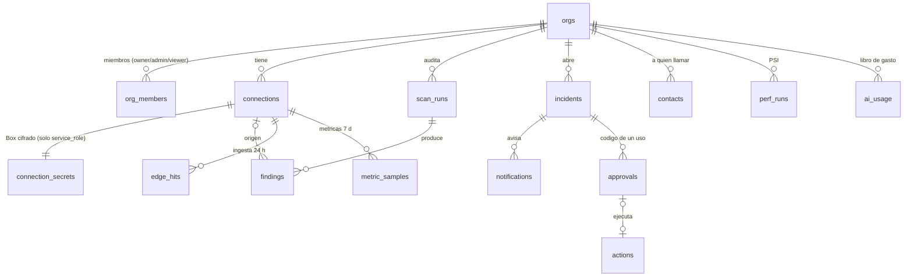

## 05. Modelo de datos y cifrado de credenciales

> **Para quién:** chat BACK (Daniel: `supabase/`, `packages/core/src/crypto.ts`; Andrés: lo que use desde `apps/api`), chat ORQUESTADOR (Vault, secretos del Worker, `database.types.ts`, revisión) y chat FRONT (solo 05.9). **Fuente de verdad:** `00-decisiones-canonicas.md` §6 (tablas), §10 (credenciales) y §14 (nombres). Aquí se concretan el DDL, las funciones, el código de cifrado, la retención, las migraciones y los seeds. La arquitectura está en la §04, la seguridad general del producto en la §06, el contrato API en la §15 y el presupuesto de IA en la §11.
> **Convenciones:** identificadores en inglés `snake_case`; enums como `text` + `check` (decisión canónica §6); "hoy" = día de `America/Caracas` (UTC−4) en todo cálculo diario. Nada de CLI `supabase`: las migraciones se aplican con la herramienta `apply_migration` del MCP de Supabase o pegándolas en el editor SQL, **primero en `vanguard-dev` y después en `vanguard-prod`**.

### 05.1 Tareas, prioridad y dueño

| # | Tarea | Prio | Dueño | Hecho cuando |
|---|---|---|---|---|
| T1 | Migraciones `0001`–`0003` (base, tenencia, conexiones + Vault) | P0 | BACK | Aplicadas en dev y prod antes de las 11:00 del sábado (hito canónico §13) |
| T2 | Migraciones `0004`–`0008` (auditoría, incidentes, motor en vivo, IA, retención) con las RPC que pide la §15.12 (`vg_upsert_findings`, `vg_upsert_incident`, `vg_traffic`, `vg_ip_first_seen`) | P0 | BACK | Aplicadas antes de las 13:00; `supabase/tests/rls.sql` termina sin ERROR |
| T3 | `packages/core/src/crypto.ts` + pruebas Vitest de 05.12 (código completo en 05.7: se copia, no se rediseña) | P0 | BACK: Daniel, como fijan las canónicas §13 (revisa ORQUESTADOR; un solo autor del archivo) | `pnpm test` verde con las 8 pruebas de cripto |
| T4 | `apps/api/src/lib/keyring.ts` y `credentials.ts` (única puerta a `connection_secrets`) | P0 | BACK | `POST /connections` guarda `Box` y huella; prueba de fuga a 0 apariciones |
| T5 | Secretos `VG_KEK_PEPPER` y `VG_FP_PEPPER` (prod y dev, distintos) | P0 | ORQUESTADOR | En Actions (`--secrets-file`) y en `apps/api/.dev.vars`; nunca en el repo |
| T6 | Generar `packages/contracts/src/database.types.ts` tras cada migración | P0 | ORQUESTADOR | Herramienta `generate_typescript_types` del MCP de Supabase; commit en `contracts` |
| T7 | Seeds `supabase/seed/demo.sql` (prod) y `supabase/seed/dev-idor.sql` (dev) | P0 | BACK | Org de demo única; dos orgs para `test:idor` |
| T8 | Formularios de credenciales sin persistencia (05.9) | P0 | FRONT | El token no queda en estado, `localStorage` ni URL tras enviar |
| T9 | Rotar token del cliente sin perder historial (`vg_rotate_secret`) | P1 | BACK | Mismo `connection_id`, `Box` y huella nuevos, `rotated_at` |
| T10 | `0009` (MCP, `audit_log` encadenado, `verified_domains`) y `0010` (Realtime) | P1 | BACK | Domingo 10:00 |
| T11 | Rotación de KEK (`kek_v2`) y de pimientas | P2 | BACK + ORQUESTADOR | Runbook de 05.8 probado en dev |

### 05.2 Mapa de entidades



Tablas sin `org_id` (globales, solo `service_role`): `app_config`, `webhook_events`. Tablas con `org_id` pero **sin ninguna política** (solo `service_role`): `connection_secrets`, `approvals`, `edge_hits`, `edge_eval_state`, `ai_usage`.

### 05.3 Migraciones en orden

Carpeta `supabase/migrations/`, un archivo por paso, nombres exactos. Cada archivo es idempotente donde se puede (`if not exists`, `create or replace`) para poder re-aplicarlo en dev sin miedo. **Cada archivo activa RLS en sus tablas nuevas en el mismo archivo** (sin políticas no las lee nadie): si `0008` se retrasa, ninguna tabla queda abierta entre medias, porque Supabase da por defecto privilegios de escritura a `authenticated` sobre tablas nuevas de `public` y cualquier sesión anónima de «Ver demo» es `authenticated`.

| Archivo | Contenido | Prio | Antes de |
|---|---|---|---|
| `0001_base.sql` | Esquema `private`, privilegios por defecto, `private.looks_like_secret()` (cable trampa), `private.sev_rank()` | P0 | 11:00 |
| `0002_tenancy.sql` | `orgs`, `org_members`, `private.user_org_ids()`, `private.user_admin_org_ids()`, `join_demo_org()`, `vg_create_org()` | P0 | 11:00 |
| `0003_connections_crypto.sql` | `connections`, `connection_secrets`, secretos de Vault `kek_v1` y `fp_pepper_v1`, `vg_crypto_material()`, `vg_create_connection()`, `vg_rotate_secret()` | P0 | 11:00 |
| `0004_scans_findings.sql` | `scan_runs` (con `steps`), `findings`, `vg_upsert_findings()` | P0 | 13:00 |
| `0005_incidents_alerts.sql` | `incidents`, `contacts`, `notifications`, `approvals`, `actions`, `webhook_events`, `vg_redeem_approval()`, `vg_upsert_incident()`, `vg_replace_contacts()` | P0 | 13:00 |
| `0006_live_engine.sql` | `edge_hits`, `edge_eval_state`, `metric_samples`, `vg_try_eval()`, `vg_edge_window()` (SQL literal de las decisiones §6), `vg_ip_first_seen()`, `vg_traffic()` | P0 | 13:00 |
| `0007_ai_config_perf.sql` | `ai_usage`, `app_config` (con valores), `perf_runs`, `vg_ai_reserve()` y, al final, los bloques literales de la §11.8 (`vg_ai_status()`, `vg_ai_settle()`) y de la §10.5 (columnas añadidas de `perf_runs` y vista `perf_points`) | P0 | 13:00 |
| `0008_rls_retention.sql` | RLS, políticas y privilegios de todas las tablas (05.5), `private.vg_purge_daily()` y trabajos de `pg_cron` (05.10) | P0 | 13:00 |
| `0009_p1_mcp_audit_domains.sql` | `mcp_tokens`, `audit_log` + `public.vg_audit_append()`, `verified_domains`; al final, los añadidos literales de la §13.4 (`last4`, `expires_at`) y de la §06.8 (solo inserción, `vg_audit_verify`) | P1 | Dom 10:00 |
| `0010_p1_realtime.sql` | Triggers `realtime.broadcast_changes` y política de `realtime.messages` (R16 §5.4) | P1 | Dom 10:00 |
| `0011_p2_export_links.sql` | Enlaces temporales de export (`vgs_`) de la §13.9 | **P2** | hoja de ruta |

`perf_runs` aparece como P1 en las decisiones §6, pero se crea en `0007` (P0) porque la pantalla P0 de Rendimiento muestra una medición **sembrada** y necesita dónde guardarla; «Medir ahora» sigue siendo P1. Las RPC de la §15.12 (`sev_rank`, `vg_upsert_findings`, `vg_upsert_incident`, `vg_ip_first_seen`, `vg_traffic`) van en estos archivos con el cuerpo **literal** de la §15.12 (una sola copia, para que no diverjan); aquí se fijan el archivo, el orden y sus `revoke`/`grant`. Igual con los bloques que se citan de §06.8, §10.5, §11.8 y §13.4.

**Validación hecha al redactar y repetida en la revisión:** todo el SQL de esta sección (0001–0009, seeds y `rls.sql`, más los bloques que aquí se citan como literales, en la versión que tenían durante la revisión: `vg_try_eval`/`vg_edge_window` de las decisiones §6, las RPC de la §15.12, `vg_ai_status`/`vg_ai_settle` de la §11.8, columnas y vista `perf_points` de la §10.5, añadido de `mcp_tokens` de la §13.4 e inmutabilidad y `vg_audit_verify` de la §06.8) se ejecutó hoy en PGlite 0.3.14 (Postgres 17 en WASM), con sustitutos mínimos de `auth`, `vault`, `extensions` y `cron` y los privilegios por defecto de Supabase simulados: alta atómica de conexión, huella duplicada → `23505`, cable trampa, FK compuesta, canje de un solo uso, reserva de IA con tope por org y por minuto, upsert de hallazgos con reapertura y auto-verificación, agrupación de incidentes, tráfico por cubetas, reemplazo atómico de contactos, aislamiento entre orgs, viewer sin teléfono ni secretos, cadena e inmutabilidad de `audit_log`. Lo propio de Supabase (Vault real, `pg_cron`, privilegios reales, `auth.uid()`, paso de `bytea` por PostgREST) sigue [no verificado] hasta aplicarlo en `vanguard-dev`.

### 05.4 DDL completo (P0)

**`0001_base.sql`**

```sql
create schema if not exists private;                       -- no expuesto por la Data API
grant usage on schema private to authenticated;             -- las políticas llaman a private.user_org_ids()
create extension if not exists pgcrypto with schema extensions;   -- gen_random_bytes(), digest()
-- Postgres da EXECUTE a PUBLIC en cada función nueva y Supabase suele conceder a anon/authenticated en public
-- [no verificado en el proyecto; rls.sql lo comprueba]. Se quita por defecto y, aun así, cada función hace su revoke.
alter default privileges revoke execute on functions from public;
alter default privileges in schema public revoke execute on functions from anon, authenticated;
alter default privileges in schema public revoke all on tables from anon;
alter default privileges in schema public revoke insert, update, delete, truncate on tables from authenticated;  -- solo escribe el Worker

-- Cable trampa: si redact() falla, la base rechaza la fila (error 23514) en vez de guardar un token completo.
create or replace function private.looks_like_secret(p text) returns boolean
language sql immutable set search_path = '' as $$
  select coalesce(p, '') ~ ('(sb_secret_[A-Za-z0-9_-]{16,}|sbp_[A-Za-z0-9_]{20,}|github_pat_[A-Za-z0-9_]{20,}'
    || '|gh[pousr]_[A-Za-z0-9]{20,}|sk-ant-[A-Za-z0-9_-]{20,}|vg[iks]_[A-Za-z0-9_-]{20,}|cf(k|ut|at)_[A-Za-z0-9_-]{30,}'
    || '|eyJ[A-Za-z0-9_-]{10,}\.eyJ[A-Za-z0-9_-]{10,}\.)') $$;
grant execute on function private.looks_like_secret(text) to service_role;
-- + private.sev_rank(text): LITERAL de la §15.12 (bloque «0001»).
```

Los tokens de Cloudflare creados con el formato nuevo llevan prefijo: `cfut_` (token de usuario), `cfat_` (token de cuenta) y `cfk_` (Global API Key), seguidos de 40 caracteres y una suma de control; los antiguos no traen prefijo (tokens de 40 alfanuméricos; Global API Key de 37–45 hexadecimales en minúscula) [verificado: https://developers.cloudflare.com/fundamentals/api/get-started/token-formats/]. El cable trampa ve los nuevos; para los antiguos manda la prueba de fuga de 05.12. El prefijo `vgi_` del secreto de ingesta es nuestro [propuesta]: `vgi_` + base64url de 32 bytes aleatorios; `vgk_` es el del token MCP (§14) y `vgs_` el del enlace de export de la §13 (P1, pendiente de aprobación).

**`0002_tenancy.sql`**

```sql
create table if not exists public.orgs (
  id uuid primary key default gen_random_uuid(),
  name text not null check (char_length(name) between 2 and 80),
  slug text not null unique check (slug ~ '^[a-z0-9][a-z0-9-]{1,38}[a-z0-9]$'),
  is_demo boolean not null default false,
  daily_audit boolean not null default false,
  ai_daily_cap_usd numeric(8,2) not null default 1.5 check (ai_daily_cap_usd between 0 and 100),
  created_at timestamptz not null default now());
create unique index if not exists orgs_one_demo on public.orgs (is_demo) where is_demo;   -- una sola org de demo

create table if not exists public.org_members (
  org_id uuid not null references public.orgs(id) on delete cascade,
  user_id uuid not null references auth.users(id) on delete cascade,
  role text not null check (role in ('owner','admin','viewer')),
  created_at timestamptz not null default now(),
  primary key (org_id, user_id));
create index if not exists org_members_user_idx on public.org_members (user_id);
alter table public.orgs enable row level security;  alter table public.org_members enable row level security;  -- políticas en 0008

create or replace function private.user_org_ids() returns setof uuid
language sql stable security definer set search_path = '' as $$
  select org_id from public.org_members where user_id = (select auth.uid()) $$;
create or replace function private.user_admin_org_ids() returns setof uuid
language sql stable security definer set search_path = '' as $$
  select org_id from public.org_members where user_id = (select auth.uid()) and role in ('owner','admin') $$;
revoke all on function private.user_org_ids(), private.user_admin_org_ids() from public, anon;
grant execute on function private.user_org_ids(), private.user_admin_org_ids() to authenticated;

-- «Ver demo»: cualquier sesión (también la anónima) entra como viewer a la única org is_demo.
create or replace function public.join_demo_org() returns uuid
language plpgsql security definer set search_path = '' as $$
declare v_org uuid; v_uid uuid := (select auth.uid());
begin
  if v_uid is null then raise exception 'unauthorized' using errcode = '42501'; end if;
  select id into v_org from public.orgs where is_demo;
  if v_org is null then raise exception 'demo_org_missing' using errcode = 'P0002'; end if;
  insert into public.org_members (org_id, user_id, role) values (v_org, v_uid, 'viewer')
  on conflict (org_id, user_id) do nothing;              -- un owner de la demo no baja a viewer
  return v_org;
end $$;
revoke all on function public.join_demo_org() from public, anon;
grant execute on function public.join_demo_org() to authenticated;

-- POST /api/orgs: org + membresía owner en una transacción. El API rechaza sesiones anónimas (claim is_anonymous)
-- y usuarios owner de 3 orgs o más [propuesta]. slug = slugify(name) recortado a 35 car. (vacío → 'org') + '-' + 4 car.
-- [a-z0-9] al azar (cabe en el check de 3–40 car.); reintenta hasta 3 veces si da 23505.
create or replace function public.vg_create_org(p_name text, p_slug text, p_owner uuid) returns uuid
language plpgsql security definer set search_path = '' as $$
declare v_id uuid;
begin
  insert into public.orgs (name, slug) values (p_name, p_slug) returning id into v_id;
  insert into public.org_members (org_id, user_id, role) values (v_id, p_owner, 'owner');
  return v_id;
end $$;
revoke all on function public.vg_create_org(text, text, uuid) from public, anon, authenticated;
grant execute on function public.vg_create_org(text, text, uuid) to service_role;
```

`POST /api/demo/join` (E4, manda la §15) hace con el **cliente admin** un `upsert` en `org_members` `{org_id de la org is_demo, user_id = sub del JWT validado, role:'viewer'}` con `ignoreDuplicates` (misma semántica que `join_demo_org()`: idempotente y nunca rebaja un rol), porque el Worker no tiene la publishable key para crear un cliente con el JWT del usuario. `join_demo_org()` queda como **plan B** que el FRONT llama por `supabase.rpc` con su propia sesión si E4 falla. Que el JWT anónimo lleve el claim `is_anonymous`, que la sesión anónima use el rol `authenticated` y que haya un límite de 30 altas anónimas por hora y por IP (configurable en el panel) está [verificado: https://supabase.com/docs/guides/auth/auth-anonymous]. Si el jurado comparte IP, subir ese límite el sábado.

**`0003_connections_crypto.sql`**

```sql
create table if not exists public.connections (
  id uuid primary key,                    -- lo genera el Worker (crypto.randomUUID()): entra en el AAD antes de insertar
  org_id uuid not null references public.orgs(id) on delete cascade,
  provider text not null check (provider in ('supabase','cloudflare','github','ingest')),
  kind text not null default 'read' check (kind in ('read','action')),
  label text not null check (char_length(label) between 1 and 80),
  status text not null default 'active' check (status in ('active','error','revoked','expired')),
  meta jsonb not null default '{}',       -- supabase {project_ref} · cloudflare {zone_id, zone_name, account_id, plan}
                                          -- github {repo_full_name, default_branch} · ingest {hostname}
  last4 text check (char_length(last4) <= 4),
  scopes text[] not null default '{}',
  capabilities jsonb not null default '{}',   -- sondeo, solo booleanos con claves cortas: {"health":true,"sql_read_only":true,"analytics":false} (§15.5)
  expires_at timestamptz, last_checked_at timestamptz,
  last_error text check (char_length(last_error) <= 200),   -- ProviderErrorCode: unauthorized|forbidden|not_found|rate_limited|unavailable|timeout|invalid
  created_by uuid references auth.users(id) on delete set null,
  created_at timestamptz not null default now(),
  unique (id, org_id),                                    -- destino de la FK compuesta de connection_secrets
  check (kind = 'read' or provider = 'cloudflare'),       -- solo Cloudflare tiene token de acciones (§10.2)
  check (provider <> 'supabase'   or meta ? 'project_ref'),
  check (provider <> 'cloudflare' or meta ? 'zone_id'),
  check (provider <> 'github'     or meta ? 'repo_full_name'),
  check (not private.looks_like_secret(meta::text) and not private.looks_like_secret(last_error)));
create index if not exists connections_org_idx on public.connections (org_id);
alter table public.connections enable row level security;   -- política en 0008

create table if not exists public.connection_secrets (
  connection_id uuid primary key,
  org_id uuid not null,
  sealed jsonb not null,                  -- Box {v, kid, iv, ct, ivk, wdek} (05.7)
  kid text not null check (kid ~ '^v[0-9]{1,3}$'),
  fingerprint text not null check (fingerprint ~ '^[0-9a-f]{64}$'),
  created_at timestamptz not null default now(),
  rotated_at timestamptz,
  foreign key (connection_id, org_id) references public.connections (id, org_id) on delete cascade,
  unique (org_id, fingerprint),
  check (sealed ?& array['v','kid','iv','ct','ivk','wdek'] and sealed->>'kid' = kid));
alter table public.connection_secrets enable row level security;     -- y NINGUNA política
revoke all on public.connection_secrets from anon, authenticated;

-- Material de Vault: se genera dentro de la base; el valor no aparece en ningún texto de sentencia ni en el repo.
do $$ begin
  if not exists (select 1 from vault.secrets where name = 'kek_v1') then
    perform vault.create_secret(encode(extensions.gen_random_bytes(32), 'base64'), 'kek_v1', 'VanGUARD KEK v1 (mitad Vault)');
  end if;
  if not exists (select 1 from vault.secrets where name = 'fp_pepper_v1') then
    perform vault.create_secret(encode(extensions.gen_random_bytes(32), 'base64'), 'fp_pepper_v1', 'VanGUARD pimienta de huellas v1');
  end if;
end $$;

create or replace function public.vg_crypto_material(p_version int)
returns table (kek_b64 text, fp_pepper_b64 text)
language sql stable security definer set search_path = '' as $$
  select (select d.decrypted_secret from vault.decrypted_secrets d where d.name = 'kek_v' || p_version),
         (select d.decrypted_secret from vault.decrypted_secrets d where d.name = 'fp_pepper_v1') $$;

-- Alta atómica: fila pública + secreto sellado en una transacción (el Worker ya selló con el id definitivo).
create or replace function public.vg_create_connection(p_conn jsonb, p_secret jsonb) returns void
language plpgsql security definer set search_path = '' as $$
begin
  insert into public.connections (id, org_id, provider, kind, label, meta, last4, scopes, capabilities,
                                  expires_at, last_checked_at, created_by)
  values ((p_conn->>'id')::uuid, (p_conn->>'org_id')::uuid, p_conn->>'provider', coalesce(p_conn->>'kind', 'read'),
          p_conn->>'label', coalesce(p_conn->'meta', '{}'), p_conn->>'last4',
          array(select jsonb_array_elements_text(coalesce(p_conn->'scopes', '[]'))),
          coalesce(p_conn->'capabilities', '{}'), (p_conn->>'expires_at')::timestamptz, now(),
          (p_conn->>'created_by')::uuid);
  insert into public.connection_secrets (connection_id, org_id, sealed, kid, fingerprint)
  values ((p_conn->>'id')::uuid, (p_conn->>'org_id')::uuid, p_secret->'sealed', p_secret->>'kid', p_secret->>'fingerprint');
end $$;

-- P1 «Rotar token sin perder historial»: mismo connection_id, así los hallazgos siguen colgando de él.
create or replace function public.vg_rotate_secret(p_org uuid, p_conn uuid, p_secret jsonb, p_last4 text,
  p_scopes text[], p_capabilities jsonb, p_expires_at timestamptz) returns void
language plpgsql security definer set search_path = '' as $$
begin
  update public.connection_secrets set sealed = p_secret->'sealed', kid = p_secret->>'kid',
         fingerprint = p_secret->>'fingerprint', rotated_at = now()
   where connection_id = p_conn and org_id = p_org;
  if not found then raise exception 'not_found' using errcode = 'P0002'; end if;
  update public.connections set last4 = p_last4, scopes = p_scopes, capabilities = p_capabilities,
         expires_at = p_expires_at, status = 'active', last_error = null, last_checked_at = now()
   where id = p_conn and org_id = p_org;
end $$;

revoke all on function public.vg_crypto_material(int), public.vg_create_connection(jsonb, jsonb),
  public.vg_rotate_secret(uuid, uuid, jsonb, text, text[], jsonb, timestamptz) from public, anon, authenticated;
grant execute on function public.vg_crypto_material(int), public.vg_create_connection(jsonb, jsonb),
  public.vg_rotate_secret(uuid, uuid, jsonb, text, text[], jsonb, timestamptz) to service_role;
```

La API de Vault (`vault.create_secret(secreto, nombre, descripción)` devuelve el uuid; se lee por `vault.decrypted_secrets.decrypted_secret`) y el aviso «quien accede a la vista lee los secretos» están [verificado: https://supabase.com/docs/guides/database/vault]. Que `gen_random_bytes` viva en `extensions` es la práctica de Supabase [no verificado en el proyecto: si falla, `select extnamespace::regnamespace from pg_extension where extname = 'pgcrypto'`]. Un `pg_dump` restaurado en otro proyecto trae otra clave raíz de Vault y los secretos dejan de descifrar (R09 §5.1): **cada proyecto tiene su propio `kek_v1` y un `Box` nunca se copia entre dev y prod.**

**`0004_scans_findings.sql`**

```sql
create table if not exists public.scan_runs (
  id uuid primary key default gen_random_uuid(),          -- también es el id de la instancia del Workflow vg-scan
  org_id uuid not null references public.orgs(id) on delete cascade,
  kind text not null check (kind in ('full_audit','supabase','cloudflare','repo','zip','lighthouse')),
  status text not null default 'queued' check (status in ('queued','running','succeeded','failed')),
  progress smallint not null default 0 check (progress between 0 and 100),
  step text check (char_length(step) <= 40), params jsonb not null default '{}',
  steps jsonb not null default '[]' check (jsonb_typeof(steps) = 'array'),   -- ScanRun.steps de §15.5: [{name,status,findings?,error_code?}]
  summary jsonb,                                          -- salida de IA-2 audit_summary
  score smallint check (score between 0 and 100),
  coverage jsonb,                                         -- {"seen":3,"total":4,"missing":["performance"]}
  error text check (char_length(error) <= 200),
  requested_by uuid references auth.users(id) on delete set null,
  created_at timestamptz not null default now(), started_at timestamptz, finished_at timestamptz,
  check (not private.looks_like_secret(params::text || ' ' || coalesce(summary::text, '') || ' ' || coalesce(error, ''))));
create index if not exists scan_runs_org_created_idx on public.scan_runs (org_id, created_at desc);   -- tope 3 auditorías/día

create table if not exists public.findings (
  id uuid primary key default gen_random_uuid(),
  org_id uuid not null references public.orgs(id) on delete cascade,
  scan_run_id uuid references public.scan_runs(id) on delete set null,
  connection_id uuid references public.connections(id) on delete set null,   -- revocar no borra el historial
  module text not null check (module in ('supabase','cloudflare','codebase','performance')),
  rule_id text not null check (rule_id ~ '^(SB|CF|CB|PF)_[A-Z0-9_]+$'),
  severity text not null check (severity in ('critical','high','medium','low','info')),
  severity_rank smallint generated always as (case severity when 'critical' then 5 when 'high' then 4
                 when 'medium' then 3 when 'low' then 2 else 1 end) stored,     -- para .order() en PostgREST
  confirmed boolean not null default false,
  origin text not null default 'rule' check (origin in ('rule','ai','provider')),
  title text not null check (char_length(title) <= 200), resource text not null check (char_length(resource) <= 300),
  evidence jsonb not null default '{}' check (octet_length(evidence::text) <= 16384),   -- SIEMPRE redactada
  fix_prompt text check (char_length(fix_prompt) <= 20000), fix_model text,
  status text not null default 'open' check (status in ('open','fixed','verified','ignored')),
  status_reason text check (char_length(status_reason) <= 300),
  suspected_injection boolean not null default false,
  dedupe_key text not null check (dedupe_key ~ '^[0-9a-f]{64}$'),
  first_seen_at timestamptz not null default now(), last_seen_at timestamptz not null default now(),
  verified_at timestamptz,
  unique (org_id, dedupe_key),
  check (not private.looks_like_secret(evidence::text || ' ' || title || ' ' || resource || ' ' || coalesce(fix_prompt, ''))));
create index if not exists findings_org_open_idx on public.findings (org_id, status, severity_rank desc);
create index if not exists findings_scan_idx on public.findings (scan_run_id);
alter table public.scan_runs enable row level security;
alter table public.findings enable row level security;

-- + public.vg_upsert_findings(p_org, p_scan, p_module, p_conn, p_rows, p_complete, p_rule): LITERAL de la §15.12 (bloque
--   «0004»): reapertura, respeta ignored, distinct on por dedupe_key, auto-verificación acotada a p_conn. Y después:
revoke all on function public.vg_upsert_findings(uuid, uuid, text, uuid, jsonb, boolean, text) from public, anon, authenticated;
grant execute on function public.vg_upsert_findings(uuid, uuid, text, uuid, jsonb, boolean, text) to service_role;
```

`dedupe_key` = `sha256hex(org_id|rule_id|resource)` (función `dedupeKey()` en `packages/core/src/crypto.ts`), con un `resource` que ya es único por regla (§15.8 regla 3). **No** se usa `upsert()` de supabase-js: no sabe reabrir condicionalmente ni respetar `ignored`; el Workflow llama a `vg_upsert_findings` (un lote por paso y módulo, con `p_conn` = la conexión auditada, `null` en `zip`, y en `zip` siempre `p_complete: false`, §09). Si el cable trampa rechaza el lote (`23514`), el paso reintenta fila por fila (§15.8 regla 7). En el lote no cuentan `org_id`, `status`, `fix_prompt`, `scan_run_id` ni `connection_id`: los fija la función. Las RPC de la §15.12 se pegan en el archivo que su comentario indica (`0001`, `0004`, `0005`, `0006`): **una sola copia**, la de la §15.12; aquí solo se marca dónde va cada una.

**`0005_incidents_alerts.sql`** (los `check` ya incluyen los valores P1 de las decisiones §6 para no migrar el domingo)

```sql
create table if not exists public.incidents (
  id uuid primary key default gen_random_uuid(),
  code text not null unique default upper(substr(md5(gen_random_uuid()::text), 1, 6)) check (code ~ '^[0-9A-F]{6}$'),
  org_id uuid not null references public.orgs(id) on delete cascade,
  connection_id uuid references public.connections(id) on delete set null,
  rule_ids text[] not null check (cardinality(rule_ids) >= 1),
  severity text not null check (severity in ('critical','high','medium','low','info')),
  severity_rank smallint generated always as (case severity when 'critical' then 5 when 'high' then 4
                 when 'medium' then 3 when 'low' then 2 else 1 end) stored,
  title text not null check (char_length(title) <= 200),
  resource text not null check (char_length(resource) <= 120),      -- ip:203.0.113.7 · supabase:<ref>:db
  status text not null default 'open' check (status in ('open','ack','mitigated','resolved')),
  event_count int not null default 1 check (event_count >= 1),
  details jsonb not null default '{}',                              -- sin secretos ni PII
  dedupe_key text not null check (dedupe_key ~ '^[0-9a-f]{64}$'),   -- sha256(org_id|edge|ip)
  started_at timestamptz not null default now(), last_event_at timestamptz not null default now(),
  notified_at timestamptz, acked_at timestamptz,
  acked_via text check (acked_via in ('in_app','whatsapp','voice')),
  muted_until timestamptz, mitigated_at timestamptz, resolved_at timestamptz,
  suspected_injection boolean not null default false,
  check (not private.looks_like_secret(details::text || ' ' || title)));
create unique index if not exists incidents_open_dedupe on public.incidents (org_id, dedupe_key) where status <> 'resolved';
create index if not exists incidents_org_status_idx on public.incidents (org_id, status, last_event_at desc);

create table if not exists public.contacts (
  id uuid primary key default gen_random_uuid(),
  org_id uuid not null references public.orgs(id) on delete cascade,
  name text not null check (char_length(name) between 1 and 80),
  phone_e164 text not null check (phone_e164 ~ '^\+[1-9][0-9]{7,14}$'),
  whatsapp boolean not null default true, voice boolean not null default false,
  priority smallint not null default 1 check (priority between 1 and 9),
  verified_at timestamptz, created_at timestamptz not null default now(),
  unique (org_id, phone_e164));

create table if not exists public.notifications (
  id uuid primary key default gen_random_uuid(),
  org_id uuid not null references public.orgs(id) on delete cascade,
  incident_id uuid not null references public.incidents(id) on delete cascade,
  channel text not null check (channel in ('in_app','whatsapp','voice','telegram','email')),
  recipient_masked text not null check (recipient_masked ~ '^(\+[0-9]{2}•+[0-9]{4}|in_app)$'),   -- +58•••••4567
  template text not null check (template ~ '^[a-z0-9_]{3,40}$'),
  status text not null default 'queued' check (status in ('queued','sent','delivered','read','failed','skipped_cap')),
  provider_id text check (char_length(provider_id) <= 120),        -- wamid, conversation_id, callSid
  error text check (char_length(error) <= 200),
  created_at timestamptz not null default now(), sent_at timestamptz, delivered_at timestamptz, read_at timestamptz,
  unique (incident_id, channel, recipient_masked, template));   -- 23505 = «ya avisado»: el despachador lo trata como éxito.
  -- Para que una subida de severidad pueda volver a avisar, la plantilla lleva la severidad en el nombre (edge_high_v1, edge_critical_v1).
create index if not exists notifications_provider_idx on public.notifications (provider_id) where provider_id is not null;
create index if not exists notifications_caps_idx on public.notifications (org_id, channel, created_at desc);   -- topes por hora

create table if not exists public.approvals (
  id uuid primary key default gen_random_uuid(),
  org_id uuid not null references public.orgs(id) on delete cascade,
  incident_id uuid references public.incidents(id) on delete cascade,
  action_kind text not null check (action_kind in ('block_ip','unblock_ip','under_attack_on','under_attack_off','rate_limit',
                                                   'ack','mute')),  -- ack/mute: botones «Lo estoy viendo» y «Silenciar 1 h» (§15.10)
  params jsonb not null default '{}',                               -- {"target":"203.0.113.7","incident_id":"…","group":"…","connection_id":"…"}
  channel text not null check (channel in ('in_app','whatsapp')),
  recipient text not null check (char_length(recipient) <= 64),     -- whatsapp: E.164 SIN '+' (igual que el from del webhook); in_app: user_id
  nonce_hash bytea not null unique check (octet_length(nonce_hash) = 32),   -- 32 bytes: SHA-256 (botones) o HMAC-SHA256 (código de la app), decisión 3 de 05.14
  attempts smallint not null default 0 check (attempts between 0 and 5),   -- añadido: tope a fuerza bruta del código de 6 dígitos
  expires_at timestamptz not null default now() + interval '10 minutes',
  used_at timestamptz, result jsonb, created_at timestamptz not null default now());

create table if not exists public.actions (
  id uuid primary key default gen_random_uuid(),
  org_id uuid not null references public.orgs(id) on delete cascade,
  incident_id uuid references public.incidents(id) on delete set null,
  approval_id uuid unique references public.approvals(id) on delete set null,   -- idempotencia: una ejecución por aprobación
  kind text not null check (kind in ('block_ip','unblock_ip','under_attack_on','under_attack_off','rate_limit')),
  target text not null check (char_length(target) <= 120),
  status text not null default 'proposed' check (status in ('proposed','executed','undone','failed')),
  provider_ref text, previous jsonb,
  requested_by uuid references auth.users(id) on delete set null,
  created_at timestamptz not null default now(), undone_at timestamptz, expires_at timestamptz);
create index if not exists actions_org_idx on public.actions (org_id, created_at desc);
create index if not exists actions_expiring_idx on public.actions (expires_at) where status = 'executed';   -- auto-deshacer a 1 h

create table if not exists public.webhook_events (
  id bigint generated always as identity primary key,
  provider text not null check (provider in ('kapso','elevenlabs','cloudflare')),   -- cloudflare: webhook dos_attack_l7 (P1, §08)
  external_id text not null check (char_length(external_id) <= 200),   -- X-Idempotency-Key / conversation_id
  payload_redacted jsonb not null default '{}',
  received_at timestamptz not null default now(),
  unique (provider, external_id),
  check (not private.looks_like_secret(payload_redacted::text)));

-- Canje atómico del código de un solo uso. WhatsApp: p_approval null, hash = sha256(nonce de 16 bytes), recipient = from
-- del webhook (sin '+'). App: p_approval = id (el Worker genera el id con crypto.randomUUID() ANTES de insertar, porque entra
-- en el hash), hash = HMAC-SHA256(FPK, 'otp|' || approval_id || '|' || código) (decisión 3 de 05.14), recipient = user_id.
-- La función no filtra por org: E21 hace antes una pre-lectura por id + org_id + channel 'in_app' + recipient (§15).
-- Devuelve la fila canjeada (0 filas = vencido, usado, quemado o código malo). Al 5.º fallo en la app queda quemada.
create or replace function public.vg_redeem_approval(p_approval uuid, p_nonce_hash bytea, p_recipient text)
returns setof public.approvals language plpgsql security definer set search_path = '' as $$
begin
  return query with u as (
    update public.approvals a set used_at = now()
     where a.nonce_hash = p_nonce_hash and a.used_at is null and a.expires_at > now() and a.attempts < 5
       and a.recipient = p_recipient and (p_approval is null or a.id = p_approval)
    returning a.*) select * from u;
  if not found and p_approval is not null then
    update public.approvals set attempts = attempts + 1 where id = p_approval and used_at is null and attempts < 5;
  end if;
end $$;
revoke all on function public.vg_redeem_approval(uuid, bytea, text) from public, anon, authenticated;
grant execute on function public.vg_redeem_approval(uuid, bytea, text) to service_role;

-- + public.vg_upsert_incident(uuid, uuid, text, text[], text, text, text, jsonb, inet, timestamptz) (agrupación por
--   dedupe_key, reapertura < 10 min, marcas detected_at/severity_up_at en details): LITERAL de la §15.12 (bloque «0005»),
--   aquí, antes de su revoke/grant de más abajo. Si llega p_started null, el Worker pasa now(): started_at es not null.

-- PUT /api/orgs/:org/contacts (E26) reemplaza la lista en UNA transacción (un 23505 no deja la org sin contactos).
-- Upsert por (org_id, phone_e164): conserva verified_at de los teléfonos que no cambian (§06: solo se envía a verificados)
-- y borra los que faltan. Nunca delete + insert de todo, que dejaría verified_at en null en cada PUT.
create or replace function public.vg_replace_contacts(p_org uuid, p_rows jsonb) returns setof public.contacts
language plpgsql security definer set search_path = '' as $$
begin
  delete from public.contacts c where c.org_id = p_org
     and c.phone_e164 not in (select r->>'phone_e164' from jsonb_array_elements(coalesce(p_rows, '[]'::jsonb)) r);
  return query with up as (
    insert into public.contacts as c (org_id, name, phone_e164, whatsapp, voice, priority)
    select p_org, r->>'name', r->>'phone_e164', coalesce((r->>'whatsapp')::boolean, true),
           coalesce((r->>'voice')::boolean, false), coalesce((r->>'priority')::smallint, 1)
      from jsonb_array_elements(coalesce(p_rows, '[]'::jsonb)) r
    on conflict (org_id, phone_e164) do update
      set name = excluded.name, whatsapp = excluded.whatsapp, voice = excluded.voice, priority = excluded.priority
    returning *) select * from up order by up.priority;                      -- verified_at no se toca
end $$;

revoke all on function public.vg_upsert_incident(uuid, uuid, text, text[], text, text, text, jsonb, inet, timestamptz),
  public.vg_replace_contacts(uuid, jsonb) from public, anon, authenticated;
grant execute on function public.vg_upsert_incident(uuid, uuid, text, text[], text, text, text, jsonb, inet, timestamptz),
  public.vg_replace_contacts(uuid, jsonb) to service_role;
alter table public.incidents enable row level security;   alter table public.contacts enable row level security;
alter table public.notifications enable row level security; alter table public.approvals enable row level security;
alter table public.actions enable row level security;     alter table public.webhook_events enable row level security;
```

`vg_upsert_incident` lee `edge_hits`, que se crea en `0006`: PL/pgSQL resuelve las tablas al ejecutar, no al crear, así que el orden de archivos vale; la función no se llama hasta que existe la ingesta. Una carrera entre dos evaluaciones que insertan el mismo incidente la evita `vg_try_eval`; si aun así llega un `23505` del índice parcial (o del `code`, 1 entre 16,7 millones), `engine/incidents.ts` reintenta la RPC una vez.

**`bytea` por supabase-js:** `approvals.nonce_hash` y el parámetro `p_nonce_hash` viajan en JSON como texto hexadecimal con prefijo `\x` (en TS: `'\\x' + hex`), que es el formato de entrada de `bytea` de Postgres. Que PostgREST lo convierta así en `.insert()` y en `.rpc()` está [no verificado]: es la prueba de humo de E20/E21 (insertar una aprobación y canjearla); plan B, una RPC `vg_redeem_approval_hex(uuid, text, text)` que haga `decode(p_hex, 'hex')` dentro.

**`0006_live_engine.sql`**

```sql
create table if not exists public.edge_hits (
  id bigint generated always as identity primary key,
  org_id uuid not null references public.orgs(id) on delete cascade,
  connection_id uuid not null references public.connections(id) on delete cascade,
  ts timestamptz not null, ip inet not null,
  method text not null check (char_length(method) <= 10),
  path text not null check (char_length(path) <= 300 and position('?' in path) = 0),   -- nunca la query
  status smallint not null check (status between 100 and 599),
  ua text not null default '' check (char_length(ua) <= 200),
  latency_ms int not null check (latency_ms >= 0), auth boolean not null default false);
create index if not exists edge_hits_org_ts_idx on public.edge_hits (org_id, ts desc);
create index if not exists edge_hits_org_ip_ts_idx on public.edge_hits (org_id, ip, ts desc);   -- vg_upsert_incident, vg_ip_first_seen

create table if not exists public.edge_eval_state (
  org_id uuid primary key references public.orgs(id) on delete cascade, last_eval_at timestamptz not null);

create table if not exists public.metric_samples (
  id bigint generated always as identity primary key,
  org_id uuid not null references public.orgs(id) on delete cascade,
  connection_id uuid not null references public.connections(id) on delete cascade,
  metric text not null check (metric ~ '^[a-z0-9_.]{2,60}$'), ts timestamptz not null,   -- sb_cpu_pct, cf_req_5m (§15.7)
  value double precision not null, labels jsonb not null default '{}');
create index if not exists metric_samples_conn_idx on public.metric_samples (connection_id, metric, ts desc);
alter table public.edge_hits enable row level security;  alter table public.edge_eval_state enable row level security;
alter table public.metric_samples enable row level security;
-- + public.vg_try_eval(uuid) y public.vg_edge_window(uuid, int), con sus revoke/grant: LITERAL de 00-decisiones-canonicas §6.
--   vg_try_eval devuelve null (no false) cuando no toca evaluar: el TS lo trata como false.

-- + public.vg_ip_first_seen(uuid, inet, int) (inicio del cronómetro, timeline.attack_start) y public.vg_traffic(uuid, int)
--   (cubetas de 10 s de E18): LITERAL de la §15.12 (bloque «0006»). Y después:
revoke all on function public.vg_ip_first_seen(uuid, inet, int), public.vg_traffic(uuid, int) from public, anon, authenticated;
grant execute on function public.vg_ip_first_seen(uuid, inet, int), public.vg_traffic(uuid, int) to service_role;
```

`vg_traffic` devuelve las cubetas **con datos** (las vacías no salen): el FRONT rellena con `n:0` las que falten en la ventana. `to_jsonb(b)` serializa `t` como ISO con zona (`2026-10-24T19:01:00+00:00`): el API la pasa a `…Z` con `new Date(t).toISOString()` antes de validar `Traffic`.

**`0007_ai_config_perf.sql`**

```sql
create table if not exists public.ai_usage (
  id uuid primary key default gen_random_uuid(),
  org_id uuid references public.orgs(id) on delete set null,       -- el libro de gasto sobrevive a la org
  route text not null check (route in ('fix_prompt','audit_summary','alert_text','triage')),   -- triage: P2 reservado (§11.1)
  model text not null check (model ~ '^claude-[a-z0-9.-]{2,60}$'),  -- el pedido al reservar (§11.8); admite cualquier claude-*
                                                                    -- por si se guarda el servido por fallbacks:"default" (§8)
  input_tokens int not null default 0, cache_read int not null default 0, cache_write int not null default 0,
  output_tokens int not null default 0, cost_usd numeric(12,6) not null check (cost_usd >= 0),
  stop_reason text,          -- 'reserved' en curso; luego end_turn, max_tokens, refusal, error_4xx (costo 0), error_transient
  refusal_category text, request_id text, created_at timestamptz not null default now());
create index if not exists ai_usage_created_idx on public.ai_usage (created_at);
create index if not exists ai_usage_org_idx on public.ai_usage (org_id, created_at);

create table if not exists public.app_config (
  key text primary key check (key ~ '^[a-z_]{2,40}$'), value jsonb not null, updated_at timestamptz not null default now());
insert into public.app_config (key, value) values
  ('ia_habilitada', 'true'),
  ('topes', '{"global_usd_day":40,"demo_usd_day":10,"org_usd_day":1.5,"org_audits_day":3}'),
  ('kek_active', '"v1"')                                            -- añadido para la rotación de 05.8
on conflict (key) do nothing;

create table if not exists public.perf_runs (
  id uuid primary key default gen_random_uuid(),
  org_id uuid not null references public.orgs(id) on delete cascade,
  url text not null check (url ~ '^https://[a-z0-9.-]+(/[^?#[:space:]]*)?$'),
  strategy text not null check (strategy in ('mobile','desktop')),
  source text not null default 'psi' check (source = 'psi'), lighthouse_version text,
  scores jsonb not null default '{}',     -- {"performance":0.62,"accessibility":0.91,"best-practices":0.96,"seo":0.9} (ids de PSI)
  metrics jsonb not null default '{}',    -- {"lcp_ms":..,"tbt_ms":..,"cls":..,"fcp_ms":..,"si_ms":..,"ttfb_ms":..}
  created_at timestamptz not null default now());   -- = lighthouseResult.fetchTime
create index if not exists perf_runs_org_url_idx on public.perf_runs (org_id, url, strategy, created_at desc);
alter table public.ai_usage enable row level security;  alter table public.app_config enable row level security;
alter table public.perf_runs enable row level security;
-- + AL FINAL de este archivo, LITERAL de la §10.5: alter table perf_runs add column if not exists (scan_run_id, run_group,
--   rep, is_representative, trigger, version_label, commit_sha, final_url, runtime_error, diagnosis, field), índice
--   perf_runs_group_idx y vista public.perf_points (security_invoker = true, hereda la RLS de perf_runs). El sembrado de 05.11
--   usa trigger e is_representative: corre después de 0008, así que ya existen.

-- Reserva del peor caso ANTES de llamar a Claude (§8 y §11). Serializa con un candado de transacción para que dos
-- llamadas simultáneas no se salten el tope. vg_ai_settle (§11.8) liquida después la misma fila con el uso y costo reales;
-- una fila que se queda en 'reserved' (proceso caído) cuenta por su peor caso: conservador, sin cron.
-- Nunca lanza: devuelve {ok:false, code:'disabled'|'budget', scope} (contrato de §15.10) o {ok:true, usage_id, global_pct}.
-- scope 'request' (peor caso > 1 USD) y 'rate' (≥ 10 reservas en 60 s por org) repiten DENTRO del candado las comprobaciones
-- que llamarIA hace antes (§11.8): así una ráfaga en paralelo tampoco se cuela.
create or replace function public.vg_ai_reserve(p_org uuid, p_route text, p_model text, p_worst_usd numeric)
returns jsonb language plpgsql security definer set search_path = '' as $$
declare
  v_day timestamptz := date_trunc('day', now() at time zone 'America/Caracas') at time zone 'America/Caracas';
  v_topes jsonb; v_on boolean; v_global numeric; v_org numeric; v_min int; v_demo boolean; v_cap numeric; v_lim numeric; v_id uuid;
begin
  if p_worst_usd is null or p_worst_usd <= 0 or p_worst_usd > 1 then          -- una sola llamada nunca pasa de 1 USD (§11.8)
    return jsonb_build_object('ok', false, 'code', 'budget', 'scope', 'request'); end if;
  perform pg_advisory_xact_lock(hashtext('vg_ai_budget'));
  select value into v_topes from public.app_config where key = 'topes';
  select (value #>> '{}')::boolean into v_on from public.app_config where key = 'ia_habilitada';
  if not coalesce(v_on, false) then return jsonb_build_object('ok', false, 'code', 'disabled'); end if;
  select is_demo, ai_daily_cap_usd into v_demo, v_cap from public.orgs where id = p_org;
  if not found then return jsonb_build_object('ok', false, 'code', 'budget', 'scope', 'org'); end if;
  select coalesce(sum(cost_usd), 0) into v_global from public.ai_usage where created_at >= v_day;
  select coalesce(sum(cost_usd), 0), count(*) filter (where created_at > now() - interval '60 seconds')
    into v_org, v_min from public.ai_usage where created_at >= v_day and org_id = p_org;
  v_lim := case when v_demo then coalesce((v_topes->>'demo_usd_day')::numeric, 0)          -- sin tope configurado → 0 (sin IA), nunca «sin límite»
                else least(coalesce(v_cap, 1.5), coalesce((v_topes->>'org_usd_day')::numeric, 0)) end;
  if v_global + p_worst_usd > coalesce((v_topes->>'global_usd_day')::numeric, 0)
     then return jsonb_build_object('ok', false, 'code', 'budget', 'scope', 'global'); end if;
  if v_org + p_worst_usd > v_lim then return jsonb_build_object('ok', false, 'code', 'budget', 'scope', 'org'); end if;
  if v_min >= 10 then return jsonb_build_object('ok', false, 'code', 'budget', 'scope', 'rate'); end if;   -- 10/min/org [propuesta §11.8]
  insert into public.ai_usage (org_id, route, model, cost_usd, stop_reason)
  values (p_org, p_route, p_model, p_worst_usd, 'reserved') returning id into v_id;
  return jsonb_build_object('ok', true, 'usage_id', v_id,
    'global_pct', round(100 * (v_global + p_worst_usd) / (v_topes->>'global_usd_day')::numeric, 1));
end $$;

revoke all on function public.vg_ai_reserve(uuid, text, text, numeric) from public, anon, authenticated;
grant execute on function public.vg_ai_reserve(uuid, text, text, numeric) to service_role;
-- + AL FINAL de este archivo, LITERAL de la §11.8: public.vg_ai_status(uuid) (nivel de la escalera y calls_1m) y
--   public.vg_ai_settle(uuid, int, int, int, int, numeric, text, text, text) (liquidación de la fila 'reserved'), con sus revoke/grant.
```

Orden en `ia/claude.ts` (§11.3): (1) `IA_CORTE=1` → `disabled` sin tocar la base; (2) `vg_ai_status(org)` → `level` de la escalera de §8 (< 70 % `normal`; 70–90 % `reduced`, IA-2 pasa a Sonnet; 90–100 % `minimal`, todo a Haiku e IA-3 apagada; ≥ 100 % o IA apagada → `off`, cero llamadas); (3) `vg_ai_reserve` con el modelo ya elegido; (4) llamada; (5) `vg_ai_settle(usage_id, …)`. Todo `ok:false` con `code:'budget'` (cualquier `scope`) → `429 budget_exceeded`. El `check` de `ai_usage.model` admite cualquier `claude-*` para no romper si algún día se guarda el modelo servido por `fallbacks`; hoy la §11.8 deja en la fila el modelo pedido. El detalle del libro y del panel es de la §11.

### 05.5 RLS, privilegios y funciones `security definer` (`0008_rls_retention.sql`, primera mitad)

```sql
do $$ declare t text; begin
  for t in select tablename from pg_tables where schemaname = 'public' loop      -- 0 tablas de public sin RLS
    execute format('alter table public.%I enable row level security', t);
  end loop;
  revoke all on all tables in schema public from anon;                           -- anon no lee ni escribe nada
  revoke insert, update, delete, truncate on all tables in schema public from authenticated;   -- solo escribe el Worker
  foreach t in array array['connections','scan_runs','findings','incidents','notifications','actions',
                           'contacts','metric_samples','perf_runs'] loop          -- patrón canónico §6
    execute format('drop policy if exists %I on public.%I', t || '_sel', t);
    execute format('create policy %I on public.%I for select to authenticated using (org_id in (select private.user_org_ids()))',
                   t || '_sel', t);
  end loop;
  foreach t in array array['connection_secrets','approvals','edge_hits','edge_eval_state','ai_usage','app_config',
                           'webhook_events'] loop                                 -- solo servidor: RLS sin políticas
    execute format('revoke all on public.%I from anon, authenticated', t);
  end loop;
end $$;
drop policy if exists orgs_sel on public.orgs;
create policy orgs_sel on public.orgs for select to authenticated using (id in (select private.user_org_ids()));
drop policy if exists org_members_sel on public.org_members;
create policy org_members_sel on public.org_members for select to authenticated using (org_id in (select private.user_org_ids()));
-- El viewer anónimo de la org de demo (el jurado) ve la fila del contacto, pero NO el teléfono del equipo:
revoke select on public.contacts from authenticated;
grant select (id, org_id, name, whatsapp, voice, priority, verified_at, created_at) on public.contacts to authenticated;
```

Inventario de funciones `security definer` (todas con `search_path = ''`; ninguna ejecutable por `anon`):

| Función | Ejecuta | Para qué |
|---|---|---|
| `private.user_org_ids()`, `private.user_admin_org_ids()` | `authenticated` | Membresía dentro de las políticas (evita la recursión `42P17`) |
| `public.join_demo_org()` | `authenticated` | «Ver demo» → viewer de la org `is_demo` |
| `public.vg_create_org`, `vg_crypto_material`, `vg_create_connection`, `vg_rotate_secret` | `service_role` | Altas de org y de conexiones, material de Vault |
| `public.vg_upsert_findings`, `vg_upsert_incident`, `vg_redeem_approval`, `vg_replace_contacts` | `service_role` | Escrituras con lógica (Workflow, motor en vivo, aprobaciones, E26) |
| `public.vg_try_eval`, `vg_edge_window`, `vg_ip_first_seen`, `vg_traffic` | `service_role` | Motor en vivo y E18 |
| `public.vg_ai_reserve` (aquí), `vg_ai_status` y `vg_ai_settle` (§11.8) | `service_role` | Libro de gasto de IA |
| `public.vg_audit_append` (P1, 05.13) | `service_role` | Registro de auditoría encadenado |

Todas las de `service_role` las llama solo el Worker, después de validar el JWT y el rol en la org (§15.3), pasando siempre el `org_id` de `ctx`, nunca uno del cuerpo. Reglas para el BACK: (1) toda tabla nueva en `0009`+ repite `enable row level security` y los `revoke` de arriba (los privilegios por defecto de Supabase la abrirían a `authenticated`); (2) el cliente admin de supabase-js filtra siempre con `.eq('org_id', ctx.orgId)` aunque salte RLS (anti-IDOR, contrato §7); (3) «Allow public access» de Realtime queda desactivado (decisiones §7). Patrón de RLS [verificado: https://supabase.com/docs/guides/database/postgres/row-level-security].

### 05.6 Cifrado de credenciales: diseño (decisiones §10.1, concretado)

Un hash con pimienta no sirve para guardar tokens: es irreversible y el Worker necesita el token en claro cada 60 s. Se usa **cifrado de sobre AES-256-GCM con la KEK partida entre Supabase Vault y un secreto del Worker**; el HMAC con pimienta queda solo como **huella** (deduplicar, verificar sin descifrar, detectar la propia key del cliente en su repo con `CB_KEY_REUSE`).

| Material | Dónde vive | Cómo se crea | Quién lo usa |
|---|---|---|---|
| `kek_v1` (32 B) | Vault de cada proyecto (`vanguard-prod`, `vanguard-dev`) | Migración `0003` con `gen_random_bytes`: nadie ve el valor | `vg_crypto_material(1)` → Worker |
| `fp_pepper_v1` (32 B) | Vault | Igual | Igual |
| `VG_KEK_PEPPER` (32 B base64) | Secreto del Worker (Actions `--secrets-file`) y `apps/api/.dev.vars` (valor distinto) | Git Bash: `node -e "console.log(require('node:crypto').randomBytes(32).toString('base64'))"` (intérprete, sin binarios nuevos) | `deriveKeys()` |
| `VG_FP_PEPPER` (32 B base64) | Igual, **otro** valor | Igual | `deriveKeys()` |
| KEK | Memoria del isolate ≤ 10 min, `CryptoKey` **no extraíble** | `HKDF-SHA256(ikm = kek_v1, salt = VG_KEK_PEPPER, info = "vanguard/kek/v1")` | `seal` / `open` |
| FPK | Memoria, `CryptoKey` HMAC no extraíble | `HKDF-SHA256(ikm = fp_pepper_v1, salt = VG_FP_PEPPER, info = "vanguard/fp/v1")` | `fingerprint` |
| DEK | Una aleatoria por credencial, envuelta con la KEK | `getRandomValues(32)`, se pone a cero tras usarla | — |

- **AAD** = `vanguard|v1|${org_id}|${connection_id}|${provider}|${kind}` (decisiones §10.1): un `Box` copiado a otra fila u otra org no descifra.
- **Copia de seguridad de las pimientas:** Giovanni guarda `VG_KEK_PEPPER` y `VG_FP_PEPPER` de producción en su gestor de contraseñas. Si se pierden, ningún `Box` descifra y hay que volver a conectar todo (no hay puerta trasera, y es a propósito).
- WebCrypto con AES-GCM, HKDF, HMAC y `timingSafeEqual` (extensión no estándar) en Workers [verificado: https://developers.cloudflare.com/workers/runtime-apis/web-crypto/]; el mismo `globalThis.crypto.subtle` en Node 24 [verificado hoy: el `crypto.ts` de 05.7 y las 8 pruebas de 05.12 pasan en Node 24.13.0 con type stripping]. El código usa solo lo estándar para correr igual en los dos.

| Si roban… | Obtienen |
|---|---|
| Un volcado o backup de la base | `Box` y DEK envueltas: nada útil |
| `SUPABASE_SECRET_KEY` | `kek_v1` y `fp_pepper_v1`, pero no las pimientas: no descifran |
| Los secretos del Worker | Pimientas + `sb_secret_`: compromiso total, **incluido el token de acciones** (el código de un uso protege la ruta `confirm`, no el token: quien lo descifra llama a Cloudflare directamente). Mitigación: los tokens de lectura son de **solo lectura** (§10.2); el de acciones es opcional, solo `Firewall Services Write` de una zona y con caducidad corta recomendada en la guía |
| La sesión de un usuario | Hallazgos de su org; ningún endpoint devuelve tokens |

### 05.7 Código (TypeScript portable)

**`packages/core/src/crypto.ts`** (BACK; exportado como subruta `@vanguard/core/crypto` en el `package.json` de `core`: `"exports": {".": "./src/index.ts", "./crypto": "./src/crypto.ts"}`; `src/index.ts` **no** lo re-exporta y `apps/web` tiene prohibido importarlo)

```ts
const te = new TextEncoder(), td = new TextDecoder();
export type Provider = 'supabase' | 'cloudflare' | 'github' | 'ingest';
export type SecretCtx = { orgId: string; connectionId: string; provider: Provider; kind: 'read' | 'action' };
export type Box = { v: 1; kid: string; iv: string; ct: string; ivk: string; wdek: string };
export type Keys = { kid: string; kek: CryptoKey; fpk: CryptoKey };

export const b64 = (u: Uint8Array) => { let s = ''; for (const x of u) s += String.fromCharCode(x); return btoa(s); };
export const unb64 = (s: string) => Uint8Array.from(atob(s), (c) => c.charCodeAt(0));
const hex = (u: Uint8Array) => Array.from(u, (b) => b.toString(16).padStart(2, '0')).join('');
export const aadFor = (c: SecretCtx) => te.encode(`vanguard|v1|${c.orgId}|${c.connectionId}|${c.provider}|${c.kind}`);

async function hkdfKey(ikmB64: string, saltB64: string, info: string, alg: 'AES-GCM' | 'HMAC'): Promise<CryptoKey> {
  const ikm = unb64(ikmB64), salt = unb64(saltB64);
  if (ikm.length !== 32 || salt.length !== 32) throw new Error('CRYPTO_MATERIAL_BAD_LENGTH');
  const base = await crypto.subtle.importKey('raw', ikm, 'HKDF', false, ['deriveKey']);
  const p = { name: 'HKDF', hash: 'SHA-256', salt, info: te.encode(info) };
  return alg === 'AES-GCM'
    ? crypto.subtle.deriveKey(p, base, { name: 'AES-GCM', length: 256 }, false, ['encrypt', 'decrypt'])
    : crypto.subtle.deriveKey(p, base, { name: 'HMAC', hash: 'SHA-256', length: 256 }, false, ['sign']);
}
export async function deriveKeys(m: { kid: string; vaultKekB64: string; kekPepperB64: string;
  vaultFpB64: string; fpPepperB64: string }): Promise<Keys> {
  return { kid: m.kid, kek: await hkdfKey(m.vaultKekB64, m.kekPepperB64, `vanguard/kek/${m.kid}`, 'AES-GCM'),
           fpk: await hkdfKey(m.vaultFpB64, m.fpPepperB64, 'vanguard/fp/v1', 'HMAC') };
}
const enc = async (k: CryptoKey, iv: Uint8Array, ad: Uint8Array, d: Uint8Array) =>
  new Uint8Array(await crypto.subtle.encrypt({ name: 'AES-GCM', iv, additionalData: ad }, k, d));
const dec = async (k: CryptoKey, iv: Uint8Array, ad: Uint8Array, d: Uint8Array) =>
  new Uint8Array(await crypto.subtle.decrypt({ name: 'AES-GCM', iv, additionalData: ad }, k, d));  // lanza si algo no cuadra

export async function seal(keys: Keys, plaintext: string, ctx: SecretCtx): Promise<Box> {
  const ad = aadFor(ctx), dekRaw = crypto.getRandomValues(new Uint8Array(32));
  const iv = crypto.getRandomValues(new Uint8Array(12)), ivk = crypto.getRandomValues(new Uint8Array(12));
  try {
    const dek = await crypto.subtle.importKey('raw', dekRaw, 'AES-GCM', false, ['encrypt']);
    const ct = await enc(dek, iv, ad, te.encode(plaintext.trim()));
    return { v: 1, kid: keys.kid, iv: b64(iv), ct: b64(ct), ivk: b64(ivk), wdek: b64(await enc(keys.kek, ivk, ad, dekRaw)) };
  } finally { dekRaw.fill(0); }
}
export async function open(keys: Keys, box: Box, ctx: SecretCtx): Promise<string> {
  if (box.v !== 1 || box.kid !== keys.kid) throw new Error('BOX_KID_MISMATCH');
  const ad = aadFor(ctx), dekRaw = await dec(keys.kek, unb64(box.ivk), ad, unb64(box.wdek));
  try {
    const dek = await crypto.subtle.importKey('raw', dekRaw, 'AES-GCM', false, ['decrypt']);
    return td.decode(await dec(dek, unb64(box.iv), ad, unb64(box.ct)));
  } finally { dekRaw.fill(0); }
}
/** Rotación de KEK: re-envuelve solo la DEK; el token (ct) no se descifra ni se toca. */
export async function rewrap(from: Keys, to: Keys, box: Box, ctx: SecretCtx): Promise<Box> {
  const ad = aadFor(ctx), dekRaw = await dec(from.kek, unb64(box.ivk), ad, unb64(box.wdek));
  try {
    const ivk = crypto.getRandomValues(new Uint8Array(12));
    return { ...box, kid: to.kid, ivk: b64(ivk), wdek: b64(await enc(to.kek, ivk, ad, dekRaw)) };
  } finally { dekRaw.fill(0); }
}
/** Huella con alcance de org (decisión 1 de 05.14). Nunca descifra nada ni se compara entre orgs. */
export async function fingerprint(keys: Keys, orgId: string, secret: string): Promise<string> {
  return hex(new Uint8Array(await crypto.subtle.sign('HMAC', keys.fpk, te.encode(`${orgId}|${secret.trim()}`))));
}
export const sha256hex = async (s: string) => hex(new Uint8Array(await crypto.subtle.digest('SHA-256', te.encode(s))));
export const dedupeKey = (orgId: string, ruleId: string, resource: string) => sha256hex(`${orgId}|${ruleId}|${resource}`);
export function ctEqual(a: string, b: string): boolean {          // tiempo constante para hex de igual longitud
  if (a.length !== b.length) return false;
  let d = 0; for (let i = 0; i < a.length; i++) d |= a.charCodeAt(i) ^ b.charCodeAt(i);
  return d === 0;
}
export const last4 = (s: string) => { const t = s.trim(); return t.length >= 12 ? t.slice(-4) : ''; };
export const newIngestSecret = () =>
  'vgi_' + b64(crypto.getRandomValues(new Uint8Array(32))).replace(/\+/g, '-').replace(/\//g, '_').replace(/=+$/, '');
```

Si TypeScript 6.0.3 se queja de `Uint8Array<ArrayBufferLike>` frente a `BufferSource`, tipar los parámetros de `enc`/`dec` como `Uint8Array<ArrayBuffer>` [no verificado].

**`apps/api/src/lib/keyring.ts`** (BACK)

```ts
import type { SupabaseClient } from '@supabase/supabase-js';
import { deriveKeys, type Keys } from '@vanguard/core/crypto';
const TTL_MS = 10 * 60_000;
const cache = new Map<string, { keys: Promise<Keys>; exp: number }>();   // se cachea la promesa: sin estampida

export function getKeys(env: CloudflareBindings, admin: SupabaseClient, kid: string): Promise<Keys> {
  const hit = cache.get(kid);
  if (hit && hit.exp > Date.now()) return hit.keys;
  const keys = (async () => {
    const { data, error } = await admin.rpc('vg_crypto_material', { p_version: Number(kid.slice(1)) });
    const row = Array.isArray(data) ? data[0] : null;
    if (error || !row?.kek_b64 || !row?.fp_pepper_b64) throw new Error('CRYPTO_MATERIAL_UNAVAILABLE');
    return deriveKeys({ kid, vaultKekB64: row.kek_b64, kekPepperB64: env.VG_KEK_PEPPER,
                        vaultFpB64: row.fp_pepper_b64, fpPepperB64: env.VG_FP_PEPPER });
  })();
  cache.set(kid, { keys, exp: Date.now() + TTL_MS });
  keys.catch(() => cache.delete(kid));                                    // un fallo no se cachea
  return keys;
}
export async function activeKid(admin: SupabaseClient): Promise<string> {
  const { data } = await admin.from('app_config').select('value').eq('key', 'kek_active').maybeSingle();
  return typeof data?.value === 'string' ? data.value : 'v1';
}
```

**`apps/api/src/lib/credentials.ts`** (BACK; **único** módulo que toca `connection_secrets`)

```ts
import type { SupabaseClient } from '@supabase/supabase-js';
import { seal, open, fingerprint, last4, type Box, type SecretCtx } from '@vanguard/core/crypto';
import { getKeys, activeKid } from './keyring.ts';
import { ApiError } from './errors.ts';

export type NewConnection = SecretCtx & { label: string; meta: Record<string, unknown>; scopes: string[];
  capabilities: Record<string, boolean>; expiresAt: string | null; createdBy: string };

export async function createConnectionWithSecret(env: CloudflareBindings, admin: SupabaseClient, c: NewConnection, token: string) {
  const keys = await getKeys(env, admin, await activeKid(admin));
  const sealed = await seal(keys, token, c);
  const { error } = await admin.rpc('vg_create_connection', {
    p_conn: { id: c.connectionId, org_id: c.orgId, provider: c.provider, kind: c.kind, label: c.label, meta: c.meta,
              last4: last4(token), scopes: c.scopes, capabilities: c.capabilities, expires_at: c.expiresAt, created_by: c.createdBy },
    p_secret: { sealed, kid: keys.kid, fingerprint: await fingerprint(keys, c.orgId, token) } });
  if (error?.code === '23505') throw new ApiError('conflict', 'Ese token ya está conectado en esta organización.');
  if (error) throw new ApiError('internal', 'No se pudo guardar la conexión.');   // nunca error.message
}

/** El token existe solo dentro de fn: prohibido devolverlo, registrarlo o meterlo en un error, un prompt o un MCP. */
export async function withSecret<T>(env: CloudflareBindings, admin: SupabaseClient, ctx: SecretCtx,
                                    fn: (token: string) => Promise<T>): Promise<T> {
  const { data, error } = await admin.from('connection_secrets').select('sealed, kid')
    .eq('connection_id', ctx.connectionId).eq('org_id', ctx.orgId).maybeSingle();
  if (error || !data) throw new ApiError('not_found', 'Esta conexión ya no tiene credencial. Vuelve a conectarla.');
  return fn(await open(await getKeys(env, admin, data.kid), data.sealed as Box, ctx));
}

/** Ingesta (cada lote): clave HMAC importada no extraíble, en caché 60 s. Clave = bytes UTF-8 del vgi_… completo. */
const ingestCache = new Map<string, { key: Promise<CryptoKey>; exp: number }>();
export function ingestKey(env: CloudflareBindings, admin: SupabaseClient, ctx: SecretCtx): Promise<CryptoKey> {
  const hit = ingestCache.get(ctx.connectionId);
  if (hit && hit.exp > Date.now()) return hit.key;
  const key = withSecret(env, admin, ctx, (s) => crypto.subtle.importKey('raw', new TextEncoder().encode(s),
    { name: 'HMAC', hash: 'SHA-256' }, false, ['verify']));
  ingestCache.set(ctx.connectionId, { key, exp: Date.now() + 60_000 });
  key.catch(() => ingestCache.delete(ctx.connectionId));
  return key;   // verificar con crypto.subtle.verify('HMAC', key, firma, `${ts}.${cuerpo}`): comparación constante
}

/** CB_KEY_REUSE (P1, §09.9): huella → connection_id de las credenciales de ESTA org, para comparar en memoria con las huellas
 *  del repo (fingerprint(keys, orgId, valor), la MISMA función del alta). Así repo.ts no toca connection_secrets y las
 *  huellas no viajan en una URL de PostgREST. Una org tiene pocas conexiones. */
export async function fingerprintsOfOrg(_env: CloudflareBindings, admin: SupabaseClient, orgId: string): Promise<Map<string, string>> {
  const { data, error } = await admin.from('connection_secrets').select('connection_id, fingerprint').eq('org_id', orgId);
  if (error) throw new ApiError('internal', 'No se pudieron leer las huellas.');
  return new Map((data ?? []).map((r) => [r.fingerprint as string, r.connection_id as string]));
}
```

Nombres: los de este bloque (`createConnectionWithSecret`, `withSecret`, `ingestKey`, `fingerprintsOfOrg`, `getKeys(env, admin, kid)`, `deriveKeys`, `fingerprint(keys, orgId, secret)`) son los que se implementan; la §15.11 ya los usa tal cual.

**Orden obligatorio de `POST /api/orgs/:org/connections`** (contrato E8 de la §15): (1) auth `admin` y sesión no anónima; (2) zod de `ConnectionCreate` → `422 invalid_body`; (3) `guardKey()` de `key-guards.ts` sobre **cada** campo de token, sea cual sea el proveedor → `422 key_rejected` con `details.reason` (incluye `invalid_chars` para `/[^\x21-\x7E]/`, R01 §8.1, y `too_long`; decisiones §10.3); (4) sondeo de permisos con el token en memoria → `422 provider_rejected` o `502 provider_unavailable`; (5) `connectionId = crypto.randomUUID()`; (6) `createConnectionWithSecret`; (7) `201 ConnectionCreated`. En `ingest` el token lo genera el servidor con `newIngestSecret()` y va en `ingest_secret` **una sola vez**. **Cloudflare con `action_token`**: dos llamadas a `createConnectionWithSecret` (primero `kind:'read'`, luego `kind:'action'`, cada una con su propio `connectionId`, que entra en su AAD); si la segunda falla, el BACK borra la primera (`delete from connections where id = … and org_id = …`). Si falla cualquier paso, no queda nada guardado.

### 05.8 Revocación, caducidad y rotación

| Operación | Prio | Cómo | Efecto |
|---|---|---|---|
| **Revocar en un clic** | P0 | `DELETE /api/orgs/:org/connections/:id` → `delete from public.connections where id = $1 and org_id = $2`. La FK borra `connection_secrets`, `edge_hits` y `metric_samples`; `findings` e `incidents` quedan con `connection_id = null` (historial intacto). `204` + cabecera `X-VG-Revoke-Url`. **Si es `kind='action'`**, antes de borrar el BACK deshace los `actions` `executed` vigentes cuya aprobación lleva ese `connection_id` en `approvals.params` (§08): sin el token nadie podría quitar el bloqueo en Cloudflare, ni el «Deshacer» ni la caducidad de 1 h. Si algún deshacer falla → `409 conflict` («Hay bloqueos activos que no pudimos retirar») | Ninguna lectura nueva puede descifrar. La caché de ingesta caduca en ≤ 60 s y la de KEK no contiene tokens |
| Enlace para revocar en el proveedor | P0 | Supabase `https://supabase.com/dashboard/account/tokens` · Cloudflare `https://dash.cloudflare.com/profile/api-tokens` · GitHub `https://github.com/settings/personal-access-tokens` [no verificado los tres] · ingesta: borrar `VG_INGEST_SECRET` en la app | El FRONT lo abre en pestaña nueva tras el `204` |
| 401 del proveedor | P0 | `status = 'revoked'`, `last_error = 'http_401'`; los monitores saltan la conexión; banner «Tu token fue revocado o caducó» | Sin reintentos en bucle (R01 §9.2) |
| Caducidad | P1 | `expires_at` del sondeo: Cloudflare `GET /user/tokens/verify` → `result.expires_on` (opcional) y `result.status` ∈ `active`/`disabled`/`expired` [verificado: https://developers.cloudflare.com/api/resources/user/subresources/tokens/methods/verify/]; un token de cuenta (`cfat_`) se verifica por `GET /accounts/{account_id}/tokens/verify` [no verificado]; PAT con alcance de Supabase, caducidad elegida al crearlo y como máximo un año [verificado: https://supabase.com/changelog/scoped-personal-access-tokens-ga]; GitHub, cabecera `github-authentication-token-expiration` [no verificado]. Cron `vg-expire-connections` (05.10) y aviso 7 días antes | `status = 'expired'` |
| Rotar el token del cliente | P1 | Ruta nueva `POST /api/orgs/:org/connections/:id/rotate {token}` (**no está** en el contrato §15.4: el orquestador la añade antes de construirla): mismos pasos 3–4 de 05.7 con el token nuevo, `seal()` con el **mismo** `connectionId` y `vg_rotate_secret()` | Historial y reglas siguen colgando de la conexión |
| Revocar todas | P1 | Botón en Ajustes que llama al `DELETE` de cada conexión | Pánico en un clic |
| Rotar KEK (`kek_v2`) | P2 | (1) `select vault.create_secret(encode(extensions.gen_random_bytes(32),'base64'),'kek_v2','VanGUARD KEK v2');` (2) `update public.app_config set value = '"v2"' where key = 'kek_active';` → las altas nuevas usan v2. (3) Paso del cron `* * * * *`: `rewrap()` de hasta 50 filas con `kid <> 'v2'` por minuto. (4) Con `select count(*) from public.connection_secrets where kid = 'v1'` = 0: `delete from vault.secrets where name = 'kek_v1';` | Ningún token se descifra durante la rotación |
| Rotar `VG_KEK_PEPPER` | P2 | Se trata como kid nuevo: la pimienta nueva acompaña a `kek_v3`; durante la ventana el Worker tiene la anterior en `VG_KEK_PEPPER_PREV` y `getKeys` la usa para los kid viejos | Igual que arriba |
| Rotar la pimienta de huellas | P2 | Abrir cada `Box`, recalcular `fingerprint`, `update`. Solo ante sospecha de fuga | Huellas nuevas |
| Compromiso total (runbook) | — | (1) Rotar `SUPABASE_SECRET_KEY` en Supabase; (2) pimientas nuevas + `kek_v2`; (3) borrar todas las conexiones y avisar a los clientes con los enlaces de arriba | Los tokens eran de solo lectura: el daño máximo es lectura |

### 05.9 Lo que nunca llega al navegador (lista de comprobación)

| Dueño | Regla |
|---|---|
| BACK | Ningún archivo lee `connection_secrets` salvo `credentials.ts` (también `CB_KEY_REUSE`, vía `fingerprintsOfOrg`). La respuesta se arma con el esquema `ConnectionPublic` de la §15.5 (lista blanca: `id, provider, kind, label, status, last4, scopes, meta, capabilities, expires_at, last_checked_at, last_error`): nunca `sealed`, `kid`, `fingerprint` ni `created_by`. La consulta pide esas columnas por nombre, nunca `select('*')` |
| BACK | Nunca se registra el cuerpo de `/connections`, `/rotate` ni `/ingest`; todo `console.*` pasa por `redact()` (§06); los errores de supabase-js o de `fetch` no se interpolan nunca (`error.message` puede citar valores) |
| BACK | El `Box` no sale en respuestas, exportaciones, prompts ni herramientas MCP; `meta` solo lleva identificadores públicos |
| Base | `connection_secrets`: RLS sin políticas + `revoke all`; cable trampa en las columnas de texto libre (05.4); `vg_crypto_material` solo para `service_role` |
| FRONT | Campo `type="password"`, `autoComplete="off"`, `spellCheck={false}`, nunca prellenado. Tras enviar (éxito o error), se vacía el campo y el estado. Nunca en `localStorage`, `sessionStorage`, URL, query string, clave de TanStack Query ni `console.log`. Se muestra solo `••••${last4}` |
| FRONT | El `ingest_secret` se muestra **una vez** en un modal con «Copiar» y el aviso «No la volverás a ver»; vive solo en el resultado de `useMutation` y se descarta al cerrar |
| FRONT (aprueba §06) | CSP del `_headers` (lo genera el plugin `vg-headers` de la §14) con `connect-src 'self' https://<ref>.supabase.co wss://<ref>.supabase.co` (el `wss:` es para Realtime, P1) para que un XSS no pueda exfiltrar a otro host (detalle en la §06.11) |

### 05.10 Retención de datos (`0008_rls_retention.sql`, segunda mitad)

| Dato | Se guarda | Mecanismo | Motivo |
|---|---|---|---|
| `edge_hits` | 24 h | Cron horario | Volumen e IPs (dato personal del visitante) |
| `metric_samples` | 7 días | Cron diario | Guardar solo las ~12 métricas que usan las reglas, no las ~200 series de Prometheus (R01 §11): ~17 000 filas/día por proyecto |
| `webhook_events`, `approvals` (tras caducar) | 7 días | Cron diario | La idempotencia y el canje solo necesitan ventanas cortas |
| `notifications` | 30 días | Cron diario | Línea de tiempo de incidentes recientes |
| `scan_runs`, `ai_usage`, `incidents` resueltos, `findings` no abiertos | 90 días | Cron diario | Historial y libro de gasto; un hallazgo `open` no se borra nunca |
| Usuarios anónimos («Ver demo») | 7 días | Cron diario | Supabase no los limpia solo y propone este `delete` (con 30 días) [verificado: https://supabase.com/docs/guides/auth/auth-anonymous]; su membresía cae en cascada |
| `cron.job_run_details` | 7 días | Cron diario | No se limpia solo [verificado: https://supabase.com/docs/guides/cron/quickstart] |
| `connection_secrets` | Hasta revocar | `DELETE` en cascada (05.8) | — |
| ZIP en R2 | 1 día | Regla de ciclo de vida del bucket (§09) | No guardar código ajeno |
| Workers Logs / logs de Supabase Free | 7 días / 1 día | Plataforma [verificado: R17 §6.1, R09 §5.7] | Por eso los logs nunca llevan secretos |

```sql
create extension if not exists pg_cron;   -- si falla, activarlo en el panel (Integrations → Cron) [no verificado el menú]
-- Una sola sentencia por trabajo (los ejemplos de Supabase son así): la purga diaria va dentro de una función.
create or replace function private.vg_purge_daily() returns void
language plpgsql set search_path = '' as $$
begin
  delete from public.metric_samples where ts < now() - interval '7 days';
  delete from public.webhook_events where received_at < now() - interval '7 days';
  delete from public.approvals where expires_at < now() - interval '7 days';
  delete from public.notifications where created_at < now() - interval '30 days';
  delete from public.scan_runs where created_at < now() - interval '90 days';
  delete from public.findings where status <> 'open' and last_seen_at < now() - interval '90 days';
  delete from public.incidents where status = 'resolved' and resolved_at < now() - interval '90 days';
  delete from public.ai_usage where created_at < now() - interval '90 days';
  delete from auth.users where is_anonymous is true and created_at < now() - interval '7 days';
  delete from cron.job_run_details where end_time < now() - interval '7 days';
end $$;
revoke all on function private.vg_purge_daily() from public, anon, authenticated;
select cron.schedule('vg-purge-edge-hits', '7 * * * *',
  $$delete from public.edge_hits where ts < now() - interval '24 hours'$$);
select cron.schedule('vg-purge-daily', '15 7 * * *', $$select private.vg_purge_daily()$$);   -- 07:15 UTC = 03:15 en Caracas
select cron.schedule('vg-expire-connections', '*/10 * * * *',
  $$update public.connections set status = 'expired' where status = 'active' and expires_at < now()$$);
```

`cron.schedule(nombre, horario, comando)` (un nombre repetido sobrescribe el trabajo: re-aplicar `0008` es seguro) y `cron.unschedule(nombre)` [verificado: https://supabase.com/docs/guides/cron/quickstart]. Los trabajos corren con el rol que los programó (`postgres` al aplicar la migración), que es dueño de las tablas y puede borrar en `auth.users` (es el `delete` que propone la guía de anónimos). Comprobar tras aplicar: `select jobname, schedule from cron.job;` → 3 filas.

### 05.11 Seeds de demo y de pruebas

**`supabase/seed/demo.sql`** (BACK; en `vanguard-prod` y `vanguard-dev`, una vez, después de `0008`; sin teléfonos, correos ni tokens)

```sql
-- daily_audit = false: una re-auditoría a las 06:00 del domingo cambiaría el estado de la demo y gastaría IA (§15.12).
insert into public.orgs (id, name, slug, is_demo, daily_audit, ai_daily_cap_usd)
values ('00000000-0000-4000-a000-00000000de00', 'Tienda Demo', 'demo', true, false, 10)
on conflict (id) do nothing;
-- Rendimiento P0: medición REAL tomada a mano el sábado en https://pagespeed.web.dev sobre https://demo.officialvanguard.com/
-- (móvil y escritorio). Sustituir cada __X__ por el valor del informe antes de ejecutar (puntajes de 0 a 1, como los da PSI);
-- un dato que falte se omite, no se inventa. PLAN B: la siembra real es scripts/perf-medir.ts + demo/seed-perf.sql de la §10.11
-- (16:30, 17:15 y 18:00, cuando la víctima ya está en línea); esta fila manual solo se pega a las 19:00 si aquello falló.
-- version_label: 'v1-sana' (la versión que esté desplegada al medir).
insert into public.perf_runs (org_id, url, strategy, lighthouse_version, scores, metrics, created_at, trigger, is_representative, version_label) values
 ('00000000-0000-4000-a000-00000000de00', 'https://demo.officialvanguard.com/', 'mobile', '__LH__',
  '{"performance":__P__,"accessibility":__A__,"best-practices":__BP__,"seo":__SEO__}',
  '{"lcp_ms":__LCP__,"tbt_ms":__TBT__,"cls":__CLS__,"fcp_ms":__FCP__,"si_ms":__SI__,"ttfb_ms":__TTFB__}', '__ISO__', 'seed', true, 'v1-sana'),
 ('00000000-0000-4000-a000-00000000de00', 'https://demo.officialvanguard.com/', 'desktop', '__LH__',
  '{"performance":__P__,"accessibility":__A__,"best-practices":__BP__,"seo":__SEO__}',
  '{"lcp_ms":__LCP__,"tbt_ms":__TBT__,"cls":__CLS__,"fcp_ms":__FCP__,"si_ms":__SI__,"ttfb_ms":__TTFB__}', '__ISO__', 'seed', true, 'v1-sana');
```

Se hace **a mano y no se versiona** (lleva correos reales), después de que Giovanni y Gabriel se registren en `https://officialvanguard.com` con correo: `insert into public.org_members (org_id, user_id, role) select '00000000-0000-4000-a000-00000000de00', id, case when email = '<correo de Giovanni>' then 'owner' else 'admin' end from auth.users where email in ('<correo de Giovanni>', '<correo de Gabriel>') on conflict (org_id, user_id) do update set role = excluded.role;` (Gabriel necesita rol `admin` para crear las conexiones de abajo).

**Lo que no se siembra por SQL, y por qué:** (1) **Conexiones de la demo**: el sellado ocurre en el Worker y los tokens no pueden estar en el repo. Gabriel las crea desde la UI de producción el sábado a las 16:00: PAT `sbp_fc…` de `vanguard-demo`; token de lectura y token de acciones de la zona **`officialvanguard.com`** (dogfooding: la víctima `demo.officialvanguard.com` está en esa zona); PAT fine-grained de `vanguard-demo-victima`; conexión `ingest` con `label` «demo.officialvanguard.com», cuyo `ingest_secret` se carga como secreto `VG_INGEST_SECRET` del Worker `vanguard-victima` y cuyo `connection.id` va como `VG_INGEST_CONN_ID` (cabecera `x-vg-conn`; no es secreto, puede ir en `vars`). (2) **Contactos**: teléfonos reales del equipo (dato personal); se cargan en Ajustes (E26). (3) **Auditoría de respaldo**: es la auditoría real del sábado; no se borra y su `scan_run_id` se apunta en `demo/guion.md`.

**`supabase/seed/dev-idor.sql`** (BACK; **solo** `vanguard-dev`). Antes, `apps/api/test/idor.mjs` crea `idor-a@vanguard.test` e `idor-b@vanguard.test` con la API de administración de Auth (`POST <SUPABASE_URL>/auth/v1/admin/users` con la secret key de `vanguard-dev` desde `.dev.vars`, `email_confirm: true`) o, si falla, a mano en Auth → Users → Add user; contraseñas generadas en `apps/api/.dev.vars` (`TEST_USER_A_PASSWORD`, `TEST_USER_B_PASSWORD`; `.dev.vars.example` lleva solo los nombres). Los mismos UUID los usan los fixtures de `@vanguard/contracts` (ORQUESTADOR). Cada org lleva una fila de cada recurso que `test:idor` pide por id (conexión, hallazgo, auditoría, incidente, acción).

```sql
insert into public.orgs (id, name, slug) values
  ('00000000-0000-4000-a000-00000000a001', 'Org A (IDOR)', 'idor-a'),
  ('00000000-0000-4000-a000-00000000b002', 'Org B (IDOR)', 'idor-b') on conflict (id) do nothing;
insert into public.org_members (org_id, user_id, role)
  select '00000000-0000-4000-a000-00000000a001'::uuid, id, 'owner' from auth.users where email = 'idor-a@vanguard.test'
  union all
  select '00000000-0000-4000-a000-00000000b002'::uuid, id, 'owner' from auth.users where email = 'idor-b@vanguard.test'
on conflict do nothing;
insert into public.connections (id, org_id, provider, label, meta) values        -- sin secreto: basta para probar IDOR
  ('00000000-0000-4000-a000-0000000c0a01', '00000000-0000-4000-a000-00000000a001', 'github', 'Repo A', '{"repo_full_name":"vg/a"}'),
  ('00000000-0000-4000-a000-0000000c0b02', '00000000-0000-4000-a000-00000000b002', 'github', 'Repo B', '{"repo_full_name":"vg/b"}')
on conflict (id) do nothing;
insert into public.findings (id, org_id, module, rule_id, severity, title, resource, dedupe_key) values
  ('00000000-0000-4000-a000-0000000f0a01', '00000000-0000-4000-a000-00000000a001', 'codebase', 'CB_ENV_COMMITTED',
   'critical', '.env subido (org A)', '.env', repeat('a', 64)),
  ('00000000-0000-4000-a000-0000000f0b02', '00000000-0000-4000-a000-00000000b002', 'codebase', 'CB_ENV_COMMITTED',
   'critical', '.env subido (org B)', '.env', repeat('b', 64))
on conflict (id) do nothing;
insert into public.scan_runs (id, org_id, kind, status, progress) values
  ('00000000-0000-4000-a000-0000000d0a01', '00000000-0000-4000-a000-00000000a001', 'repo', 'succeeded', 100),
  ('00000000-0000-4000-a000-0000000d0b02', '00000000-0000-4000-a000-00000000b002', 'repo', 'succeeded', 100)
on conflict (id) do nothing;
insert into public.incidents (id, org_id, rule_ids, severity, title, resource, dedupe_key) values
  ('00000000-0000-4000-a000-0000000e0a01', '00000000-0000-4000-a000-00000000a001', '{CF_PATH_SCAN}', 'high',
   'Escaneo (org A)', 'ip:198.51.100.1', repeat('c', 64)),
  ('00000000-0000-4000-a000-0000000e0b02', '00000000-0000-4000-a000-00000000b002', '{CF_PATH_SCAN}', 'high',
   'Escaneo (org B)', 'ip:198.51.100.2', repeat('d', 64))
on conflict (id) do nothing;
insert into public.actions (id, org_id, incident_id, kind, target, status) values
  ('00000000-0000-4000-a000-0000000a0a01', '00000000-0000-4000-a000-00000000a001', '00000000-0000-4000-a000-0000000e0a01',
   'block_ip', '198.51.100.1', 'undone'),
  ('00000000-0000-4000-a000-0000000a0b02', '00000000-0000-4000-a000-00000000b002', '00000000-0000-4000-a000-0000000e0b02',
   'block_ip', '198.51.100.2', 'undone')
on conflict (id) do nothing;
```

### 05.12 Pruebas y criterios de hecho

**Vitest `packages/core/test/crypto.test.ts`** (P0, BACK; el material se genera en cada corrida, ningún secreto en el repo):

```ts
import { describe, it, expect } from 'vitest';
import { deriveKeys, seal, open, b64, type SecretCtx } from '../src/crypto.ts';
const rnd = () => b64(crypto.getRandomValues(new Uint8Array(32)));
const mk = (kid = 'v1') => deriveKeys({ kid, vaultKekB64: rnd(), kekPepperB64: rnd(), vaultFpB64: rnd(), fpPepperB64: rnd() });
const A: SecretCtx = { orgId: 'org-a', connectionId: 'c1', provider: 'cloudflare', kind: 'read' };
const flip = (s: string) => { const u = Uint8Array.from(atob(s), (c) => c.charCodeAt(0)); u[0] ^= 1; return b64(u); };
describe('crypto', () => {
  it('ida y vuelta (recorta espacios)', async () => { const k = await mk(); expect(await open(k, await seal(k, ' t_1 ', A), A)).toBe('t_1'); });
  it('1 byte de ct o de wdek lanza', async () => { const k = await mk(), b = await seal(k, 't', A);
    await expect(open(k, { ...b, ct: flip(b.ct) }, A)).rejects.toThrow();
    await expect(open(k, { ...b, wdek: flip(b.wdek) }, A)).rejects.toThrow(); });
  it('otra org u otra conexión lanza', async () => { const k = await mk(), b = await seal(k, 't', A);
    await expect(open(k, b, { ...A, orgId: 'org-b' })).rejects.toThrow();
    await expect(open(k, b, { ...A, connectionId: 'c2' })).rejects.toThrow(); });
});
```

Completar con: (4) otra KEK con el mismo `kid` lanza; (5) `kid` distinto → `BOX_KID_MISMATCH`; (6) `fingerprint` estable, ignora espacios y **distinta entre orgs**; (7) `rewrap` abre con las llaves nuevas y no con las viejas, con `ct` idéntico; (8) material de 31 bytes → `CRYPTO_MATERIAL_BAD_LENGTH`.

**`supabase/tests/rls.sql`** (P0: se corre tras `0008` y tras cada migración posterior con `execute_sql` del MCP o el editor SQL; antes falla por tablas que aún no existen, y a las 11:00 basta con `select tablename from pg_tables where schemaname = 'public' and not rowsecurity` = 0 filas; P1: `psql` en GitHub Actions ubuntu contra `vanguard-dev` con un secreto `SUPABASE_DB_URL_DEV` [propuesta]). Termina en ERROR si algo falla:

```sql
do $$
declare bad text[] := '{}'; r record;
begin
  if has_table_privilege('authenticated', 'public.connection_secrets', 'select') then bad := bad || 'secrets legibles'::text; end if;
  if has_table_privilege('authenticated', 'public.approvals', 'select') then bad := bad || 'approvals legibles'::text; end if;
  if has_table_privilege('anon', 'public.findings', 'select') then bad := bad || 'anon lee findings'::text; end if;
  if has_table_privilege('authenticated', 'public.findings', 'update') then bad := bad || 'authenticated escribe'::text; end if;
  if has_column_privilege('authenticated', 'public.contacts', 'phone_e164', 'select') then bad := bad || 'telefonos visibles'::text; end if;
  if has_table_privilege('authenticated', 'vault.decrypted_secrets', 'select') then bad := bad || 'vault legible'::text; end if;
  if has_function_privilege('authenticated', 'public.vg_crypto_material(int)', 'execute') then bad := bad || 'material ejecutable'::text; end if;
  for r in select tablename t from pg_tables where schemaname = 'public' and not rowsecurity loop
    bad := bad || ('sin RLS: ' || r.t); end loop;
  for r in select p.oid::regprocedure::text f from pg_proc p join pg_namespace n on n.oid = p.pronamespace
           where n.nspname in ('public', 'private') and p.prosecdef
             and not exists (select 1 from unnest(coalesce(p.proconfig, '{}')) c where c like 'search_path=%') loop
    bad := bad || ('definer sin search_path: ' || r.f); end loop;
  for r in select p.oid::regprocedure::text f from pg_proc p join pg_namespace n on n.oid = p.pronamespace
           where n.nspname = 'public' and p.prosecdef and has_function_privilege('anon', p.oid, 'execute') loop
    bad := bad || ('anon ejecuta: ' || r.f); end loop;
  for r in select p.oid::regprocedure::text f from pg_proc p join pg_namespace n on n.oid = p.pronamespace
           where n.nspname = 'public' and p.prosecdef and p.proname <> 'join_demo_org'
             and has_function_privilege('authenticated', p.oid, 'execute') loop     -- vg_ai_reserve, vg_upsert_*…: solo service_role
    bad := bad || ('authenticated ejecuta: ' || r.f); end loop;
  for r in select c.relname t from pg_class c join pg_namespace n on n.oid = c.relnamespace
           where n.nspname = 'public' and c.relkind in ('r', 'v')
             and has_table_privilege('authenticated', c.oid, 'insert, update, delete') loop
    bad := bad || ('authenticated escribe en: ' || r.t); end loop;
  if cardinality(bad) > 0 then raise exception 'rls.sql FALLA: %', array_to_string(bad, ' | '); end if;
end $$;
-- Aislamiento con JWT simulado (solo dev, datos de dev-idor.sql): debe devolver 0
begin;
select set_config('request.jwt.claims', json_build_object('sub', id, 'role', 'authenticated')::text, true)
  from auth.users where email = 'idor-a@vanguard.test';
set local role authenticated;
select count(*) as debe_ser_0 from public.findings where org_id = '00000000-0000-4000-a000-00000000b002';
rollback;
```

Que `auth.uid()` lea el `sub` de `request.jwt.claims` es el patrón habitual de pruebas de RLS en Supabase [no verificado hoy].

**Prueba de fuga** (P0, BACK, al cerrar T4; decisiones §10.1): (a) en dev, un script `apps/api/scripts/leak-test.ts` (`node --env-file=.dev.vars`) llama a `createConnectionWithSecret` con `vg_test_LEAK_7Q2X` (salta el sondeo a propósito) y luego a `withSecret`; después: Logs Explorer de `vanguard-dev` (`postgres_logs`, `edge_logs`) con `LEAK_7Q2X` → 0; `select count(*) from public.connection_secrets where sealed::text like '%LEAK%'` → 0. (b) En producción, pegar en la UI un PAT falso `sbp_fcLEAK7Q2X…` que el sondeo rechaza: Workers Logs con `LEAK7Q2X` → 0 (una clave rechazada tampoco se registra).

**Hecho cuando:** `pnpm test` en verde con las 8 pruebas de cripto; `rls.sql` sin ERROR y el bloque de aislamiento en 0; la prueba de fuga en 0 en los dos casos; `database.types.ts` regenerado y commiteado.

### 05.13 DDL P1 (`0009`, `0010`)

```sql
-- 0009_p1_mcp_audit_domains.sql (repetir enable RLS + revokes de 05.5 para cada tabla nueva)
create table if not exists public.mcp_tokens (
  id uuid primary key default gen_random_uuid(),
  org_id uuid not null references public.orgs(id) on delete cascade,
  name text not null check (char_length(name) between 1 and 60),
  token_hash text not null unique check (token_hash ~ '^[0-9a-f]{64}$'),     -- sha256hex del vgk_ (se muestra una vez)
  scopes text[] not null default '{findings:read,incidents:read,metrics:read,export:read}',   -- los 4 de §13.4 en P1
  created_by uuid references auth.users(id) on delete set null,
  created_at timestamptz not null default now(), last_used_at timestamptz, revoked_at timestamptz);
-- last4 y expires_at (E29b) + índice + su grant: bloque literal de §13.4, al final de este archivo.
create table if not exists public.verified_domains (            -- añadido: PSI (P1) solo mide dominios verificados
  org_id uuid not null references public.orgs(id) on delete cascade,
  domain text not null check (domain ~ '^[a-z0-9-]+(\.[a-z0-9-]+)+$'),
  method text not null check (method in ('cf_zone','dns_txt')),   -- cf_zone = zone_name de su conexión de Cloudflare
  token_hash text check (token_hash ~ '^[0-9a-f]{64}$'),          -- TXT _vanguard.<dominio> = "vg-verify=<token>"
  verified_at timestamptz, created_at timestamptz not null default now(), primary key (org_id, domain));
create table if not exists public.audit_log (                   -- «registro de auditoría encadenado» (decisiones §2, Ajustes P1)
  id bigint generated always as identity primary key,
  org_id uuid not null references public.orgs(id) on delete cascade,
  actor_id uuid, actor_kind text not null check (actor_kind in ('user','system','mcp','webhook')),
  action text not null check (action ~ '^[a-z_]+\.[a-z_]+$'),     -- connection.created, finding.status, action.executed
  target text, meta jsonb not null default '{}', prev_hash bytea, hash bytea not null,
  at timestamptz not null default now(), check (not private.looks_like_secret(meta::text)));
create index if not exists audit_log_org_idx on public.audit_log (org_id, id desc);
-- En public y no en private: PostgREST solo expone public, y el Worker la llama por supabase-js .rpc().
create or replace function public.vg_audit_append(p_org uuid, p_actor uuid, p_kind text, p_action text,
  p_target text, p_meta jsonb) returns bigint language plpgsql security definer set search_path = ''
  set timezone = 'UTC' as $$                             -- 'at' entra al hash como texto JSON: misma zona que vg_audit_verify (§06.8)
declare v_prev bytea; v_at timestamptz := now(); v_hash bytea; v_id bigint;
begin
  perform pg_advisory_xact_lock(hashtext('audit:' || p_org::text));     -- dos altas no comparten prev_hash
  select hash into v_prev from public.audit_log where org_id = p_org order by id desc limit 1;
  v_hash := extensions.digest(coalesce(v_prev, ''::bytea) || convert_to(jsonb_build_object('org_id', p_org,
    'actor_id', p_actor, 'action', p_action, 'target', p_target, 'meta', p_meta, 'at', v_at)::text, 'UTF8'), 'sha256');
  insert into public.audit_log (org_id, actor_id, actor_kind, action, target, meta, prev_hash, hash, at)
  values (p_org, p_actor, p_kind, p_action, p_target, p_meta, v_prev, v_hash, v_at) returning id into v_id;
  return v_id;
end $$;
revoke all on function public.vg_audit_append(uuid, uuid, text, text, text, jsonb) from public, anon, authenticated;
grant execute on function public.vg_audit_append(uuid, uuid, text, text, text, jsonb) to service_role;
-- + AL FINAL de este archivo, LITERAL de §06.8: private.audit_immutable() con triggers before update/delete/truncate
--   (solo inserción) y public.vg_audit_verify(uuid).
alter table public.mcp_tokens enable row level security;
alter table public.verified_domains enable row level security;
alter table public.audit_log enable row level security;
revoke all on public.mcp_tokens, public.verified_domains, public.audit_log from anon;
revoke insert, update, delete, truncate on public.mcp_tokens, public.verified_domains, public.audit_log from authenticated;
drop policy if exists mcp_tokens_sel on public.mcp_tokens;
create policy mcp_tokens_sel on public.mcp_tokens for select to authenticated using (org_id in (select private.user_admin_org_ids()));
drop policy if exists verified_domains_sel on public.verified_domains;
create policy verified_domains_sel on public.verified_domains for select to authenticated using (org_id in (select private.user_org_ids()));
drop policy if exists audit_log_sel on public.audit_log;
create policy audit_log_sel on public.audit_log for select to authenticated using (org_id in (select private.user_admin_org_ids()));
revoke select on public.mcp_tokens from authenticated;                -- el hash del token tampoco sale
grant select (id, org_id, name, scopes, created_at, last_used_at, revoked_at) on public.mcp_tokens to authenticated;
revoke select on public.verified_domains from authenticated;          -- token_hash del TXT tampoco
grant select (org_id, domain, method, verified_at, created_at) on public.verified_domains to authenticated;
```

**Orden de `0009`:** este bloque, luego el añadido de la §13.4 (`last4`, `expires_at`, índice y su `grant` por columnas) y luego el de la §06.8 (triggers de solo inserción y `vg_audit_verify`). El MCP (E34) acepta un token si `token_hash` coincide, `revoked_at is null` y (`expires_at is null` o `expires_at > now()`). La lista de tokens la ven solo owner/admin (`user_admin_org_ids`), como su ruta E29b.

`0010_p1_realtime.sql`: SQL literal de R16 §5.4 (función `private.broadcast_org_change()`, triggers sobre `scan_runs`, `findings`, `incidents` y política de `realtime.messages`) más un trigger igual sobre `notifications`, con dos ajustes: la función lleva `set search_path = ''` (si es `security definer`, `rls.sql` falla sin él) y la política compara `split_part((select realtime.topic()), ':', 2)::uuid in (select private.user_org_ids())` (texto contra `uuid`: sin el `::uuid` da error de tipos). `contacts` nunca se emite. El canal y la invalidación en el FRONT son de la §14 y la §15.6.

### 05.14 Decisiones tomadas y riesgos

> **Decisión 1 (huella; aprobada por el orquestador).** Las decisiones §10.1 fijan `huella = HMAC(FPK, token)` y a la vez exigen la prueba «la huella es distinta entre orgs». Con esa fórmula el mismo token da la misma huella en dos orgs, así que la prueba no pasaría. Este plan usa `HMAC(FPK, org_id | token)`: cumple la prueba, refuerza «nunca se comparan huellas entre orgs» y no afecta a `CB_KEY_REUSE`, que compara dentro de la misma org. Las decisiones canónicas §10.1 quedan corregidas a esta fórmula.

> **Decisión 2 (teléfonos visibles).** El patrón canónico «select para todo miembro» aplicado a `contacts` dejaría leer los teléfonos del equipo a cualquier viewer anónimo de la org de demo con la publishable key (`/rest/v1/contacts`). Se mantiene la política canónica, pero se quita el privilegio de columna sobre `phone_e164` (05.5); el teléfono completo solo lo devuelve el API a los admin.

> **Decisión 3 (código de 6 dígitos; aprobada: HMAC-FPK).** La §15 (E20/E21) guardaba `sha256(approval_id + ':' + código)` y la §06.7 proponía `HMAC(FPK, 'otp|' + approval_id + '|' + código)` con otra firma de `vg_redeem_approval(p_id, p_org, p_hash)`. Con 10^6 códigos posibles y el `approval_id` a la vista, quien lea `approvals` invierte el SHA-256 en milisegundos; con HMAC necesita además la pimienta. **Este DDL sirve para los dos** (columna de 32 bytes, la base solo compara bytes) y fija la firma `vg_redeem_approval(p_approval, p_nonce_hash, p_recipient)`, que es la que usa el contrato §15. Decidido: HMAC con la FPK para `in_app` (`otpHash` en `actions/approvals.ts`, ya en E20/E21 de la §15); `sha256(nonce)` para los botones de WhatsApp (16 bytes aleatorios, no se puede invertir).

> **Nota 4 (libro de gasto, reparto con la §11).** Este DDL es dueño de `ai_usage`, `app_config` y `vg_ai_reserve` (`uuid`, `jsonb`, estado `reserved`, sin cron); la §11.8 añade al final de `0007` `vg_ai_status` y `vg_ai_settle`. Para no tener dos definiciones de la misma función, aquí no se escriben esas dos. Los topes de la §11.8 que esta sección comprueba también dentro del candado (1 USD por petición, 10 por minuto) devuelven `code:'budget'`, que `llamarIA` ya trata.

| Riesgo | Prob. | Mitigación |
|---|---|---|
| Se pierde una pimienta o la clave raíz de Vault (restauración a otro proyecto) | Baja | Copia de las pimientas en el gestor de Giovanni; si pasa, se vuelven a conectar las cuentas (no hay puerta trasera) |
| Los privilegios por defecto de Supabase reabren tablas o funciones nuevas | Media | RLS activada en el mismo archivo que crea cada tabla, privilegios por defecto sin escritura para `authenticated` (0001), `revoke` explícito en cada objeto + `rls.sql` tras cada migración |
| El cable trampa rechaza un hallazgo legítimo (falso positivo) | Baja | El Worker captura `23514`, registra `TRIPWIRE <rule_id>` sin el valor y reintenta con `evidence = {"redacted": true}` |
| El cable trampa rechaza un `fix_prompt` porque el modelo escribió un marcador con forma de clave (`sb_secret_xxxxxxxxxxxxxxxx`) | Baja | `claude.ts` captura `23514` al guardar, no cachea y devuelve la plantilla de la regla con `injection_flags:['secreto_en_salida']` |
| `bytea` no viaja bien por supabase-js en `approvals` | Media | Prueba de humo con E20/E21 antes de las 17:30; plan B de 05.4 (RPC con hex en `text`) |
| `metric_samples` llena los 500 MB del Free | Baja | Solo ~12 métricas por minuto y conexión, con 7 días de retención |
| `vg_ai_reserve` serializa todas las llamadas de IA | Baja | El candado dura milisegundos; con decenas de llamadas por hora no se nota |
