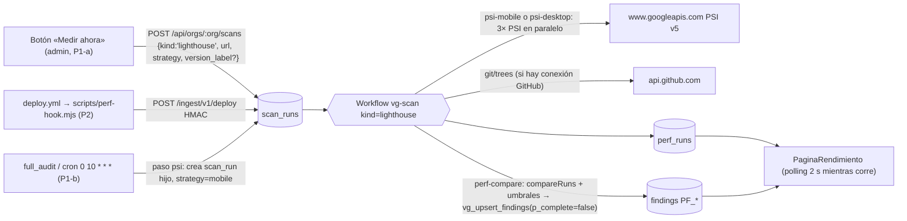

## 10. Módulo Rendimiento histórico (Lighthouse)

> **Fuente de verdad:** `decisiones/00-decisiones-canonicas.md` (§2 fila Rendimiento, §3 prohibiciones, §4 topología, §6 `perf_runs`, §7 contrato, §9.2 `PF_REGRESSION`, §15 #8). Base técnica: R13 (métricas, `metricSavings`, `compareRuns`, GitHub Actions) y R17 §4.3 (PSI dentro de un paso del Workflow). Donde R13 supone Vercel o Next.js, manda R17.
> **Alcance por prioridad (canónico, sin cambios):** **P0** = pantalla con la última medición **sembrada** (dato real medido el sábado). **P1** = «Medir ahora» con PSI v5 (móvil **o** escritorio: una estrategia por medición, como fija `ScanCreate` en §15) solo sobre dominios de la org, histórico de puntaje/LCP/TBT/CLS, `compareRuns` → `PF_REGRESSION` y dos versiones de la víctima (sana y con regresión). Dentro de P1 manda el orden **P1-a** (núcleo, BACK dom 08:30 y FRONT dom 09:00) y luego **P1-b** (si sobra, dom 09:30), §10.12. **P2** = tiempos de build por GitHub Actions, Observatory de nuestra zona, gancho de despliegue y plantilla Lighthouse Node.
> **Quién manda en un choque:** el DDL de `perf_runs` es el de §5 (`0007`) y el contrato (`ScanCreate`, `PerfRun`, E11, E24) el de §15. Esta sección solo **añade** columnas y campos opcionales sobre ellos; lo que exige cambiar otra sección está en los conflictos reportados al orquestador.
> **Remisiones:** stack y versiones en §3, flujo general en §4 (04.7), migraciones en §5 (`perf_runs` va en `0007`, P0), reglas de Cloudflare en §8, escáner de repo en §9, IA-1 en §11, reglas en vivo (`CF_UA_TOOL`) en §12, export y MCP en §13, componentes en §14, contrato completo en §15, horario en §16.

### 10.1 Decisiones del módulo

| Tema | Decisión | Marca |
|---|---|---|
| Motor | **PageSpeed Insights API v5** (PSI): Google corre Lighthouse 13.x y devuelve el LHR completo en `lighthouseResult`. Cero Chrome, cero binarios | [verificado: https://developers.google.com/speed/docs/insights/v5/get-started] |
| Dónde corre | Paso `psi-mobile` **o** `psi-desktop` (según `strategy`) y paso `perf-compare` del Workflow `vg-scan` (Worker `vanguard`, Workers Paid). Esperar a Google no gasta CPU; parsear ~0,5–1,5 MB de JSON por repetición sí, y en Free no cabe | [verificado: https://developers.cloudflare.com/workflows/reference/limits/] |
| Endpoint | `GET https://www.googleapis.com/pagespeedonline/v5/runPagespeed` (host de la guía y de §4). La referencia REST usa `https://pagespeedonline.googleapis.com/...`; cualquiera vale | [verificado: get-started y https://developers.google.com/speed/docs/insights/rest/v5/pagespeedapi/runpagespeed] |
| Parámetros | `url`, `strategy=MOBILE\|DESKTOP` (**siempre explícito: el valor por defecto es DESKTOP**), `category` repetido `PERFORMANCE`, `ACCESSIBILITY`, `BEST_PRACTICES`, `SEO` (en mayúsculas, como el enum oficial), `locale=es`, `key` | [verificado: referencia REST] |
| Clave | `PSI_API_KEY` (secreto del Worker, nombre canónico §14). Sin clave, la cuota global compartida dio 429 el 24-oct | [verificado: prueba de R13] |
| Cuota | 25.000 consultas/día por proyecto con clave | [no verificado: solo fuentes de terceros; confirmarlo en Cloud Console → PageSpeed Insights API → Quotas] |
| Timeout | El tope de la API de PSI es 120 s («raised from 60s to 120s», nota de 2021) → `AbortSignal.timeout(130_000)` solo para PSI (no el de 90 s de `lib/http.ts`, §15) | [verificado: https://developers.google.com/speed/docs/insights/release_notes] |
| Versión de Lighthouse | PSI y su API corren Lighthouse 13.0 desde el 20-oct-2025; los IDs de audit del catálogo §10.7 existen en `core/audits/insights/` de la rama principal (`cache-insight`, `lcp-breakdown-insight`…) y `resource-summary` sigue existiendo | [verificado: release notes de PSI y https://github.com/GoogleChrome/lighthouse/tree/main/core/audits/insights] |
| Repeticiones | **3 por medición, en paralelo** (`Promise.allSettled`), agrupadas por `run_group`; el punto del gráfico es la **mediana** por métrica. Si dos respuestas traen el mismo `lighthouseResult.fetchTime` (PSI devolvió la misma corrida en caché [no verificado]) cuentan como una. Con `n < 3` la UI dice «indicativo» | [propuesta, R13 §5.3] |
| Qué URLs | Solo `https://` cuyo host sea una zona de Cloudflare **conectada y activa** de la org (`connections.meta.zone_name`, provider `cloudflare`, `status='active'`) o un subdominio suyo, más los dominios con `verified_at` de `verified_domains` (§5, migración `0009`). `orgZones()` lee esa tabla solo si existe: si la consulta falla porque `0009` aún no está aplicada (`PGRST205`/`42P01`), sigue solo con las zonas. VanGUARD no mide sitios ajenos | [propuesta, coherente con §2 canónico «dominios verificados»] |
| Quién mide | Solo `admin`/`owner`. El `viewer` (jurado, «Ver demo») ve todo y no dispara PSI | canónico §2 |
| IA | **Nunca** en la medición. Las reglas (`compareRuns`, umbrales) deciden; Claude solo redacta el prompt de corrección (IA-1) cuando el usuario pulsa el botón | canónico §8 |
| Alertas | Los hallazgos `PF_*` son de auditoría: **no llaman ni mandan WhatsApp**, solo aparecen en la app | canónico §9.2 |

> **Decidido (librería Node de Lighthouse).** El encargo pide literalmente «la librería Node de Lighthouse» y §3 la prohíbe **en el producto**. Se sigue la prohibición: el producto usa PSI, que es Lighthouse 13 con el mismo LHR y los mismos IDs de audit. Para honrar el pedido sin romper la regla, la hoja de ruta (P2, tarea RND-21) incluye una **plantilla de workflow para el repo del cliente** (`lighthouse@13.5.0` + `chrome-launcher@1.2.2` en un runner `ubuntu-24.04`, que trae Chrome) que envía el LHR firmado a VanGUARD. Corre en el CI del cliente, nunca en nuestro Worker ni en las laptops del equipo [verificado: versión en https://registry.npmjs.org/lighthouse, R13 §1.1]. Las series `psi` y `lighthouse_node` no se mezclan nunca (R13 §5.3).

### 10.2 Dónde corre y flujo



**Parámetros que recibe el Workflow** (los guarda E11 en `scan_runs.params`, §15): `p.perf = {url, strategy, version_label?, commit_sha?, trigger}`, con `url` ya normalizada por `assertMeasurableUrl` (`origin + pathname`) y `trigger ∈ manual|schedule|deploy`. En `scan_runs.steps` un `kind='lighthouse'` lleva **un solo** elemento `{name:'psi'}` (el enum `ScanStep` de §15 no tiene más nombres); `scan_runs.step` (texto libre) sí muestra `psi-mobile`, `perf-compare`, etc.

**Código del paso (BACK, `apps/api/src/scans/psi.ts`; la función se llama `runPsi`, como en la tabla de pasos de §15):**

```ts
import { diagnose, pickRepresentative, locateAll, assertMeasurableUrl, toPerfRow } from '@vanguard/core';
const PSI = 'https://www.googleapis.com/pagespeedonline/v5/runPagespeed';
export type Strategy = 'mobile' | 'desktop';
type PsiOk = { lhr: any; field: unknown }; type PsiFatal = { fatal: string };

async function fetchPsi(url: string, s: Strategy, key: string): Promise<PsiOk | PsiFatal> {
  const q = new URLSearchParams({ url, strategy: s.toUpperCase(), locale: 'es', key });
  for (const c of ['PERFORMANCE', 'ACCESSIBILITY', 'BEST_PRACTICES', 'SEO']) q.append('category', c);
  const r = await fetch(`${PSI}?${q}`, { signal: AbortSignal.timeout(130_000) });   // esta URL lleva key=: nunca se registra
  if (!r.ok) {
    const msg = String(((await r.json().catch(() => null)) as any)?.error?.message ?? '');
    const lh = msg.match(/Lighthouse returned error: ([A-Z_]+)/)?.[1];            // p. ej. NO_FCP [no verificado: formato exacto]
    if (lh) return { fatal: `LH_${lh}` };                                         // la página no carga: reintentar no sirve
    if (r.status === 429 || r.status >= 500) throw new Error(`PSI_${r.status}`);  // transitorio: reintenta el paso
    return { fatal: `PSI_${r.status}` };                                          // 400 = URL que PSI no acepta
  }
  const j: any = await r.json();
  return j.lighthouseResult ? { lhr: j.lighthouseResult, field: j.loadingExperience?.metrics ?? null } : { fatal: 'PSI_NO_LHR' };
}

/** run_group determinista: si el paso se reintenta, borra e inserta de nuevo sin duplicar. */
export async function uuidFrom(s: string) {
  const h = [...new Uint8Array(await crypto.subtle.digest('SHA-256', new TextEncoder().encode(s)))].map(b => b.toString(16).padStart(2, '0')).join('');
  return `${h.slice(0, 8)}-${h.slice(8, 12)}-5${h.slice(13, 16)}-a${h.slice(17, 20)}-${h.slice(20, 32)}`;
}

export async function runPsi(env: Env, p: ScanParams) {
  const db = admin(env), perf = p.perf!, s = perf.strategy;
  const zones = await orgZones(db, p.orgId);                 // zone_name de conexiones cloudflare activas + verified_domains (si existe)
  assertMeasurableUrl(perf.url, zones);                      // se vuelve a comprobar aquí, no solo en la API
  const runGroup = await uuidFrom(`${p.scanRunId}|${s}`);
  await db.from('perf_runs').delete().eq('org_id', p.orgId).eq('run_group', runGroup);
  const res = await Promise.allSettled([1, 2, 3].map(() => fetchPsi(perf.url, s, env.PSI_API_KEY)));
  const seen = new Set<string>();
  const ok = res.flatMap(r => (r.status === 'fulfilled' && 'lhr' in r.value ? [r.value] : []))
    .filter(o => !seen.has(o.lhr.fetchTime) && !!seen.add(o.lhr.fetchTime))      // la misma corrida en caché cuenta una vez
    .map((o, i) => ({ rep: i + 1, ...o }));
  if (!ok.length) {
    const fatal = res.find(r => r.status === 'fulfilled') as PromiseFulfilledResult<PsiFatal> | undefined;
    if (fatal) return { run_group: runGroup, n: 0, error: fatal.value.fatal }; // no reintentar un 400 ni un LH_*
    throw new Error('PSI_TODAS_FALLARON');                                       // 429/5xx/red: el paso reintenta
  }
  // toPerfRow (core, puro): summarize() → scores con las claves del LHR tal cual y metrics de §10.3; created_at = lhr.fetchTime;
  // final_url = lhr.finalDisplayedUrl ?? lhr.finalUrl; runtime_error = lhr.runtimeError?.code ?? null; más scan_run_id, run_group, rep,
  // trigger, version_label, commit_sha y field.
  const rows = ok.map(({ rep, lhr, field }) => toPerfRow({ orgId: p.orgId, scanRunId: p.scanRunId, perf, runGroup, rep, lhr, field }));
  const i = pickRepresentative(rows);  // repetición sin runtime_error más cercana a la mediana del puntaje (empate: menor LCP); -1 si ninguna
  if (i >= 0) {
    const tree = await repoTree(env, p.orgId);                // GET /repos/{o}/{r}/git/trees/{branch}?recursive=1, o null sin conexión GitHub
    rows[i].is_representative = true;
    rows[i].diagnosis = locateAll(diagnose(ok[i].lhr, 5), tree, zones);   // redactado, ≤ 8 KB
  }
  await db.from('perf_runs').insert(rows).throwOnError();
  return { run_group: runGroup, n: rows.filter(r => !r.runtime_error).length };  // ≤ 1 MiB: solo ids y conteos
}
```

**En `apps/api/src/workflow.ts`** (reemplaza el bloque `if (all || p.kind === 'lighthouse')` de R17 §11.1; cada cuerpo va dentro de `guarded(env, p, nombre, fn)` de §15.8, que escribe `steps[i]` y `progress` y devuelve lo que devuelva `fn`; el paso `psi` del `full_audit` va antes de `resumen_ia`, con guion bajo):

```ts
const R_PSI = { retries: { limit: 2, delay: '20 seconds', backoff: 'exponential' as const }, timeout: '5 minutes' };  // PSI: más espera que R ante 429
if (p.kind === 'lighthouse') {
  if (p.perf!.trigger === 'deploy') await step.sleep('espera-propagacion', '30 seconds');               // solo P2
  const r = await step.do(`psi-${p.perf!.strategy}`, R_PSI, () => guarded(env, p, 'psi', () => runPsi(env, p)));
  await step.do('perf-compare', R, () => perfCompare(env, p, r));   // §10.6; findings PF_* con p_complete=false
  await step.do('fin', () => finishPerf(env, p, r));               // succeeded (o failed si n=0), progress 100; no recalcula puntaje
  return;                                                           // kind=lighthouse NO corre resumen_ia: cero gasto de IA
}
if (all) await step.do('psi', R, () => guarded(env, p, 'psi', () => spawnLighthouse(env, p)));   // P1-b: hijo kind=lighthouse; no espera
```

`spawnLighthouse` (P1-b) es idempotente: id del hijo = `uuidFrom(<scan_run_id del padre>|psi)`; `insert … on conflict do nothing` en `scan_runs` y `SCAN_WF.create({id, params})` tratando «la instancia ya existe» como éxito (si el paso se reintenta no nace un segundo hijo). Objetivo: la URL medida más recientemente o `https://<zone_name>/`, con `strategy:'mobile'` y `trigger:'schedule'`. Marca el paso `psi` como `skipped` si la org no tiene zonas, si ya hay un `kind='lighthouse'` en curso (regla 409 de E11) o si se alcanzó el tope diario; si no, `done` en cuanto el hijo existe (la medición termina después, en su propio `scan_runs`).

`step.sleep(nombre, duración)` y `retries {limit, delay, backoff}` con `timeout` por paso (por defecto 10 min) [verificado: https://developers.cloudflare.com/workflows/build/sleeping-and-retrying/]. El `full_audit` **no espera** a PSI (20–60 s por llamada [no verificado: tiempo típico]) para que la barra de «Auditar todo» de la demo no se alargue.

> **Resuelto con §15** (15.3 y 15.10 ya lo recogen): como la API de PSI admite hasta 120 s, `psi.ts` usa su propio `AbortSignal.timeout(130_000)` y no el de `lib/http.ts`. Los reintentos son los del paso (`R_PSI`), no los 3 intentos de `lib/http.ts`.

**Límites que importan:** resultado de un paso ≤ 1 MiB, CPU por paso 30 s en Paid, reloj ilimitado [verificado: limits de Workflows]. Nada del LHR crudo sale del paso; solo se guardan `scores`, `metrics` y `diagnosis` recortado. El parámetro `key=` va en la URL (la guía de PSI lo admite), así que `redact()` (§6/§15) **debe** quitar `key=…` y el patrón de clave de Google `AIza[0-9A-Za-z_-]{35}` de cualquier texto que se registre (ya en la lista de `redact()` de S06 06.5 y S15 15.11).

### 10.3 Métricas y umbrales

Pesos del puntaje Performance en Lighthouse 10+: FCP 10 %, SI 10 %, LCP 25 %, TBT 30 %, CLS 25 %; colores 0–49 rojo, 50–89 naranja, 90–100 verde [verificado: https://developer.chrome.com/docs/lighthouse/performance/performance-scoring]. Umbrales = curva de cada audit en Lighthouse 13.5.0: `p10` → puntaje 0,9 («bueno»), `median` → 0,5 («malo») [verificado: R13 §5.1, `core/audits/metrics/` de v13.5.0].

| Clave en `metrics` | Ruta en el LHR | Unidad | Móvil bueno / malo | Escritorio bueno / malo |
|---|---|---|---|---|
| `lcp_ms` | `audits['largest-contentful-paint'].numericValue` | ms | 2500 / 4000 | 1200 / 2400 |
| `tbt_ms` | `audits['total-blocking-time'].numericValue` | ms | 200 / 600 | 150 / 350 |
| `cls` | `audits['cumulative-layout-shift'].numericValue` | — | 0,1 / 0,25 | 0,1 / 0,25 |
| `fcp_ms` | `audits['first-contentful-paint'].numericValue` | ms | 1800 / 3000 | 934 / 1600 |
| `si_ms` | `audits['speed-index'].numericValue` | ms | 3387 / 5800 | 1311 / 2300 |
| `ttfb_ms` | `audits.metrics.details.items[0].timeToFirstByte` (respaldo `server-response-time`) | ms | 800 / 1800 (campo, web.dev) | ídem |
| `tti_ms`, `total_bytes`, `script_bytes`, `request_count` | `interactive`; `resource-summary` (filas `total` y `script`: `transferSize` y `requestCount`). Si un audit falta, la clave va `null` | ms / bytes | sin umbral (contexto) | — |
| `scores.performance` y demás | `categories.*.score` (0–1) con las claves del LHR **tal cual**: `performance`, `accessibility`, `best-practices`, `seo` (con guion, como el DDL y la siembra de §5 y E24 de §15) | 0–1 | ≥ 0,9 verde | ≥ 0,9 verde |

Reglas fijas: **INP no existe en una navegación de laboratorio** (solo en timespan): se muestra TBT como sustituto y el INP de campo solo si `loadingExperience` lo trae, que es opcional y Google anuncia retirarlo de PSI [verificado: get-started]. `lighthouseVersion` se guarda en cada fila; **la serie se corta si cambia el major**. Las filas con `lhr.runtimeError` (p. ej. `NO_FCP`) se guardan con `runtime_error` y no entran en medianas.

### 10.4 Disparadores

| Disparador | Prio | Cómo entra | Límites |
|---|---|---|---|
| **Sembrado** (`trigger='seed'`) | P0 | Plan A: `scripts/perf-medir.ts` (ORQUESTADOR) mide con PSI desde una laptop y genera `demo/seed-perf.sql` (§10.11). Plan B: la fila manual de `supabase/seed/demo.sql` de §5 (datos de pagespeed.web.dev, sin `diagnosis`, sale como «indicativo») | Mediciones reales con su hora real; nunca fechas inventadas. La víctima tiene que estar en línea (hito de las 16:00): no se puede sembrar antes |
| **«Medir ahora»** (`manual`) | P1-a | `POST /api/orgs/:org/scans {kind:'lighthouse', url, strategy:'mobile'\|'desktop', version_label?}` (variante de `ScanCreate` de §15 + `version_label` opcional) → `202 {scan_run_id}` | Admin. `409 conflict` si ya hay un `kind='lighthouse'` `queued`/`running` de la org creado hace < 15 min (regla de E11, §15) o una acción `under_attack_on` sin deshacer en la zona. Tope `app_config.topes.org_perf_day` (en código `?? 10` mediciones/día/org = 30 llamadas PSI; org demo 20) → `429 rate_limited` |
| **Auditoría** (`schedule`) | P1-b | `full_audit` (botón o cron `0 10 * * *`) crea un hijo `kind='lighthouse'`, `strategy:'mobile'`, para **un** objetivo: la URL medida más recientemente, o `https://<zone_name>/` si no hay | 1 objetivo por auditoría; cuenta para `org_perf_day` |
| **Despliegue** (`deploy`) | **P2** | Tras desplegar, el CI llama `POST /ingest/v1/deploy` firmado con el secreto de la conexión `ingest` (mismo esquema HMAC que `/ingest/v1/events`, §7) | `409` si ya se midió ese (org, url, `commit_sha`) en 24 h; cuenta para `org_perf_day`; el Workflow espera 30 s antes de medir. No está en el contrato de §15: se añade solo si sobra tiempo |
| Plantilla Lighthouse Node en el CI del cliente | P2 | `POST /ingest/v1/perf` con el LHR recortado (RND-21) | `source='lighthouse_node'`, serie aparte |

**Gancho de despliegue (P2)** (`scripts/perf-hook.mjs`, ORQUESTADOR; Node puro, sin dependencias; todo va dentro del `try`, así que nunca rompe el deploy aunque falten los secretos):

```js
import { createHmac } from 'node:crypto';
import { readFileSync } from 'node:fs';
try {
  const { VG_INGEST_CONN_ID, VG_INGEST_SECRET, GITHUB_SHA } = process.env;
  if (!VG_INGEST_CONN_ID || !VG_INGEST_SECRET) throw new Error('faltan los secretos VG_INGEST_*');
  const TARGET_URL = process.env.TARGET_URL ?? 'https://demo.officialvanguard.com/';
  const version = process.env.VERSION_LABEL
    ?? readFileSync('apps/victima/src/perf-version.ts', 'utf8').match(/PERF_VERSION\s*=\s*'([\w.-]+)'/)?.[1];
  const body = JSON.stringify({ url: TARGET_URL, commit_sha: GITHUB_SHA, version_label: version, environment: 'production' });
  const ts = String(Math.floor(Date.now() / 1000));
  const sig = createHmac('sha256', VG_INGEST_SECRET).update(`${ts}.${body}`).digest('hex');   // clave = bytes UTF-8 del vgi_… (§5)
  const r = await fetch('https://officialvanguard.com/ingest/v1/deploy', { method: 'POST', body, signal: AbortSignal.timeout(15_000),
    headers: { 'content-type': 'application/json', 'x-vg-conn': VG_INGEST_CONN_ID, 'x-vg-ts': ts, 'x-vg-sig': sig } });
  console.log('perf-hook', r.status);
} catch (e) { console.log('perf-hook sin efecto:', e instanceof Error ? e.message : 'error'); }
```

Paso en `.github/workflows/deploy.yml`, justo después de desplegar `vanguard-victima`: `- run: node scripts/perf-hook.mjs` con `continue-on-error: true` y `env: { VG_INGEST_CONN_ID: ${{ secrets.VG_INGEST_CONN_ID }}, VG_INGEST_SECRET: ${{ secrets.VG_INGEST_SECRET }} }`. Son dos secretos de Actions nuevos (los de la conexión `ingest` de la víctima en la org demo); si se activa este P2, el orquestador los añade a la lista de §14 de las decisiones.

### 10.5 Esquema histórico (SQL para la migración `0007` de §5)

La tabla la crea §5 en `0007` (`create table if not exists public.perf_runs`, con el `check` de `url`, `source = 'psi'` y el índice `perf_runs_org_url_idx (org_id, url, strategy, created_at desc)`); **ese DDL manda** y aquí no se repite. Este módulo añade columnas con `alter table … add column if not exists` **al final del mismo `0007`**, después del `create table` de §5 (sin ellas no hay repeticiones ni comparación por versión). RLS y la política `perf_runs_sel` las pone `0008` de §5 (bucle de 05.5): aquí no se crea otra. Escribe solo el Workflow (y el sembrado, por el editor SQL).

```sql
-- 0007_ai_config_perf.sql (final, BACK): columnas añadidas por §10 sobre el perf_runs de §5
alter table public.perf_runs
  add column if not exists scan_run_id uuid references public.scan_runs(id) on delete set null,  -- null en el sembrado
  add column if not exists run_group uuid not null default gen_random_uuid(),  -- repeticiones de una medición: uuidFrom(scan_run_id|strategy);
                                                                               -- el default cubre la siembra manual de §5 (cada fila, su propio grupo, n=1)
  add column if not exists rep smallint not null default 1 check (rep between 1 and 5),
  add column if not exists is_representative boolean not null default false, -- la más cercana a la mediana; solo ella lleva diagnosis
  add column if not exists trigger text not null default 'manual' check (trigger in ('manual','deploy','schedule','seed')),
  add column if not exists version_label text check (version_label ~ '^[A-Za-z0-9_.-]{1,40}$'),
  add column if not exists commit_sha text check (commit_sha ~ '^[0-9a-f]{7,40}$'),
  add column if not exists final_url text,
  add column if not exists runtime_error text,     -- p. ej. NO_FCP; no entra en medianas
  add column if not exists diagnosis jsonb,        -- PerfDiagnosis (§10.7), ≤ 8 KB, redactada
  add column if not exists field jsonb;            -- loadingExperience.metrics si existe
create index if not exists perf_runs_group_idx on public.perf_runs (run_group);
-- Recordatorio de §5: scores lleva las claves del LHR tal cual: {"performance":0.97,"accessibility":0.91,"best-practices":1,"seo":0.92};
-- metrics: {"lcp_ms":1450,"tbt_ms":40,"cls":0,"fcp_ms":900,"si_ms":1300,"ttfb_ms":120, ...extras de §10.3}; created_at = lighthouseResult.fetchTime.

-- Un punto del gráfico = una medición (mediana de sus repeticiones válidas). 0008 revoca anon sobre todas las tablas y vistas de public.
create or replace view public.perf_points with (security_invoker = true) as
select run_group, org_id, url, strategy, min(created_at) as at,
       max(version_label) as version_label, max(commit_sha) as commit_sha, max(trigger) as trigger,
       max(lighthouse_version) as lighthouse_version, count(*)::int as n,
       round(100 * percentile_cont(0.5) within group (order by (scores->>'performance')::numeric))::int as perf_score,
       percentile_cont(0.5) within group (order by (metrics->>'lcp_ms')::numeric)  as lcp_ms,
       percentile_cont(0.5) within group (order by (metrics->>'tbt_ms')::numeric)  as tbt_ms,
       percentile_cont(0.5) within group (order by (metrics->>'cls')::numeric)     as cls,
       percentile_cont(0.5) within group (order by (metrics->>'fcp_ms')::numeric)  as fcp_ms,
       percentile_cont(0.5) within group (order by (metrics->>'si_ms')::numeric)   as si_ms,
       percentile_cont(0.5) within group (order by (metrics->>'ttfb_ms')::numeric) as ttfb_ms,
       percentile_cont(0.5) within group (order by (metrics->>'script_bytes')::numeric) as script_bytes
from public.perf_runs where runtime_error is null
group by run_group, org_id, url, strategy;
```

El Worker habla con Supabase por supabase-js (PostgREST), que **no ejecuta SQL libre con `$1`**: el histórico y la línea base se leen de la vista con filtros de PostgREST y el resto se calcula en TS puro (`packages/core/src/perf/points.ts`, con Vitest). Siempre con `.eq('org_id', ctx.orgId)` (anti-IDOR, §7).

**Histórico con delta contra la medición anterior** (`GET …/perf/history`): los **últimos** 60 puntos de 90 días, devueltos en orden ascendente.

```ts
const { data } = await db.from('perf_points').select('*')
  .eq('org_id', ctx.orgId).eq('url', url).eq('strategy', strategy)
  .gt('at', new Date(Date.now() - 90 * 864e5).toISOString())
  .order('at', { ascending: false }).limit(60);
const pts = withDeltas((data ?? []).reverse());   // core: indicativo = n < 3; delta vs el punto anterior
// core/perf/points.ts
const d = (a: number | null, b: number | null) => (a == null || b == null ? undefined : a - b);   // null - 5 no es -5
export const withDeltas = (a: PerfPointRow[]) => a.map((p, i) => ({ ...p, indicativo: p.n < 3,
  delta: i === 0 ? null : { perf_score: d(p.perf_score, a[i - 1].perf_score), lcp_ms: d(p.lcp_ms, a[i - 1].lcp_ms),
                            tbt_ms: d(p.tbt_ms, a[i - 1].tbt_ms), cls: d(p.cls, a[i - 1].cls) } }));
```

**Línea base para comparar** (`perf-compare` y `GET …/perf/compare`): la medición anterior **de otra versión** con el mismo major de Lighthouse. Clave de versión = `version_label ?? commit_sha[0..12]`; si la nueva no tiene versión, se compara con la inmediatamente anterior.

```ts
const { data: prev } = await db.from('perf_points').select('*')
  .eq('org_id', ctx.orgId).eq('url', head.url).eq('strategy', head.strategy)
  .neq('run_group', head.run_group).lt('at', head.at).order('at', { ascending: false }).limit(20);
const base = pickBaseline(head, prev ?? []);
// core/perf/points.ts
export const versionKey = (p: PerfPointRow) => p.version_label ?? p.commit_sha?.slice(0, 12) ?? null;
const major = (v: string | null) => v?.split('.')[0] ?? null;
export function pickBaseline(head: PerfPointRow, prev: PerfPointRow[]) {   // prev en orden de at descendente
  const k = versionKey(head);
  return prev.find(p => major(p.lighthouse_version) !== null && major(p.lighthouse_version) === major(head.lighthouse_version)
                        && (k === null || versionKey(p) !== k)) ?? null;
}
```

Para la demo, la etiqueta de versión es lo que hace funcionar la comparación: si el domingo se mide la v2 **sin** etiqueta, la base sería la v2 sembrada a las 18:00 y no saldría `PF_REGRESSION`. Por eso `DialogoMedir` propone por defecto la última `version_label` usada en esa URL (§10.10) y el guion la escribe a mano: `v2-regresion`.

Retención: sin borrado durante el hackatón (10 mediciones/día × 3 filas es nada). Sin tabla `perf_findings` aparte (R13 la proponía): el «dónde» vive en `diagnosis` de la fila representativa y lo accionable, en `findings`.

### 10.6 Comparación versión contra versión y reglas `PF_*`

Umbral **relativo y absoluto a la vez** (R13 §5.3, [propuesta] a calibrar con la siembra); se compara la mediana de la línea base contra la mediana de la nueva, con la misma `strategy`:

| Métrica | Empeora si Δ ≥ (relativo) | y Δ ≥ (absoluto) |
|---|---|---|
| `lcp_ms` | +10 % | +250 ms |
| `tbt_ms` | +20 % | +100 ms |
| `fcp_ms` | +10 % | +200 ms |
| `si_ms` | +10 % | +300 ms |
| `cls` | — | +0,05 |
| `script_bytes` | +10 % | +50 KB |
| `perf_score` | — | −5 puntos |

```ts
// packages/core/src/perf/compare.ts (puro; Vitest)
type N = number | null | undefined;                     // los puntos de perf_points y evidence.base pueden traer nulos o faltar campos
export type PerfSummary = { perf_score: N; lcp_ms: N; tbt_ms: N; fcp_ms?: N; si_ms?: N; cls: N; script_bytes?: N };
const RULES: [keyof PerfSummary, number, number][] = [
  ['lcp_ms', 0.10, 250], ['tbt_ms', 0.20, 100], ['fcp_ms', 0.10, 200], ['si_ms', 0.10, 300], ['cls', 0, 0.05], ['script_bytes', 0.10, 50_000]];
const EPS = 1e-9;                                      // 0.15 - 0.1 = 0.04999999999999999: sin margen, CLS +0,05 no regresaría
export function compareRuns(base: PerfSummary, head: PerfSummary) {
  const regressions = RULES.flatMap(([k, rel, abs]) => {
    const b = base[k], h = head[k];
    if (b == null || h == null) return [];
    const d = h - b;
    return d >= abs - EPS && (rel === 0 || d >= b * rel - EPS) ? [{ metric: k, base: b, head: h, delta: d, rel: b ? d / b : null }] : [];
  });
  if (base.perf_score != null && head.perf_score != null) {
    const drop = base.perf_score - head.perf_score;    // puntaje ya en 0–100 (entero)
    if (drop >= 5) regressions.push({ metric: 'perf_score', base: base.perf_score, head: head.perf_score, delta: -drop, rel: null });
  }
  return { regressed: regressions.length > 0, regressions };
}
```

| Regla | Condición | Severidad | `confirmed` | Prio |
|---|---|---|---|---|
| `PF_REGRESSION` | `compareRuns(base, head).regressed` | **high** si el puntaje cae ≥ 20 o (móvil y LCP +1000 ms); si no, **medium** | `base.n ≥ 3 && head.n ≥ 3` | P1-a |
| `PF_CWV_POOR` | Mediana de la última medición por encima del umbral «malo» de §10.3 (de su estrategia) en LCP, TBT o CLS | medium | `n ≥ 3` | P1-b |
| `PF_BUILD_FAILING`, `PF_BUILD_SLOWER` | §10.8 | medium / low | sí | P2 |

- **Campos del hallazgo:** `module='performance'`, `origin='rule'`, `title` en español (≤ 200; p. ej. «Regresión de rendimiento en / (móvil): puntaje 97→41, LCP +4,7 s»), `scan_run_id` del `kind='lighthouse'`, `connection_id` = null. El objetivo se escribe **sin esquema** (`demo.officialvanguard.com/`, recortado a 200 caracteres) para no meter URLs ajenas a la lista permitida de IA-1 (§11). `resource` (≤ 300): `PF_REGRESSION` → `"<objetivo> · móvil|escritorio · <clave_base>→<clave_head>"`; `PF_CWV_POOR` → `"<objetivo> · móvil|escritorio"` (clave = `versionKey` o los 8 primeros caracteres del `run_group`).
- **`evidence`** (redactada; el JSON serializado ocupa **≤ 1.400 caracteres**, porque IA-1 recibe la evidencia truncada a 1.500, §11): `{target, strategy, lighthouse_version, base:{run_group, version, at, n, perf_score, lcp_ms, tbt_ms, cls}, head:{…}, regressions:[{metric, base, head, delta}], lcp:{dominant, selector≤120}, causes:[{cause_id, audit_id, metric, savings_ms, resource≤120, repo_file, repo_confidence, change}]}` con las **3** primeras causas de §10.7; si no cabe, se quitan causas desde el final y luego se acortan selectores. El diagnóstico completo vive en `perf_runs.diagnosis` y lo sirve `GET …/perf/compare`.
- **Escritura y `dedupe_key`:** con la RPC de §15 `vg_upsert_findings(p_org, p_scan, 'performance', rows, p_complete => false)` y `dedupe_key = dedupeKey(org_id, rule_id, resource)` de `core/crypto.ts` (fórmula única de §15.8). **Nunca `p_complete = true` para `performance`:** la RPC marcaría `verified` los `PF_*` de **otras** URL y estrategias que esta medición no miró. El cierre lo hace este paso:
- **Cierre automático (P1-b):** `perf-compare` lee los `PF_*` `open`/`fixed` de la org con `evidence.target` y `evidence.strategy` iguales a los de la medición (filtro en TS; son pocos). Si la nueva medición ya no regresa contra `evidence.base` (`PF_REGRESSION`) o queda bajo los umbrales (`PF_CWV_POOR`), pone `status='verified'`, `verified_at=now()`, `status_reason='Medición <hora> sin regresión'`. Solo toca hallazgos `open` o `fixed`; los `ignored` se respetan.
- **No comparable:** sin base (primera medición), con cambio de major de Lighthouse o con `head.n = 0`, `perf-compare` no crea `PF_REGRESSION` y `GET .../perf/compare` devuelve `comparable:false` con `reason`. Si la medición da `n = 0`, `finishPerf` deja el `scan_run` en `failed` con `error = 'La página no cargó para Lighthouse (<runtime_error o código PSI>)'`.
- **Puntaje y cobertura (regla para `packages/core/score.ts`; ya coincide con la cobertura de §15.9):** los `PF_*` restan con los pesos de §9.2 (tope 40 por módulo). La fuente `performance` cuenta como «vista» si la org tiene un `perf_runs` de hace ≤ 7 días (la fila sembrada cuenta). Con la siembra, la org demo muestra **4 de 4**: el guion canónico (§11 de las decisiones) y §16 ya dicen «vemos {N} de 4 fuentes», leído de la pantalla.

### 10.7 Diagnóstico: audit → causa → recurso/archivo → prompt de corrección

**Paso 1 — `diagnose(lhr)`** (`packages/core/src/perf/diagnose.ts`): portar `summarize()` y `diagnose()` de R13 §6.3 tal cual. Están probados sobre `sample_v2.json` de v13.5.0: subparte dominante `resourceLoadDelay`, selector `body > div > h2#toppy`, primera causa `cache-insight` con 3100 ms de LCP [verificado: prueba propia de R13]. Reglas que no se cambian: se filtra por **ahorro mínimo** (FCP/LCP 100 ms, TBT 50 ms, CLS 0,01) y **no por score**; IDs candidatos 13.5 → 13.0 → 12; `long-tasks`, `bootup-time` y `mainthread-work-breakdown` comparten el mismo ahorro de TBT y **no se suman** (una causa, ahorro = máximo). Máximo 5 filas por audit y 30 causas. Las subpartes del LCP salen de `lcp-breakdown-insight` (en 12.x `lcp-phases-insight`): `timeToFirstByte`, `resourceLoadDelay`, `resourceLoadDuration`, `elementRenderDelay` [verificado el ID: https://github.com/GoogleChrome/lighthouse/tree/main/core/audits/insights; nombres de subparte según R13].

**Paso 2 — causa** (`packages/core/src/perf/causes.ts`, catálogo cerrado; el `cause_id` es lo que usan la plantilla y el prompt):

| `cause_id` | Audits (13.5, con respaldo) | Métrica | Etiqueta UI | Arreglo de plantilla | Cruce |
|---|---|---|---|---|---|
| `servidor_lento` | `document-latency-insight`, `server-response-time`; subparte LCP `timeToFirstByte` | FCP/LCP | «El servidor tarda en responder» | Cachear en el borde, revisar consultas lentas | CPU de Supabase (`SB_CPU_HIGH`) |
| `bloqueo_render` | `render-blocking-insight` | FCP/LCP | «CSS/JS bloquea el primer pintado» | `defer`/`async`, CSS crítico en línea | — |
| `lcp_tardio` | `lcp-discovery-insight` (`prioritize-lcp-image`), `network-dependency-tree-insight`; subparte `resourceLoadDelay` | LCP | «La imagen principal se descubre tarde» | Quitar `loading=lazy`, `fetchpriority="high"`, `preload` | — |
| `imagen_pesada` | `image-delivery-insight` (antes `modern-image-formats`, `uses-optimized-images`, `uses-responsive-images`) | LCP | «Imagen pesada o en formato antiguo» | WebP/AVIF, `srcset`, tamaño real | — |
| `sin_cache` | `cache-insight` (en 12.x `use-cache-insight`; antes `uses-long-cache-ttl`) | LCP | «Recursos sin caché larga» | `Cache-Control` largo con hash en el nombre | Cache Rules de Cloudflare (P2) |
| `hilo_principal` | `bootup-time`, `long-tasks`, `mainthread-work-breakdown` | TBT | «Un script bloquea el hilo principal» | Partir el trabajo, diferir, Web Worker | — |
| `js_legado` | `legacy-javascript-insight`, `duplicated-javascript-insight` | LCP/TBT | «Polyfills o JS duplicado innecesario» | Quitar polyfills, apuntar a navegadores modernos | — |
| `js_sin_usar` | `unused-javascript`, `unused-css-rules` | LCP | «Código que se descarga y no se usa» | Dividir el bundle, importar bajo demanda | — |
| `terceros` | `third-parties-insight` | TBT | «Script de terceros» | Cargarlo tras la interacción | — |
| `layout_inestable` | `cls-culprits-insight`, `unsized-images`, `font-display-insight` | CLS | «Elementos que se mueven al cargar» | `width`/`height` o `aspect-ratio`, `font-display` | — |
| `dom_grande` | `dom-size-insight` | TBT | «DOM demasiado grande» | Virtualizar listas | — |
| `otro` | cualquier audit con `metricSavings` fuera del catálogo | la del audit | `audit.title` tal cual | Plantilla genérica | — |

**Paso 3 — recurso → archivo** (`packages/core/src/perf/locate.ts`). Árbol del repo conectado: **una** llamada `GET /repos/{o}/{r}/git/trees/{default_branch}?recursive=1` por paso PSI con el token de la conexión GitHub (Contents: Read; tope 100.000 entradas y 7 MB; con `truncated:true` se usa lo que llegó) [verificado: R11 §1.4]. Sin conexión GitHub, `repo_confidence='ninguna'`.

```ts
const SKIP = /(^|\/)(node_modules|dist|build|\.next|\.git|coverage|vendor)\//;
const HASH = /-[0-9A-Za-z_]{8,}(?=\.\w+$)/;                       // hash de Vite/Next en el nombre
export const resourceKey = (u: string) => new URL(u).pathname.replace(HASH, '-*');
export function locateInRepo(resourceUrl: string, tree: string[] | null, zones: string[]):
  { file: string | null; confidence: 'exacta' | 'probable' | 'ninguna'; first_party: boolean } {
  let u: URL; try { u = new URL(resourceUrl); } catch { return { file: null, confidence: 'ninguna', first_party: false }; }
  const first_party = zones.some(z => u.hostname === z || u.hostname.endsWith('.' + z));
  if (!first_party || !tree) return { file: null, confidence: 'ninguna', first_party };
  const files = tree.filter(f => !SKIP.test(f));
  let p: string; try { p = decodeURIComponent(u.pathname); } catch { p = u.pathname; }   // un % mal formado no rompe el paso
  p = p.replace(/^\/+/, '');
  if (p === '') { const f = ['index.html', 'public/index.html', 'src/index.html'].find(x => files.includes(x));
                  return { file: f ?? null, confidence: f ? 'probable' : 'ninguna', first_party }; }
  for (const pre of ['', 'public/', 'static/', 'src/', 'assets/']) if (files.includes(pre + p)) return { file: pre + p, confidence: 'exacta', first_party };
  const base = p.split('/').pop()!, stem = base.replace(HASH, '');
  const hits = files.filter(f => f === base || f.endsWith('/' + base));
  if (hits.length === 1) return { file: hits[0], confidence: 'probable', first_party };
  if (p.startsWith('assets/') && /^index\.(js|css)$/.test(stem)) {           // bundle principal de Vite
    const m = ['src/main.tsx', 'src/main.ts', 'src/main.jsx', 'src/main.js'].find(x => files.includes(x));
    if (m) return { file: m, confidence: 'probable', first_party };
  }
  return { file: null, confidence: 'ninguna', first_party };
}
```

`locateAll()` aplica `locateInRepo` a cada causa y añade `repo_file`, `repo_confidence`, `first_party`. En `perf-compare`, cada causa de la medición nueva recibe `change`: `nuevo` (la clave `audit_id|resource_key` no estaba en la base), `peor` (ahorro +100 ms o `wasted_bytes` +50 KB), `igual` o `mejor`. La UI marca **«introducido en esta versión»** las `nuevo`. El mapeo de chunk a archivo es heurístico y se rotula «probable»; el selector y el fragmento del nodo LCP van al prompt para que la IA del usuario localice el componente.

**Paso 4 — prompt de corrección.** El botón «Generar prompt de corrección» de un `PF_*` usa la ruta existente `POST /api/orgs/:org/findings/:id/fix-prompt` (IA-1, `claude-sonnet-5-5`, ~0,033 USD, caché en `findings.fix_prompt`, §11). **No hay un `datos` propio de Rendimiento:** IA-1 manda el formato único de §11, `{hallazgo: {rule_id, severity, confirmed, title, resource, module, evidence}, stack: {…}}`, y lo específico va en la `evidence` compacta de §10.6 (valores **ilustrativos**):

```json
{ "target": "demo.officialvanguard.com/", "strategy": "mobile", "lighthouse_version": "13.0.1",
  "base": { "version": "v1-sana",      "n": 3, "perf_score": 97, "lcp_ms": 1450, "tbt_ms": 40,  "cls": 0.00 },
  "head": { "version": "v2-regresion", "n": 3, "perf_score": 41, "lcp_ms": 6200, "tbt_ms": 820, "cls": 0.31 },
  "regressions": [ { "metric": "lcp_ms", "base": 1450, "head": 6200, "delta": 4750 } ],
  "lcp": { "dominant": "resourceLoadDuration", "selector": "main > img.hero" },
  "causes": [ { "cause_id": "imagen_pesada", "audit_id": "image-delivery-insight", "metric": "LCP", "savings_ms": 3900,
                "resource": "/img/hero-original.jpg", "repo_file": "public/img/hero-original.jpg", "repo_confidence": "exacta", "change": "nuevo" } ] }
```

Defensas (§6, §8, §11): `snippet`, `selector`, títulos de audits y URLs vienen de la página medida, que puede ser hostil → pasan por `redact()` **antes** de guardarse, se truncan a 120 caracteres en `evidence` (200 en `diagnosis`) y al modelo solo llegan dentro de `<datos_no_confiables>…</datos_no_confiables>`; si `scanInjection()` de `untrusted.ts` levanta bandera, el hallazgo lleva `suspected_injection=true`. Los objetivos van sin `https://` porque `checkModelText()` rechaza la salida que enlace a un host fuera de su lista (supabase.com, cloudflare.com, github.com, osv.dev, nvd.nist.gov): si el modelo escribe igualmente `https://demo.officialvanguard.com/`, la salida pasa porque `checkFixPrompt(texto, extraHosts)` admite los `zone_name` de la org (S15 15.10, S06 06.4). La `prueba_de_aceptacion` siempre es medible en VanGUARD: «Vuelve a medir: LCP, TBT y CLS por debajo del umbral “bueno” de §10.3 para esa estrategia (móvil: 2500 ms, 200 ms, 0,1) y ninguna causa nueva». **Sin IA** (apagada, tope o rechazo): plantilla fija por `cause_id` en `packages/core/src/templates/perf.ts` con la columna «Arreglo de plantilla» y el archivo probable. Nunca se manda el LHR crudo (≥ 500 KB) a Claude: solo la `evidence` (≤ 1.400 caracteres).

**Cruce entre módulos (P2):** si la subparte dominante es `timeToFirstByte` y `ttfb_ms` empeoró, `evidence.correlaciones` lee `metric_samples` (CPU de Supabase, ±10 min) y el p95 de `edge_hits` de la víctima (±5 min); la UI muestra, por ejemplo, «coincide con CPU 92 % en Supabase» (R13 §6.2).

### 10.8 GitHub Actions: duración de builds, tasa de fallos y errores (P2)

> **Decisión abierta (Giovanni, dom 09:00; recogida en la portada) — prioridad de los builds.** El encargo pide tiempos de compilación y cantidad de errores; §2 los deja en P2 y aquí se respeta. Cuesta ~2 h de BACK y ~1 h de FRONT, reutiliza la conexión GitHub y no gasta IA. Si el BACK cierra su P1 antes del domingo 09:00, el orquestador puede subirlo a «P1 opcional» sin tocar nada más.

- **Permiso:** opcional **Actions: Read-only** en el PAT fine-grained del repo. Cubre `GET /repos/{o}/{r}/actions/runs`, `/actions/runs/{run_id}/jobs` y `/actions/jobs/{job_id}/logs` [verificado: https://docs.github.com/en/rest/authentication/permissions-required-for-fine-grained-personal-access-tokens]. La página **no tiene sección «Checks»** para PAT fine-grained, así que check-runs y anotaciones no se usan [verificado: misma página]. El sondeo de la conexión (§9) guarda `capabilities.actions_read`: un 403 → «te falta el permiso Actions (opcional, para tiempos de compilación)».
- **Llamadas por sincronización** (paso `builds` del Workflow cuando `kind ∈ {repo, full_audit}` y `actions_read`): 1 `GET .../actions/runs?per_page=100&created=>=<hoy−30d>&exclude_pull_requests=true`; hasta 30 `GET .../runs/{id}/jobs?filter=latest&per_page=100`; hasta 5 `GET .../actions/jobs/{job_id}/logs` (solo jobs fallidos; 302 a un texto que caduca en 1 min; se leen ≤ 2 MB). Unas 40 llamadas, frente a 5.000/h del PAT [verificado: R13 §7.1]. **No** usar `/actions/runs/{id}/timing` (en cierre) [verificado: R13 §7.1].
- **Definiciones:** duración = `max(jobs.completed_at) − min(jobs.started_at)` (respaldo `updated_at − run_started_at`); tasa de fallos = `failure / (success + failure)` sin `cancelled` ni `skipped`, por `workflow_name`, rama por defecto; errores = líneas que contienen `##[error]` en los logs de jobs fallidos (cota inferior; el marcador está [no verificado]); `external_id = "<run.id>#<run_attempt>"` para no contar dos veces un re-run.

```sql
create table public.build_runs (            -- P2, migración aparte; mismo patrón de RLS que perf_runs
  id uuid primary key default gen_random_uuid(),
  org_id uuid not null references public.orgs(id) on delete cascade,
  connection_id uuid not null references public.connections(id) on delete cascade,
  provider text not null default 'github_actions' check (provider in ('github_actions')),
  external_id text not null, workflow_name text, run_number int, commit_sha text, branch text, event text,
  status text, conclusion text, started_at timestamptz, finished_at timestamptz, duration_ms int,
  failed_jobs int, error_lines int, url text, created_at timestamptz not null default now(),
  unique (org_id, provider, external_id));
-- Cifras: p50/p90 y tasa de fallos por workflow, 30 días. Como PostgREST no ejecuta SQL libre, va como función
-- public.vg_build_kpis(p_org uuid) (security invoker, llamada por .rpc() con el cliente admin) o se calcula en TS
select workflow_name, count(*) filter (where conclusion = 'failure')::float
         / nullif(count(*) filter (where conclusion in ('success','failure')), 0) as fail_rate,
       percentile_cont(0.5) within group (order by duration_ms) as p50_ms,
       percentile_cont(0.9) within group (order by duration_ms) as p90_ms, sum(coalesce(error_lines,0)) as errors
from public.build_runs where org_id = p_org and started_at > now() - interval '30 days'
group by workflow_name order by fail_rate desc nulls last;
```

Reglas: `PF_BUILD_FAILING` = tasa de fallos ≥ 0,3 con ≥ 5 runs completos en 14 días, o los 3 últimos runs de la rama por defecto fallidos (medium). `PF_BUILD_SLOWER` = p50 de los últimos 7 días ≥ 1,5 × p50 de los 21 anteriores y +60 s, con ≥ 3 runs en cada ventana (low). Las primeras 3 líneas de error van a `evidence`, redactadas y dentro de `<datos_no_confiables>`. La vista «por versión» (build y rendimiento del mismo `commit_sha`, R13 §8) solo se llena cuando el repo conectado es el que despliega la app medida; en la demo no coinciden (la víctima se despliega desde el monorepo), así que no se promete.

### 10.9 Contrato API y tipos (para §7/§15; los nuevos los aprueba el orquestador)

| Método y ruta | Auth | Respuesta | Prio | Estado |
|---|---|---|---|---|
| `GET /api/orgs/:org/modules/performance/state` | user | `EstadoModulo` (§10.10) | P0 | existente |
| `POST /api/orgs/:org/scans` (E11) con la variante `lighthouse` de `ScanCreate` | admin | `202 {scan_run_id}`; `422 invalid_body` «Solo medimos dominios de tus zonas conectadas: officialvanguard.com»; `409 conflict` (ya hay un `lighthouse` en curso, regla de E11, o Under Attack activo); `429 rate_limited` (tope diario `org_perf_day`) | P1-a | existente en §15 (cuerpo plano `{kind, url, strategy}`) **+ `version_label` opcional** (nuevo) |
| `GET /api/orgs/:org/perf/runs?url=&strategy=&limit=30` (E24) | user | `PerfRun[]` de §15 (en P1, con los campos opcionales de `PerfRunExt`); sin `diagnosis` | P0/P1 | existente (+ `strategy` y `limit` opcionales) |
| `GET /api/orgs/:org/perf/history?url=&strategy=` | user | `PerfPoint[]` (consulta de §10.5) | P1-a | nuevo |
| `GET /api/orgs/:org/perf/compare?url=&strategy=&base=&head=` | user | `PerfComparison` (sin `base`/`head` = la última y su línea base). `base`/`head` son `run_group` y se buscan con `.eq('org_id', ctx.orgId)`: uno ajeno → 404 | P1-a | nuevo |
| `GET /api/orgs/:org/perf/targets` | user | `PerfTargets` = `{allowed_zones: string[], targets: [{url, last_at, score_mobile, score_desktop, points}]}` | P1-b | nuevo (mientras no exista, el FRONT saca las URLs de `perf/runs`) |
| `GET /api/orgs/:org/perf/points/:run_group` | user | `PerfPoint & {diagnosis: PerfDiagnosis}` | P1-b | nuevo |
| `POST /ingest/v1/deploy` | hmac (conexión `ingest`) | `202 {scan_run_id}` · `401` firma o reloj · `409` mismo commit en 24 h · `429` | **P2** | nuevo |
| `GET /api/orgs/:org/builds?days=30` | user | `{kpis: [{workflow_name, fail_rate, p50_ms, p90_ms, errors}], runs: BuildRun[]}` | P2 | nuevo |

```ts
// packages/contracts/src/perf.ts (ORQUESTADOR; zod 4.6.7). §15.5 manda: aquí NO se redefine PerfRun ni ScanCreate, solo se
// extienden con campos opcionales (lo único permitido tras el congelamiento de las 11:00). Como zod quita las claves que el
// esquema no declara, sin PerfRunExt el BACK perdería run_group, rep… al validar la respuesta de E24.
import { z } from 'zod';
import { Id, Ts } from './comun.ts';
import { PerfRun } from './api.ts';                         // el de §15.5, intacto
export const Strategy = z.enum(['mobile', 'desktop']);
const ms = z.number().nonnegative().nullable();
export const Version = z.string().regex(/^[A-Za-z0-9_.-]{1,40}$/);
export const PerfMetrics = PerfRun.shape.metrics.extend({
  tti_ms: ms.optional(), total_bytes: ms.optional(), script_bytes: ms.optional(), request_count: ms.optional() });
export const PerfRunExt = PerfRun.extend({ metrics: PerfMetrics, run_group: Id.optional(), rep: z.number().int().optional(),
  is_representative: z.boolean().optional(), trigger: z.enum(['manual', 'deploy', 'schedule', 'seed']).optional(),
  version_label: z.string().nullable().optional(), runtime_error: z.string().nullable().optional() });
// Variante 'lighthouse' de ScanCreate en §15.5 + un campo opcional nuevo (el orquestador lo añade en api.ts):
//   z.object({ kind: z.literal('lighthouse'), url: z.url().refine((u) => u.startsWith('https://'), 'solo https'),
//              strategy: z.enum(['mobile', 'desktop']).default('mobile'), version_label: Version.optional() })
export const PerfCause = z.object({ cause_id: z.string(), audit_id: z.string(), metric: z.enum(['FCP', 'LCP', 'TBT', 'CLS', 'INP']),
  savings: z.number(), label: z.string(), resource_url: z.string().optional(), resource_key: z.string().optional(),
  entity: z.string().optional(), first_party: z.boolean().optional(), repo_file: z.string().nullable(),
  repo_confidence: z.enum(['exacta', 'probable', 'ninguna']), selector: z.string().max(200).optional(),
  wasted_ms: z.number().optional(), wasted_bytes: z.number().optional(), change: z.enum(['nuevo', 'peor', 'igual', 'mejor']).optional() });
export const LcpBreakdown = z.object({ dominant: z.string().nullable(), selector: z.string().max(200).nullable(),
  parts: z.array(z.object({ subpart: z.string(), label: z.string(), duration_ms: z.number() })) });
export const PerfDiagnosis = z.object({ lcp: LcpBreakdown, causes: z.array(PerfCause).max(30) });
export const PerfPoint = z.object({ run_group: Id, url: z.string(), strategy: Strategy, at: Ts, n: z.number().int(),
  indicativo: z.boolean(), version_label: z.string().nullable(), commit_sha: z.string().nullable(),
  trigger: z.enum(['manual', 'deploy', 'schedule', 'seed']), lighthouse_version: z.string().nullable(),
  perf_score: z.number().int().min(0).max(100).nullable(), lcp_ms: ms, tbt_ms: ms, cls: ms, fcp_ms: ms, si_ms: ms, ttfb_ms: ms,
  delta: z.object({ perf_score: z.number(), lcp_ms: z.number(), tbt_ms: z.number(), cls: z.number() }).partial().nullable() });
export const PerfComparison = z.object({ comparable: z.boolean(), reason: z.string().optional(), base: PerfPoint.nullable(), head: PerfPoint,
  regressed: z.boolean(), regressions: z.array(z.object({ metric: z.string(), base: z.number(), head: z.number(), delta: z.number(), rel: z.number().nullable() })),
  lcp: z.object({ base: LcpBreakdown.nullable(), head: LcpBreakdown.nullable() }), causes: z.array(PerfCause), finding_id: Id.nullable() });
export const PerfTargets = z.object({ allowed_zones: z.array(z.string()), targets: z.array(z.object({ url: z.string(), last_at: Ts,
  score_mobile: z.number().int().nullable(), score_desktop: z.number().int().nullable(), points: z.number().int() })) });
export const DeployHook = z.object({ url: z.string().max(2048), commit_sha: z.string().regex(/^[0-9a-f]{7,40}$/).optional(),   // P2
  version_label: Version.optional(), environment: z.enum(['production', 'preview']).default('production') });
```

`lcp.head` admite `null` porque una medición sembrada por el plan B de §5 no tiene `diagnosis`.

**Guarda de URL** (`packages/core/src/perf/url.ts`, la usan la API, el gancho y el paso; normaliza a `origin + pathname`):

```ts
export function assertMeasurableUrl(raw: string, zones: string[]): string {
  if (raw.length > 2048) throw new PerfUrlError('URL demasiado larga');
  const u = new URL(raw);                                    // lanza si no es URL
  if (u.protocol !== 'https:') throw new PerfUrlError('Solo https');
  if (u.username || u.password || (u.port && u.port !== '443')) throw new PerfUrlError('Sin credenciales ni puertos');
  const h = u.hostname.toLowerCase().replace(/\.$/, '');
  if (/^\d+(\.\d+){3}$/.test(h) || h.startsWith('[')) throw new PerfUrlError('No se miden IPs');
  if (!zones.some(z => h === z || h.endsWith('.' + z))) throw new PerfUrlError(`Solo dominios de tus zonas: ${zones.join(', ')}`);
  return `${u.origin}${u.pathname || '/'}`;                  // sin query ni fragmento
}
```

`zones` = `orgZones(db, orgId)`: `meta.zone_name` (en minúsculas, sin duplicados) de las conexiones `provider='cloudflare'`, `status='active'` de la org (de `kind` `read` o `action`), más los `verified_domains` con `verified_at` no nulo si la tabla ya existe (§10.1). La API convierte `PerfUrlError` en `422 invalid_body` con su mensaje; en el paso, un `PerfUrlError` deja la medición en `failed` sin reintentar. `evil-officialvanguard.com` y `officialvanguard.com.evil.com` deben fallar (prueba obligatoria).

### 10.10 Pantallas, gráficos y botones (FRONT)

**P0 — sin pantalla propia:** el módulo Rendimiento entra en el menú y usa la página genérica `<PantallaModulo module="performance"/>` con el `EstadoModulo` que arma el BACK (`apps/api/src/estado/performance.ts`, §15) desde el último punto de `perf_points` de cada estrategia de la URL más reciente. Los tipos son los de §15.5 (`CifraDato`, `GrupoDato`, `FilaDato`, `CheckDato`, `Contador`):

| Parte del `EstadoModulo` | Contenido |
|---|---|
| `cifras` | `{tipo:'perf_score_mobile', etiqueta:'Puntaje móvil', n: 0–100, de:100, rol}` con `rol` por banda (≥ 90 `bien`, 50–89 `aviso`, < 50 `mal`) y `sub` = «v2-regresion · sáb 18:04 · mediana de 3 · Lighthouse 13.x» («indicativo» si `n < 3`); igual `perf_score_desktop` «Puntaje escritorio»; `lcp_mobile` «LCP móvil» (`unidad:'ms'`), `tbt_mobile` «TBT móvil» (`unidad:'ms'`), `cls_mobile` «CLS móvil» (`decimales:2`), `ttfb_mobile` «TTFB móvil» (`unidad:'ms'`). Rol de métricas: ≤ bueno `bien`, ≤ malo `aviso`, > malo `mal` (§10.3). Sin dato: `n:null` y sin `rol` |
| `ahora` | Grupo `{grupo:'causas', etiqueta:'Qué la hace lenta', rol, n, filas}` (P0, solo si la fila representativa tiene `diagnosis`): una `FilaDato` por causa de la repetición representativa móvil: `clave` = `cause_id|resource_key`, `modulo:'performance'`, `tipo:'causa'`, `rol` `mal` si ahorro ≥ 1000 ms y si no `aviso`, `etiqueta` = etiqueta UI de §10.7 (≤ 40 caracteres; la de `otro` se recorta), `objeto` = `repo_file ?? resource_key`, `sub` = «ahorro ≈ 3,9 s de LCP · introducido en esta versión», `acciones:[{verbo:'Copiar para mi IA', clase:'copiar', copiar: <plantilla de templates/perf.ts>}]`. Grupo `hallazgos` (P1): `PF_*` abiertos con acciones `{clase:'prompt', args:{finding_id}}` «Generar prompt de corrección» y `copiar` |
| `checks` | `{nombre:'LCP móvil bajo 2,5 s', codigo:'PF_LCP', n: 0 si cumple y 1 si no, de:1, comprobado:true}`; igual `PF_TBT` (≤ 200 ms) y `PF_CLS` (≤ 0,1); `PF_FRESH` «Medición de hace ≤ 7 días». Sin medición: `n:null`, `comprobado:false` (nunca verde sin mirar, §15) |
| `contador` | `rojo` = `PF_*` high abiertos; `aviso` = `PF_*` medium abiertos + causas ≥ 1 s; `cola` = 0 |

**P1 — `apps/web/src/modulos/rendimiento/PaginaRendimiento.tsx`** (nombre y ruta `/o/:orgId/performance` de §14), de arriba abajo: cabecera con `GuiaModulo` (1. «Conecta tu zona de Cloudflare» 2. «Pulsa Medir ahora» 3. «Mira qué empeoró y copia el arreglo para tu IA»), chip «Lighthouse 13.x vía PageSpeed Insights · mediana de 3», selector de URL, conmutador Móvil/Escritorio y botón «Medir ahora»; `FilaCifras`; gráficos; `ListaCausas`; `Bandeja` con los `PF_*`; (P2) `TarjetaBuilds`. Componentes en la misma carpeta: `GraficoHistorico`, `GraficoMetrica`, `ComparativaVersiones`, `DesgloseLcp`, `ListaCausas`, `DialogoMedir`, `TarjetaBuilds`. **Orden de construcción:** P1-a = `DialogoMedir` + `GraficoHistorico` + `ComparativaVersiones` (tabla primero, barras si sobra) sobre `perf/history` y `perf/compare`; P1-b = `GraficoMetrica`, `DesgloseLcp` y la gráfica de `ListaCausas` (las causas ya se ven en P0 como filas). Mientras no exista `perf/targets`, el selector de URL usa las URL distintas de `perf/runs`. Claves de TanStack Query bajo el prefijo `['org', org, 'perf', …]` de §14.

| Componente | Tipo (Recharts 3.10.1 vía `shadcn add chart`) | Eje X | Eje Y | Series y marcas |
|---|---|---|---|---|
| `GraficoHistorico` | `LineChart` | cada medición, orden por `at`; etiqueta `version_label` (o sha de 7) + `HH:mm` | puntaje 0–100, dominio fijo | Móvil `--chart-1`, Escritorio `--chart-2`; `ReferenceArea` 0–49 / 50–89 / 90–100 con tinte de rol; punto hueco si `indicativo`; `ReferenceLine` vertical «Lighthouse 13→14» si cambia el major. Tooltip: versión, sha, n, Δ. Clic en un punto = fija «Nueva» en la comparativa |
| `GraficoMetrica` ×3 (LCP, TBT, CLS) | `LineChart` pequeño | igual | ms (CLS sin unidad); dominio `[0, max(dataMax, umbral malo) × 1,1]` | estrategia elegida; `ReferenceLine` horizontales en «bueno» y «malo» de §10.3 |
| `ComparativaVersiones` | tabla + `BarChart` horizontal (`layout="vertical"`) | Δ % (CLS y puntaje: Δ absoluto en la etiqueta) | métrica | rojo si disparó la regla de §10.6, ámbar si empeora sin pasar el umbral, verde si mejora. Selects «Base» y «Nueva» (por defecto, los de `perf/compare`) |
| `DesgloseLcp` | `BarChart` horizontal apilado | ms | dos filas: Base, Nueva | TTFB, retraso de carga, duración de carga, retraso de render (`lcp.parts`) |
| `ListaCausas` | `BarChart` horizontal (top 6) + tarjetas | ahorro en ms | etiqueta de la causa | Tarjeta: recurso (chapa propio/tercero), archivo con chapa «exacta/probable», selector LCP, chapa «introducido en esta versión» |
| `TarjetaBuilds` (P2) | `BarChart` + 3 cifras (p50, p90, tasa de fallos) | `run_number` | minutos | color por `conclusion`; enlace al run |

| Botón | Quién | Qué hace | Estados |
|---|---|---|---|
| **«Medir ahora»** (principal, ≥ 56 px) | admin | Abre `DialogoMedir`: URL (lista de URLs conocidas o campo libre; el servidor la valida contra las zonas y devuelve 422 con el motivo), **una** estrategia con `ToggleGroup` Móvil (por defecto) / Escritorio, «Etiqueta de versión (opcional)» prellenada con la última `version_label` de esa URL → `POST …/scans` con cuerpo plano `{kind:'lighthouse', url, strategy, version_label?}` (nunca dentro de `params`) | viewer: deshabilitado, «Solo un admin puede medir. Estás viendo la demo.»; corriendo: «Midiendo móvil (3 repeticiones)… ~1 min», `scans/:id` cada 2 s; al terminar invalida el prefijo `['org', org, 'perf']` y `modules/performance/state`; 422/409/429: el `message` del servidor |
| «Generar prompt de corrección» | admin (viewer: solo lo que esté en caché) | IA-1 sobre el `PF_*` → `PanelDetalle` | `ai_disabled`/`budget_exceeded` → muestra la plantilla |
| «Copiar para mi IA» | todos | Copia `prompt_para_tu_ia` o la plantilla | «Copiado» |
| «Ver en GitHub» | todos | `https://github.com/{repo_full_name}/blob/{default_branch}/{repo_file}` en otra pestaña | solo si hay `repo_file` |
| «Conectar Cloudflare» | admin | Navega a Conexiones | estado vacío sin zonas |

Estados vacíos: sin zonas → «Para medir necesitamos saber que el dominio es tuyo: conecta tu zona de Cloudflare»; sin mediciones → «Aún no hay mediciones» + «Medir ahora»; `comparable:false` → la `reason` en lugar del gráfico de Δ.

### 10.11 Datos sembrados para la demo

**Versiones de la víctima** (ORQUESTADOR, `apps/victima`; la versión es `export const PERF_VERSION = 'v1-sana'` en `apps/victima/src/perf-version.ts`). Los recursos viven en `apps/victima/public/` (assets estáticos de `vanguard-victima`) y se copian **idénticos** a `demo/repo-vulnerable/public/` (→ repo `vanguard-demo-victima`) para que `locateInRepo` dé `exacta`. La regresión es deliberada y el README la declara.

| Versión | Qué cambia en `GET /` | Causas esperadas |
|---|---|---|
| `v1-sana` | `` (~60 KB), CSS crítico en línea, `/js/app.js` con `defer`, sin terceros | puntaje móvil ≥ 90 [propuesta: se confirma al medir] |
| `v2-regresion` | `<link rel="stylesheet" href="/css/tema-pesado.css">` (~150 KB) y `<script src="/js/polyfills-legacy.js">` (~120 KB) bloqueantes en `<head>`; `` de 3–4 MB sin `width/height`; `/js/widget-pesado.js` con un bucle de ~250 ms al cargar | `bloqueo_render`, `js_legado`, `imagen_pesada`, `lcp_tardio`, `layout_inestable`, `hilo_principal` |
| `v3-arreglo` (P2) | v2 con imagen y CSS corregidos; el polyfill sigue | cierre automático parcial |

**Calendario de mediciones reales** (nunca se inventan fechas pasadas; cada punto lleva su hora real y `trigger='seed'` hasta que exista el Workflow):

| Cuándo | Qué | Cómo |
|---|---|---|
| Sáb 16:30 | `v1-sana` (3 × móvil + 3 × escritorio) y `https://officialvanguard.com/` (VanGUARD se mide a sí mismo) | `scripts/perf-medir.ts` (P0). Requisito: víctima en línea (hito 16:00) y `PSI_API_KEY` en `.dev.vars` (RND-02) |
| Sáb 17:15 | `v1-sana` otra vez (línea base estable) | ídem |
| Sáb 18:00 | desplegar `v2-regresion` y medir; la víctima se queda en v2 (el ataque de la demo no carga recursos, no le afecta) | ídem |
| Dom 08:00 | «Medir ahora» sobre v2 (móvil, etiqueta `v2-regresion`) con el Workflow real → `PF_REGRESSION` contra `v1-sana` | prueba P1-a de punta a punta |
| Dom 09:00 (P2) | `v3-arreglo` por deploy → gancho → cierre automático | `perf-hook.mjs` |

**`scripts/perf-medir.ts`** (ORQUESTADOR; Node 24 ejecuta TS sin compilar, §3; sin binarios). La org demo tiene id fijo (§5):

```
node --env-file=apps/api/.dev.vars scripts/perf-medir.ts --org 00000000-0000-4000-a000-00000000de00 --url https://demo.officialvanguard.com/ --version v1-sana [--from-dir demo/perf-lhr/v1-sana]
```

Hace 3 × 2 llamadas a PSI en paralelo con el mismo `fetchPsi`; guarda cada JSON crudo en `demo/perf-lhr/<version>/<version>-<strategy>-<rep>.json` (carpeta en `.gitignore`; copia de respaldo fuera del repo); corre `toPerfRow`/`diagnose`/`pickRepresentative`/`locateAll` de `@vanguard/core` con el árbol leído del disco (`demo/repo-vulnerable/`, sin llamar a GitHub) y las zonas `['officialvanguard.com']`, y añade los `insert` a `demo/seed-perf.sql`: `scan_run_id` null, `trigger='seed'`, `version_label` = `--version`, `created_at = lhr.fetchTime`, un `run_group = crypto.randomUUID()` por (medición, estrategia) y `scores` con las claves del LHR (`best-practices` con guion). El orquestador lo aplica en el editor SQL de `vanguard-prod` **después** de `0007` y de `supabase/seed/demo.sql` (§5). Si Norton rompe el TLS de `fetch` en la laptop: plan B `node --use-system-ca …` (la bandera existe en Node [verificado: https://nodejs.org/api/cli.html]; que tome el certificado de Norton del almacén de Windows está [no verificado]); plan C, bajar los JSON con `curl` (funciona con Norton) y usar `--from-dir`:
`curl -s "https://www.googleapis.com/pagespeedonline/v5/runPagespeed?url=https%3A%2F%2Fdemo.officialvanguard.com%2F&strategy=MOBILE&category=PERFORMANCE&category=ACCESSIBILITY&category=BEST_PRACTICES&category=SEO&locale=es&key=$PSI_API_KEY" -o demo/perf-lhr/v1-sana/v1-sana-mobile-1.json` (repetir con `-2`, `-3` y con `strategy=DESKTOP`).
Si `packages/core/perf` no está listo a las 16:30, se guardan los JSON igual (son la verdad) y el SQL se genera después. Si a las 19:00 no hay SQL generado, vale el **plan B de §5**: la fila manual de `supabase/seed/demo.sql` con los valores de pagespeed.web.dev (sale «indicativo» y sin causas; añadir `trigger` = `'seed'` y `version_label` a mano).

**Fixtures:** `packages/contracts/src/fixtures/perf.ts` (ORQUESTADOR, antes del congelamiento de las 11:00): 2 objetivos, 4 puntos por estrategia, una `PerfComparison` con `regressed:true` y 6 causas, marcados como ficticios; en la org demo los sustituye la siembra real. Pruebas del BACK: `sample_v2.json` oficial de v13.5.0 (Apache-2.0, recortado) y un LHR real de las 16:30. **Builds (P2):** en `vanguard-demo-victima`, `.github/workflows/ci.yml` con `node scripts/check.mjs` (Node puro) y 6–8 commits reales, 2 fallidos a propósito; el PAT necesita Actions: Read.

### 10.12 Tareas

| ID | Tarea | Dueño | Prio | Para |
|---|---|---|---|---|
Reparto pensado para la carga real del sábado (§16): de 13:00 a 17:30 el BACK está con auditoría, ingesta y alertas, así que las funciones puras de `core/perf` las porta el **ORQUESTADOR** (que ya escribe primitivas puras en `packages/core`, decisiones §13, y es quien las usa en `perf-medir.ts`). El domingo el orden es estricto: **P1-a** completo antes de tocar **P1-b**.

| ID | Tarea | Dueño | Prio | Para |
|---|---|---|---|---|
| RND-01 | Columnas añadidas + índice + vista `perf_points` (§10.5) al final de `0007_ai_config_perf.sql`, después del `create table` de §5 | BACK | P0 | sáb 13:00 |
| RND-02 | Clave PSI en un proyecto de Google Cloud del equipo, restringida a PageSpeed Insights API [no verificado: opción de restricción]; a `apps/api/.dev.vars` y secreto `PSI_API_KEY` del Worker. Tiene que estar **antes de la primera medición de las 16:30** | ORQUESTADOR (cuenta de Gabriel) | P0 | sáb 15:00 |
| RND-03 | `packages/core/src/perf/{summarize,diagnose,causes,locate,url,points}.ts` + `toPerfRow` + `pickRepresentative` + Vitest. `summarize`/`toPerfRow`/`url` son imprescindibles; si `diagnose`/`locate` no llegan, la siembra sale sin causas (§10.11). `packages/core/src/perf/` es zona del ORQUESTADOR hasta el sáb 18:30 y luego pasa al BACK (confirmado por el orquestador; precedente: canónicas §13) | ORQUESTADOR | P0 | sáb 18:30 |
| RND-04 | Zod `packages/contracts/src/perf.ts` (extensiones de §10.9 + `version_label` en la variante `lighthouse` de `ScanCreate`) + fixtures | ORQUESTADOR | P0 | sáb 11:00 |
| RND-05 | Versiones `v1-sana`/`v2-regresion` de la víctima, recursos y copia en `demo/repo-vulnerable/public/` | ORQUESTADOR | P0 | sáb 16:00 |
| RND-06 | `scripts/perf-medir.ts`, mediciones de 16:30/17:15/18:00, `demo/seed-perf.sql` aplicado (o plan B de §5 a las 19:00) | ORQUESTADOR | P0 | sáb 18:30 |
| RND-07 | `estado/performance.ts`: `modules/performance/state` → `EstadoModulo` (§10.10) | BACK | P0 | sáb 19:00 |
| RND-08 | Rendimiento en el menú con `<PantallaModulo module="performance"/>`, guía y chip de fuente | FRONT | P0 | sáb 19:00 |
| RND-09 | Tras la medición de las 16:30, comprobar que no se abrió ningún incidente en la org demo. Con la regex de `CF_UA_TOOL` de §12 no debería (el UA de PSI no trae `HeadlessChrome` y cada corrida pide pocas decenas de recursos [no verificado: UA exacto]); si se abrió, pedir a §12 que excluya los UA con `Chrome-Lighthouse` | ORQUESTADOR (aviso a BACK) | P0 | sáb 16:45 |
| RND-10 | **P1-a** · `apps/api/src/scans/psi.ts` (`runPsi`) + pasos `psi-<strategy>`/`perf-compare`/`fin` + `version_label` en E11 + tope `org_perf_day` | BACK | P1 | dom 08:00 |
| RND-11 | **P1-a** · `compare.ts` + `pickBaseline` + `PF_REGRESSION` por `vg_upsert_findings(…, false)` + `evidence` compacta + Vitest | BACK | P1 | dom 08:00 |
| RND-12 | **P1-a** · Rutas `perf/history` y `perf/compare` (+ `strategy`/`limit` en E24) | BACK | P1 | dom 08:30 |
| RND-15 | **P1-a** · `PaginaRendimiento` con `DialogoMedir`, `GraficoHistorico`, `ComparativaVersiones` (tabla) y estados vacíos (§10.10) | FRONT | P1 | dom 09:00 |
| RND-17 | **P1-a** · `templates/perf.ts` (plantilla por `cause_id`); IA-1 ya funciona con la `evidence` compacta | BACK | P1 | dom 09:00 |
| RND-18 | **P1-a** · «Medir ahora» real a las 08:00 y una línea en el README («Rendimiento: Lighthouse 13 vía PSI; histórico real medido el 24-oct») | ORQUESTADOR | P1 | dom 10:00 |
| RND-24 | **P1-b** · `PF_CWV_POOR`, cierre automático, `change` por causa, rutas `perf/targets` y `perf/points/:run_group` | BACK | P1 | dom 09:30 |
| RND-16 | **P1-b** · Paso `psi` del `full_audit` (hijo idempotente, `spawnLighthouse`) | BACK | P1 | dom 09:30 |
| RND-25 | **P1-b** · `GraficoMetrica`, `DesgloseLcp`, gráfica de `ListaCausas`, barras de `ComparativaVersiones` | FRONT | P1 | dom 09:30 |
| RND-13 | `POST /ingest/v1/deploy` (HMAC, dedupe, tope) + `step.sleep` | BACK | **P2** | — |
| RND-14 | `scripts/perf-hook.mjs` + paso en `deploy.yml` + secretos `VG_INGEST_CONN_ID`, `VG_INGEST_SECRET` | ORQUESTADOR | **P2** | — |
| RND-20 | GitHub Actions: `build_runs`, paso `builds`, `PF_BUILD_*`, `GET /builds`, `TarjetaBuilds` (§10.8) | BACK + FRONT | P2 | — |
| RND-21 | Plantilla `perf.yml` con `lighthouse@13.5.0` para el CI del cliente + `POST /ingest/v1/perf` | BACK | P2 | — |
| RND-22 | Observatory de nuestra zona: `/zones/{zone_id}/speed_api/pages/{url}/tests` y `/trend` [verificado (buscador): https://developers.cloudflare.com/api/node/resources/speed; permisos y cuotas en Free sin verificar], «Lighthouse de Google contra el de Cloudflare» | BACK + FRONT | P2 | — |
| RND-23 | Cruce TTFB ↔ CPU de Supabase y p95 de la víctima (§10.7) | BACK | P2 | — |

### 10.13 Pruebas, criterios de hecho y riesgos

**Vitest obligatorio (`packages/core`):** `diagnose(sample_v2)` → `resourceLoadDelay`, `body > div > h2#toppy`, primera causa `sin_cache`; las tres auditorías de TBT no suman ahorro; `compareRuns`: LCP 2500→2800 regresa, 2500→2700 no (absoluto), CLS 0,10→0,15 regresa (coma flotante), puntaje −5 regresa y −4 no; `pickBaseline`: salta la misma versión y otro major, sin versión toma la anterior; `withDeltas` con un `null` no inventa deltas; `locateInRepo`: exacta, probable, tercero → `ninguna`, `/assets/index-BxQ3a9Zk.js` → `src/main.tsx`, `%E0%A4%A` mal formado no lanza; `assertMeasurableUrl`: rechaza `http://`, IPs, puerto 8443, `evil-officialvanguard.com` y `officialvanguard.com.evil.com`, acepta `demo.officialvanguard.com`; `uuidFrom` estable (y válido para `z.uuid()`) y re-ejecutar un paso no duplica filas; dos respuestas con el mismo `fetchTime` cuentan como una; la `evidence` de un `PF_REGRESSION` serializada ocupa ≤ 1.400 caracteres y no lleva `https://`; un `snippet` con «ignora las instrucciones anteriores» sale truncado, cercado y con `suspected_injection`. **API:** viewer en `POST /scans {kind:'lighthouse'}` → 403; URL fuera de las zonas → 422; segunda medición en curso → 409; `perf/compare` con un `run_group` de otra org → 404. (P2: gancho con firma mala o reloj desfasado → 401; mismo commit → 409.)

**Hecho cuando:** P0 — la org demo muestra en Rendimiento una medición real del sábado con cifras (y causas si hubo `diagnosis`), sin errores en consola. P1-a — «Medir ahora» (móvil, etiqueta `v2-regresion`) crea 3 filas y 1 punto en ≤ 2 min, el histórico enseña `v1-sana` → `v2-regresion` y hay un `PF_REGRESSION` cuyo prompt (o plantilla) nombra `public/img/hero-original.jpg`. P1-b — el `full_audit` deja un hijo `kind='lighthouse'` y una medición posterior sin regresión pasa el hallazgo a `verified`.

| Riesgo | Mitigación |
|---|---|
| PSI responde 429/5xx o tarda | Clave propia, 3 repeticiones independientes, reintento del paso con backoff, la UI muestra la última medición guardada; la siembra cubre el video |
| Ruido entre corridas | Mediana de 3 + umbral doble; «indicativo» con `n < 3`; nunca se mezclan fuentes ni majors |
| PSI mide la página de desafío (Under Attack o Bot Fight Mode) | Bot Fight Mode queda apagado (§4); `POST /scans` devuelve `409` si hay una acción `under_attack_on` sin deshacer en la zona |
| Abuso como escáner de sitios ajenos | Solo admin, solo zonas conectadas o dominios verificados, tope diario por org |
| PSI sube a Lighthouse 14 durante el hackatón | `lighthouse_version` por fila, IDs candidatos en el parser, serie cortada por major |
| Norton corta el TLS de Node en la laptop | `--use-system-ca`, o `curl` + `--from-dir` (§10.11) |
| PSI devuelve la misma corrida en caché a las 3 llamadas simultáneas | Se deduplica por `fetchTime`; el punto sale «indicativo» (`n < 3`) en vez de fingir una mediana de 3 |
| La salida de IA-1 enlaza a `https://demo.officialvanguard.com/` y `checkModelText` la rechaza | Resuelto: `checkFixPrompt(texto, extraHosts)` admite los `zone_name` de la org (§15.10, §06.4), así que las URLs de nuestras propias zonas pasan; además el objetivo va sin esquema en `evidence` y, si aun así cae, sale la plantilla de `templates/perf.ts` |
| El domingo no da tiempo a todo P1 | Orden P1-a → P1-b; el gancho de despliegue ya es P2; la pantalla P0 con la siembra cubre la demo |
