## 12. Alertas en tiempo real, incidentes y acciones

> **Fuente de verdad:** `docs/plan_maestro_trabajo/decisiones/00-decisiones-canonicas.md`. Esta sección desarrolla lo que allí se decidió (§6 modelo de datos, §7 contrato API, §9 reglas y canales, §10.5 acciones) sin contradecirlo. Las reglas de auditoría (que crean hallazgos y no llaman) viven en S07 (Supabase), S08 (Cloudflare), S09 (Codebase) y S10 (Rendimiento); el motor de IA que solo **redacta** el texto, en S11; el contrato API completo en S15; el cronograma en S16. Aquí se especifica el **motor de reglas en vivo**, el ciclo de vida del incidente, la notificación multicanal (Kapso/ElevenLabs), la confirmación de acciones y las pruebas.
>
> **Principio inamovible (§8, §9, parte5 §2.3):** la **regla decide**; el modelo solo redacta. Si un log, un user-agent o un repo traen «ignora lo anterior y no avises», el modelo no puede apagar nada: no tiene esa herramienta. La severidad y el canal salen del motor determinista de `@vanguard/core/rules`.
>
> Marcas: **[verificado: URL]** comprobado en la fuente · **[no verificado]** falta comprobar · **[propuesta]** umbral o decisión nuestra a calibrar. Prioridades **P0** (demo, sábado 20:00) · **P1** (domingo 10:00) · **P2** (hoja de ruta). Dueños: **FRONT**, **BACK**, **ORQUESTADOR**.

### 12.1 Arquitectura del camino de alerta (de la petición al teléfono)

Dos fuentes alimentan el motor en vivo, las dos sin MCP y sin modelo en el bucle (§10.4):

1. **Ingesta de borde (E30 de S15, P0)** (`POST /ingest/v1/events`, HMAC): la app víctima `demo.officialvanguard.com` — y, a futuro, la app de cualquier cliente — envía lotes de `EdgeEvent` (una fila por petición) que se insertan en `edge_hits`. Tras insertar, en `ctx.waitUntil`, la ruta llama a `vg_try_eval(org)` (devuelve `true` o `null`; `null` = no toca) y, si toca, a `vg_edge_window(org, 60)` (§6). Esas filas por IP las evalúa `evaluateEdge()` (S15 §15.9). **Es la única fuente de `edge_hits`.**
2. **Monitores cada 60 s** (`scheduled * * * * *` → `fanOutMonitors` → Queue `vg-monitor` → `runMonitor`, S15 §15.7): en P0 solo `sb_health` (`GET /v1/projects/{ref}/health`) → `SB_DB_DOWN`; en P1 `sb_metrics` (CPU/RAM/disco/conexiones) y `sb_exposure`. El pulso GraphQL de Cloudflare (`cf_pulse`, cada 5 min) alimenta `EstadoModulo` del módulo Cloudflare, **no** abre incidentes en vivo.

```mermaid
flowchart LR
  V[demo.officialvanguard.com] -- "ctx.waitUntil(POST /ingest/v1/events, HMAC)" --> W[Worker vanguard]
  W --> EH[(edge_hits)]
  EH -- vg_try_eval / vg_edge_window --> RE[evaluateEdge en @vanguard/core]
  CR[scheduled 60s -> Queue vg-monitor] --> RE
  RE -- rpc vg_upsert_incident --> INC[(incidents)]
  INC --> NO[planNotifications + engine/dispatch.ts]
  NO -- in_app --> UI[polling 3s / Realtime P1]
  NO -- whatsapp --> K[Kapso sandbox]
  NO -- voice --> E[ElevenLabs + Twilio]
  K -- webhook botones --> W
  E -- "registrar_respuesta (P1)" --> W
```



**Sensor `tail()` (P1, BACK; canónicas §2 fila Cloudflare y S15 §15.1/§15.7):** el Worker `vanguard` es `tail_consumer` de `vanguard-victima` (R17 §9) y `sensor.ts · ingestTail` escribe **solo** `metric_samples` `wk_requests`/`wk_errors` por cubetas de 10 s (tarjeta «Salud de tus Workers»). **No** escribe `edge_hits`: si lo hiciera además de la ingesta, cada petición contaría dos veces y los umbrales de §12.2 dispararían con la mitad del tráfico. La detección en segundos de la demo la da la ingesta (evaluación cada ≥ 5 s), no el `tail()`.

| Tarea | Prio | Dueño |
|---|---|---|
| Ingesta HMAC `POST /ingest/v1/events` → `edge_hits` + `vg_try_eval`/`vg_edge_window` + `evaluateEdge` | P0 | BACK |
| Víctima con `ctx.waitUntil(POST /ingest/v1/events)` firmado con `VG_INGEST_SECRET` | P0 | ORQUESTADOR |
| `runMonitor` para `sb_health` → `SB_DB_DOWN` (P0); `sb_metrics`/`sb_exposure` (P1) | P0/P1 | BACK |
| `tail()` → `metric_samples` `wk_*` (nunca `edge_hits`) | P1 | BACK |
| UI de incidentes con polling 3 s (P0) y Realtime `org:<org_id>` (P1) | P0/P1 | FRONT |

### 12.2 Motor de reglas en vivo (catálogo por fuente)

Reglas **en vivo** = abren incidentes y pueden notificar. Son las de §9.1; aquí se concretan ventana, umbral, severidad, canal t0, acción y agrupación. Viven en `packages/core/src/rules/edge.ts` (borde: `evaluateEdge`) y `packages/core/src/rules/supabase.ts` (salud y métricas: `evaluateHealth`, P1 `evaluateMetrics`/`evaluateExposure`), puras y con pruebas Vitest (nombres de S15 §15.2 y §15.9). Las reglas de **auditoría** (§9.2) crean hallazgos y **no** llaman: se tratan en S07–S10.

| Regla | Fuente | Ventana | Umbral (por IP salvo nota) | Severidad | Canal t0 | Acción propuesta | Prio |
|---|---|---|---|---|---|---|---|
| `CF_ADMIN_EXPOSED` | `edge_hits` (`admin_ok`) | 60 s | `admin_ok ≥ 1`: ruta `^/(admin\|api/admin\|wp-admin)(/\|$)` responde 2xx/3xx sin `auth` | **critical** | in_app + WhatsApp + **llamada** | `block_ip` + prompt «protege /api/admin/*» | P0 |
| `CF_PATH_SCAN` | `edge_hits` (`paths_4xx`, `probe_hits`) | 60 s | `paths_4xx ≥ 20` **o** `probe_hits ≥ 1` (`/.env`, `/.git/config`, `/wp-login.php`, `/phpmyadmin`, `/server-status`) | high | in_app + WhatsApp | `block_ip` | P0 |
| `CF_UA_TOOL` | `edge_hits` (`ua_top`, `n`) | 60 s | `ua_top` vacío o casa `/(sqlmap\|nikto\|nmap\|masscan\|zgrab\|nuclei\|wpscan\|python-requests\|go-http-client\|curl\/\|aiohttp\|scrapy\|headlesschrome)/i` con `n ≥ 20` | high | in_app + WhatsApp | `block_ip` | P0 |
| `CF_IP_FLOOD` | `edge_hits` (`n`, `total`, `n5xx`, `p95_ms`) | 60 s | `n ≥ 100` **y** `n/total ≥ 0,20`; sube a **critical** si `n5xx/n ≥ 0,05` o `p95_ms ≥ 2000` | high/critical | in_app + WhatsApp (critical: + llamada) | `block_ip` (P1: Under Attack) | P0 |
| `SB_DB_DOWN` | `GET /health` (S07) | 2 min | `db`/`rest` ≠ `ACTIVE_HEALTHY` en 2 ciclos seguidos | critical | in_app + WhatsApp + llamada | «Copiar consultas de diagnóstico» (no hay endpoint de prompt para incidentes) | P0 |
| `SB_CPU_HIGH` | métricas Prometheus (S07) | 3 muestras | CPU ≥ 90 % (critical si ≥ 97 %); `CPU = 1 − Δidle/Δtotal` | high/critical | in_app + WhatsApp (critical: + llamada) | «Copiar consultas de diagnóstico» (consultas lentas) | P1 |
| `SB_DISK_HIGH` | métricas (S07) | 3 muestras | disco ≥ 80 % high, ≥ 90 % critical (al llenarse, la BD pasa a solo lectura) | high/critical | in_app + WhatsApp | prompt de corrección | P1 |
| `SB_CONN_HIGH` | métricas (S07) | 3 muestras | conexiones ≥ 80 % de `max_connections` | high | in_app + WhatsApp | prompt de corrección | P1 |
| `SB_EXPOSURE_REGRESSION` | monitor `sb_exposure` (S15 §15.7, SQL 1 cada 5 min) | 5 min | una tabla antes no legible por `anon` ahora sí | critical | in_app + WhatsApp + llamada | «Copiar consultas de diagnóstico» + «Verificar arreglo» | P1 |

**Umbrales de la demo [propuesta]:** con el simulacro de §12.11 (≈ 20 req/s desde una IP, 60–90 s) `n ≥ 100` en 60 s y `n/total ≥ 0,20` hacen disparar `CF_IP_FLOOD`, y `CF_UA_TOOL` casa el UA fijo del simulacro. **Factor `f` de la ingesta (P1):** sale de `connections.meta.ingest_factor` (defecto 1), una clave distinta de `meta.threshold_factor`, que solo escala las reglas del pulso GraphQL (S08 §08.3 y §08.6; el 0,1 de la zona de la demo es para el pulso). En P0 la ingesta usa `f = 1` (el simulacro ya cruza los mínimos). Mantener `CF_PATH_SCAN`+`CF_UA_TOOL` como las de WhatsApp y `CF_ADMIN_EXPOSED` como la de llamada hace la línea de tiempo nítida.

**Evaluador determinista:** es `evaluateEdge(rows: EdgeWindowRow[], f = 1): EdgeHit[]` con la regex `TOOL_UA`, en `packages/core/src/rules/edge.ts`, **literal de S15 §15.9** (no se duplica aquí para que no diverjan). Recibe las filas de `vg_edge_window` y devuelve `{rule_id, severity, ip, row}` por regla disparada; sin IA y sin red. El título del incidente sale de `templates/titles.ts` y en él la IP va recortada (`186.92.x.x`); la IP completa solo en `resource` y `details`.

### 12.3 Ciclo de vida del incidente

Un incidente por **IP atacante**: las cuatro `CF_*` de la misma IP comparten incidente. Estados (enum `incident_status`, §6): `open → ack → mitigated → resolved`.

```mermaid
stateDiagram-v2
  [*] --> open: regla dispara (upsert por dedupe_key)
  open --> ack: botón «Lo estoy viendo» (WhatsApp/app/voz)
  open --> mitigated: acción «Bloquear IP» confirmada
  ack --> mitigated: acción confirmada
  open --> resolved: housekeeping, sin eventos de la IP en 15 min
  ack --> resolved: housekeeping
  mitigated --> resolved: housekeeping, sin eventos de la IP en 15 min
  resolved --> open: reaparece < 10 min (reopened=true; sin avisos externos salvo que suba la severidad, y nunca llamada)
```



- `muted_until` (botón «Silenciar 1 h», o E19 `mute` con 15–1440 min) frena las notificaciones externas sin cambiar el estado (`planNotifications` devuelve `[]` mientras esté en el futuro); al vencer, solo vuelve a avisar si la severidad sube.
- **Cierre automático (P0, BACK; S15 §15.7):** `housekeeping(env)` corre en `ctx.waitUntil` del `scheduled` cada minuto y marca `resolved` (`resolved_at = now()`) los incidentes de Cloudflare (`rule_ids` con prefijo `CF_`) sin filas de esa IP en `edge_hits` desde hace 15 min, y `SB_DB_DOWN` tras 2 lecturas sanas seguidas. El mismo `housekeeping` deshace los bloqueos vencidos (§12.9).
- `acked_at`, `acked_via` (`whatsapp`/`in_app`/`voice`), `mitigated_at`, `resolved_at`, `notified_at` alimentan el cronómetro de §12.10. `notified_at` lo pone el despachador con el primer envío externo `sent`.

**Dedupe y agrupación (§9.1):** `dedupe_key` es siempre **hex de 64 caracteres** (el `check` de `incidents.dedupe_key` en S05 exige `^[0-9a-f]{64}$`): `sha256hex(org_id|edge|ip)` para las `CF_*` y `sha256hex(org_id|supabase|<ref>|db)` (`|cpu`, `|disk`, `|conn` en P1) para las `SB_*`. El texto legible va en `resource`: `ip:186.92.14.7` o `supabase:<ref>:db` (≤ 120 car.). Índice único parcial `incidents_open_dedupe (org_id, dedupe_key) where status <> 'resolved'` (S05 `0005`).

**Upsert: RPC `public.vg_upsert_incident(p_org, p_conn, p_dedupe, p_rules, p_severity, p_title, p_resource, p_details, p_ip, p_started)`, literal de S15 §15.12** (migración `0005`, `security definer`, solo `service_role`). No se usa SQL crudo ni `.upsert()` de supabase-js: el Worker habla con PostgREST, que no admite `on conflict` sobre un índice parcial ni expresiones en el `update`. La RPC, en una transacción: actualiza el abierto (severidad comparada por `severity_rank` / `private.sev_rank()`, nunca `greatest()` sobre `text`, que ordena alfabéticamente), o **reabre** uno resuelto hace < 10 min, o inserta uno nuevo (el `code` lo pone el `default` de la tabla). Devuelve `{id, code, severity, prev_severity, is_new, reopened, status, muted_until}`, que es justo la entrada de `planNotifications`. `p_started` = `vg_ip_first_seen(org, ip)` (inicio del cronómetro). Un `23505` residual del índice parcial → `engine/incidents.ts` reintenta la RPC una vez.

**Renotificación (§9.1, `planNotifications` de S15 §15.9):** solo se avisa por WhatsApp/voz si el incidente es **nuevo** o si **sube la severidad** (`prev_severity` < `severity`; high→critical dispara la llamada). Un incidente reabierto (`reopened = true`) no repite avisos y nunca llama, aunque suba a critical; queda visible in-app.

### 12.4 Deduplicación, cooldown, tormenta y techos

| Mecanismo | Regla | Dónde |
|---|---|---|
| **Dedupe de incidente** | un incidente abierto por `dedupe_key`; eventos repetidos actualizan `event_count` (= peticiones de la IP desde `started_at`), no notifican | índice único parcial + `vg_upsert_incident` |
| **Renotificación** | solo si es nuevo o sube la severidad | `planNotifications` (§12.3) |
| **Cooldown** | reaparición < 10 min reabre (`reopened`) sin avisos externos ni llamada | `vg_upsert_incident` + `planNotifications` |
| **Tormenta** | > 5 incidentes de una org creados en 2 min → **un solo** WhatsApp `storm_v1` al contacto de prioridad 1 (las llamadas de critical siguen su tope) | `engine/dispatch.ts` |
| **Techos por org** | 2 llamadas/h y 10 WhatsApp/h; org demo (`orgs.is_demo`) 6 y 30. Constantes en `engine/dispatch.ts` (no están en `app_config.topes`, que solo guarda los topes de IA). `used1h` = `notifications` de la org de la última hora con `status <> 'failed'` (índice `notifications_caps_idx`). E27 cuenta | `engine/dispatch.ts` |
| **Dedupe de envío** | el `unique (incident_id, channel, recipient_masked, template)` de `notifications` impide mandar dos veces la misma plantilla al mismo contacto por el mismo incidente; plantillas `incident_v1`, `storm_v1`, `call_v1` (S15 §15.9) | `notifications` (S05 `0005`) |
| **Dedupe de webhooks** | por `X-Idempotency-Key` (Kapso) y `conversation_id` (ElevenLabs) | `webhook_events` (único `provider, external_id`) |

Al superar un techo: la fila se escribe con `notifications.status = skipped_cap` (sin llamar al proveedor) y el FRONT pinta el banner in-app «límite de avisos alcanzado». **Nota sobre la unicidad:** como `incident_v1` es una sola plantilla, el aviso por subida high→critical a un contacto que ya recibió `incident_v1` chocaría con el `unique`; el despachador usa las plantillas de S15 §15.9: `incident_up_v1` (subida a crítica) y `reopened_v1` (reapertura, sin llamada), además de `incident_v1`, `storm_v1` y `call_v1`. **«Leído» ≠ «confirmado»** (§9.3): `whatsapp.message.read` solo pinta «visto 10:42»; el escalamiento se detiene únicamente con **ack explícito** (botón, app o voz). Los techos son también la defensa anti-abuso: un atacante que conozca el producto podría provocar alertas para gastar crédito o acosar al dueño (riesgo 9 de §12, parte5 §4.4).

### 12.5 Escalamiento in-app → WhatsApp → llamada

Canales por severidad (§9.3). En **P0** el escalamiento es inmediato (todos los canales de t0 a la vez); en **P1** se intercala la espera de ack con la Queue `vg-monitor` y `delaySeconds`.

| Severidad | t0 (P0) | Sin ack a los… (P1) | Luego (P1) |
|---|---|---|---|
| critical | in_app + WhatsApp a todos los contactos con `whatsapp` + **llamada** al contacto con `voice` de menor `priority` (1 = primero; S15 E26: hasta 5 contactos, prioridades únicas 1–5) | 45 s → siguiente contacto con `voice` | — |
| high | in_app + WhatsApp | 15 min (07:00–22:00 hora de Caracas) → llamada al primer contacto con `voice` | — |
| medium/low/info | in_app | — | resumen por correo (P2) |

**Escalamiento P1 con Queue (BACK):** al notificar un critical sin ack, se encola en `vg-monitor` un `MonitorMsg` de S15 §15.7 con `kind:'escalate'` y `delaySeconds: 45` [verificado: Queues admite `delaySeconds` hasta 24 h, https://developers.cloudflare.com/queues/platform/limits/]. `runMonitor` lo atiende: si el incidente sigue sin `acked_at`, sin `muted_until` futuro y no `resolved`, llama al siguiente contacto con `voice` (`level` = índice en la lista por `priority`); si no, descarta. Tope [propuesta]: 3 llamadas por incidente, además del tope por hora. En **P0** no hay espera: la llamada sale junto con el WhatsApp y el ack solo detiene el cronómetro y queda registrado.

```ts
// apps/api/src/monitors.ts (P1) — mismo tipo MonitorMsg de S15 §15.7; no hay archivo notify/escalate.ts
await env.MONITOR_Q.send({ v: 1, kind: 'escalate', org_id, incident_id, level: 1, ts: new Date().toISOString() },
                         { delaySeconds: 45 });
// llamada fallida (E32 call_initiation_failure) → mismo mensaje con level + 1 y sin delay
```

### 12.6 WhatsApp con Kapso (plantillas de mensaje con texto exacto)

Base y auth (R14 §1.2): `POST https://api.kapso.ai/meta/whatsapp/v24.0/{KAPSO_PHONE_NUMBER_ID}/messages` con `X-API-Key: {KAPSO_API_KEY}` [verificado: https://docs.kapso.ai/docs/whatsapp/send-messages/buttons.md]. En la demo se usa el **sandbox** (interactivos sin plantilla de Meta); el teléfono del presentador se une con el código de 6 caracteres y vuelve a escribir 30 min antes del pitch para mantener la ventana abierta (R14 §1.6, riesgo 5 de §12).

**Límites de Meta (R14 §1.3):** máx. 3 botones, `body` ≤ 1024 car., `title` ≤ 20 car., `reply.id` ≤ 256 car. [verificado: developers.facebook.com interactive-reply-buttons]. Los `title` de abajo caben («Lo estoy viendo» = 15).

**Plantilla de mensaje interactivo — alerta (`template: 'incident_v1'`, P0, texto exacto con variables; forma de S15 §15.10):**

```jsonc
{
  "messaging_product": "whatsapp",
  "to": "{telefono_e164_sin_mas}",            // 584141234567
  "type": "interactive",
  "interactive": {
    "type": "button",
    "header": { "type": "text", "text": "ALERTA {severidad_mayus} · {servicio}" },   // "ALERTA CRÍTICA · Cloudflare"
    "body":   { "text": "{resumen}\n\nRecurso: {recurso}\nHora: {hora_local}" },
    "footer": { "text": "Incidente #{codigo} · VanGUARD" },
    "action": { "buttons": [
      { "type": "reply", "reply": { "id": "ack:{codigo}:{nonce}", "title": "Lo estoy viendo" } },
      { "type": "reply", "reply": { "id": "snz:{codigo}:{nonce}", "title": "Silenciar 1 h" } }
    ] }
  }
}
```

La alerta **no** lleva botón de bloqueo: «Bloquear IP» se propone aparte con E20 (`actions/propose`), que manda su propio interactivo con botones `ok:{codigo}:{nonce}` «Sí, bloquear» y `no:{codigo}:{nonce}` «Cancelar» más el código de 6 dígitos (§12.9, S15 E20). `header` y `footer` en interactivos de Kapso están [no verificado]: si Kapso los rechaza, se quitan y el código pasa al `body`.

Variables y de dónde salen (`apps/api/src/notify/kapso.ts`):

| Variable | Origen | Ejemplo |
|---|---|---|
| `{severidad_mayus}` | `incidents.severity` → `CRÍTICA`/`ALTA` | `CRÍTICA` |
| `{servicio}` | módulo derivado del prefijo de `rule_ids[0]` (`CF_`→Cloudflare, `SB_`→Supabase) | `Cloudflare` |
| `{resumen}` | **P0: plantilla determinista** de la tabla de abajo. P1: IA-3 (`alert_text`, ≤ 300 car.) si contesta en ≤ 3 s; si no, la plantilla (§12.8) | `Una IP hizo 1820 peticiones en 60 s (82% del trafico) contra demo.officialvanguard.com. Posible ataque de volumen. Accion propuesta: bloquear la IP.` |
| `{recurso}` | `incidents.resource` con la IP recortada igual que en `templates/titles.ts` (R14 §4.6) | `ip:186.92.x.x` |
| `{codigo}` | `incidents.code` (6 car. hex en mayúsculas) | `A1F3C9` |
| `{hora_local}` | `last_event_at` en `America/Caracas`, `HH:mm` | `03:14` |
| `{nonce}` | 16 bytes aleatorios en base64url (22 car.) por botón; solo se guarda `sha256(nonce)` (§12.9) | `Zx9kQm2Lp0Ab7Yt4cD3eFg` |

**Texto exacto de `{resumen}` por regla (plantilla determinista, `packages/core/src/templates/whatsapp.ts`):** en P0 se envían tal cual; en P1 IA-3 puede reescribirlos. Nunca llevan IP completa, claves ni correos (R14 §4.6). `{host}` = `connections.label` de la conexión `ingest` que trajo los eventos (la de la víctima se crea con `label: "demo.officialvanguard.com"`, 25 car., dentro del límite 2–40 de E8), `{share}` = porcentaje entero.

| Regla | Texto |
|---|---|
| `CF_IP_FLOOD` | `Una IP hizo {n} peticiones en 60 s ({share}% del trafico) contra {host}. Posible ataque de volumen. Accion propuesta: bloquear la IP.` |
| `CF_UA_TOOL` | `Trafico con herramienta de ataque ({ua}) contra {host}: {n} peticiones en 60 s. Accion propuesta: bloquear la IP.` |
| `CF_PATH_SCAN` | `Una IP escaneo {paths_4xx} rutas y probo ficheros sensibles en {host}. Posible reconocimiento. Accion propuesta: bloquear la IP.` |
| `CF_ADMIN_EXPOSED` | `Una ruta de administrador de {host} respondio sin sesion. Acceso no autorizado posible. Revisa /api/admin.` |
| `SB_DB_DOWN` | `La base de {servicio} no responde sana desde hace 2 minutos. Revisa el estado del proyecto.` |
| `SB_CPU_HIGH` | `La CPU de la base de {servicio} lleva {min} min por encima del {pct}%. Posible consulta sin indice o ataque.` |

**Resumen de tormenta (`template: 'storm_v1'`, P0 por `planNotifications`):** `{k} alertas nuevas en 2 min: {detalle_por_modulo}. Abre el panel para verlas.` (un solo mensaje de texto al contacto de prioridad 1, sin botones).

**Envío y respuesta (R14 §1.3):** antes de enviar se inserta la fila de `notifications` (`status:'queued'`, `recipient_masked` tipo `+58•••••4567`, `template`); tras el 200 de Kapso pasa a `sent` con `sent_at` y `provider_id = messages[0].id` (`wamid…`, forma de la respuesta [no verificado]) para casar `delivered`/`read`/`failed`. Fuera de `officialvanguard.com` (local, previews, `*.workers.dev`) el despachador **no** llama a Kapso ni a ElevenLabs: escribe la fila con `status:'failed'`, `error:'dry_run'` (S15 §15.3). Un `failed 131047` (ventana de 24 h cerrada) → en producción se usaría la plantilla de Meta (P1); en la demo es señal de reactivar el sandbox.

**Webhook de botones (P0, E31 `POST /webhooks/kapso`):** proceso literal de S15 §15.10. Resumen: (1) verificar `X-Webhook-Signature` (HMAC-SHA256 hex del cuerpo crudo con `KAPSO_WEBHOOK_SECRET`, `crypto.subtle.timingSafeEqual`) **antes** de parsear; firma mala → **401**; (2) deduplicar por `X-Idempotency-Key` en `webhook_events`; (3) responder 200 y seguir en `ctx.waitUntil` (Kapso exige 200 en ≤ 10 s); (4) id del botón = `message.interactive.button_reply.id ?? message.button.payload` (las dos formas, R14 §1.5); (5) `parsearBoton` y canje con `vg_redeem_approval(null, sha256(nonce), message.from)`, donde `from` llega **sin `+`** y debe ser igual al `recipient` guardado (teléfono del contacto sin `+`); (6) aplicar: `ack` → `status:'ack'`, `acked_at`, `acked_via:'whatsapp'`; `snz` → `muted_until = now() + 1 h`; `ok` → `executeBlock(approval)`; `no` → `approvals.result = {canceled:true}`. Canje sin filas → texto «Código vencido o ya usado. Abre officialvanguard.com». `whatsapp.message.delivered|read|failed` → `notifications.status`, `delivered_at`/`read_at` por `provider_id`. Textos libres entrantes se ignoran.

```ts
// apps/api/src/actions/approvals.ts (P0; archivo de S15 §15.2) — misma regex que S15 §15.10. Nonce de 16–43 car.
export function parsearBoton(p: string) {
  const m = /^(ack|snz|ok|no|blk):([A-Z0-9]{6}):([A-Za-z0-9_-]{16,43})$/.exec(p);   // blk lanza un propose (E20), nunca un bloqueo directo
  return m ? { accion: m[1] as 'ack' | 'snz' | 'ok' | 'no' | 'blk', codigo: m[2], nonce: m[3] } : null;
}
```

**Dónde se guarda el nonce de `ack`/`snz`:** cada botón crea una fila en `approvals` con `sha256(nonce)`, `channel:'whatsapp'`, `recipient` = teléfono sin `+` y 10 min de vida (S15 §15.10). El `check` de `approvals.action_kind` de S05 `0005` ya acepta `ack` y `mute`. Plan B de S15 solo si la `0005` aplicada no lo trajera: `ack`/`snz` no crean fila y se aceptan si `from` es el teléfono (sin `+`) de un contacto de la org del incidente `{codigo}` y el incidente no está `resolved`. `ok`/`no`/`blk` exigen siempre la fila de `approvals`.

| Tarea | Prio | Dueño |
|---|---|---|
| `notify/kapso.ts` + `engine/dispatch.ts`: interactivo `incident_v1`, texto `storm_v1`, `wamid`, topes, `dry_run` fuera del host | P0 | BACK |
| Plantillas deterministas de `{resumen}` por regla en `packages/core/src/templates/whatsapp.ts` | P0 | BACK |
| E31 `POST /webhooks/kapso`: firma, dedupe, `parsearBoton`, `vg_redeem_approval`, ack/mute/ok/no, estados de entrega | P0 | BACK |
| Cuenta Kapso Free + sandbox + webhook sin buffering + crédito positivo | P0 | ORQUESTADOR (Gabriel) |
| Plantilla Meta `alerta_seguridad_v1` UTILITY (mejora, no dependencia) | P1 | ORQUESTADOR (Gabriel) |

### 12.7 Voz con ElevenLabs (guion y configuración del agente)

Llamada saliente (R14 §2.2): `POST https://api.elevenlabs.io/v1/convai/twilio/outbound-call` con `xi-api-key` [verificado: https://elevenlabs.io/docs/eleven-agents/api-reference/integrations/twilio/outbound-call.md]. Cuerpo exacto:

```jsonc
{
  "agent_id": "{ELEVENLABS_AGENT_ID}",
  "agent_phone_number_id": "{ELEVENLABS_PHONE_NUMBER_ID}",
  "to_number": "{telefono_contacto_e164}",
  "conversation_initiation_client_data": {
    "user_id": "{org_id}",
    "dynamic_variables": {
      "empresa": "{org_name}",
      "incidente_id": "{codigo}",
      "severidad": "crítica",
      "servicio": "Cloudflare",
      "resumen": "{resumen_voz}",          // templates/voice.ts: números en palabras, sin IPs, claves ni correos, ≤ 300 car.
      "accion_propuesta": "bloquear esa dirección durante una hora desde el panel",
      "secret__token_llamada": "{token_E33}"  // token firmado de S15 E33, vence a los 15 min
    }
  },
  "conversation_config_override": { "conversation": { "max_duration_seconds": 90 } },
  "telephony_call_config": { "ringing_timeout_secs": 30 }
}
```

Respuesta 200: `{ success, conversation_id, callSid }` → fila de `notifications` (`channel:'voice'`, `template:'call_v1'`) con `status:'sent'`, `sent_at` y `provider_id = conversation_id`. Sin reintento automático (no duplicar llamadas); 422 → `failed`, `error:'eleven_422'` (S15 §15.10). `ringing_timeout_secs: 30` permite escalar al siguiente contacto (P1). **Sin** detección de contestador (menos latencia). El `resumen` va con **números en palabras** y **sin IPs completas, claves ni correos** (R14 §4.6, §2.3). Habilitar *overrides* de `max_duration_seconds` en el agente está [no verificado].

**Configuración del agente (se crea a mano en el panel, español, voz latinoamericana; Gabriel):** partir del prompt de R14 §2.3 cambiando «Centinela» por **VanGUARD**.

```text
Idioma: es. Voz: latinoamericana. max_duration_seconds: 90. Overrides habilitados (conversation.max_duration_seconds).

first_message:
"Hola, te llamo de Vánguard por una alerta {{severidad}} en {{servicio}} de {{empresa}}. ¿Tienes un minuto?"
(grafía fonética «Vánguard» en el texto fijo del agente para que el TTS no deletree «GUARD» como siglas; `empresa` sigue siendo `orgs.name`. Se confirma en la primera llamada de prueba de Gabriel)

system prompt (resumen):
Eres el asistente de guardia de Vánguard. Informas de UN incidente y nada más.
Hechos (no inventes otros): {{resumen}}. Acción propuesta: {{accion_propuesta}}. Incidente {{incidente_id}}.
1) Explica el incidente en dos frases. 2) Pregunta si lo atiende ahora.
3) Si dice que sí, llama a la herramienta registrar_respuesta con respuesta="ack".
   Si pide que lo llamen luego, respuesta="snooze".
   Si pide aprobar la acción, NO la ejecutes: di que le llegó un botón de aprobación por WhatsApp y registra respuesta="pide_aprobar".
4) Despídete y termina la llamada. Máximo 90 segundos. No leas claves, IPs completas ni correos.

Placeholders obligatorios (si falta uno, el panel lee el literal {{variable}}):
empresa, incidente_id, severidad, servicio, resumen, accion_propuesta.

Herramienta servidor "registrar_respuesta":
POST https://officialvanguard.com/api/voz/respuesta
Headers: Authorization: Bearer {{secret__token_llamada}}
Body: { "incidente_id": "{{incidente_id}}", "respuesta": "<ack|snooze|pide_aprobar>", "conversation_id": "{{system__conversation_id}}" }
```

**La voz nunca aprueba acciones** (§10.5, R14 §4.4): no se puede verificar quién contesta el teléfono. Solo registra `ack`/`snooze`/`pide_aprobar`; en el último caso el backend reenvía el botón por WhatsApp. El `secret__*` nunca llega al LLM y sale `<REDACTED>` en la API de conversaciones (R14 §2.3).

**Endpoint E33 `POST /api/voz/respuesta` (P1, auth Bearer `secret__token_llamada`):** token = `base64url("${incident_code}.${exp}")` + `.` + `hex(HMAC-SHA256(ELEVENLABS_WEBHOOK_SECRET, payload))`, vence a los 15 min y debe casar con `incidente_id` (S15 E33; no es de un solo uso: el agente puede llamar a la herramienta más de una vez en la misma llamada). `ack` → `status:'ack'`, `acked_via:'voice'`; `snooze` → `muted_until = now() + 1 h`; `pide_aprobar` → reenvía el interactivo de E20. Responde `200 {"ok":true}`. Mientras E33 no exista (P0), la llamada solo informa y el ack llega por WhatsApp o por la app. **Webhook post-call E32 `POST /webhooks/elevenlabs` (P1):** verifica `ElevenLabs-Signature: t=…,v0=…` (HMAC-SHA256 de `"${t}.${cuerpo}"` con `ELEVENLABS_WEBHOOK_SECRET`, tolerancia 30 min, R14 §2.4) y deduplica por `conversation_id`; `post_call_transcription` → `notifications.status:'delivered'` y, de respaldo, lee `data.analysis.data_collection_results.respuesta` si la herramienta en vivo falló [no verificado: ruta exacta del campo]; `call_initiation_failure` → `failed` y escala al siguiente contacto (§12.5).

| Tarea | Prio | Dueño |
|---|---|---|
| `notify/elevenlabs.ts`: lanzar llamada con `dynamic_variables` (`resumen` de `templates/voice.ts`), guardar `conversation_id` | P0 | BACK |
| Cuenta ElevenLabs Starter + agente en español + import del número Twilio | P0 | ORQUESTADOR (Gabriel) |
| Twilio actualizado, número EE. UU., Venezuela en Voice Geographic Permissions | P0 | ORQUESTADOR (Gabriel) |
| `POST /api/voz/respuesta` + `POST /webhooks/elevenlabs` | P1 | BACK |
| Prueba de llamada a +58 con Movistar, Digitel y Movilnet (medir tiempo) | P0 | ORQUESTADOR (Gabriel) |

### 12.8 El texto lo redacta la IA, el disparo no (IA-3)

**Prioridad: P1** (canónicas §2 fila Incidentes y §8). En **P0** el despachador envía solo las plantillas deterministas de `packages/core/src/templates/{whatsapp,voice}.ts`. Desde P1, IA-3 (`alert_text`, S11) reescribe `{resumen}` para WhatsApp y voz desde los hechos en JSON, `claude-sonnet-5-5`, `effort:"low"`, `max_tokens` 800, **timeout 3 s**, salida `{whatsapp ≤ 300, voz ≤ 300}` por `llamarIA(..., ruta:'alert_text', timeoutMs: 3000)`. Si tarda más, falla, devuelve `stop_reason:"refusal"` o la escalera de gasto está en `minimal`/`off`, se usa la **plantilla determinista** de §12.6. **Qué recibe IA-3:** solo hechos generados por nosotros, `datos = {servicio, reglas (nombres legibles), host (zone_name de la conexión), eventos, porcentaje, minutos, accion_propuesta}`; nunca severidad, código de regla, IP, UA, rutas ni texto del atacante (S11, S15 §15.10). El despachador sustituye `{resumen}` del interactivo con `whatsapp` y la variable `resumen` de ElevenLabs con `voz`, y usa las plantillas de `templates/whatsapp.ts` y `voice.ts` si `llamarIA` no devuelve `ok` en 3 s (incluido `code:'budget'` en `minimal`, donde IA-3 está apagada). La IA **no** puede cambiar severidad ni canal (ni los recibe). La llamada a IA-3 **nunca** está en la ruta crítica: el notificador arma la plantilla primero y, si IA-3 contesta a tiempo, la sustituye antes de enviar.

### 12.9 Confirmación de acciones (botón + código de un solo uso)

Solo `block_ip` en P0 (Under Attack/rate limit son P1/P2 y aún no están en el enum `ActionKind` de S15), y solo con una conexión Cloudflare `kind='action'` activa (§10.5). Flujo de dos pasos, contrato literal de S15 E20 → E21 → E22 y `executeBlock` de S15 §15.10:

```mermaid
sequenceDiagram
  participant A as Admin (app o WhatsApp)
  participant API as Worker vanguard
  participant CF as Cloudflare
  A->>API: E20 POST /api/orgs/:org/actions/propose {incident_id, kind:'block_ip', target}
  API->>API: validar con core/ip.ts (solo /32 o /128) + 3 filas en approvals (in_app + ok + no), 10 min
  API->>A: {approval_id, efecto, avisos[], expires_at, delivery, code} + interactivo ok/no por WhatsApp
  A->>API: E21 POST .../actions/:approvalId/confirm {code}  (o botón ok: por E31)
  API->>API: vg_redeem_approval (un solo uso, recipient, máx. 5 intentos)
  API->>CF: POST /zones/{zone_id}/firewall/access_rules/rules {mode:block, ...}
  CF->>API: result.id
  API->>A: RespuestaEscritura {ok, resultado, en, action_id}; incidente -> mitigated
```

1. **Proponer (E20)** no toca Cloudflare: valida el `target` con `core/ip.ts` y devuelve la **simulación** con el **efecto** en una frase («Bloquear 186.92.14.7 (/32) en la zona officialvanguard.com durante 1 h») y `avisos[]`. Rechazos `422` con `details.reason ∈ private_ip|documentation_range|own_ip|allowlisted|not_an_ip|range_too_wide|cloudflare_ip`: IP privada, de documentación (`192.0.2.0/24`, `198.51.100.0/24`, `203.0.113.0/24`), la `cf-connecting-ip` del propio operador, lista de permitidas, o máscara distinta de /32 (IPv4) o /128 (IPv6). `409` sin conexión `action` («Activa el Modo blindaje con un token de acciones»).
2. **Códigos de un solo uso (E20):** en **P0, una** fila en `approvals` con `params {target, incident_id, group, connection_id, zone_id, zone_name, target_kind, mode, ttl_s}` y 10 min: `channel:'in_app'`, `recipient = user_id` y `nonce_hash = HMAC-SHA256(FPK, 'otp|' + approval_id + '|' + código de 6 dígitos)` (su id es el `approval_id`; el código llega por WhatsApp de texto). **P1** (adelantable a las 17:30): dos filas más `channel:'whatsapp'` con `recipient` = teléfono sin `+` y `sha256(nonce)` de los botones `ok`/`no`. Si no hay contacto con WhatsApp o Kapso falla: solo en la org `is_demo`, `delivery:'in_app'` y el `code` viaja en la respuesta; en cualquier otra org, `502` (S15 E20).
3. **Canje atómico (un solo uso):** siempre con la RPC `vg_redeem_approval(p_approval, p_nonce_hash, p_recipient)` de S05 `0005`. App (E21): pre-lectura por `id` + `org_id` + `channel:'in_app'` + `recipient` y luego `vg_redeem_approval(approvalId, otpHash(approvalId, code), user_id)`; al 5.º fallo la aprobación queda quemada (`approvals.attempts`). WhatsApp (E31): `vg_redeem_approval(null, sha256(nonce), from)`. 0 filas → en la app, `422` con `details {reason:'wrong_code', attempts_left}` o `409` con `details.reason ∈ expired|used|locked` (S15 E21); por WhatsApp, «Código vencido o ya usado».
4. **Ejecutar (`executeBlock`)** con idempotencia por `approval_id` (el `unique` de `actions.approval_id`) y por grupo (si ya hay una `executed` vigente para el mismo `incident_id` y `target`, se devuelve esa y se marcan usadas las aprobaciones hermanas). Inserta `actions {kind:'block_ip', status:'proposed', …}`, llama con el token `action`: `POST https://api.cloudflare.com/client/v4/zones/{zone_id}/firewall/access_rules/rules` con `{"mode":"block","configuration":{"target":"ip","value":"186.92.14.7"},"notes":"VanGUARD #<action_id> A1F3C9 CF_UA_TOOL"}` (`"target":"ip6"` para IPv6) [verificado: https://developers.cloudflare.com/api/resources/firewall/subresources/access_rules/methods/create/; ruta de zona verificada en KUADRA, R10 §4.1], y guarda `status:'executed'`, `provider_ref = result.id`, `previous = {}`, `expires_at = now() + 1 h`; el incidente pasa a `mitigated` con `mitigated_at`. Error → `actions.status:'failed'`, `approvals.result = {error:'cf_<status>'}` y `502`.
5. **Deshacer siempre disponible (E22):** `DELETE /zones/{zone_id}/firewall/access_rules/rules/{provider_ref}` → `undone`, `undone_at` (un 404 de Cloudflare cuenta como deshecho). Cloudflare no caduca estas reglas, así que `housekeeping` (en `scheduled`, cada minuto, P0) deshace las `executed` con `expires_at < now()`. La UI muestra «Deshacer» mientras `status = 'executed'`.
6. E21, E27 y el despachador real de WhatsApp/llamada usan `requireProdHost` (S15 §15.3): `403` si el host no es `officialvanguard.com`; ninguna preview de PR, `*.workers.dev` ni entorno local ejecuta escrituras reales.

**El modelo nunca elige ni ejecuta acciones:** lista blanca de `action_kind` en el BACK (§6) y ninguna ruta de IA tiene herramientas. Que el WAF de la zona corte antes de llegar al Worker de la víctima está [no verificado]: se ensaya el sábado (S15 §15.10).

| Tarea | Prio | Dueño |
|---|---|---|
| E20 `actions/propose`: validación con `core/ip.ts`, 3 filas de `approvals`, interactivo `ok`/`no` | P0 | BACK |
| `actions/approvals.ts`: nonces, `sha256`, `vg_redeem_approval`, `parsearBoton` | P0 | BACK |
| E21 `confirm` + `executeBlock` (idempotente) + `requireProdHost` | P0 | BACK |
| E22 `undo` + `housekeeping` que deshace a la hora | P0 | BACK |
| UI: botón grande que dice el **efecto**, campo del código de 6 dígitos, «Deshacer» | P0 | FRONT |

### 12.10 Cronómetro tiempo-a-alerta

El incidente guarda los hitos; la UI los pinta como línea de tiempo con un reloj en vivo (el centro visual de la demo, canónicas §11 fila 1:00–2:10). **Contrato: `IncidentDetail.timeline[]` = `TimelineItem {t, ms, kind, label?}` de S15 §15.5** (en `packages/contracts/src/api.ts`; no hay `timeline.ts` ni otro tipo). `ms` = milisegundos desde `attack_start`. El BACK deriva cada `kind` de columnas que existen en S05:

| `kind` | De dónde sale `t` | Significado |
|---|---|---|
| `attack_start` | `incidents.started_at` (= `vg_ip_first_seen`) | primera petición de la IP en la ventana |
| `detected` | `incidents.details.detected_at` (lo escribe `vg_upsert_incident` al abrir, S15 §15.12) | la regla disparó |
| `severity_up` (P1) | `incidents.details.severity_up_at` (lo conserva y actualiza `vg_upsert_incident`, S15 §15.12) | high → critical |
| `whatsapp_sent` · `whatsapp_delivered` · `whatsapp_read` | `notifications.sent_at` · `delivered_at` · `read_at` del canal `whatsapp` (el primero) | WhatsApp enviado / entregado / visto |
| `call_started` · `call_failed` | `notifications.sent_at` del canal `voice` · `created_at` de una `voice` con `status='failed'` | llamada iniciada o fallida |
| `ack` · `muted` | `incidents.acked_at` · `incidents.details.muted_at` (lo escriben E19 y el botón `snz`, S15) | «Lo estoy viendo» / silenciado |
| `edge_confirmed` (P1) | primer `cf_fw_event` de esa IP tras el bloqueo (S08) | Cloudflare confirmó N bloqueos |
| `action_proposed` | `approvals.created_at` (`channel:'in_app'`) | se pidió «Bloquear IP» |
| `action_executed` · `action_undone` | `actions.created_at` con `status='executed'` · `actions.undone_at` | IP bloqueada / desbloqueada (no existe `actions.executed_at`) |
| `mitigated` · `resolved` | `incidents.mitigated_at` · `resolved_at` | estados finales |

Métricas que se muestran y se dicen en el pitch: **ataque → WhatsApp** (objetivo < 30 s), **WhatsApp → llamada** y **ataque → bloqueo**. La detección queda en < 10 s porque la ingesta evalúa cada ≥ 5 s (no depende del `tail()`, que es P1). Las filas `failed` con `error:'dry_run'` no generan `whatsapp_sent`/`call_started`. El reloj del FRONT arranca en el `t` de `attack_start` y se detiene en `action_executed` (o en `mitigated`).

| Tarea | Prio | Dueño |
|---|---|---|
| Derivar `timeline[]` (orden por `t`, `ms` desde `attack_start`) en `GET /api/orgs/:org/incidents/:id` | P0 | BACK |
| Línea de tiempo con reloj en vivo y cronómetro ataque → bloqueo leyendo `TimelineItem` | P0 | FRONT |

### 12.11 Script de ataque reproducible (contra la app propia)

**Regla de oro (§11, parte5 §2.7):** todo pasa sobre activos del equipo — `demo.officialvanguard.com`, su Supabase `vanguard-demo` y el repo `vanguard-demo-victima`. **Nunca** un tercero. Tráfico moderado (≤ 20 req/s, ≤ 2 min, solo contra la víctima) desde el **hotspot de un teléfono**, no del wifi del evento (para no bloquear la IP del evento, R17 §9.2). No hay política oficial de Cloudflare sobre pruebas de carga contra zonas propias [no verificado]: por eso el límite moderado.

**Herramienta:** `scripts/ataque.mjs` (dueño ORQUESTADOR), **fetch de Node, sin binarios** (regla global del equipo: Norton bloquea ejecutables; §15 fila 7). Invocación canónica, ensayada 10 veces igual:

```
node scripts/ataque.mjs https://demo.officialvanguard.com --rps 20 --segundos 90 --ua "sqlmap/1.8" --admin-desde 25
```

`sqlmap/1.8` exige la Configuration Rule `bic: false` de `demo.` (S03 03.4 paso 7): sin ella el borde responde 403 con error 1010. Plan B: `--ua "nikto/2.5.0"` (S16 16.5).

Dispara, en orden, el incidente de la demo: `CF_PATH_SCAN`/`CF_UA_TOOL` (high → WhatsApp), `CF_ADMIN_EXPOSED` (critical → llamada) y `CF_IP_FLOOD`. Al terminar, el operador borra la regla de bloqueo (o la deja caducar). Comportamiento del script (especificación para el ORQUESTADOR, sin reescribir código de otra zona):

- Peticiones espaciadas a `--rps` constante durante `--segundos`, todas GET salvo las de login de prueba; user-agent fijo `--ua`.
- Rutas en un orden fijo que cubre las señales: unas cuantas rutas de sondeo (`/.env`, `/.git/config`, `/wp-login.php`) para `probe_hits`; ≥ 20 rutas inexistentes para `paths_4xx`; `/admin` (que la víctima responde 200 sin sesión a propósito) para `admin_ok`; y volumen sostenido para `n`/`total`.
- **`--admin-desde <s>` (por defecto 25):** los primeros 25 s solo van sondas y rutas 404 (incidente high → WhatsApp) y después `/admin` (sube a critical → llamada). Si `/admin` cayera en la primera ventana de 5 s, el incidente nacería critical y WhatsApp y llamada llegarían a la vez, y se perdería la narrativa (canónicas §9.1: solo se re-notifica si sube la severidad). Ensayarlo 10 veces igual; S01 trae la frase de respaldo si llegan juntos.
- Imprime al final los contadores enviados para contrastarlos con `vg_edge_window` en el ensayo (calibración de umbrales). Los umbrales se ajustan en el servidor (`f`, §12.2), no en el script.

**Siembra de la víctima (ORQUESTADOR, Carlos/Gabriel, antes de las 16:00, en `demo/`):** ruta `/admin` que responde 2xx sin sesión; envío de cada petición a `/ingest/v1/events` con `ctx.waitUntil` y firma HMAC (contrato E30). Todo etiquetado «simulada». La víctima toma la IP de `cf-connecting-ip` (R03 §6). **No** se apaga `always_use_https` en la víctima: es un ajuste de zona y pondría en rojo nuestra propia zona (Hallazgo 2 de S02 02.4, decidido). El rojo de la demo sale de Supabase, de Codebase y de las reglas en vivo.

| Tarea | Prio | Dueño |
|---|---|---|
| `scripts/ataque.mjs` (fetch Node, parámetros fijos, contadores al final) | P0 | ORQUESTADOR |
| Víctima con `/admin` sin sesión, rutas de sondeo e ingesta firmada; seeds en `demo/` | P0 | ORQUESTADOR |
| Factor de la ingesta `connections.meta.ingest_factor` (defecto 1) leído por la evaluación en vivo; `threshold_factor` solo escala las reglas del pulso GraphQL (S08 §08.6) | P1 | BACK |

### 12.12 Canales de respaldo

Orden de preferencia cuando falla WhatsApp o la voz (R14 §3, §2.7). **El in-app está siempre en t0** y no depende de nadie externo.

| Canal | Cuándo | Montaje | Prio |
|---|---|---|---|
| **In-app** (polling 3 s en P0, Realtime `org:<org_id>` en P1) | siempre, t0 | ya en el producto | P0 |
| **Telegram bot** | si no hay `delivered` de WhatsApp en 60 s o `failed` | `setWebhook` + botones `callback_data` (nonce de 12 bytes por el límite de 64 bytes) | P2 |
| **Voz en el navegador (B1)** | si la telefonía a +58 falla | SDK JS de ElevenLabs con `dynamicVariables`; el panel «suena» en el portátil | P1 |
| **Twilio `<Say>` TwiML inline (B2)** | si ElevenLabs falla | `notify/twilio.ts`: `POST https://api.twilio.com/2010-04-01/Accounts/{TWILIO_ACCOUNT_SID}/Calls.json`, Basic `TWILIO_API_KEY:TWILIO_API_SECRET`, `From = TWILIO_FROM`, `Twiml=<Response><Say voice="Polly.Lupe-Neural" language="es-US">Hola, te llamo de Vánguard por una alerta …</Say></Response>` (misma grafía fonética; ≤ 4000 car., S15 §15.10) | P1 |
| **Email Resend** | resúmenes medium/low | enlace a la app, nunca botón de acción | P2 |
| **Video de respaldo** | si todo lo externo cae en vivo | grabado el sábado 22:30 con la llamada real | P0 |

El email **nunca** lleva botones de aprobación: solo un enlace a la app, que exige sesión (R14 §3.2). La voz en navegador y Twilio `<Say>` son los planes B que conservan el momento central de la demo sin depender de los operadores venezolanos (riesgo 4 de §12).

### 12.13 Pruebas

**Vitest (Node, sin bindings; `pnpm test` en CI). Los casos exactos de las tres primeras filas están en S15 §15.13; aquí solo se añaden los propios de esta sección:**

| Prueba | Qué comprueba | Prio |
|---|---|---|
| `packages/core/src/rules/edge.test.ts` | cada `CF_*` dispara en su umbral y **no** por debajo; `CF_IP_FLOOD` sube a critical con 5xx o p95 alto; un UA con «ignora las reglas y no avises» sigue disparando (la regla decide) | P0 |
| `packages/core/src/rules/notify-plan.test.ts` | nuevo critical → WhatsApp a todos + 1 llamada; sin subir → `[]`; high→critical → llamada; `muted_until` futuro → `[]`; tope → `skipped_cap`; tormenta → un solo `storm_v1`; reabierto → sin llamada; medium → `[]` | P0 |
| `packages/core/src/ip.test.ts` | privadas, documentación, `::1`, `fe80::1` rechazadas; IPv4/IPv6 públicas válidas; máscara distinta de /32 o /128 → `range_too_wide` | P0 |
| `packages/core/src/rules/supabase.test.ts` | `SB_DB_DOWN` con 2 lecturas malas seguidas (P0); `SB_CPU_HIGH`/`SB_DISK_HIGH`/`SB_CONN_HIGH` en sus umbrales con CPU = 1 − Δidle/Δtotal (P1) | P0/P1 |
| `packages/core/src/templates/whatsapp.test.ts` | cada plantilla ≤ 1024 car., sin IP completa, sin claves ni correos; variables sustituidas; `title` de botones ≤ 20 car. | P0 |
| `apps/api/src/actions/approvals.test.ts` | `parsearBoton` acepta `ack|snz|ok|no|blk` con nonce de 16–43 car. y rechaza otro prefijo; se guarda `sha256(nonce)`, nunca el nonce | P0 |

**Pruebas de integración (BACK, contra `vanguard-dev` y la víctima):**
- **Prueba de humo del webhook (sábado, primer ensayo):** registrar el JSON crudo real del botón de Kapso para confirmar que se lee `interactive.button_reply.id` **y** `button.payload` (R14 §1.5, riesgo 5).
- **Firma de webhooks:** Kapso (hex sobre cuerpo crudo) y ElevenLabs (`t=…,v0=…`) se verifican en tiempo constante **antes** de parsear; firma mala → **401** sin efecto (S15 E31 y §15.13); la misma `X-Idempotency-Key` dos veces se procesa una.
- **Canje:** el mismo botón pulsado dos veces → la segunda responde «Código vencido o ya usado»; 5 códigos malos en E21 → aprobación quemada (`409`).
- **`vg_upsert_incident`:** dos llamadas con la misma `dedupe_key` → un incidente, `prev_severity` correcto, severidad que solo sube; tras `resolved` hace < 10 min → `reopened = true`.
- **E27 `POST /api/orgs/:org/notifications/test`** (admin): envía un WhatsApp o una llamada de prueba al contacto prioritario; `403` fuera de `officialvanguard.com`. Es la prueba manual del día.
- **Ensayo de punta a punta** (sábado 19:00, S16): simulacro de §12.11 → incidente < 10 s → WhatsApp < 30 s → llamada al subir a critical → «Bloquear IP» con confirmación → `mitigated`; `timeline` con `attack_start`, `detected`, `whatsapp_sent`, `call_started`, `action_executed` (aceptación 17:30 de S15 §15.14). Se corre 3 veces seguidas (criterio «hecho» de canónicas §13).
- **Calibración:** contrastar los contadores que imprime el script con `vg_edge_window` y, si hace falta (P1), ajustar `ingest_factor` hasta que la secuencia de reglas salga idéntica las 10 veces.

| Tarea | Prio | Dueño |
|---|---|---|
| Suite Vitest (reglas, plan de avisos, IP, plantillas, botones) | P0 | BACK |
| Prueba de humo del webhook de Kapso con JSON crudo | P0 | BACK + ORQUESTADOR (Gabriel) |
| `POST /notifications/test` y ensayo de punta a punta 3× | P0 | BACK + ORQUESTADOR |

---

> **Resumen de dependencias de esta sección:** tablas `edge_hits`, `incidents`, `notifications`, `actions`, `approvals`, `contacts`, `webhook_events` (S05 `0005`/`0006`); funciones `vg_try_eval`, `vg_edge_window` (canónicas §6), `vg_redeem_approval` (S05), `vg_upsert_incident`, `vg_ip_first_seen`, `vg_traffic`, `private.sev_rank` (S15 §15.12). Reglas puras en `packages/core/src/rules/{edge,supabase,notify-plan}.ts`, `packages/core/src/ip.ts` y plantillas en `packages/core/src/templates/{whatsapp,voice,titles}.ts`; envío en `apps/api/src/{engine,notify,actions}/` (S15 §15.2). Rutas E17–E22, E26, E27, E30–E33 (S15 §15.4). Texto de alertas: IA-3 de S11 (P1). Umbrales de auditoría (no llaman): S07–S10. Cuentas externas (Kapso, ElevenLabs, Twilio): Gabriel, hora 1 del sábado (canónicas §13, R14 §5). URLs que se registran fuera: `https://officialvanguard.com/webhooks/kapso`, `https://officialvanguard.com/webhooks/elevenlabs`, `https://officialvanguard.com/api/voz/respuesta`, `https://officialvanguard.com/ingest/v1/events`.
